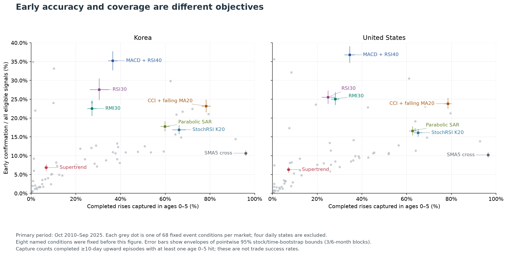

# 기술적 지표 연구 — 매도 규칙에서 추세 초입의 확인까지

**매도를 규칙화하려고 시작한 연구는, 상승 후보를 일찍 찾는 데는 CCI20 회복을, 잦은 흔들림을 걸러 하락 전환을 점검하는 데는 MACD+RSI60을 우선 검토하는 것으로 정리됐다.** 이동평균선 매도·재진입으로 보유 성과를 개선했다는 근거는 찾지 못했다. 이후 질문을 ‘언제 팔면 돈을 더 버는가’에서 ‘이미 시작된 추세의 초입을 어떤 신호로 확인할 수 있는가’로 좁혔다.

이 저장소에는 그 과정의 보고서·CSV·차트·계산 코드와 최종 해석을 남겼다. 핵심은 지표 하나의 우승보다 **질문, 추세의 정의, 확률의 분모를 고치면서 내가 판단에 쓸 수 있는 값에 도달한 과정**이다.

연구·질문 구체화: 김성훈 · 연구 대화: 2026-10-16~10-29 · 공개 보관: 2026-11-01 · README 개편: 2026-11-05

## 먼저, 무엇을 얻었나

최종 주 분석은 **2010-10-01~2025-09-30의 15년**, 한국·미국을 분리한 상승 72조건·하락 81조건 비교다. 아래 ‘초입’은 사후 L1 추세로 판정한 **10거래일 이상 지속된 추세의 시작 당일~5거래일째, 총 6거래일**이다. 매일 같은 방향의 종가가 이어졌다는 뜻은 아니다.

- **초입 적중률:** 평가 가능한 신호 중 그날이 실제 초입이었던 비율.
- **초입 포착률:** 초입 전체를 관측할 수 있는 실제 추세 구간 중 신호가 한 번 이상 나온 비율.
- **확인 지연:** 초입 포착에 성공한 구간에서 첫 신호까지 걸린 평균 거래일. 놓친 구간은 이 평균에 포함되지 않는다.

| 방향·역할 | 우선 검토 조건 | 한국 적중률 / 포착률 | 미국 적중률 / 포착률 | 평균 확인 지연, 한국 / 미국 |
| --- | --- | --- | --- | --- |
| 상승 후보를 빠르고 넓게 발견 | CCI20 −100 상향 돌파 + SMA20 하락 | 23.2% / 78.3% | 23.8% / 78.5% | 1.97 / 1.92거래일 |
| 상승을 더 선별해서 확인 | MACD 상향 교차 + 최근 RSI40 회복 | 35.2% / 36.5% | 36.8% / 34.5% | 3.73 / 3.74거래일 |
| 하락 전환을 비교적 드물게 점검 | MACD 하향 교차 + 최근 RSI60 이탈 | 37.6% / 34.2% | 31.6% / 34.6% | 3.87 / 3.77거래일 |

상승에서는 후보를 일찍 보고 판단할 시간을 확보하고 싶었다. CCI 조건은 적중률이 가장 높아서 고른 것이 아니라, 실제 상승의 약 78%를 평균 약 2거래일에 발견했기 때문에 우선했다. 하락에서는 작은 흔들림마다 매도 판단을 반복하고 싶지 않아 더 선별적인 MACD+RSI를 절충안으로 두었다. 대신 실제 하락의 약 65%를 초입에서 놓친다는 대가를 받아들여야 한다.

**‘상승 100개 중 78개를 잡았다’와 ‘신호 100번 중 78번 맞았다’는 다른 말이다.** CCI 조건의 신호 100번 중 정확히 목표 초입이었던 것은 약 23~24번이다. 이 수치는 매수 승률이나 매도 수익률이 아니며, 아래 선택도 실제 주문·자동 매도 규칙의 채택을 뜻하지 않는다.

[상승 최종 해석](final/uptrend-interpretation-ko.md) · [하락 최종 해석](final/downtrend-interpretation-ko.md) · [15년 상승 근거](docs/research/uptrend-longhistory-2026-10-29.md) · [15년 하락 근거](docs/research/downtrend-longhistory-2026-10-29.md)

## 어떻게 질문을 좁혔나

### 1. 매수에는 과정이 있었지만, 매도에는 반복 가능한 기준이 부족했다

산업을 공부하고 투자 아이디어를 세워 종목을 고르는 과정에 비해, 매도는 감각에 의존하는 부분이 컸다. 처음에는 이동평균선 이탈과 데드크로스마다 나눠 팔면 상승은 오래 보유하고 큰 하락은 피할 수 있지 않을까 생각했다.

10월 16일에는 800종목·5,397개 사이클에서 888개 전략을 비교했다. 당시 평가 기준의 우선 후보는 2봉 확인·60:10:10:20·매도 보류 없음이었다. 그러나 검증 2,512개 사이클에서 평균 최대낙폭이 35.31%→13.67%로 줄어든 반면, 평균 조건부 수익률은 −0.43%로 보유 유지의 +0.13%를 넘지 못했다. 보유 대비 수익률 차이의 신뢰구간도 0을 포함했다.

여기서 **낙폭 완화와 수익 개선은 다른 목표**라는 점을 확인했다. 비중을 더 세밀하게 최적화하기 전에, 큰 하락을 구분하는 신호 자체가 있는지부터 물어야 했다. [4분할 매도 보고서](ma/docs/research/ma-exit4-research-2026-10-16.md)

### 2. 먼저 피했다가 되사면 유리하다는 기대도 확인되지 않았다

10월 16~18일에는 큰 하락의 조기 경고와 역배열 매도·재진입을 검토했다. −15% 하락 경고 후보는 비슷하게 약해진 비신호 상태보다 충분한 추가 예측력을 보이지 못했다. 이후 ‘교차가 발생할 때 이미 얼마나 내려와 있는가’를 별도 기술통계로 분리했다. 이미 내려온 폭으로 앞으로의 하락을 예측했다고 말할 수는 없었다.

역배열 2조건×반등 3조건의 6규칙에 이어, 매수 3종×매도 3종의 9조합으로 회피와 재진입까지 연결했다. 새 9조합의 검증기간에서 거래비용 반영 후 절반 회피의 최종자산은 보유보다 한국 8.18~20.93%, 미국 5.20~13.94% 적었다. 회피 중 가격이 내려갔다는 사실만으로 재진입까지 마친 자산이 늘지는 않았다.

10월 18~19일 재검토에서는 집계의 정확성과 실험이 내 질문에 맞는지를 따로 봤다. 보고서마다 시작 상태·종목 자격·재진입 규칙이 달랐고, 재매수 조건이 이미 충족돼도 새 교차 사건을 기다리는 문제가 있었다. **모든 기회손실을 지표의 후행성으로 설명할 수 없었고, 현금 비중을 늘려 낙폭이 줄어든 효과를 신호의 우수성으로 읽어서도 안 됐다.** 비교 기준을 같은 횟수·비중의 다른 선택과 비슷한 비신호 상태로 구체화했다.

[MA 연구 경위](ma/HISTORY.md) · [−15% 경고 연구](ma/docs/research/ma-warning15-research-2026-10-16.md) · [재진입 6규칙](ma/docs/research/ma-reentry-research-2026-10-17.md) · [최종 9조합](ma/docs/research/ma-timing-segments-2026-10-18.md)

### 3. 지표를 비교하기 전에 ‘하락추세’의 정답부터 다시 정했다

10월 19~20일에는 내가 차트에서 보는 하락과 코드가 분류한 하락이 어긋나는 문제를 다뤘다. 처음의 3%·5%·8% 반전과 낮아지는 고점·저점 방식은 충분한 반등이 없으면 눈에 보이는 하락도 확정하지 못했다. 독립 구간별 회귀에서는 구간 사이의 점프와 완만한 하락이 횡보로 분류되는 문제가 있었다.

삼성전자·NAVER·현대차·AAPL·NVDA·XOM 차트에서 정의를 비교한 뒤, 잔파동을 줄이는 **로그가격 L1 추세 필터 λ=1**을 사후 평가 기준으로 선택했다. 최종 방향은 하루 기울기가 +1e−6 초과면 상승, −1e−6 미만이면 하락, 경계를 포함한 나머지는 횡보다.

이 결정으로 지표와 비교할 기준을 명시할 수 있었다. 다만 L1은 미래 가격도 사용하는 **평가용 정답표**다. 실시간 신호에는 당시까지의 정보만 넣고, 사후 방향이나 최종 지속기간을 넣지 않았다. 이 정의가 사람이 보는 추세의 유일한 정답이라는 뜻도 아니다. [정확한 계산 방법](docs/research/downtrend-longhistory-2026-10-29/methods.md)

### 4. ‘하락을 예고하는가’에서 ‘이미 시작된 초입을 확인하는가’로 바꿨다

10월 20~22일에는 교차가 겹치면 긴 하락을 구분할 수 있는지 탐색한 뒤, 전체 저장 종목과 63조건 비교로 확장했다. 하지만 하락 시작 부근에서 자주 보이는 신호가 평소에도 흔하다면, 포착률만 높아서는 내 목적에 충분하지 않았다.

그래서 완료된 10거래일 이상 추세의 시작 당일~+5일을 주 목표로 고정하고, **전체 신호를 분모로 한 적중률과 실제 추세 구간을 분모로 한 포착률을 분리**했다. 초기 시작 전후 ±5일 탐색과 최종 0~5일 확인은 평가 창이 다르므로 수치를 그대로 이어 붙이지 않았다.

조건을 더 붙이면 정확해질 것이라는 기대도 점검했다. MA20 이탈이나 3일 지속까지 기다리면 초입을 지나치고 포착률이 줄었다. 최종 15년 미국 결과에서도 MACD+RSI60에 당일 종가<MA20을 추가하면 적중률은 31.6%→32.4%로 조금 높아지지만 포착률은 34.6%→15.4%로 줄었다. **추가 확인의 이득과 놓치는 기회·지연을 함께 계산**해야 했다. [지표 연구 경위](HISTORY.md) · [초기 결과 보존본](history/initial-result-excerpt.md)

### 5. 상승과 하락에서 원하는 대가가 달라, 후보도 다르게 남겼다

10월 23일에는 상승을 별도로 연구했다. 하락 조건을 단순히 뒤집는 대신, 상승에서도 적중률·포착률·지연·신호 다음 시가까지 이미 오른 폭을 함께 봤다.

최종 15년 결과에서 상승 MACD+RSI40은 적중률이 높았지만, 포착에 성공한 구간에서도 신호 다음 시가까지 이미 오른 폭이 한국 7.7%·미국 8.1%였다. CCI 회복+MA20 하락은 각각 4.1%·4.3%였다. 서로 다른 포착 표본의 평균이므로 모든 종목에서 같은 순서로 발생했다는 뜻은 아니다. 그래도 ‘너무 오른 뒤 확인하면 의미가 줄어든다’는 내 목적에서는 CCI의 속도와 포착 범위가 더 맞았다.

상승 후보의 검토 순서는 **CCI+MA20 하락 → CCI 단독 → RSI30 회복 → MACD+RSI40**으로 정리했다. RSI30은 포착에 성공한 경우 가장 빨랐지만 실제 상승 초입의 한국 30.4%·미국 24.9%만 잡아, 주력보다는 별도 회복 후보로 남겼다. 하락에서는 잦은 알림보다 선별적인 전환 점검을 중시해 MACD+RSI60을 우선했다. [상승 해석](final/uptrend-interpretation-ko.md) · [하락 해석](final/downtrend-interpretation-ko.md)

### 6. 새 지표와 15년 자료를 더해도, 정확성·속도·포착 범위의 대가는 남았다

10월 29일에는 앱의 지표 목록과 실제 연구 코드를 대조하고, 상승 11조건·하락 12조건을 추가했다. 슈퍼트렌드·SAR·스토캐스틱 RSI·TRIX·RMI 등도 비교했지만 주 목표인 0~5일 초입에서 기존 절충관계를 전반적으로 대체할 근거는 찾지 못했다. 진행된 추세를 확인하는 능력과 초입을 잡는 능력은 달랐으며, 0~10일 보조 창의 장점을 0~5일 성과로 바꾸어 말하지 않았다.

이어서 저장 목록 7,483개를 점검하고 가격·L1 캐시가 가능한 7,293개로 15년 주 분석을 수행했다. 짧은 이력은 해당 기간 안에서 최초 평가 가능일부터 포함했고, 실제 분모는 지표의 준비 기간·결측·미래 관측 요건에 따라 다시 달라졌다.

기간을 넓혀도 CCI는 빠르고 넓은 후보 탐색, MACD+RSI는 더 선별적인 확인이라는 역할 차이가 남았다. 다만 이미 살펴본 과거를 넓힌 **회고적 재평가**이며, 새로운 독립 검증이 된 것은 아니다. [상승 본편](docs/research/uptrend-longhistory-2026-10-29.md) · [하락 본편](docs/research/downtrend-longhistory-2026-10-29.md)

### 7. 마지막에는 ‘21일 뒤 더 낮았나’를 별도로 다시 셌다

초입 적중률을 이해한 뒤에도 실제 판단에 필요한 질문이 남았다. 신호 다음 거래일 시가보다 21번째 거래일 종가가 더 낮았던 비율은 얼마인가? 평균 수익률이나 기간 중 −5% 접촉률로는 답할 수 없었다. 기존 양수 비율을 1에서 빼면 보합까지 섞여서, 하락·보합·상승을 직접 나눠 집계했다.

`기간말 하락 비율 = close[t+21] < open[t+1]인 신호 수 / 해당 미래 가격을 관측할 수 있는 전체 신호 수`

그 결과 한국 1위는 RSI 약세 다이버전스 58.31%, 미국 1위는 MFI80 이탈 51.00%였다. 우선 검토 후보인 MACD+RSI60은 각각 55.59%·48.77%로 1위가 아니었다. 미국 1위의 95% 구간도 48.16~53.82%로 50%를 포함했다.

여기서 **초입을 알아보는 순위, 한 달 뒤 방향의 순위, 실제 매도 이익의 순위가 서로 다르다**는 점까지 분명해졌다. 이것이 최종적으로 내가 읽고 싶었던 분석값의 구분이다. [21거래일 추가 집계·전체 81조건·검증 기록](docs/research/downtrend-terminal21-2026-10-29.md)

## 결과는 어떤 모습으로 남겼나

아래는 설명용 가상 그림이 아닌 실제 15년 연구의 비교 차트다. 적중률과 포착률을 함께 보면서, 정확성이 높은 후보가 얼마나 많은 추세를 놓치는지 확인할 수 있다.

개별 가격 사례도 [CCI 회복 사례](docs/research/uptrend-longhistory-2026-10-29/cases-cci_recovery.png)·[MACD+RSI40 사례](docs/research/uptrend-longhistory-2026-10-29/cases-macd_rsi40.png)·[한국 하락 사례](docs/research/downtrend-longhistory-2026-10-29/KR-cases.png)·[미국 하락 사례](docs/research/downtrend-longhistory-2026-10-29/US-cases.png)에 남겼다. 사례 그림은 전체 성과를 대신하지 않으며, 선정 기준과 분포는 각 보고서에서 확인한다.

## 계산과 해석에서 지킨 기준

| 구분 | 적용한 기준과 이유 |
| --- | --- |
| 신호의 정확한 정의 | 상승 CCI는 일봉 CCI20의 −100 신규 상향 돌파와 `SMA20[t] < SMA20[t−5]`. 20일선 상승 전환을 기다리지 않는다. MACD는 EMA12−EMA26과 EMA9 시그널의 신규 교차이며, Wilder RSI14의 문턱 교차가 당일·전일·전전일 중 있어야 한다. 상승은 RSI40 회복, 하락은 RSI60 이탈이다. |
| 평가와 실시간 정보 | L1·최종 지속기간은 사후 평가에만 사용한다. ‘RSI가 60 아래에 있다’는 상태와 ‘최근 60을 새로 이탈했다’는 사건도 구별한다. |
| 분모와 시점 | 초입 분류와 미래 가격 경로는 평가 가능 요건이 달라 분모가 같지 않다. 기간말은 종가, 기간 중 ±5% 접촉은 고가·저가로 계산한다. 같은 경로가 양쪽 가격에 모두 닿을 수 있다. |
| 데이터 품질 | 저장 목록과 실제 유효 이력을 구별하고, 공백을 넘어 거래일을 이어 세지 않는다. MA 연구 초안의 달력 공백 처리와 미국 배열의 실제 경로를 재확인해 정정했다. 누락·짧은 이력을 0건 성공이나 실패로 채우지 않는다. |
| 검산과 불확실성 | 21일 추가 집계에서는 162개 시장·조건 조합의 분모와 기존 양수 건수를 대조하고, 하락+보합+상승=전체를 확인했다. 직접 가격 비교 1,088,265건을 별도 점검했다. 신뢰구간은 종목·공통 시기 의존성을 반영하며, 점추정 순위를 통계적 우열로 단정하지 않는다. |
| 반대 해석 | 매도 후 낙폭 감소는 현금 비중 증가의 효과일 수 있다. 하락 횟수가 과반이어도 소수의 큰 상승 때문에 평균 수익률은 양수일 수 있다. 신호의 정보와 실제 매매의 경제적 이익을 분리한다. |

CCI 필터 조건은 CCI 단독의 일부이므로 둘이 함께 발생했다고 독립적인 확인 두 개로 세지 않는다. 또한 MA20 하락 필터는 이미 우상향 중인 주도주의 눌림 후 재상승을 제외할 수 있어, 그 용도까지 같은 성과를 가정하지 않는다.

## 내가 한 판단과 AI가 맡은 작업

나는 투자 목적을 설명하고, 결과가 직관과 다르면 되물으며, 비교 기준·기간·분모를 구체화했다. 차트를 보며 추세 정의의 어긋남을 지적했고, 상승에서는 빠른 후보 탐색을, 하락에서는 잦지 않은 전환 점검을 우선하기로 정했다.

AI는 프롬프트 구체화, 코드 작성·계산, 원장 재집계, 방법·문헌 비교, 시각화와 검증 자료 정리를 맡았다. 긴 보고서와 정상 실행만으로 질문에 답했다고 판단할 수는 없었다. **내가 이해할 수 있는 말로 숫자를 풀고, 그 숫자가 답하지 못하는 질문을 분리하는 일**이 연구를 내 판단 도구로 만드는 핵심이었다.

## 현재 남은 한계와 다음에 확인할 것

- **자료의 범위:** 현재 저장 목록을 중심으로 한 연구다. 역사상 모든 상장·상장폐지 종목을 복원한 전수 자료가 아니며, 생존편향·공급자 선택·수정가격·공백 처리의 한계가 남는다.
- **정답과 검증의 범위:** L1은 사후 정의이고 종료점·추세 기준에 민감하다. 15년으로 넓혀도 이미 본 기간의 반복 탐색은 남는다. 일부 엄격한 비신호 대조군 비교를 전체 신호의 효과로 확대할 수 없다.
- **수익성의 범위:** 최종 지표 연구는 명시적인 매도·재진입·비용·배당을 연결한 전략 수익률 검증이 아니다. 접촉률만으로 손절의 효과나 두 가격 중 어느 쪽을 먼저 만났는지도 알 수 없다.
- **재현의 범위:** 공개본에는 결과·규약·코드가 있지만 원시 OHLCV와 일부 당시 입력·공통 모듈은 없다. 새 시세 파일만 넣으면 바로 전체 실행되는 독립 패키지는 아니다.

후속 검증을 한다면 조건을 고정한 새 기간에서 먼저 관측하고 싶다. 매도 성과를 다시 묻는다면 진입·매도·재진입·비용 규칙부터 명시한 별도 실험으로 구분해야 한다. 재현 환경과 입력 연결을 정리하는 일도 남아 있다. 이는 **다음 개선 방향**이며, 이번 저장소에서 완료한 성과는 아니다.

## 자료를 찾아보는 순서

| 보고 싶은 내용 | 자료 |
| --- | --- |
| 최종 선택과 대가 | [상승 최종 해석](final/uptrend-interpretation-ko.md) · [하락 최종 해석](final/downtrend-interpretation-ko.md) |
| 추가 설명 | [상승 해설 모음](final/uptrend-explanations-ko.md) · [하락 해설 모음](final/downtrend-explanations-ko.md) |
| 연구 경위와 이전 단계 | [지표 연구 경위](HISTORY.md) · [MA 연구 경위](ma/HISTORY.md) · [MA 최종 결과 모음](ma/README.md) |
| 15년 보고서·CSV·차트 | [상승 보고서](docs/research/uptrend-longhistory-2026-10-29.md) / [결과 폴더](docs/research/uptrend-longhistory-2026-10-29/) · [하락 보고서](docs/research/downtrend-longhistory-2026-10-29.md) / [결과 폴더](docs/research/downtrend-longhistory-2026-10-29/) |
| 21일 뒤 방향을 직접 센 근거 | [추가 집계 보고서](docs/research/downtrend-terminal21-2026-10-29.md) · [전체 81조건 CSV](docs/research/downtrend-terminal21-2026-10-29/all81-terminal21.csv) |
| 코드와 재현 범위 | [코드·외부 입력·검증 범위](CODE_AND_DATA.md) · [상승 실행 기록](scripts/research/uptrend_longhistory/README.md) · [하락 실행 기록](scripts/research/downtrend_longhistory/README.md) · [MA 공개 제외 자료](ma/OMITTED_DATA.md) |
