# 한국·미국 전체 저장 종목으로 다시 본 하락 초입 확인: 15년 주 분석과 최초 이력 분석

DOWNTREND-LONGHISTORY-20261029 · 기존 정의·조건 유지 · 새로운 최적화 없음

**주 분석을 2010-10-01~2025-09-30의 15년으로 넓혀 다시 계산했다.** 15년 이력이 없는 종목도 탈락시키지 않고 이 창 안의 최초 평가 가능일부터 포함했다. 또한 **전체 이력 보조 분석에서는 종목별 가장 이른 평가 가능일부터** 계산해,2010년 이전의 자료와 주 분석 뒤의 성숙 구간도 사용했다. 여기서 백테스트는 “신호 발생 후 실제로 이미 시작된 하락의 초입이었는가”와 이후 가격경로의 역사적 검증이다. 매도·재진입·비용을 정한 실행 전략의 수익률 검증은 아니다.

- **한국:** RMI70 적중률 **28.6%**, 포착률 30.3%, 성공한 첫 확인까지 3.80일이다. 기존 MACD+RSI는 **37.6%**, 34.2%, 3.87일이었다. 적중률 차이는 -9.07%p, 동시 보정95% 구간 [-11.48, -6.67]%p다. RMI70의 적중률이 더 낮다는 차이는 이번 다중비교 보정 후에도 남았다. 기존 CCI100·상승 MA20은 적중률 26.6%로 하락의 80.1%를 평균 1.86일에 포착했다.
- **미국:** RMI70 적중률 **21.3%**, 포착률 27.1%, 성공한 첫 확인까지 3.82일이다. 기존 MACD+RSI는 **31.6%**, 34.6%, 3.77일이었다. 적중률 차이는 -10.33%p, 동시 보정95% 구간 [-12.15, -8.51]%p다. RMI70의 적중률이 더 낮다는 차이는 이번 다중비교 보정 후에도 남았다. 기존 CCI100·상승 MA20은 적중률 22.2%로 하락의 79.2%를 평균 2.01일에 포착했다.

**15년으로 넓힌 뒤에도 새로운12조건이 기존 신호를 대체할 근거는 찾지 못했다.** 이번 고정 조건에서는 MACD+RSI가 상대적으로 선택적인 확인, CCI100 이탈·상승20일선이 빠르고 넓은 점검이라는 역할 차이를 보였다. CCI의 포착률은 한국80.1%·미국79.2%지만 적중률은26.6%·22.2%다. MACD+RSI는 적중률37.6%·31.6%를 얻는 대신 실제 하락의 약65%를 초입에서 놓쳤다. 새 지표의 이름이나 복잡성이 이 대가를 없애지는 않았다.

**평소보다 의미가 있는 것과, 신호 하나를 확신할 수 있는 것은 다르다.** 초입의 일별 기저율은 한국 약7.44%·미국7.12%다. MACD+RSI는 이보다 약5.06배·4.44배 높지만, 알림의 과반은 여전히 목표인0~5일 초입이 아니었다. 슈퍼트렌드는 완료된10일 이상 하락 전체에는88.8%·82.8%가 들어맞았지만, 초입 적중률은6.4%·8.1%였다. 진행된 하락의 확인을 초입 포착으로 바꾸어 말할 수 없다.

**장기 자료에서 더 분명해진 것은 MACD+RSI의 이후 위험 정보다.** 가장 엄격한 비신호 상태 비교에서21일 안에 다음 시가 대비5% 하락을 접촉할 비율이 한국5.58%p·미국3.92%p 높았고, 다중비교 보정95% 구간도 각각[1.23,9.92]·[1.18,6.67]%p로 양수였다. 이전 짧은 표본에서 불확실했던 차이에 장기 자료의 근거가 더해졌다. 그러나 비교에 남은 신호는15.05%·21.72%뿐이며, 그 신호들의21일 평균 수익률 자체는+1.05%·+0.81%였다. 추가 하락 접촉 증가를 매도 이익으로 해석할 수는 없다. RMI70과 CCI의 엄격한 추가 하락 차이는 여전히 불확실했다.

**RMI70은 확인을 더 늦게 허용하면 다른 모습을 보인다.**0~10일 보조 창에서는 적중률52.1%·43.6%, 포착률54.7%·54.8%였고 MACD+RSI는53.0%·44.2%,47.3%·47.4%였다. 비슷한 점추정 적중률로 더 넓게 포착한 결과지만, 질문의 확인 시점을 늦춘 것이다. 주 기준0~5일의 다중비교 신뢰구간을 이 보조 창에 재사용하지 않았으며, 새 조합이나 임계값을 찾아낸 결과도 아니다.

**남아 있는 불확실성은 표본 수만 늘려 해결되지 않는다.** 현재 저장 목록에는 역사상 모든 상장폐지 종목이 없고, 이전에 본 기간도 포함된다. 한국2017년은 기존10달력일 공백 분리 규칙이 긴 추석 휴장에도 적용되어 평가일이 크게 줄었다. 원래 정의를 보존한 장기 비교이며, 모든 종목이15년 내내 같은 품질로 평가됐다는 뜻이 아니다. 후속 확인 조건도 적중률을 크게 높이지 못하면서 포착률을 줄이는 경우가 많았다.

신규12조건 각각의 역할, 기존2.5년 결과와의 차이, 기간·종목 가중치에 따른 변화는 [분류 결과 상세 해설](downtrend-longhistory-2026-10-29/interpretation-classification.md)에서 이어서 볼 수 있다.

용어가 낯설다면 [쉬운 뜻 → 비유 → 실제 수치로 읽는 통계 안내](downtrend-longhistory-2026-10-29/reading-guide.md)를 함께 읽으면 된다.

이 비교는 “평소보다 초입에 집중되는가”, “알림을 받았을 때 실제 초입일 가능성이 높은가”, “얼마나 늦고 얼마나 놓치는가”를 함께 읽어야 한다. 아래 모든 주요 표는 고정한 신규12·기존6조건을 그대로 공개하며, 전체81조건은 마지막 부록과 CSV에 남겼다. 긴 역사를 다시 사용해도 이미 살펴본 기간과 과거 후보 선정의 영향은 남는다. **새로운 독립 검증 표본이라고 부르지 않는다.**

## 1. 정말 15년인가, 정말 전체 종목인가

| 시장 | 점검한 전체 목록 | 가격 계산 가능 | 주15년 평가 종목 | 가격 첫~끝 ≥15년 | 평가 첫~끝 ≥15년 | 연속 평가 ≥15년 |
|---|---|---|---|---|---|---|
| 한국 | 2,637 | 2,610 | 2,513 | 1,380 | 1,312 | 220 |
| 미국 | 4,846 | 4,683 | 4,385 | 1,957 | 1,754 | 1,533 |

전체 목록은 **7,483개**, 가격·L1 공용 계산이 가능한 것은 **7,293개**다. 가격 계산 가능과 실제 신호 평가 가능은 다르다. 오래된 상장 종목만 남기는15년 필터는 사용하지 않았다. 공통 평가에도 과거65봉·미래126봉·완료된 추세 경계가 필요하고, 지표별 준비 기간이 더해지면 각 분모는 추가로 줄어든다. “처음과 마지막 날짜가15년 떨어졌다”는 사실과 “빠진 날 없이15년 평가했다”는 사실도 구별했다.

| 시장 | 최초 저장 가격 | 가격 상한 | 최초 평가일 | 최종 성숙 평가일 | 15년 공통 평가일 수 | 최초 이력 공통 평가일 수 |
|---|---|---|---|---|---|---|
| 한국 | 1975-01-04 | 2026-09-30 | 1975-03-25 | 2026-03-26 | 5,915,843 | 8,797,580 |
| 미국 | 1990-01-02 | 2026-09-30 | 1990-04-04 | 2026-03-31 | 9,802,408 | 15,069,996 |

일 수는 종목별 거래일을 합친 값이다. 주15년 창은 종목 간 비교와 세 개5년 구간을 고정하기 위해 사용했다. 그 뒤까지 확보된 성숙 이력은 `period=all` 보조 결과에 포함했다. 신호를 계산할 때2010년에서 지표를 초기화하지 않고, 그 이전 저장 자료도 준비 기간으로 사용했다.

| 시장 | 가격 계산 제외 사유 | 종목 수 |
|---|---|---|
| 한국 | 가격 이력 부족 | 26 |
| 한국 | 빈 자료 | 1 |
| 미국 | 가격 이력 부족 | 135 |
| 미국 | 유효한 연속 구간 부족 | 27 |
| 미국 | 빈 자료 | 1 |

저장된 운영 제외57종목도 연구용으로 시도해 데이터 유무를 남겼다. **BP·NVO·TSM은 저장된 차트 이력이2016년부터여서 그 시점부터 사용했다.** 이는 상장일이2016년이라는 뜻이 아니다. 실제 확보 범위와 종목별 제외 사유는 [coverage-stocks.csv](downtrend-longhistory-2026-10-29/coverage-stocks.csv)·[coverage-excluded.csv](downtrend-longhistory-2026-10-29/coverage-excluded.csv)에 있다.

“전체”는 보유한 현재·저장 종목 목록 전체라는 뜻이다. 역사상 상장폐지된 모든 주식을 복원한 무편향 상장 종목 전수는 아니다. 과거 한국 공급자 날짜와 거래달력 차이, 미국 이력 공백, 가격·거래량 수정 기준의 한계를 보존했고 공백을 임의로 메우지 않았다. 자료의 시작이 곧 균일한 품질의 시작이라는 뜻도 아니다.

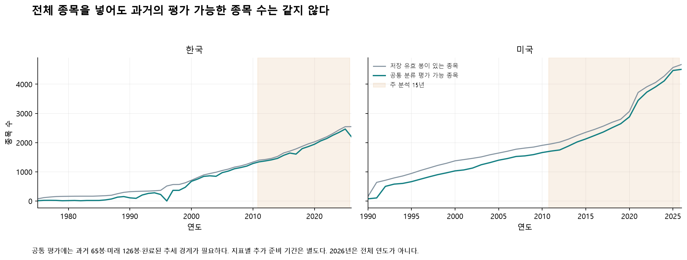

회색과 청록선의 차이는 저장 자료가 있어도 평가에 못 쓰는 부분이다. 오래된 시기에 종목 수가 적으므로 전체기간 평균이 모든 시기에서 같은 정도로 뒷받침된다고 해석하지 않는다.

## 2. 유지한 하락 정의와 발생 시점

로그종가 L1 추세의 목적함수는 `0.5×Σ(log C−x)² + 1×Σ|Δ²x|`다. `x[t+1]−x[t] < −0.000001`이면 하락, `> +0.000001`이면 상승, 두 경계를 포함한 사이는 횡보다.20거래일 가격변화 경계는 약 **−0.00199998% / +0.00200002%**다. 미래 자료까지 본 L1은 평가용 정답표이며 신호 조건과 위험 비교 표본에는 넣지 않는다.

양쪽 경계가 관측된 완료 하락 중 **10거래일 이상**을 주 대상으로 했다. 첫 음의 기울기 구간의 왼쪽 날짜가 시작 당일이며, **0~5일은 당일 포함 총6일**이다. 시작 전 신호도 전체 분모에 남고 성공으로 세지 않는다. 미완료 추세나 관측 부족을 실패·짧은 하락으로 위장하지 않는다. 횡보·가격 공백을 넘어 하락 구간을 이어 붙이지 않는다.

신규 교차·이탈·반전은 발생 사건을 센다. 기존63개 중 갭·음봉 장악·긴 위꼬리·ATR급락과 거래량·RSI 다이버전스의5개 패턴은 원래 정의대로 조건을 만족한 날마다 센다. 같은 조건이 계속 유지된 경우와 새로운 교차를 혼동하지 않도록 `kind`를 함께 공개했다. 후속 확인 조건의 신호일은 모든 조건을 그날까지 확인한 날이며 첫 신호일로 소급하지 않는다.

| 고정한 주요 신호 | 정확한 산식·발생 조건 |
|---|---|
| 슈퍼트렌드 하락 전환 | Wilder ATR10 ×3; recursive bands; bullish-to-bearish close-confirmed flip |
| 파라볼릭 SAR 하락 반전 | PSAR .02/.02/.20; bullish-to-bearish reversal, known at current close |
| TRIX18 0선 이탈 | 100*(triple EMA18[t]/triple EMA18[t-1]-1) crosses below0 |
| TRIX18 신호선 이탈 | TRIX18 crosses below EMA9(TRIX18) |
| StochRSI K80 이탈 | Wilder RSI14, range14, SMA3 K; K crosses below80; zero range unknown |
| StochRSI 고위 K/D 교차 | K crosses below SMA3(K), previous K>=80 |
| RMI70 이탈 | Wilder20 of positive/negative 5-day close differences; crosses below70 |
| RMI50 이탈 | Wilder20 of positive/negative 5-day close differences; crosses below50 |
| 체이킨 0선 이탈 | EMA3(ADL)-EMA10(ADL) crosses below0; H=L contributes0 to ADL |
| 분기 고정 VWAP 대용치 이탈 | C crosses below cumulative TP*V/sum(V), calendar quarter/segment anchor, at least5 previous anchor bars |
| 거래량 오실레이터·하락일 | SMA5(V)/SMA20(V)-1 crosses above0 AND C<previous C |
| 확정 프랙탈 저점 이탈 | Strict5-bar low pivot confirmed at pivot+2; close crosses below latest confirmed pivot low; never backdated |
| MACD 데드·최근3일 RSI60 이탈 | macd_signal AND 당일 포함 최근3거래일 중 rsi60 발생(오늘,t-1,t-2) |
| MACD 양수권 시그널 하향 교차 | macd_signal AND MACD>0 |
| CCI100 이탈·20일선 상승 | cci100 AND SMA20[t]>SMA20[t-5] |
| RSI14 60 하향 돌파 | Wilder RSI14가 60를 신규 하향 교차 |
| 스토캐스틱(14,3,3) K 80 이탈 | rawK=100*(C-최저L14)/(최고H14-최저L14), K=SMA3(rawK), K가80을 신규 하향 교차 |
| 종가 5일선 신규 이탈 | C가 SMA5를 신규 하향 교차 |

표의 기존 조건 약어를 풀면, `macd_signal`은 `EMA12(종가)−EMA26(종가)`가 자기 `EMA9`를 신규 하향 교차한 날이다. **MACD+RSI60은 그 교차가 오늘 발생하면서 Wilder RSI14의60 하향 이탈이 오늘·어제·그제 중 한번 발생한 경우**다. 양수 MACD는 같은 교차일에 MACD>0을 요구한다. `cci100`은 대표가격 `(고가+저가+종가)/3`의20일 평균 대비 차이를 `0.015×20일 평균절대편차`로 나눈 CCI20이100을 신규 하향 이탈한 경우다. CCI·상승20일선 조건은 여기에 `SMA20[t]>SMA20[t−5]`를 함께 요구한다.

분기 VWAP는 일봉 대표가격과 거래량으로 만든 대용치이며 실제 체결 VWAP가 아니다. 프랙탈 저점은 오른쪽 두 봉이 완료된 뒤에만 알려진 것으로 처리했다.81개 전체 조건은 [한국 정의](downtrend-longhistory-2026-10-29/KR-signal-definitions.csv)·[미국 정의](downtrend-longhistory-2026-10-29/US-signal-definitions.csv)에 있다.

## 3. 15년 주 결과: 모든 신호에서 출발한 적중률

적중률 = 초입에 발생한 신호 / 평가 가능한 모든 신호. 포착률 = 초입 신호가 한 번이라도 있었던 하락 구간 / 초입6일 전체를 평가할 수 있었던 하락 구간. 기저율 = 해당 지표의 평가 가능 거래일 중 초입일 비율이다. 대괄호는 종목·공통 시기의 의존성을 반영한 **주변95% 구간**이며, 직접 차이에 대한 다중비교 보정 구간과 구별한다.

### 한국

| 신호 | 전체 신호 수 | 초입 적중률 % [95%] | 기저율 % | 기저율 대비 | 포착률 % |
|---|---|---|---|---|---|
| 슈퍼트렌드 하락 전환 | 71,167 | 6.4 [5.8, 7.1] | 7.4 | 0.86배 | 6.2 |
| 파라볼릭 SAR 하락 반전 | 245,878 | 18.3 [17.4, 19.2] | 7.4 | 2.45배 | 60.7 |
| TRIX18 0선 이탈 | 61,426 | 0.1 [0.1, 0.2] | 7.4 | 0.01배 | 0.1 |
| TRIX18 신호선 이탈 | 121,311 | 3.4 [3.0, 3.7] | 7.4 | 0.45배 | 5.6 |
| StochRSI K80 이탈 | 278,615 | 16.6 [15.9, 17.4] | 7.4 | 2.23배 | 61.9 |
| StochRSI 고위 K/D 교차 | 341,731 | 10.6 [10.1, 11.1] | 7.4 | 1.42배 | 48.1 |
| RMI70 이탈 | 78,703 | 28.6 [26.3, 30.9] | 7.4 | 3.84배 | 30.3 |
| RMI50 이탈 | 129,033 | 5.9 [5.0, 6.8] | 7.4 | 0.80배 | 10.3 |
| 체이킨 0선 이탈 | 250,897 | 11.3 [10.8, 11.8] | 7.4 | 1.52배 | 37.4 |
| 분기 고정 VWAP 대용치 이탈 | 282,596 | 14.2 [13.3, 15.0] | 7.5 | 1.89배 | 51.8 |
| 거래량 오실레이터·하락일 | 138,922 | 5.5 [5.1, 6.0] | 7.4 | 0.74배 | 10.2 |
| 확정 프랙탈 저점 이탈 | 283,429 | 5.6 [5.2, 6.0] | 7.4 | 0.75배 | 21.0 |
| MACD 데드·최근3일 RSI60 이탈 | 67,079 | 37.6 [35.7, 39.7] | 7.4 | 5.06배 | 34.2 |
| MACD 양수권 시그널 하향 교차 | 138,260 | 31.8 [30.2, 33.7] | 7.4 | 4.28배 | 59.3 |
| CCI100 이탈·20일선 상승 | 238,931 | 26.6 [25.4, 27.8] | 7.4 | 3.57배 | 80.1 |
| RSI14 60 하향 돌파 | 227,877 | 25.7 [24.3, 27.2] | 7.4 | 3.46배 | 70.5 |
| 스토캐스틱(14,3,3) K 80 이탈 | 167,463 | 22.5 [21.5, 23.5] | 7.4 | 3.02배 | 50.1 |
| 종가 5일선 신규 이탈 | 767,870 | 11.0 [10.5, 11.5] | 7.4 | 1.48배 | 96.0 |

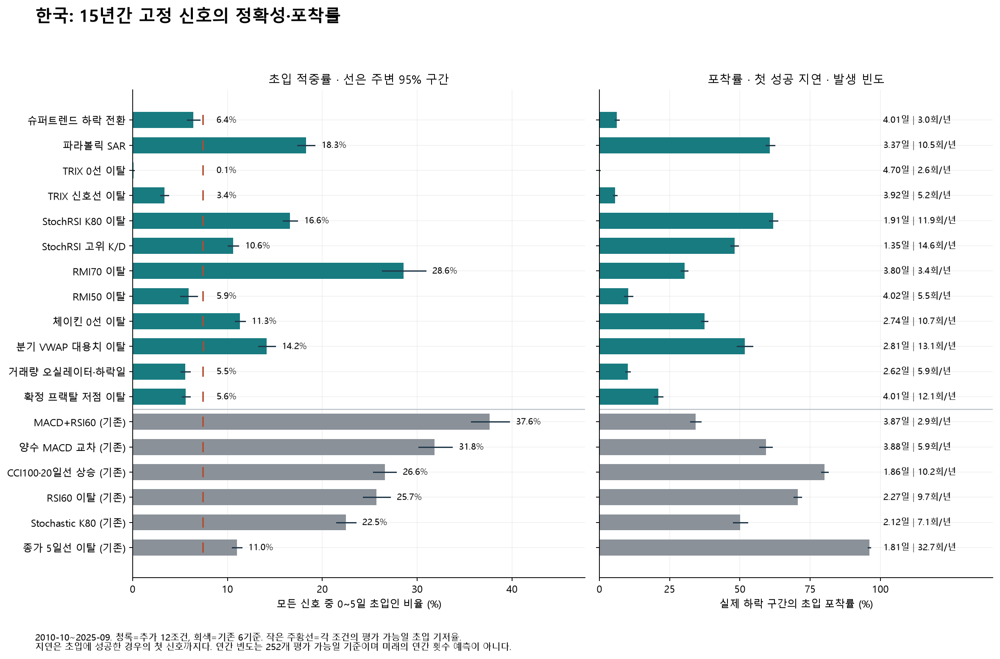

작은 주황선보다 높으면 해당 표본의 초입 기저율보다 알림 적중률이 높다. 그러나 “기저율보다 높다”와 “대부분의 알림을 믿어도 된다”는 다르다. 오른쪽 포착률과 아래 지연·빈도를 같이 봐야 한다.95% 구간끼리 겹치는지만으로 두 신호 차이의 유의성을 판단하지 않는다.

| 신호 | 놓친 하락 % | 첫 성공 지연(일) | 252평가일당 횟수 | 확인까지 이미 하락 % | 늦은 신호 비중 % |
|---|---|---|---|---|---|
| 슈퍼트렌드 하락 전환 | 93.8 | 4.01 | 3.03 | 14.4 | 82.4 |
| 파라볼릭 SAR 하락 반전 | 39.3 | 3.37 | 10.47 | 5.9 | 45.4 |
| TRIX18 0선 이탈 | 99.9 | 4.70 | 2.62 | 10.3 | 82.0 |
| TRIX18 신호선 이탈 | 94.4 | 3.92 | 5.17 | 5.3 | 73.0 |
| StochRSI K80 이탈 | 38.1 | 1.91 | 11.87 | 3.5 | 28.3 |
| StochRSI 고위 K/D 교차 | 51.9 | 1.35 | 14.56 | 2.3 | 24.9 |
| RMI70 이탈 | 69.7 | 3.80 | 3.35 | 6.9 | 30.8 |
| RMI50 이탈 | 89.7 | 4.02 | 5.50 | 6.3 | 68.8 |
| 체이킨 0선 이탈 | 62.6 | 2.74 | 10.69 | 4.6 | 43.1 |
| 분기 고정 VWAP 대용치 이탈 | 48.2 | 2.81 | 13.08 | 5.7 | 42.4 |
| 거래량 오실레이터·하락일 | 89.8 | 2.62 | 5.92 | 3.5 | 62.8 |
| 확정 프랙탈 저점 이탈 | 79.0 | 4.01 | 12.07 | 7.4 | 76.2 |
| MACD 데드·최근3일 RSI60 이탈 | 65.8 | 3.87 | 2.86 | 6.6 | 20.8 |
| MACD 양수권 시그널 하향 교차 | 40.7 | 3.88 | 5.89 | 6.0 | 25.0 |
| CCI100 이탈·20일선 상승 | 19.9 | 1.86 | 10.18 | 3.5 | 9.2 |
| RSI14 60 하향 돌파 | 29.5 | 2.27 | 9.71 | 4.3 | 12.9 |
| 스토캐스틱(14,3,3) K 80 이탈 | 49.9 | 2.12 | 7.13 | 3.6 | 11.7 |
| 종가 5일선 신규 이탈 | 4.0 | 1.81 | 32.71 | 3.1 | 44.8 |

### 미국

| 신호 | 전체 신호 수 | 초입 적중률 % [95%] | 기저율 % | 기저율 대비 | 포착률 % |
|---|---|---|---|---|---|
| 슈퍼트렌드 하락 전환 | 131,261 | 8.1 [6.7, 9.9] | 7.1 | 1.14배 | 9.2 |
| 파라볼릭 SAR 하락 반전 | 438,433 | 17.1 [15.9, 18.2] | 7.1 | 2.40배 | 63.5 |
| TRIX18 0선 이탈 | 98,372 | 0.2 [0.1, 0.2] | 7.1 | 0.02배 | 0.1 |
| TRIX18 신호선 이탈 | 205,020 | 4.1 [3.6, 4.7] | 7.1 | 0.58배 | 7.2 |
| StochRSI K80 이탈 | 473,496 | 16.2 [15.2, 17.2] | 7.1 | 2.28배 | 64.8 |
| StochRSI 고위 K/D 교차 | 589,956 | 10.6 [9.8, 11.3] | 7.1 | 1.48배 | 51.9 |
| RMI70 이탈 | 149,778 | 21.3 [19.1, 23.6] | 7.1 | 2.99배 | 27.1 |
| RMI50 이탈 | 210,895 | 5.5 [4.6, 6.4] | 7.1 | 0.77배 | 9.9 |
| 체이킨 0선 이탈 | 505,743 | 10.5 [9.7, 11.2] | 7.1 | 1.47배 | 43.5 |
| 분기 고정 VWAP 대용치 이탈 | 465,402 | 9.9 [9.0, 10.8] | 7.2 | 1.39배 | 37.7 |
| 거래량 오실레이터·하락일 | 294,971 | 7.6 [7.1, 8.1] | 7.1 | 1.07배 | 18.7 |
| 확정 프랙탈 저점 이탈 | 475,781 | 6.1 [5.6, 6.6] | 7.1 | 0.85배 | 24.1 |
| MACD 데드·최근3일 RSI60 이탈 | 128,260 | 31.6 [29.2, 34.2] | 7.1 | 4.44배 | 34.6 |
| MACD 양수권 시그널 하향 교차 | 255,795 | 27.1 [25.1, 29.2] | 7.1 | 3.81배 | 58.8 |
| CCI100 이탈·20일선 상승 | 450,943 | 22.2 [20.4, 24.0] | 7.1 | 3.12배 | 79.2 |
| RSI14 60 하향 돌파 | 420,215 | 20.9 [19.3, 22.6] | 7.1 | 2.94배 | 67.0 |
| 스토캐스틱(14,3,3) K 80 이탈 | 373,094 | 21.6 [20.0, 23.2] | 7.1 | 3.04배 | 67.5 |
| 종가 5일선 신규 이탈 | 1,323,366 | 10.3 [9.7, 10.8] | 7.1 | 1.44배 | 95.9 |

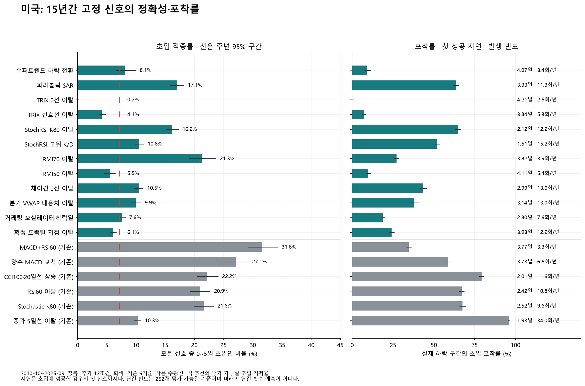

작은 주황선보다 높으면 해당 표본의 초입 기저율보다 알림 적중률이 높다. 그러나 “기저율보다 높다”와 “대부분의 알림을 믿어도 된다”는 다르다. 오른쪽 포착률과 아래 지연·빈도를 같이 봐야 한다.95% 구간끼리 겹치는지만으로 두 신호 차이의 유의성을 판단하지 않는다.

| 신호 | 놓친 하락 % | 첫 성공 지연(일) | 252평가일당 횟수 | 확인까지 이미 하락 % | 늦은 신호 비중 % |
|---|---|---|---|---|---|
| 슈퍼트렌드 하락 전환 | 90.8 | 4.07 | 3.37 | 13.6 | 74.7 |
| 파라볼릭 SAR 하락 반전 | 36.5 | 3.33 | 11.27 | 5.8 | 40.1 |
| TRIX18 0선 이탈 | 99.9 | 4.21 | 2.53 | 16.8 | 78.8 |
| TRIX18 신호선 이탈 | 92.8 | 3.84 | 5.27 | 5.1 | 63.0 |
| StochRSI K80 이탈 | 35.2 | 2.12 | 12.17 | 3.8 | 24.7 |
| StochRSI 고위 K/D 교차 | 48.1 | 1.51 | 15.17 | 2.5 | 21.1 |
| RMI70 이탈 | 72.9 | 3.82 | 3.85 | 6.8 | 31.6 |
| RMI50 이탈 | 90.1 | 4.11 | 5.42 | 9.4 | 67.2 |
| 체이킨 0선 이탈 | 56.5 | 2.99 | 13.00 | 4.9 | 43.9 |
| 분기 고정 VWAP 대용치 이탈 | 62.3 | 3.14 | 12.99 | 7.2 | 47.8 |
| 거래량 오실레이터·하락일 | 81.3 | 2.80 | 7.58 | 4.1 | 53.3 |
| 확정 프랙탈 저점 이탈 | 75.9 | 3.93 | 12.23 | 7.8 | 70.9 |
| MACD 데드·최근3일 RSI60 이탈 | 65.4 | 3.77 | 3.30 | 6.2 | 18.6 |
| MACD 양수권 시그널 하향 교차 | 41.2 | 3.73 | 6.58 | 5.3 | 21.0 |
| CCI100 이탈·20일선 상승 | 20.8 | 2.01 | 11.59 | 3.5 | 9.2 |
| RSI14 60 하향 돌파 | 33.0 | 2.42 | 10.80 | 4.3 | 13.7 |
| 스토캐스틱(14,3,3) K 80 이탈 | 32.5 | 2.52 | 9.59 | 3.7 | 12.9 |
| 종가 5일선 신규 이탈 | 4.1 | 1.93 | 34.02 | 3.1 | 40.2 |

첫 확인 지연과 이미 내린 폭은 **초입 확인에 성공한 하락 구간의 첫 신호**에만 해당한다. 이미 내린 폭은 `1−신호 다음 연속 유효 시가/사후 시작일 종가`다. 당시 고점에서 팔 수 있었다는 뜻이 아니며, 놓친 사례까지 평균 지연에 포함된 것도 아니다.

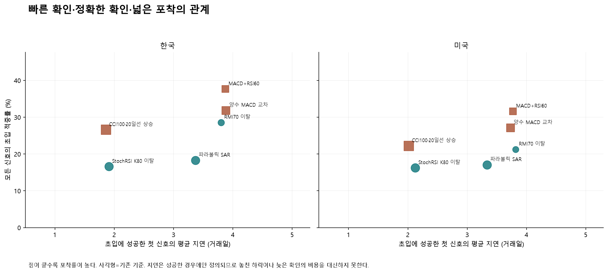

왼쪽일수록 빠르고 위일수록 정확하며 큰 점일수록 많은 하락을 포착했다. 하나의 축만 좋은 지표를 전체적으로 우수하다고 판단하지 않는다.

| 시장 | 고정 직접 비교 | 항목 | 차이 %p | 동시 보정95% 구간 %p | 보정 p |
|---|---|---|---|---|---|
| 한국 | RMI70 이탈 − MACD 데드·최근3일 RSI60 이탈 | 적중률 | -9.07 | [-11.48, -6.67] | 0.0005 |
| 한국 | RMI70 이탈 − MACD 데드·최근3일 RSI60 이탈 | 포착률 | -3.94 | [-6.47, -1.40] | 0.0005 |
| 한국 | 파라볼릭 SAR 하락 반전 − CCI100 이탈·20일선 상승 | 적중률 | -8.31 | [-10.15, -6.47] | 0.0005 |
| 한국 | 파라볼릭 SAR 하락 반전 − CCI100 이탈·20일선 상승 | 포착률 | -19.46 | [-23.04, -15.88] | 0.0005 |
| 한국 | StochRSI K80 이탈 − CCI100 이탈·20일선 상승 | 적중률 | -10.00 | [-11.60, -8.39] | 0.0005 |
| 한국 | StochRSI K80 이탈 − CCI100 이탈·20일선 상승 | 포착률 | -18.25 | [-21.73, -14.76] | 0.0005 |
| 미국 | RMI70 이탈 − MACD 데드·최근3일 RSI60 이탈 | 적중률 | -10.33 | [-12.15, -8.51] | 0.0005 |
| 미국 | RMI70 이탈 − MACD 데드·최근3일 RSI60 이탈 | 포착률 | -7.54 | [-9.59, -5.49] | 0.0005 |
| 미국 | 파라볼릭 SAR 하락 반전 − CCI100 이탈·20일선 상승 | 적중률 | -5.14 | [-7.01, -3.27] | 0.0005 |
| 미국 | 파라볼릭 SAR 하락 반전 − CCI100 이탈·20일선 상승 | 포착률 | -15.71 | [-18.80, -12.63] | 0.0005 |
| 미국 | StochRSI K80 이탈 − CCI100 이탈·20일선 상승 | 적중률 | -5.98 | [-7.77, -4.18] | 0.0005 |
| 미국 | StochRSI K80 이탈 − CCI100 이탈·20일선 상승 | 포착률 | -14.46 | [-17.40, -11.52] | 0.0005 |

신규12개와 기존6개를 두 시장에서 비교한288개 대비 전체를 함께 보정했다. 양수는 앞 지표가 더 높다는 뜻이며, 포착률의 증가는 적중률 하락을 자동으로 상쇄하지 않는다. 전체 비교는 [paired-benchmarks.csv](downtrend-longhistory-2026-10-29/paired-benchmarks.csv)에 있다.

## 4. 평소에도 흔한가, 초입에 집중되는가

| 시장 | 신호 | 상승·횡보 발생 % | 초입 발생 % | 중후반 발생 % | 초입−평소 %p | 초입/평소 |
|---|---|---|---|---|---|---|
| 한국 | 슈퍼트렌드 하락 전환 | 0.3 | 1.0 | 2.1 | +0.75 | 3.61배 |
| 한국 | 파라볼릭 SAR 하락 반전 | 3.3 | 10.2 | 4.1 | +6.95 | 3.13배 |
| 한국 | TRIX18 0선 이탈 | 0.4 | 0.0 | 1.8 | -0.39 | 0.04배 |
| 한국 | TRIX18 신호선 이탈 | 1.0 | 0.9 | 3.2 | -0.12 | 0.89배 |
| 한국 | StochRSI K80 이탈 | 5.6 | 10.5 | 2.9 | +4.90 | 1.88배 |
| 한국 | StochRSI 고위 K/D 교차 | 8.0 | 8.2 | 3.1 | +0.17 | 1.02배 |
| 한국 | RMI70 이탈 | 1.2 | 5.1 | 0.9 | +3.95 | 4.39배 |
| 한국 | RMI50 이탈 | 1.2 | 1.7 | 3.2 | +0.55 | 1.46배 |
| 한국 | 체이킨 0선 이탈 | 4.2 | 6.5 | 4.0 | +2.28 | 1.55배 |
| 한국 | 분기 고정 VWAP 대용치 이탈 | 4.9 | 9.8 | 4.7 | +4.91 | 2.00배 |
| 한국 | 거래량 오실레이터·하락일 | 1.6 | 1.7 | 3.2 | +0.15 | 1.09배 |
| 한국 | 확정 프랙탈 저점 이탈 | 1.9 | 3.6 | 7.9 | +1.74 | 1.93배 |
| 한국 | MACD 데드·최근3일 RSI60 이탈 | 1.0 | 5.7 | 0.5 | +4.72 | 5.67배 |
| 한국 | MACD 양수권 시그널 하향 교차 | 2.2 | 10.0 | 1.3 | +7.83 | 4.61배 |
| 한국 | CCI100 이탈·20일선 상승 | 5.6 | 14.4 | 0.8 | +8.82 | 2.58배 |
| 한국 | RSI14 60 하향 돌파 | 5.1 | 13.3 | 1.1 | +8.21 | 2.61배 |
| 한국 | 스토캐스틱(14,3,3) K 80 이탈 | 4.0 | 8.6 | 0.7 | +4.54 | 2.13배 |
| 한국 | 종가 5일선 신규 이탈 | 12.4 | 19.2 | 12.6 | +6.79 | 1.55배 |
| 미국 | 슈퍼트렌드 하락 전환 | 0.4 | 1.5 | 2.5 | +1.10 | 3.55배 |
| 미국 | 파라볼릭 SAR 하락 반전 | 3.6 | 10.7 | 4.4 | +7.08 | 2.94배 |
| 미국 | TRIX18 0선 이탈 | 0.4 | 0.0 | 2.0 | -0.38 | 0.05배 |
| 미국 | TRIX18 신호선 이탈 | 1.3 | 1.2 | 3.3 | -0.10 | 0.92배 |
| 미국 | StochRSI K80 이탈 | 5.4 | 11.0 | 3.0 | +5.58 | 2.03배 |
| 미국 | StochRSI 고위 K/D 교차 | 7.8 | 8.9 | 3.1 | +1.09 | 1.14배 |
| 미국 | RMI70 이탈 | 1.4 | 4.6 | 1.2 | +3.20 | 3.34배 |
| 미국 | RMI50 이탈 | 1.1 | 1.7 | 3.6 | +0.55 | 1.50배 |
| 미국 | 체이킨 0선 이탈 | 4.5 | 7.6 | 5.6 | +3.12 | 1.70배 |
| 미국 | 분기 고정 VWAP 대용치 이탈 | 4.2 | 7.1 | 6.1 | +2.98 | 1.72배 |
| 미국 | 거래량 오실레이터·하락일 | 2.2 | 3.2 | 4.0 | +0.99 | 1.44배 |
| 미국 | 확정 프랙탈 저점 이탈 | 2.1 | 4.1 | 8.5 | +2.02 | 1.95배 |
| 미국 | MACD 데드·최근3일 RSI60 이탈 | 1.2 | 5.8 | 0.6 | +4.57 | 4.70배 |
| 미국 | MACD 양수권 시그널 하향 교차 | 2.6 | 9.9 | 1.4 | +7.36 | 3.86배 |
| 미국 | CCI100 이탈·20일선 상승 | 6.0 | 14.3 | 1.0 | +8.33 | 2.39배 |
| 미국 | RSI14 60 하향 돌파 | 5.3 | 12.6 | 1.4 | +7.27 | 2.36배 |
| 미국 | 스토캐스틱(14,3,3) K 80 이탈 | 4.7 | 11.6 | 1.2 | +6.81 | 2.43배 |
| 미국 | 종가 5일선 신규 이탈 | 12.7 | 19.5 | 13.4 | +6.71 | 1.53배 |

모든 발생률은 **해당 상태의 평가 가능일 하루 단위**다.6일 창에서 한번이라도 발생할 확률과 평소 하루 발생률을 비교하지 않았다. 빈도 차이의 동시 보정 구간과 검정은 [classification-intervals.csv](downtrend-longhistory-2026-10-29/classification-intervals.csv)의 `rate_difference` 행에서 볼 수 있다.

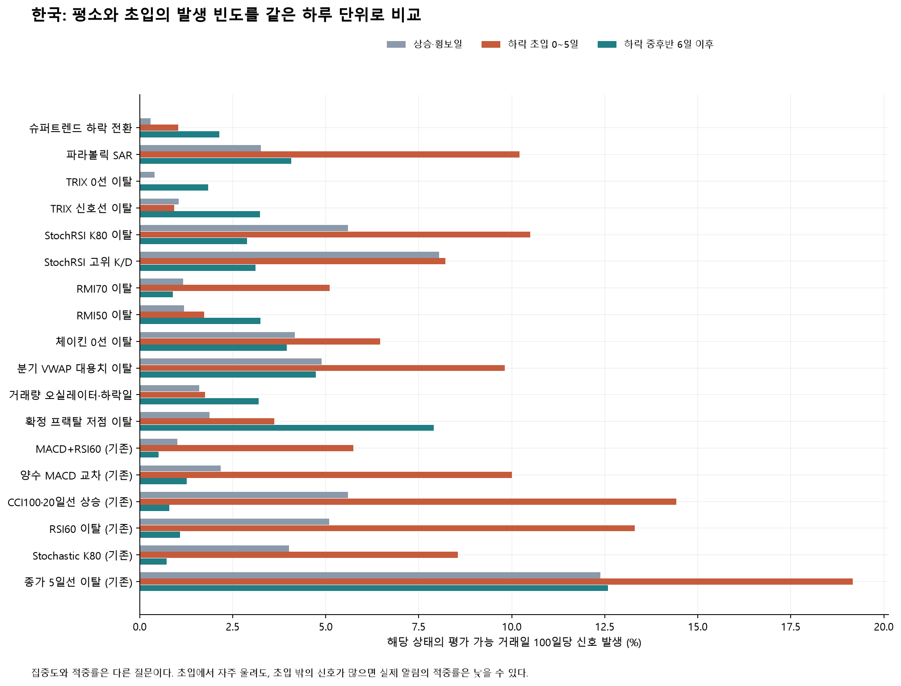

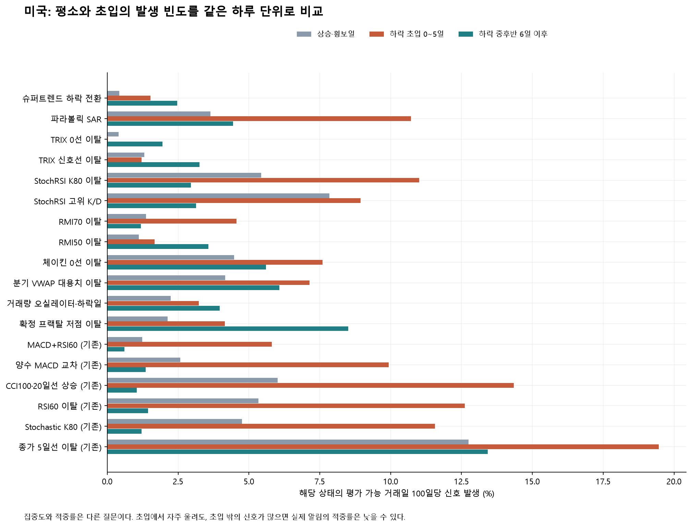

경보기가 요리할 때도 울리는지 보는 것이 평소 발생률이다. 실제 불이 났을 때 얼마나 울렸는지는 포착률이고, 울렸을 때 실제 불인 비율은 적중률이다. 이 셋은 서로 대신할 수 없다.

| 시장 | 신호 | 상태 비교 신호일 초입 % | 비신호일 초입 % | 차이 %p | 비교 유지 % |
|---|---|---|---|---|---|
| 한국 | 슈퍼트렌드 하락 전환 | 6.2 | 5.4 | +0.84 | 98.2 |
| 한국 | 파라볼릭 SAR 하락 반전 | 18.2 | 10.8 | +7.38 | 96.9 |
| 한국 | TRIX18 0선 이탈 | 0.1 | 0.7 | -0.60 | 99.2 |
| 한국 | TRIX18 신호선 이탈 | 3.3 | 6.3 | -2.98 | 98.1 |
| 한국 | StochRSI K80 이탈 | 16.6 | 11.6 | +4.99 | 97.5 |
| 한국 | StochRSI 고위 K/D 교차 | 10.6 | 9.6 | +1.00 | 97.8 |
| 한국 | RMI70 이탈 | 28.7 | 17.6 | +11.10 | 96.9 |
| 한국 | RMI50 이탈 | 5.9 | 7.0 | -1.11 | 97.8 |
| 한국 | 체이킨 0선 이탈 | 11.3 | 9.1 | +2.13 | 97.1 |
| 한국 | 분기 고정 VWAP 대용치 이탈 | 14.1 | 10.6 | +3.52 | 94.7 |
| 한국 | 거래량 오실레이터·하락일 | 5.4 | 4.6 | +0.84 | 98.1 |
| 한국 | 확정 프랙탈 저점 이탈 | 5.5 | 3.8 | +1.65 | 98.0 |
| 한국 | MACD 데드·최근3일 RSI60 이탈 | 37.9 | 18.9 | +19.05 | 94.3 |
| 한국 | MACD 양수권 시그널 하향 교차 | 32.1 | 18.0 | +14.13 | 95.3 |
| 한국 | CCI100 이탈·20일선 상승 | 26.6 | 18.1 | +8.43 | 97.4 |
| 한국 | RSI14 60 하향 돌파 | 25.9 | 17.3 | +8.58 | 90.6 |
| 한국 | 스토캐스틱(14,3,3) K 80 이탈 | 22.4 | 15.6 | +6.77 | 97.0 |
| 한국 | 종가 5일선 신규 이탈 | 10.9 | 8.6 | +2.31 | 97.5 |
| 미국 | 슈퍼트렌드 하락 전환 | 8.0 | 6.1 | +1.83 | 97.3 |
| 미국 | 파라볼릭 SAR 하락 반전 | 16.9 | 9.7 | +7.27 | 96.1 |
| 미국 | TRIX18 0선 이탈 | 0.2 | 0.7 | -0.55 | 99.2 |
| 미국 | TRIX18 신호선 이탈 | 4.0 | 6.9 | -2.81 | 97.9 |
| 미국 | StochRSI K80 이탈 | 16.1 | 10.6 | +5.51 | 97.2 |
| 미국 | StochRSI 고위 K/D 교차 | 10.5 | 9.1 | +1.42 | 97.6 |
| 미국 | RMI70 이탈 | 21.3 | 13.1 | +8.21 | 96.6 |
| 미국 | RMI50 이탈 | 5.5 | 6.5 | -0.98 | 97.5 |
| 미국 | 체이킨 0선 이탈 | 10.4 | 7.7 | +2.70 | 96.9 |
| 미국 | 분기 고정 VWAP 대용치 이탈 | 9.9 | 7.4 | +2.51 | 93.8 |
| 미국 | 거래량 오실레이터·하락일 | 7.5 | 6.0 | +1.49 | 97.3 |
| 미국 | 확정 프랙탈 저점 이탈 | 5.9 | 4.0 | +1.92 | 97.3 |
| 미국 | MACD 데드·최근3일 RSI60 이탈 | 31.8 | 14.7 | +17.11 | 93.5 |
| 미국 | MACD 양수권 시그널 하향 교차 | 27.3 | 14.5 | +12.83 | 95.0 |
| 미국 | CCI100 이탈·20일선 상승 | 22.1 | 14.7 | +7.40 | 96.9 |
| 미국 | RSI14 60 하향 돌파 | 21.0 | 12.8 | +8.17 | 89.2 |
| 미국 | 스토캐스틱(14,3,3) K 80 이탈 | 21.5 | 13.6 | +7.86 | 96.2 |
| 미국 | 종가 5일선 신규 이탈 | 10.2 | 7.7 | +2.44 | 96.9 |

이 보조 비교는 동일 종목·같은 달·당시 MA20의 상승 여부·가격 위치·RSI60 상태를 맞췄다. 결과를 보고 하락 중이었던 날만 고른 비교가 아니다. 관측 상태를 거칠게 맞춘 기술통계이므로 남은 연속 상태 차이와 뉴스 등 미관측 차이는 남는다. 더 엄격한 이후 위험 비교는 다음 절에서 따로 평가했다.

## 5. 하락 초입과 하락 기간 전체는 다른 질문이다

| 시장 | 신호 | 초입 적중 % | ≥10일 하락 전체 % | 전체 하락 기저율 % | 늦은 확인 % | 짧은 하락 % | 그 밖 % |
|---|---|---|---|---|---|---|---|
| 한국 | 슈퍼트렌드 하락 전환 | 6.4 | 88.8 | 53.7 | 82.4 | 0.2 | 11.0 |
| 한국 | 파라볼릭 SAR 하락 반전 | 18.3 | 63.6 | 53.7 | 45.4 | 0.1 | 36.3 |
| 한국 | TRIX18 0선 이탈 | 0.1 | 82.1 | 53.7 | 82.0 | 0.0 | 17.9 |
| 한국 | TRIX18 신호선 이탈 | 3.4 | 76.4 | 53.7 | 73.0 | 0.0 | 23.6 |
| 한국 | StochRSI K80 이탈 | 16.6 | 44.9 | 53.7 | 28.3 | 0.1 | 55.0 |
| 한국 | StochRSI 고위 K/D 교차 | 10.6 | 35.5 | 53.7 | 24.9 | 0.0 | 64.5 |
| 한국 | RMI70 이탈 | 28.6 | 59.3 | 53.7 | 30.8 | 0.2 | 40.5 |
| 한국 | RMI50 이탈 | 5.9 | 74.8 | 53.7 | 68.8 | 0.1 | 25.2 |
| 한국 | 체이킨 0선 이탈 | 11.3 | 54.4 | 53.7 | 43.1 | 0.1 | 45.6 |
| 한국 | 분기 고정 VWAP 대용치 이탈 | 14.2 | 56.6 | 54.0 | 42.4 | 0.1 | 43.3 |
| 한국 | 거래량 오실레이터·하락일 | 5.5 | 68.3 | 53.7 | 62.8 | 0.0 | 31.6 |
| 한국 | 확정 프랙탈 저점 이탈 | 5.6 | 81.8 | 53.7 | 76.2 | 0.0 | 18.1 |
| 한국 | MACD 데드·최근3일 RSI60 이탈 | 37.6 | 58.5 | 53.7 | 20.8 | 0.2 | 41.3 |
| 한국 | MACD 양수권 시그널 하향 교차 | 31.8 | 56.9 | 53.7 | 25.0 | 0.1 | 43.0 |
| 한국 | CCI100 이탈·20일선 상승 | 26.6 | 35.7 | 53.7 | 9.2 | 0.1 | 64.2 |
| 한국 | RSI14 60 하향 돌파 | 25.7 | 38.6 | 53.7 | 12.9 | 0.1 | 61.3 |
| 한국 | 스토캐스틱(14,3,3) K 80 이탈 | 22.5 | 34.2 | 53.7 | 11.7 | 0.1 | 65.7 |
| 한국 | 종가 5일선 신규 이탈 | 11.0 | 55.8 | 53.7 | 44.8 | 0.0 | 44.2 |
| 미국 | 슈퍼트렌드 하락 전환 | 8.1 | 82.8 | 47.6 | 74.7 | 0.4 | 16.8 |
| 미국 | 파라볼릭 SAR 하락 반전 | 17.1 | 57.2 | 47.6 | 40.1 | 0.2 | 42.7 |
| 미국 | TRIX18 0선 이탈 | 0.2 | 78.9 | 47.6 | 78.8 | 0.0 | 21.0 |
| 미국 | TRIX18 신호선 이탈 | 4.1 | 67.1 | 47.6 | 63.0 | 0.1 | 32.8 |
| 미국 | StochRSI K80 이탈 | 16.2 | 40.9 | 47.6 | 24.7 | 0.1 | 58.9 |
| 미국 | StochRSI 고위 K/D 교차 | 10.6 | 31.7 | 47.6 | 21.1 | 0.1 | 68.3 |
| 미국 | RMI70 이탈 | 21.3 | 52.9 | 47.6 | 31.6 | 0.3 | 46.9 |
| 미국 | RMI50 이탈 | 5.5 | 72.7 | 47.6 | 67.2 | 0.2 | 27.1 |
| 미국 | 체이킨 0선 이탈 | 10.5 | 54.4 | 47.6 | 43.9 | 0.1 | 45.5 |
| 미국 | 분기 고정 VWAP 대용치 이탈 | 9.9 | 57.7 | 47.7 | 47.8 | 0.1 | 42.1 |
| 미국 | 거래량 오실레이터·하락일 | 7.6 | 61.0 | 47.6 | 53.3 | 0.1 | 39.0 |
| 미국 | 확정 프랙탈 저점 이탈 | 6.1 | 77.0 | 47.6 | 70.9 | 0.1 | 22.9 |
| 미국 | MACD 데드·최근3일 RSI60 이탈 | 31.6 | 50.2 | 47.6 | 18.6 | 0.3 | 49.5 |
| 미국 | MACD 양수권 시그널 하향 교차 | 27.1 | 48.1 | 47.6 | 21.0 | 0.2 | 51.7 |
| 미국 | CCI100 이탈·20일선 상승 | 22.2 | 31.4 | 47.6 | 9.2 | 0.1 | 68.5 |
| 미국 | RSI14 60 하향 돌파 | 20.9 | 34.6 | 47.6 | 13.7 | 0.2 | 65.3 |
| 미국 | 스토캐스틱(14,3,3) K 80 이탈 | 21.6 | 34.5 | 47.6 | 12.9 | 0.1 | 65.3 |
| 미국 | 종가 5일선 신규 이탈 | 10.3 | 50.5 | 47.6 | 40.2 | 0.1 | 49.5 |

초입+늦은 확인=완료된 ≥10일 하락 전체다. 초입+늦은 확인+짧은 하락+그 밖은100%다. 시작 전5일 발생은 “그 밖”의 일부로 남는다. 당일과1~5일, 전체 하락과 짧은 하락까지 포함한 상태의 별도 수치는 [evaluate-metrics.csv](downtrend-longhistory-2026-10-29/evaluate-metrics.csv)·[base-rates.csv](downtrend-longhistory-2026-10-29/base-rates.csv)에 있다. 전체 하락 상태를 잘 분류하는 지표가 초입도 잘 잡는다고 바꾸어 말하지 않는다.

| 시장 | 주요 신호 | 시작 당일 % | 시작 후1~5일 % | 시작 전5일 % |
|---|---|---|---|---|
| 한국 | 파라볼릭 SAR 하락 반전 | 0.4 | 17.8 | 3.7 |
| 한국 | StochRSI K80 이탈 | 2.0 | 14.6 | 8.6 |
| 한국 | RMI70 이탈 | 0.5 | 28.1 | 4.8 |
| 한국 | MACD 양수권 시그널 하향 교차 | 0.2 | 31.7 | 4.6 |
| 한국 | MACD 데드·최근3일 RSI60 이탈 | 0.1 | 37.5 | 4.3 |
| 한국 | CCI100 이탈·20일선 상승 | 2.7 | 23.8 | 11.8 |
| 미국 | 파라볼릭 SAR 하락 반전 | 0.4 | 16.7 | 3.3 |
| 미국 | StochRSI K80 이탈 | 1.6 | 14.6 | 7.3 |
| 미국 | RMI70 이탈 | 0.4 | 20.9 | 3.5 |
| 미국 | MACD 양수권 시그널 하향 교차 | 0.2 | 26.9 | 4.1 |
| 미국 | MACD 데드·최근3일 RSI60 이탈 | 0.1 | 31.5 | 3.5 |
| 미국 | CCI100 이탈·20일선 상승 | 2.1 | 20.1 | 9.4 |

이 표의 분모도 모든 평가 가능한 신호다. 앞 두 열만 초입 성공에 더하고, 시작 전5일 열은 실패 분류에 남긴다. 미리 경고하는 능력을 이번 목적의 성공으로 바꾸지 않았다.

## 6. 신호 뒤 가격 경로와 비슷한 비신호일의 추가 하락 위험

| 시장 | 신호 | 전체 경로 신호 수 | −5% 접촉 % | +5% 접촉 % | 최대 추가하락 평균 % | 21일 종가 평균 % | 중앙값 % |
|---|---|---|---|---|---|---|---|
| 한국 | 슈퍼트렌드 하락 전환 | 73,328 | 65.1 | 66.8 | 9.7 | +0.71 | -0.63 |
| 한국 | 파라볼릭 SAR 하락 반전 | 254,389 | 64.9 | 63.8 | 9.5 | +0.61 | -0.89 |
| 한국 | TRIX18 0선 이탈 | 63,249 | 63.7 | 62.4 | 9.5 | +0.43 | -0.87 |
| 한국 | TRIX18 신호선 이탈 | 125,772 | 65.0 | 63.2 | 9.5 | +0.46 | -0.98 |
| 한국 | StochRSI K80 이탈 | 288,483 | 63.1 | 64.8 | 9.1 | +0.75 | -0.81 |
| 한국 | StochRSI 고위 K/D 교차 | 353,238 | 63.3 | 64.8 | 9.1 | +0.85 | -0.75 |
| 한국 | RMI70 이탈 | 81,570 | 68.3 | 66.0 | 9.9 | +0.44 | -1.30 |
| 한국 | RMI50 이탈 | 133,324 | 63.2 | 62.6 | 9.2 | +0.44 | -0.97 |
| 한국 | 체이킨 0선 이탈 | 259,258 | 64.2 | 65.4 | 9.4 | +0.79 | -0.76 |
| 한국 | 분기 고정 VWAP 대용치 이탈 | 292,456 | 64.5 | 63.8 | 9.4 | +0.40 | -1.10 |
| 한국 | 거래량 오실레이터·하락일 | 143,791 | 60.7 | 63.3 | 8.8 | +1.31 | -0.11 |
| 한국 | 확정 프랙탈 저점 이탈 | 292,740 | 64.9 | 65.1 | 9.6 | +0.89 | -0.50 |
| 한국 | MACD 데드·최근3일 RSI60 이탈 | 69,486 | 68.2 | 64.5 | 9.9 | +0.25 | -1.46 |
| 한국 | MACD 양수권 시그널 하향 교차 | 143,301 | 67.0 | 63.4 | 9.7 | +0.23 | -1.44 |
| 한국 | CCI100 이탈·20일선 상승 | 247,452 | 66.2 | 65.0 | 9.5 | +0.46 | -1.33 |
| 한국 | RSI14 60 하향 돌파 | 236,112 | 67.9 | 65.4 | 9.7 | +0.32 | -1.48 |
| 한국 | 스토캐스틱(14,3,3) K 80 이탈 | 173,162 | 64.9 | 64.5 | 9.4 | +0.63 | -1.00 |
| 한국 | 종가 5일선 신규 이탈 | 795,374 | 64.0 | 63.3 | 9.2 | +0.55 | -0.92 |
| 미국 | 슈퍼트렌드 하락 전환 | 131,988 | 58.4 | 62.1 | 9.6 | +0.83 | +0.53 |
| 미국 | 파라볼릭 SAR 하락 반전 | 441,008 | 58.2 | 60.7 | 9.3 | +0.89 | +0.36 |
| 미국 | TRIX18 0선 이탈 | 98,978 | 57.5 | 61.6 | 9.3 | +0.89 | +0.55 |
| 미국 | TRIX18 신호선 이탈 | 206,369 | 58.5 | 60.2 | 9.4 | +0.89 | +0.32 |
| 미국 | StochRSI K80 이탈 | 476,405 | 58.1 | 60.6 | 9.3 | +0.91 | +0.24 |
| 미국 | StochRSI 고위 K/D 교차 | 593,341 | 57.8 | 59.9 | 9.2 | +0.87 | +0.28 |
| 미국 | RMI70 이탈 | 150,475 | 55.6 | 57.9 | 8.6 | +0.70 | +0.35 |
| 미국 | RMI50 이탈 | 212,295 | 57.5 | 61.1 | 9.1 | +0.93 | +0.45 |
| 미국 | 체이킨 0선 이탈 | 508,298 | 57.9 | 61.0 | 9.2 | +1.09 | +0.50 |
| 미국 | 분기 고정 VWAP 대용치 이탈 | 468,946 | 58.3 | 61.7 | 9.3 | +1.18 | +0.49 |
| 미국 | 거래량 오실레이터·하락일 | 296,973 | 57.9 | 61.4 | 9.3 | +1.17 | +0.56 |
| 미국 | 확정 프랙탈 저점 이탈 | 479,119 | 60.3 | 63.7 | 10.0 | +1.06 | +0.53 |
| 미국 | MACD 데드·최근3일 RSI60 이탈 | 128,794 | 56.2 | 57.3 | 8.7 | +0.53 | +0.22 |
| 미국 | MACD 양수권 시그널 하향 교차 | 257,095 | 56.1 | 57.3 | 8.6 | +0.66 | +0.21 |
| 미국 | CCI100 이탈·20일선 상승 | 453,224 | 56.1 | 57.5 | 8.6 | +0.83 | +0.23 |
| 미국 | RSI14 60 하향 돌파 | 422,126 | 56.4 | 57.6 | 8.7 | +0.78 | +0.25 |
| 미국 | 스토캐스틱(14,3,3) K 80 이탈 | 374,753 | 56.0 | 57.8 | 8.5 | +0.77 | +0.28 |
| 미국 | 종가 5일선 신규 이탈 | 1,332,834 | 58.2 | 60.7 | 9.3 | +0.96 | +0.35 |

기준은 **신호 다음 연속 유효 거래일 시가**다. 그날을1번째 봉으로5·21·63개 봉의 고저가와 마지막 종가를 본다. 같은 경로가 상승·하락 양쪽에 닿을 수 있다. 최대 추가하락·반등은 경로의 범위이며 실제 확보 수익이나 회피 손실이 아니다. 전체81조건 경로는 [all81-path-summary.csv](downtrend-longhistory-2026-10-29/all81-path-summary.csv), 주요18조건의10·50·90백분위와5/63일 결과는 [path-distributions.csv](downtrend-longhistory-2026-10-29/path-distributions.csv)에 있다.

사후 초입 확인에 성공한 신호만 따로 보면:

| 시장 | 신호 | 성공 경로 수 | −5% 접촉 % | +5% 접촉 % | 21일 종가 중앙값 % |
|---|---|---|---|---|---|
| 한국 | RMI70 이탈 | 22,487 | 92.9 | 41.6 | -7.67 |
| 한국 | MACD 데드·최근3일 RSI60 이탈 | 25,252 | 91.5 | 42.8 | -7.33 |
| 한국 | CCI100 이탈·20일선 상승 | 63,496 | 97.2 | 32.2 | -8.79 |
| 미국 | RMI70 이탈 | 31,858 | 89.6 | 32.8 | -7.18 |
| 미국 | MACD 데드·최근3일 RSI60 이탈 | 40,530 | 87.2 | 31.6 | -6.39 |
| 미국 | CCI100 이탈·20일선 상승 | 100,130 | 94.0 | 24.7 | -7.57 |

이 하위표는 성공한 사례를 설명한다. 신호 당시에는 성공 여부를 몰랐으므로, 실제 알림의 이후 정보는 전체 신호와 비신호일 비교에서 판단해야 한다. 경로 표본에는65봉 과거·63봉 미래와 관측 상태를 요구하고, 성공 진단에만 분류용126봉 조건을 추가한다. 서로 다른 분모를 섞지 않았다.

| 시장 | 신호 | 성공 신호 수 | 이미 하락 평균 % | 중앙값 % | 10백분위 % | 90백분위 % |
|---|---|---|---|---|---|---|
| 한국 | RMI70 이탈 | 22,487 | 6.9 | 5.4 | 1.1 | 14.4 |
| 한국 | MACD 데드·최근3일 RSI60 이탈 | 25,252 | 6.6 | 5.3 | 1.5 | 13.2 |
| 한국 | CCI100 이탈·20일선 상승 | 63,496 | 3.4 | 2.4 | -0.5 | 8.4 |
| 미국 | RMI70 이탈 | 31,858 | 6.8 | 4.5 | 1.0 | 15.0 |
| 미국 | MACD 데드·최근3일 RSI60 이탈 | 40,530 | 6.2 | 4.2 | 1.0 | 13.4 |
| 미국 | CCI100 이탈·20일선 상승 | 100,130 | 3.4 | 2.0 | -0.4 | 8.7 |

이 분포는 경로 표본에서 초입 확인에 성공한 모든 신호의 다음 시가와 사후 시작일 종가를 비교한다. 앞 절의 “하락 구간별 첫 확인” 평균과 표본·집계 단위가 다르다. 평균만 보면 큰 낙폭의 영향을 받을 수 있어 중앙값과 분포를 함께 제시했다. 음수는 다음 시가가 시작일 종가보다 높았다는 뜻이다.

| 시장 | 신호 | 비교 가능 신호 | 전체 중 유지 % | 신호 −5%접촉 % | 비신호 % | 차이 %p [보정95%] | 잔여 SMD 최대 | 대조 유효수 |
|---|---|---|---|---|---|---|---|---|
| 한국 | 슈퍼트렌드 하락 전환 | 23,418 | 31.9 | 72.2 | 64.1 | +8.15 [+4.65, +11.66] | 0.20 | 32,819 |
| 한국 | 파라볼릭 SAR 하락 반전 | 70,442 | 27.7 | 62.3 | 62.4 | -0.12 [-2.46, +2.21] | 0.09 | 93,965 |
| 한국 | TRIX18 0선 이탈 | 26,111 | 41.3 | 67.1 | 60.9 | +6.17 [+3.15, +9.19] | 0.06 | 36,702 |
| 한국 | TRIX18 신호선 이탈 | 34,988 | 27.8 | 63.3 | 59.1 | +4.14 [+1.42, +6.86] | 0.10 | 46,376 |
| 한국 | StochRSI K80 이탈 | 77,231 | 26.8 | 60.5 | 63.7 | -3.13 [-5.48, -0.78] | 0.11 | 96,207 |
| 한국 | StochRSI 고위 K/D 교차 | 86,317 | 24.4 | 61.6 | 64.4 | -2.79 [-4.95, -0.62] | 0.15 | 98,284 |
| 한국 | RMI70 이탈 | 12,006 | 14.7 | 60.6 | 57.9 | +2.67 [-1.04, +6.38] | 0.15 | 13,044 |
| 한국 | RMI50 이탈 | 32,000 | 24.0 | 64.1 | 58.2 | +5.84 [+3.26, +8.41] | 0.21 | 39,827 |
| 한국 | 체이킨 0선 이탈 | 71,485 | 27.6 | 63.1 | 63.1 | -0.04 [-1.84, +1.76] | 0.20 | 91,583 |
| 한국 | 분기 고정 VWAP 대용치 이탈 | 40,593 | 13.9 | 60.4 | 58.2 | +2.18 [-1.42, +5.78] | 0.19 | 43,611 |
| 한국 | 거래량 오실레이터·하락일 | 53,203 | 37.0 | 62.4 | 62.7 | -0.35 [-3.24, +2.54] | 0.23 | 73,272 |
| 한국 | 확정 프랙탈 저점 이탈 | 100,402 | 34.3 | 68.4 | 66.7 | +1.67 [-1.04, +4.37] | 0.17 | 114,792 |
| 한국 | MACD 데드·최근3일 RSI60 이탈 | 10,456 | 15.0 | 58.9 | 53.3 | +5.58 [+1.23, +9.92] | 0.12 | 11,572 |
| 한국 | MACD 양수권 시그널 하향 교차 | 24,902 | 17.4 | 58.8 | 54.9 | +3.87 [+1.13, +6.60] | 0.10 | 27,855 |
| 한국 | CCI100 이탈·20일선 상승 | 53,872 | 21.8 | 60.4 | 59.9 | +0.51 [-1.32, +2.35] | 0.19 | 60,704 |
| 한국 | RSI14 60 하향 돌파 | 18,813 | 8.0 | 61.3 | 51.6 | +9.72 [+5.68, +13.77] | 0.88 | 17,391 |
| 한국 | 스토캐스틱(14,3,3) K 80 이탈 | 44,894 | 25.9 | 62.6 | 63.7 | -1.09 [-3.01, +0.84] | 0.11 | 54,700 |
| 한국 | 종가 5일선 신규 이탈 | 168,214 | 21.1 | 62.3 | 61.4 | +0.96 [-0.53, +2.44] | 0.15 | 173,727 |
| 미국 | 슈퍼트렌드 하락 전환 | 36,564 | 27.7 | 66.4 | 60.4 | +6.09 [+3.59, +8.58] | 0.27 | 52,390 |
| 미국 | 파라볼릭 SAR 하락 반전 | 132,783 | 30.1 | 56.2 | 55.7 | +0.49 [-1.01, +2.00] | 0.15 | 179,383 |
| 미국 | TRIX18 0선 이탈 | 42,248 | 42.7 | 60.6 | 55.7 | +4.87 [+2.71, +7.03] | 0.05 | 60,337 |
| 미국 | TRIX18 신호선 이탈 | 65,593 | 31.8 | 57.6 | 54.6 | +3.01 [+1.09, +4.94] | 0.12 | 89,621 |
| 미국 | StochRSI K80 이탈 | 142,951 | 30.0 | 54.0 | 55.3 | -1.33 [-2.72, +0.07] | 0.12 | 187,554 |
| 미국 | StochRSI 고위 K/D 교차 | 165,794 | 27.9 | 52.6 | 54.4 | -1.84 [-3.19, -0.48] | 0.11 | 193,765 |
| 미국 | RMI70 이탈 | 33,355 | 22.2 | 46.2 | 44.5 | +1.62 [-0.62, +3.86] | 0.13 | 37,668 |
| 미국 | RMI50 이탈 | 55,923 | 26.3 | 56.8 | 52.6 | +4.24 [+2.24, +6.24] | 0.13 | 70,374 |
| 미국 | 체이킨 0선 이탈 | 157,121 | 30.9 | 55.9 | 55.5 | +0.37 [-0.96, +1.70] | 0.04 | 203,984 |
| 미국 | 분기 고정 VWAP 대용치 이탈 | 76,096 | 16.2 | 54.4 | 51.5 | +2.90 [+0.17, +5.63] | 0.16 | 82,196 |
| 미국 | 거래량 오실레이터·하락일 | 107,906 | 36.3 | 59.2 | 58.6 | +0.52 [-0.93, +1.96] | 0.16 | 151,822 |
| 미국 | 확정 프랙탈 저점 이탈 | 175,507 | 36.6 | 66.4 | 65.3 | +1.12 [-0.46, +2.70] | 0.23 | 207,559 |
| 미국 | MACD 데드·최근3일 RSI60 이탈 | 27,970 | 21.7 | 45.9 | 42.0 | +3.92 [+1.18, +6.67] | 0.13 | 32,069 |
| 미국 | MACD 양수권 시그널 하향 교차 | 63,098 | 24.5 | 46.3 | 43.3 | +3.02 [+1.16, +4.88] | 0.08 | 73,579 |
| 미국 | CCI100 이탈·20일선 상승 | 121,483 | 26.8 | 47.8 | 47.4 | +0.31 [-1.05, +1.68] | 0.08 | 141,210 |
| 미국 | RSI14 60 하향 돌파 | 50,800 | 12.0 | 49.0 | 41.6 | +7.42 [+4.83, +10.00] | 0.72 | 46,505 |
| 미국 | 스토캐스틱(14,3,3) K 80 이탈 | 100,285 | 26.8 | 49.4 | 49.7 | -0.24 [-1.80, +1.31] | 0.08 | 123,737 |
| 미국 | 종가 5일선 신규 이탈 | 312,030 | 23.4 | 55.1 | 54.5 | +0.64 [-0.57, +1.85] | 0.16 | 325,583 |

동일 종목·같은 분기에서 MA/RSI 상태, ATR/가격, 당일·5일·20일 수익률, MA20과 거리를 사전에 정한 구간으로 맞춘 가장 엄격한 비교(scheme3)다. **사후 L1 상태나 미래 지속기간으로 표본을 제한하지 않았다.** 같은 분기의 비신호일은 신호 전후 모두 가능하므로 인과효과나 실시간 대조군 선택 절차로 해석하지 않는다.

유지율은 비교할 비신호일이 남은 신호의 비율이다. SMD는 맞춘 뒤에도 남은 관측 상태의 차이이고, 대조 유효수는 같은 대조일을 반복 사용한 정도를 반영한다. 유지율이 낮고 잔여 차이가 크면 전체 알림으로 일반화하기 어렵다. 구간이0 위에 있더라도 기업 뉴스·실적 등 관측하지 않은 차이는 남는다.

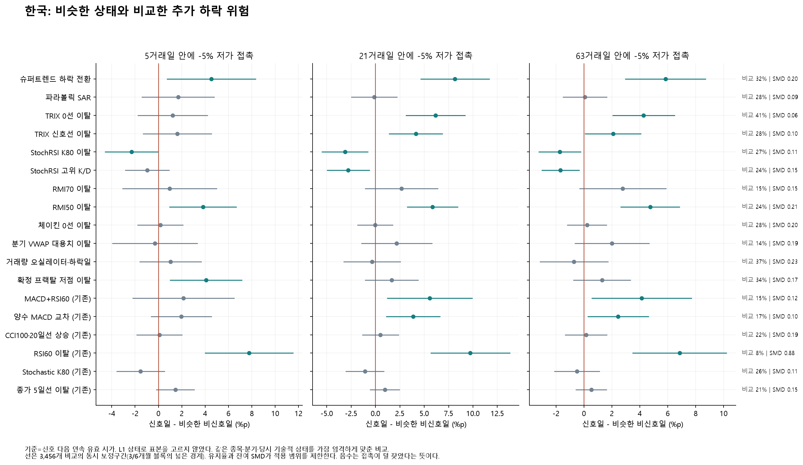

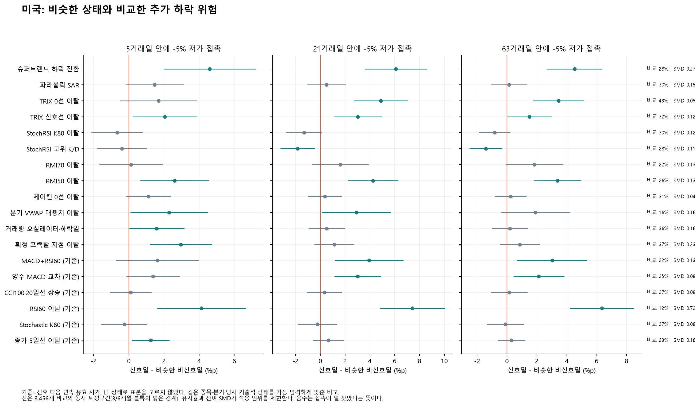

세 패널은 같은 기준 시가에서5·21·63일을 비교한다.0을 가로지르는 구간은 그 비교에서 차이가 불확실하다는 뜻이며, 추가 정보가 없다고 입증한 것은 아니다. 느슨한 비교부터 엄격한 비교까지 scheme0~3 전체는 [matched-paths.csv](downtrend-longhistory-2026-10-29/matched-paths.csv)·[balance.csv](downtrend-longhistory-2026-10-29/balance.csv)에 있다.

장기 자료에서 달라진 MACD의 근거, 신규12조건 각각의 위험 정보, 잔여 상태 차이·시기별 변화·양수인 평균 수익률까지 연결한 설명은 [가격 경로 상세 해설](downtrend-longhistory-2026-10-29/interpretation-paths.md)에서 확인할 수 있다.

## 7. 기존 후속 확인 조건은 무엇을 얻고 무엇을 잃었는가

| 시장 | 기준 신호 | 기존 추가 확인 | 적중 % | 기준 대비 %p | 포착 % | 기준 대비 %p | 성공 지연(일) | 지연 차이(일) |
|---|---|---|---|---|---|---|---|---|
| 한국 | MACD 데드·최근3일 RSI60 이탈 | 같은 날 20일선 아래 | 37.5 | -0.17 | 14.3 | -19.96 | 3.98 | 0.11 |
| 한국 | MACD 데드·최근3일 RSI60 이탈 | 이후5일 안에 20일선 이탈 | 25.4 | -12.29 | 17.2 | -17.04 | 4.11 | 0.24 |
| 한국 | MACD 데드·최근3일 RSI60 이탈 | 약화3일 지속 확인 | 5.3 | -32.34 | 2.7 | -31.50 | 4.79 | 0.92 |
| 한국 | MACD 양수권 시그널 하향 교차 | 같은 날 20일선 아래 | 29.6 | -2.22 | 26.9 | -32.40 | 4.03 | 0.15 |
| 한국 | MACD 양수권 시그널 하향 교차 | 이후5일 안에 20일선 이탈 | 21.7 | -10.15 | 29.0 | -30.33 | 4.10 | 0.22 |
| 한국 | MACD 양수권 시그널 하향 교차 | 약화3일 지속 확인 | 4.7 | -27.16 | 5.0 | -54.30 | 4.71 | 0.83 |
| 미국 | MACD 데드·최근3일 RSI60 이탈 | 같은 날 20일선 아래 | 32.4 | +0.84 | 15.4 | -19.21 | 3.96 | 0.19 |
| 미국 | MACD 데드·최근3일 RSI60 이탈 | 이후5일 안에 20일선 이탈 | 23.3 | -8.26 | 18.7 | -15.90 | 4.06 | 0.29 |
| 미국 | MACD 데드·최근3일 RSI60 이탈 | 약화3일 지속 확인 | 5.4 | -26.22 | 3.1 | -31.51 | 4.74 | 0.97 |
| 미국 | MACD 양수권 시그널 하향 교차 | 같은 날 20일선 아래 | 25.8 | -1.27 | 25.4 | -33.38 | 3.98 | 0.25 |
| 미국 | MACD 양수권 시그널 하향 교차 | 이후5일 안에 20일선 이탈 | 19.3 | -7.77 | 28.8 | -29.92 | 4.04 | 0.31 |
| 미국 | MACD 양수권 시그널 하향 교차 | 약화3일 지속 확인 | 4.6 | -22.47 | 5.0 | -53.74 | 4.67 | 0.94 |

이6조건은 이번 장기 결과를 보고 새로 만든 조합이 아니다. 동시 조건은 그날, 순서·지속 조건은 실제로 두 번째 조건 또는 지속을 확인한 날에 신호를 기록한다. 확인 속도의 차이는 서로 포착한 하락 집합이 달라서 생기는 효과도 포함하므로 동일 하락에서의 순수 추가 대기시간이라고 단정하지 않는다.

## 8. 장기 평균은 시기·종목·하락 길이에 따라 달라지는가

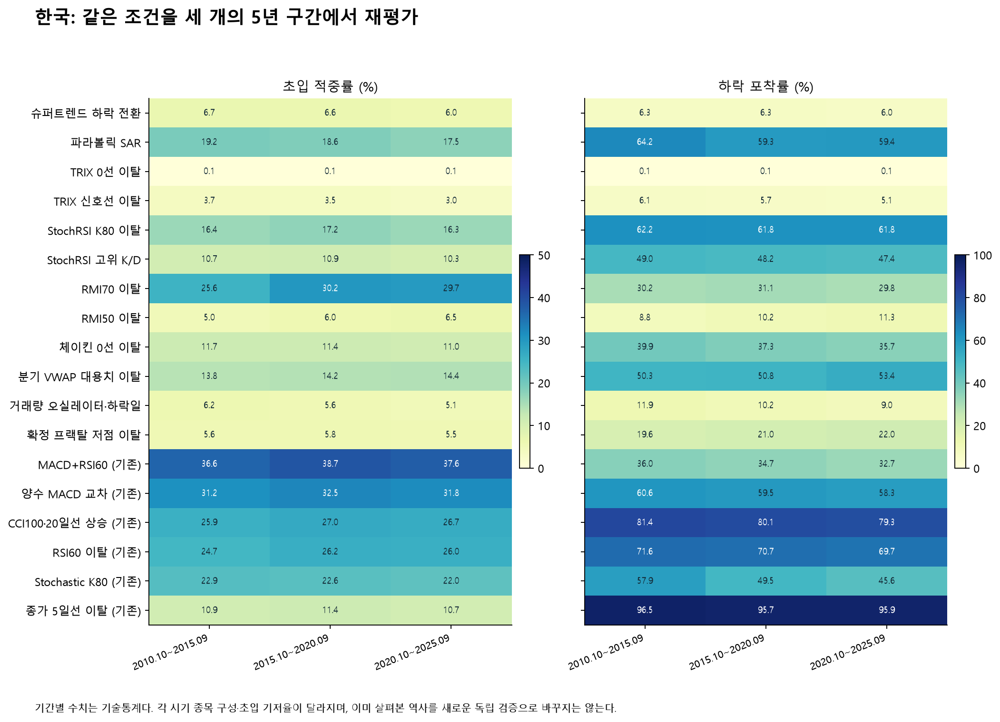

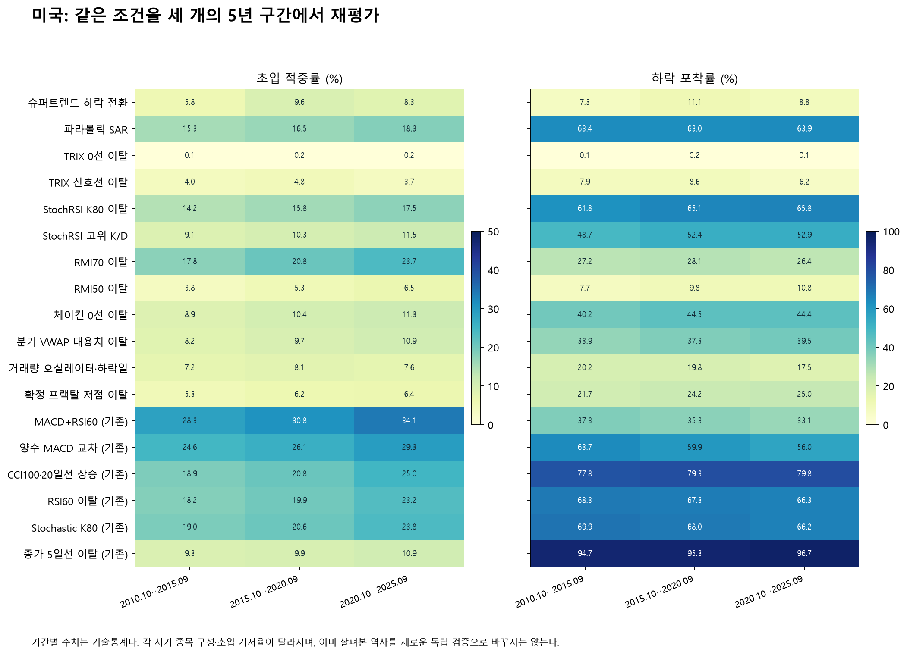

각 칸의 숫자를 가로로 읽으면 같은 조건의 시기별 변화가 보인다. 짙은 색 하나를 골라 새 기준을 만들지 않았다. 시기별 기저율·종목 수와 함께 봐야 하며, 구간별 값에 전체기간 신뢰구간을 붙이지 않는다. 자세한 기저율·포착·지연은 [classification-eras.csv](downtrend-longhistory-2026-10-29/classification-eras.csv)·[classification-yearly.csv](downtrend-longhistory-2026-10-29/classification-yearly.csv)에 있다.

| 시장 | 신호 | 신호 건수 가중 적중 % | 종목 동일가중 적중 % | 같은 종목 기저율 % | 신호 발생 종목 수 |
|---|---|---|---|---|---|
| 한국 | RMI70 이탈 | 28.6 | 30.8 | 7.5 | 2,474 |
| 한국 | 파라볼릭 SAR 하락 반전 | 18.3 | 18.6 | 7.6 | 2,508 |
| 한국 | StochRSI K80 이탈 | 16.6 | 17.3 | 7.6 | 2,510 |
| 한국 | MACD 데드·최근3일 RSI60 이탈 | 37.6 | 38.9 | 7.6 | 2,461 |
| 한국 | MACD 양수권 시그널 하향 교차 | 31.8 | 32.7 | 7.6 | 2,500 |
| 한국 | CCI100 이탈·20일선 상승 | 26.6 | 28.4 | 7.6 | 2,506 |
| 미국 | RMI70 이탈 | 21.3 | 26.4 | 7.6 | 4,223 |
| 미국 | 파라볼릭 SAR 하락 반전 | 17.1 | 18.7 | 7.6 | 4,355 |
| 미국 | StochRSI K80 이탈 | 16.2 | 18.0 | 7.6 | 4,355 |
| 미국 | MACD 데드·최근3일 RSI60 이탈 | 31.6 | 35.4 | 7.6 | 4,206 |
| 미국 | MACD 양수권 시그널 하향 교차 | 27.1 | 29.6 | 7.6 | 4,294 |
| 미국 | CCI100 이탈·20일선 상승 | 22.2 | 27.0 | 7.6 | 4,340 |

동일가중은 알림이 많은 몇 종목이 결과를 끌고 가는지 확인한다. 알림이 없는 종목의 적중률을0으로 넣지 않고, 신호가 있었던 종목의 적중률을 하나씩 같은 무게로 평균했다. 비교 기저율도 같은 종목으로 맞췄다.

| 시장 | 신호 | 사후 지속기간 | 하락 수 | 포착 % | 첫 성공 지연 | 이미 하락 % |
|---|---|---|---|---|---|---|
| 한국 | RMI70 이탈 | 10-20 | 15,560 | 28.0 | 4.02 | 8.6 |
| 한국 | MACD 데드·최근3일 RSI60 이탈 | 10-20 | 15,560 | 30.4 | 4.18 | 8.2 |
| 한국 | CCI100 이탈·20일선 상승 | 10-20 | 15,560 | 86.4 | 2.16 | 4.0 |
| 한국 | RMI70 이탈 | 21-62 | 43,049 | 30.3 | 3.75 | 6.6 |
| 한국 | MACD 데드·최근3일 RSI60 이탈 | 21-62 | 43,049 | 34.8 | 3.79 | 6.4 |
| 한국 | CCI100 이탈·20일선 상승 | 21-62 | 43,049 | 78.4 | 1.76 | 3.3 |
| 한국 | RMI70 이탈 | 63+ | 14,510 | 32.7 | 3.73 | 6.2 |
| 한국 | MACD 데드·최근3일 RSI60 이탈 | 63+ | 14,510 | 36.5 | 3.83 | 5.9 |
| 한국 | CCI100 이탈·20일선 상승 | 63+ | 14,510 | 78.6 | 1.80 | 3.2 |
| 미국 | RMI70 이탈 | 10-20 | 27,872 | 23.6 | 3.98 | 9.0 |
| 미국 | MACD 데드·최근3일 RSI60 이탈 | 10-20 | 27,872 | 29.4 | 4.06 | 8.2 |
| 미국 | CCI100 이탈·20일선 상승 | 10-20 | 27,872 | 83.6 | 2.25 | 4.2 |
| 미국 | RMI70 이탈 | 21-62 | 68,360 | 28.1 | 3.77 | 6.3 |
| 미국 | MACD 데드·최근3일 RSI60 이탈 | 21-62 | 68,360 | 36.2 | 3.69 | 5.7 |
| 미국 | CCI100 이탈·20일선 상승 | 21-62 | 68,360 | 77.8 | 1.93 | 3.3 |
| 미국 | RMI70 이탈 | 63+ | 19,807 | 28.5 | 3.79 | 6.2 |
| 미국 | MACD 데드·최근3일 RSI60 이탈 | 63+ | 19,807 | 36.5 | 3.69 | 5.5 |
| 미국 | CCI100 이탈·20일선 상승 | 63+ | 19,807 | 78.0 | 1.93 | 3.3 |

이 구분은 오래 이어지는 하락을 특히 놓쳤는지 보는 사후 보조 분석이다. 신호 당시 앞으로10일·60일 이상 이어질지 알아냈다는 뜻은 아니다.

| 시장 | 신호 | 초입 범위 | 적중 % | 포착 % |
|---|---|---|---|---|
| 한국 | RMI70 이탈 | 0..3 | 9.6 | 10.3 |
| 한국 | MACD 데드·최근3일 RSI60 이탈 | 0..3 | 12.4 | 11.3 |
| 한국 | CCI100 이탈·20일선 상승 | 0..3 | 23.3 | 73.5 |
| 한국 | RMI70 이탈 | 0..5 | 28.6 | 30.3 |
| 한국 | MACD 데드·최근3일 RSI60 이탈 | 0..5 | 37.6 | 34.2 |
| 한국 | CCI100 이탈·20일선 상승 | 0..5 | 26.6 | 80.1 |
| 한국 | RMI70 이탈 | 0..10 | 52.1 | 54.7 |
| 한국 | MACD 데드·최근3일 RSI60 이탈 | 0..10 | 53.0 | 47.3 |
| 한국 | CCI100 이탈·20일선 상승 | 0..10 | 28.6 | 82.1 |
| 미국 | RMI70 이탈 | 0..3 | 7.0 | 8.9 |
| 미국 | MACD 데드·최근3일 RSI60 이탈 | 0..3 | 11.5 | 12.6 |
| 미국 | CCI100 이탈·20일선 상승 | 0..3 | 18.5 | 69.3 |
| 미국 | RMI70 이탈 | 0..5 | 21.3 | 27.1 |
| 미국 | MACD 데드·최근3일 RSI60 이탈 | 0..5 | 31.6 | 34.6 |
| 미국 | CCI100 이탈·20일선 상승 | 0..5 | 22.2 | 79.2 |
| 미국 | RMI70 이탈 | 0..10 | 43.6 | 54.8 |
| 미국 | MACD 데드·최근3일 RSI60 이탈 | 0..10 | 44.2 | 47.4 |
| 미국 | CCI100 이탈·20일선 상승 | 0..10 | 24.7 | 82.5 |

0~3일은 더 엄격한 빠른 확인,0~10일은 더 기다린 확인이다. 창을 넓혀 얻은 포착을0~5일의 성능 개선으로 바꾸어 말하지 않는다. 이 보조 창에 주 기준의 직접 비교 신뢰구간을 재사용하지 않았다.

## 9. 실제 성공·실패·늦은 확인 사례

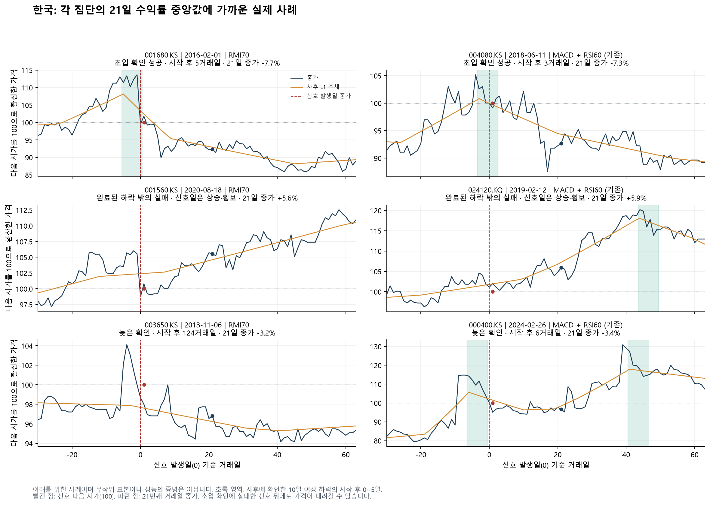

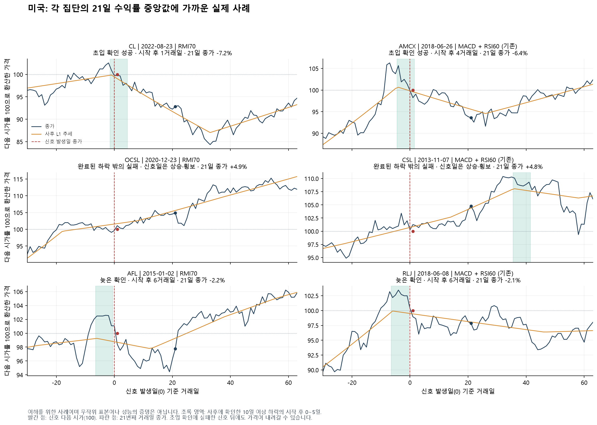

가격·사후 L1·초입 영역·실제 신호일·다음 시가 이후 경로를 함께 보았다. 예시는 각 집단의21일 종가 경로 중앙값에 가까운 고정 후보의 사례이며, 무작위 대표 표본이나 성능 증명이 아니다. 신호 뒤 가격이 내렸다고 반드시 초입 확인에 성공한 것도, 초입 확인에 실패했다고 반드시 이후 가격이 오른 것도 아니다. 날짜·가격은 [illustrated-cases.csv](downtrend-longhistory-2026-10-29/illustrated-cases.csv)에서 확인할 수 있다.

## 10. 논문에서 가져온 점과 남은 불확실성

| 연구 근거 | 이번 분석에서의 적용·한계 |
|---|---|
| [Kim, Koh, Boyd & Gorinevsky (2009), L1 Trend Filtering](https://stanford.edu/~boyd/papers/pdf/l1_trend_filter.pdf) | 구간별 선형 추세를 사후 정답으로 사용한다. λ=1은 기존 연구를 유지한 선택이며 보편적 최적값이 아니다. 사후 시작점을 그날 알았던 것처럼 신호에 넣지 않는다. |
| [Lo, Mamaysky & Wang (2000)](https://www.mit.edu/~wangj/pap/LoMamayskyWang00.pdf) | 패턴을 객관적으로 계산하고 조건부 가격 분포를 비교한다. 상태 분류·추가 가격 정보·실현 거래 이익은 서로 다른 주장이다. |
| [Sullivan, Timmermann & White (1999), 기관 공개 작업논문](https://www.fmg.ac.uk/sites/default/files/2020-11/dp303.pdf) | 다수 규칙의 우연한 우승과 시간 의존성을 고려한다. 이번 대비의 최대통계량 보정은 분류/경로 차이에 대한 것으로, 매도 전략 수익의 White Reality Check를 수행했다는 주장이 아니다. |
| [Bajgrowicz & Scaillet (2012)](https://scaillet.ch/pdfs/BajSca.pdf) | 과거의 우수한 규칙이 미래에도 유지되는지와 거래비용의 영향을 따로 검증해야 한다.15년 재평가를 새 독립 표본이나 비용 차감 매도 성과로 부르지 않는다. |

비유하면 L1은 경기 뒤 영상을 돌려본 판정이고 신호는 경기 중의 판단이다. 같은 날 많은 주식이 함께 움직이므로 사건 수가 많다는 이유만으로 독립적인 증거가 늘었다고 볼 수 없다. 이번에는 종목 재표집과 공통3/6개월 시간 블록을 함께 사용했고1,999회 계산했다. 두 설정의 넓은 구간을 사용했다.

많은 사람에게 동전 던지기를 시키면 우연한 연승자가 생기듯, 많은 규칙을 비교할수록 보기 좋은 결과가 나올 수 있다. 이번에는486개 상태 대비,162개 발생률 대비,288개 직접 비교,3,456개 가격경로 대비를 각 고정 집합 안에서 보정했다. 그러나 이전 연구부터 이어진 적응적 탐색 전체를 지우지는 못한다.

매칭은 고정된 셀·지지 표본을 사용하고, 비신호일 평균의1차 불확실성을 실제 대조일의 월에 배분했다. 매 반복마다 대조군을 새로 구성한 완전한 재매칭은 아니다. 세부 구간을 나눈다고 연속 상태가 완전히 같아지는 것도 아니다. 새 기간의 관측, 생존편향 없는 역사 종목군, 시점별 가격 수정본까지 확보한 검증은 여전히 별도다.

종료일 민감도는 한국20·미국20종목에 대해2015·2020·2025년9월 종료 추세와 최종 추세를 비교해 하락 정답을 다시 계산했다.126봉 완충 뒤 양쪽에서 확정된 날짜의 하락 상태·초입은 모두 일치했다. 다만 미국2015년에는 미완료였던21일이 나중에 확정되면서 시작점이181개에서182개로 늘었다. 완충을 적용하지 않은 마지막126봉의 상태 일치율은 한국76.5~94.2%, 미국59.1~88.1%였다. **완충이 종료점 위험을 줄이지만 정답 불변을 보장하지는 않는다.**40종목 표본의 결과를 모든 신규 상장·짧은 이력에 일반화할 수 없다. 상세는 [종료일 민감도 감사](downtrend-longhistory-2026-10-29/endpoint-recheck.md)에 있다.

## 11. 전체81조건: 15년과 최초 확보 이력 비교

아래 전체 이력은 종목별 최초 평가 가능일부터 시작한다. 오래된 자료의 품질·종목 구성이 다르고 주15년과 겹치므로 별도의 독립 검증이 아니다. 짧은 이력도 포함했으며, 모든 조건에 공통으로15년치 관측을 만들어 넣지 않았다.

### 한국 전체 조건

| 조건 | 집계 유형 | 15년 신호 수 | 15년 적중 % | 15년 포착 % | 최초 이력 신호 수 | 최초 이력 적중 % | 최초 이력 포착 % |
|---|---|---|---|---|---|---|---|
| 슈퍼트렌드 하락 전환 | 사건 | 71,167 | 6.4 | 6.2 | 107,416 | 7.6 | 7.4 |
| 파라볼릭 SAR 하락 반전 | 사건 | 245,878 | 18.3 | 60.7 | 365,150 | 19.1 | 62.7 |
| TRIX18 0선 이탈 | 사건 | 61,426 | 0.1 | 0.1 | 89,902 | 0.1 | 0.1 |
| TRIX18 신호선 이탈 | 사건 | 121,311 | 3.4 | 5.6 | 180,331 | 3.5 | 5.6 |
| StochRSI K80 이탈 | 사건 | 278,615 | 16.6 | 61.9 | 414,033 | 17.0 | 62.7 |
| StochRSI 고위 K/D 교차 | 사건 | 341,731 | 10.6 | 48.1 | 502,876 | 11.1 | 49.4 |
| RMI70 이탈 | 사건 | 78,703 | 28.6 | 30.3 | 120,168 | 28.1 | 30.2 |
| RMI50 이탈 | 사건 | 129,033 | 5.9 | 10.3 | 190,018 | 6.1 | 10.3 |
| 체이킨 0선 이탈 | 사건 | 250,897 | 11.3 | 37.4 | 381,078 | 11.7 | 38.9 |
| 분기 고정 VWAP 대용치 이탈 | 사건 | 282,596 | 14.2 | 51.8 | 423,884 | 14.3 | 51.7 |
| 거래량 오실레이터·하락일 | 사건 | 138,922 | 5.5 | 10.2 | 199,564 | 5.8 | 10.1 |
| 확정 프랙탈 저점 이탈 | 사건 | 283,429 | 5.6 | 21.0 | 410,452 | 5.7 | 20.7 |
| 종가 5일선 신규 이탈 | 사건 | 767,870 | 11.0 | 96.0 | 1,144,764 | 11.1 | 96.3 |
| 종가 10일선 신규 이탈 | 사건 | 512,110 | 15.3 | 93.7 | 766,191 | 15.4 | 94.0 |
| 종가 20일선 신규 이탈 | 사건 | 333,613 | 11.6 | 49.2 | 499,785 | 11.8 | 49.7 |
| 종가 50일선 신규 이탈 | 사건 | 211,593 | 8.4 | 22.1 | 314,690 | 8.5 | 22.0 |
| 종가 60일선 신규 이탈 | 사건 | 188,557 | 8.9 | 20.8 | 280,251 | 9.0 | 20.6 |
| 종가 200일선 신규 이탈 | 사건 | 98,422 | 10.1 | 13.3 | 140,459 | 10.2 | 13.1 |
| 5/10 데드크로스 | 사건 | 333,751 | 15.8 | 70.5 | 497,308 | 16.0 | 70.7 |
| 5/20 데드크로스 | 사건 | 185,116 | 5.0 | 12.5 | 274,309 | 5.0 | 12.3 |
| 10/20 데드크로스 | 사건 | 163,108 | 1.7 | 3.7 | 242,052 | 1.6 | 3.5 |
| 20/60 데드크로스 | 사건 | 59,277 | 0.5 | 0.4 | 86,972 | 0.6 | 0.4 |
| 50/200 데드크로스 | 사건 | 17,110 | 2.9 | 0.7 | 24,594 | 3.0 | 0.7 |
| 5일선 이탈·20일선 상승 | 사건 | 406,251 | 20.3 | 94.3 | 605,592 | 20.3 | 93.7 |
| 5/10 데드·20일선 상승 | 사건 | 186,578 | 26.9 | 67.0 | 278,482 | 26.9 | 66.5 |
| 5/10 데드·10일선>20일선 | 사건 | 220,408 | 23.4 | 68.9 | 328,254 | 23.8 | 69.2 |
| 5/10 데드·종가<20일선·10일선>20일선 | 사건 | 101,752 | 19.1 | 26.4 | 151,005 | 20.1 | 27.4 |
| 20일선 이탈·10일선>20일선 | 사건 | 216,140 | 17.2 | 47.6 | 321,424 | 17.6 | 48.1 |
| 20일선 5일 기울기 음전환 | 사건 | 143,476 | 2.5 | 4.8 | 212,508 | 2.6 | 4.9 |
| RSI14 70 하향 돌파 | 사건 | 86,504 | 27.3 | 30.2 | 136,034 | 27.6 | 31.8 |
| RSI14 60 하향 돌파 | 사건 | 227,877 | 25.7 | 70.5 | 343,720 | 25.6 | 70.7 |
| RSI14 50 하향 돌파 | 사건 | 333,030 | 10.6 | 44.1 | 495,636 | 10.8 | 44.4 |
| RSI14 40 하향 돌파 | 사건 | 250,097 | 1.0 | 3.4 | 365,361 | 1.1 | 3.7 |
| MACD 시그널 하향 교차 | 사건 | 227,906 | 20.2 | 62.1 | 339,338 | 20.5 | 62.1 |
| MACD 양수권 시그널 하향 교차 | 사건 | 138,260 | 31.8 | 59.3 | 206,981 | 31.9 | 59.1 |
| MACD 0선 하향 교차 | 사건 | 103,486 | 3.6 | 5.0 | 151,853 | 3.7 | 5.0 |
| DMI -DI가 +DI 상향 교차 | 사건 | 238,258 | 6.9 | 21.4 | 356,894 | 7.0 | 21.8 |
| DMI 하락 교차·ADX≥25 | 사건 | 45,629 | 7.1 | 4.4 | 67,263 | 7.3 | 4.4 |
| -DI 우위·ADX20 상향 진입 | 사건 | 47,936 | 0.4 | 0.2 | 69,568 | 0.4 | 0.2 |
| 스토캐스틱(14,3,3) K 80 이탈 | 사건 | 167,463 | 22.5 | 50.1 | 255,341 | 23.3 | 52.5 |
| 스토캐스틱 K/D 데드·전일 K≥80 | 사건 | 192,674 | 16.8 | 42.4 | 293,259 | 17.4 | 44.6 |
| CCI20 100 하향 돌파 | 사건 | 272,618 | 23.6 | 81.1 | 410,297 | 23.9 | 82.1 |
| CCI20 0 하향 돌파 | 사건 | 291,231 | 11.6 | 44.2 | 436,070 | 11.8 | 44.7 |
| CCI20 -100 하향 돌파 | 사건 | 291,835 | 1.7 | 6.7 | 429,594 | 1.7 | 6.5 |
| 볼린저 상단 밴드 안으로 복귀 | 사건 | 177,970 | 14.4 | 33.8 | 275,122 | 15.0 | 36.2 |
| 볼린저 하단 신규 이탈 | 사건 | 170,540 | 0.8 | 1.9 | 244,018 | 0.8 | 1.8 |
| 밴드 수축 뒤 하단 이탈 | 사건 | 24,040 | 1.7 | 0.6 | 34,086 | 1.6 | 0.5 |
| EMA20−2ATR14 하단 이탈 | 사건 | 101,418 | 0.3 | 0.4 | 145,917 | 0.3 | 0.4 |
| 직전 20일 저가 이탈 첫날 | 사건 | 215,852 | 0.5 | 1.6 | 305,481 | 0.6 | 1.7 |
| 직전 60일 저가 이탈 첫날 | 사건 | 110,980 | 0.2 | 0.2 | 156,474 | 0.2 | 0.3 |
| 20일 고가 돌파 실패·음봉 | 사건 | 121,001 | 13.3 | 20.9 | 190,582 | 14.0 | 23.1 |
| 전일 저가 아래 갭·음봉 | 일별 패턴 | 204,486 | 9.3 | 23.2 | 328,500 | 10.0 | 26.0 |
| 전일 양봉을 감싼 음봉 몸통 | 일별 패턴 | 364,080 | 9.3 | 40.2 | 519,870 | 9.5 | 39.4 |
| 윗꼬리≥60%·종가 하위30% | 일별 패턴 | 463,492 | 7.3 | 36.7 | 739,125 | 7.5 | 39.3 |
| 하락일·거래량 전20일의1.5배 | 사건 | 283,438 | 8.1 | 28.0 | 429,975 | 8.8 | 30.2 |
| 전일 종가−1.5ATR 이탈·거래량1.5배 | 일별 패턴 | 48,437 | 11.1 | 7.0 | 66,095 | 13.2 | 7.5 |
| 20일 OBV 순유출 비율 −20% 진입 | 사건 | 210,009 | 1.4 | 3.8 | 307,780 | 1.7 | 4.3 |
| CMF20 0선 하향 돌파 | 사건 | 225,233 | 8.3 | 22.9 | 340,521 | 8.7 | 24.2 |
| CMF20 −0.1 하향 돌파 | 사건 | 227,285 | 5.7 | 15.9 | 342,375 | 6.2 | 17.2 |
| MFI14 80 하향 돌파 | 사건 | 137,040 | 21.6 | 37.4 | 203,863 | 22.1 | 37.8 |
| MFI14 50 하향 돌파 | 사건 | 277,885 | 4.6 | 16.2 | 420,848 | 4.6 | 16.3 |
| 10일 ROC 음전환 | 사건 | 427,320 | 11.4 | 60.0 | 638,117 | 11.3 | 59.1 |
| Aroon25 하락 교차 | 사건 | 134,323 | 2.7 | 5.0 | 198,571 | 2.8 | 5.0 |
| Vortex14 하락 교차 | 사건 | 319,260 | 7.4 | 29.8 | 479,004 | 7.5 | 30.3 |
| 일목 전환선/기준선 데드 | 사건 | 152,515 | 2.6 | 5.4 | 225,251 | 2.5 | 4.9 |
| 일목 기준선 종가 이탈 | 사건 | 284,658 | 13.4 | 47.2 | 427,721 | 13.8 | 48.3 |
| 당일에 표시된 일목 구름 하단 이탈 | 사건 | 161,723 | 7.3 | 14.7 | 237,800 | 7.4 | 14.6 |
| 5일/20일 변동성1.25배 신규 진입 | 사건 | 346,677 | 6.1 | 26.8 | 517,394 | 6.6 | 28.5 |
| MACD 데드·최근3일 RSI60 이탈 | 사건 | 67,079 | 37.6 | 34.2 | 101,472 | 37.8 | 34.5 |
| 스토캐스틱80 이탈·MACD<시그널 | 사건 | 13,035 | 29.5 | 5.2 | 19,248 | 29.8 | 5.2 |
| CCI100 이탈·20일선 상승 | 사건 | 238,931 | 26.6 | 80.1 | 359,462 | 26.9 | 80.9 |
| 밴드 상단 복귀·RSI<60 | 사건 | 68,729 | 12.1 | 11.0 | 105,899 | 12.7 | 11.9 |
| MACD 데드·거래량1.5배 | 사건 | 32,880 | 12.3 | 5.5 | 46,109 | 13.3 | 5.5 |
| 20일 저가 이탈·거래량1.5배 | 사건 | 60,059 | 0.7 | 0.6 | 78,083 | 0.8 | 0.6 |
| 20일 종가 신고가·이전 고점 RSI보다5 낮음 | 일별 패턴 | 25,162 | 14.0 | 4.8 | 40,990 | 13.4 | 4.9 |
| MACD 데드·최근3일 RSI60 이탈 / and20 | 사건 | 27,945 | 37.5 | 14.3 | 41,720 | 38.3 | 14.5 |
| MACD 데드·최근3일 RSI60 이탈 / then20 | 사건 | 49,709 | 25.4 | 17.2 | 74,245 | 25.7 | 17.3 |
| MACD 데드·최근3일 RSI60 이탈 / persist3 | 사건 | 37,564 | 5.3 | 2.7 | 55,878 | 5.3 | 2.7 |
| MACD 양수권 시그널 하향 교차 / and20 | 사건 | 66,840 | 29.6 | 26.9 | 98,217 | 30.1 | 26.6 |
| MACD 양수권 시그널 하향 교차 / then20 | 사건 | 98,245 | 21.7 | 29.0 | 145,148 | 21.8 | 28.5 |
| MACD 양수권 시그널 하향 교차 / persist3 | 사건 | 77,990 | 4.7 | 5.0 | 114,359 | 4.6 | 4.7 |

### 미국 전체 조건

| 조건 | 집계 유형 | 15년 신호 수 | 15년 적중 % | 15년 포착 % | 최초 이력 신호 수 | 최초 이력 적중 % | 최초 이력 포착 % |
|---|---|---|---|---|---|---|---|
| 슈퍼트렌드 하락 전환 | 사건 | 131,261 | 8.1 | 9.2 | 204,544 | 7.9 | 9.1 |
| 파라볼릭 SAR 하락 반전 | 사건 | 438,433 | 17.1 | 63.5 | 668,909 | 16.9 | 63.2 |
| TRIX18 0선 이탈 | 사건 | 98,372 | 0.2 | 0.1 | 151,617 | 0.1 | 0.1 |
| TRIX18 신호선 이탈 | 사건 | 205,020 | 4.1 | 7.2 | 315,216 | 4.3 | 7.5 |
| StochRSI K80 이탈 | 사건 | 473,496 | 16.2 | 64.8 | 726,838 | 15.9 | 64.0 |
| StochRSI 고위 K/D 교차 | 사건 | 589,956 | 10.6 | 51.9 | 901,332 | 10.4 | 51.2 |
| RMI70 이탈 | 사건 | 149,778 | 21.3 | 27.1 | 234,150 | 20.8 | 27.1 |
| RMI50 이탈 | 사건 | 210,895 | 5.5 | 9.9 | 325,319 | 5.3 | 9.5 |
| 체이킨 0선 이탈 | 사건 | 505,743 | 10.5 | 43.5 | 770,682 | 10.2 | 42.3 |
| 분기 고정 VWAP 대용치 이탈 | 사건 | 465,402 | 9.9 | 37.7 | 719,894 | 9.9 | 37.8 |
| 거래량 오실레이터·하락일 | 사건 | 294,971 | 7.6 | 18.7 | 456,969 | 7.5 | 18.7 |
| 확정 프랙탈 저점 이탈 | 사건 | 475,781 | 6.1 | 24.1 | 719,794 | 5.9 | 23.3 |
| 종가 5일선 신규 이탈 | 사건 | 1,323,366 | 10.3 | 95.9 | 2,043,403 | 10.2 | 96.0 |
| 종가 10일선 신규 이탈 | 사건 | 886,461 | 13.6 | 90.7 | 1,373,682 | 13.4 | 90.9 |
| 종가 20일선 신규 이탈 | 사건 | 604,215 | 10.6 | 50.8 | 935,400 | 10.5 | 51.1 |
| 종가 50일선 신규 이탈 | 사건 | 364,274 | 7.8 | 22.2 | 564,817 | 7.6 | 21.8 |
| 종가 60일선 신규 이탈 | 사건 | 330,748 | 8.1 | 20.7 | 514,395 | 7.7 | 20.2 |
| 종가 200일선 신규 이탈 | 사건 | 162,873 | 8.6 | 11.3 | 251,207 | 8.2 | 11.0 |
| 5/10 데드크로스 | 사건 | 548,302 | 14.3 | 65.9 | 847,220 | 14.1 | 66.0 |
| 5/20 데드크로스 | 사건 | 312,501 | 4.8 | 12.7 | 481,480 | 4.7 | 12.7 |
| 10/20 데드크로스 | 사건 | 272,554 | 1.6 | 3.8 | 419,428 | 1.6 | 3.7 |
| 20/60 데드크로스 | 사건 | 94,802 | 0.5 | 0.4 | 146,299 | 0.5 | 0.4 |
| 50/200 데드크로스 | 사건 | 28,497 | 2.8 | 0.7 | 43,450 | 2.8 | 0.7 |
| 5일선 이탈·20일선 상승 | 사건 | 749,486 | 17.5 | 93.0 | 1,166,738 | 17.2 | 93.0 |
| 5/10 데드·20일선 상승 | 사건 | 328,534 | 22.2 | 61.4 | 510,454 | 21.8 | 61.4 |
| 5/10 데드·10일선>20일선 | 사건 | 377,497 | 20.2 | 64.3 | 584,534 | 19.9 | 64.4 |
| 5/10 데드·종가<20일선·10일선>20일선 | 사건 | 177,395 | 18.4 | 28.0 | 272,992 | 18.1 | 27.8 |
| 20일선 이탈·10일선>20일선 | 사건 | 386,751 | 15.8 | 49.1 | 598,531 | 15.7 | 49.3 |
| 20일선 5일 기울기 음전환 | 사건 | 234,214 | 2.6 | 5.1 | 360,752 | 2.6 | 5.1 |
| RSI14 70 하향 돌파 | 사건 | 161,035 | 23.2 | 29.6 | 249,835 | 22.3 | 29.0 |
| RSI14 60 하향 돌파 | 사건 | 420,215 | 20.9 | 67.0 | 654,747 | 20.6 | 67.3 |
| RSI14 50 하향 돌파 | 사건 | 570,305 | 9.7 | 43.1 | 884,060 | 9.5 | 43.0 |
| RSI14 40 하향 돌파 | 사건 | 383,415 | 1.6 | 5.1 | 584,056 | 1.5 | 4.8 |
| MACD 시그널 하향 교차 | 사건 | 388,647 | 18.7 | 61.6 | 602,612 | 18.6 | 62.2 |
| MACD 양수권 시그널 하향 교차 | 사건 | 255,795 | 27.1 | 58.8 | 400,598 | 26.7 | 59.4 |
| MACD 0선 하향 교차 | 사건 | 171,915 | 3.6 | 5.2 | 264,360 | 3.4 | 5.0 |
| DMI -DI가 +DI 상향 교차 | 사건 | 452,543 | 9.3 | 34.6 | 685,602 | 9.5 | 35.0 |
| DMI 하락 교차·ADX≥25 | 사건 | 70,549 | 10.5 | 6.3 | 112,514 | 10.6 | 6.7 |
| -DI 우위·ADX20 상향 진입 | 사건 | 84,374 | 0.7 | 0.5 | 130,769 | 0.7 | 0.5 |
| 스토캐스틱(14,3,3) K 80 이탈 | 사건 | 373,094 | 21.6 | 67.5 | 586,706 | 21.2 | 68.4 |
| 스토캐스틱 K/D 데드·전일 K≥80 | 사건 | 483,847 | 15.4 | 60.3 | 758,696 | 15.1 | 61.0 |
| CCI20 100 하향 돌파 | 사건 | 504,304 | 20.2 | 80.7 | 776,037 | 20.0 | 80.8 |
| CCI20 0 하향 돌파 | 사건 | 509,063 | 10.5 | 44.1 | 778,923 | 10.5 | 44.0 |
| CCI20 -100 하향 돌파 | 사건 | 464,691 | 2.0 | 8.1 | 710,737 | 2.0 | 7.9 |
| 볼린저 상단 밴드 안으로 복귀 | 사건 | 310,646 | 11.9 | 30.6 | 483,261 | 11.7 | 30.5 |
| 볼린저 하단 신규 이탈 | 사건 | 272,153 | 1.3 | 3.0 | 415,277 | 1.2 | 2.8 |
| 밴드 수축 뒤 하단 이탈 | 사건 | 38,754 | 1.7 | 0.6 | 57,827 | 1.8 | 0.6 |
| EMA20−2ATR14 하단 이탈 | 사건 | 186,192 | 1.0 | 1.5 | 290,167 | 0.8 | 1.4 |
| 직전 20일 저가 이탈 첫날 | 사건 | 349,505 | 1.0 | 2.8 | 527,476 | 0.9 | 2.6 |
| 직전 60일 저가 이탈 첫날 | 사건 | 183,581 | 0.5 | 0.8 | 273,634 | 0.5 | 0.7 |
| 20일 고가 돌파 실패·음봉 | 사건 | 285,589 | 12.5 | 28.3 | 412,644 | 12.4 | 26.7 |
| 전일 저가 아래 갭·음봉 | 일별 패턴 | 488,975 | 9.1 | 32.6 | 701,252 | 9.1 | 31.0 |
| 전일 양봉을 감싼 음봉 몸통 | 일별 패턴 | 468,133 | 8.8 | 32.0 | 727,788 | 8.7 | 32.3 |
| 윗꼬리≥60%·종가 하위30% | 일별 패턴 | 651,971 | 6.8 | 31.9 | 1,015,357 | 6.8 | 32.1 |
| 하락일·거래량 전20일의1.5배 | 사건 | 512,579 | 7.9 | 30.9 | 805,377 | 7.9 | 31.5 |
| 전일 종가−1.5ATR 이탈·거래량1.5배 | 일별 패턴 | 103,550 | 10.7 | 9.1 | 156,522 | 10.5 | 8.9 |
| 20일 OBV 순유출 비율 −20% 진입 | 사건 | 342,708 | 2.5 | 6.7 | 526,741 | 2.5 | 6.8 |
| CMF20 0선 하향 돌파 | 사건 | 445,673 | 7.3 | 24.8 | 677,687 | 7.0 | 24.0 |
| CMF20 −0.1 하향 돌파 | 사건 | 359,995 | 4.4 | 12.4 | 541,399 | 4.3 | 12.0 |
| MFI14 80 하향 돌파 | 사건 | 135,112 | 21.5 | 23.4 | 213,578 | 20.8 | 23.4 |
| MFI14 50 하향 돌파 | 사건 | 517,767 | 7.1 | 29.1 | 791,447 | 7.1 | 29.2 |
| 10일 ROC 음전환 | 사건 | 725,979 | 10.7 | 60.3 | 1,125,299 | 10.6 | 60.3 |
| Aroon25 하락 교차 | 사건 | 210,575 | 3.1 | 5.6 | 322,731 | 3.1 | 5.6 |
| Vortex14 하락 교차 | 사건 | 527,789 | 6.8 | 28.7 | 805,551 | 6.7 | 28.5 |
| 일목 전환선/기준선 데드 | 사건 | 236,291 | 1.6 | 3.2 | 362,388 | 1.6 | 3.1 |
| 일목 기준선 종가 이탈 | 사건 | 484,623 | 9.7 | 37.2 | 754,187 | 9.5 | 36.9 |
| 당일에 표시된 일목 구름 하단 이탈 | 사건 | 256,282 | 6.6 | 13.2 | 397,367 | 6.2 | 12.6 |
| 5일/20일 변동성1.25배 신규 진입 | 사건 | 582,157 | 6.5 | 30.2 | 900,557 | 6.3 | 29.9 |
| MACD 데드·최근3일 RSI60 이탈 | 사건 | 128,260 | 31.6 | 34.6 | 201,293 | 31.2 | 35.2 |
| 스토캐스틱80 이탈·MACD<시그널 | 사건 | 69,590 | 24.7 | 14.6 | 108,633 | 24.4 | 14.8 |
| CCI100 이탈·20일선 상승 | 사건 | 450,943 | 22.2 | 79.2 | 695,454 | 21.9 | 79.3 |
| 밴드 상단 복귀·RSI<60 | 사건 | 113,442 | 11.6 | 11.0 | 173,962 | 11.4 | 10.8 |
| MACD 데드·거래량1.5배 | 사건 | 69,470 | 16.1 | 9.6 | 107,067 | 16.2 | 9.8 |
| 20일 저가 이탈·거래량1.5배 | 사건 | 113,559 | 1.8 | 1.8 | 174,084 | 1.7 | 1.6 |
| 20일 종가 신고가·이전 고점 RSI보다5 낮음 | 일별 패턴 | 51,255 | 10.3 | 4.5 | 80,926 | 9.9 | 4.5 |
| MACD 데드·최근3일 RSI60 이탈 / and20 | 사건 | 55,190 | 32.4 | 15.4 | 83,824 | 32.0 | 15.1 |
| MACD 데드·최근3일 RSI60 이탈 / then20 | 사건 | 93,180 | 23.3 | 18.7 | 146,116 | 23.1 | 19.0 |
| MACD 데드·최근3일 RSI60 이탈 / persist3 | 사건 | 66,868 | 5.4 | 3.1 | 102,079 | 5.3 | 3.0 |
| MACD 양수권 시그널 하향 교차 / and20 | 사건 | 114,667 | 25.8 | 25.4 | 178,354 | 25.3 | 25.4 |
| MACD 양수권 시그널 하향 교차 / then20 | 사건 | 173,973 | 19.3 | 28.8 | 273,299 | 19.2 | 29.5 |
| MACD 양수권 시그널 하향 교차 / persist3 | 사건 | 125,771 | 4.6 | 5.0 | 194,806 | 4.5 | 5.0 |

신호 수가 많아도 신뢰도는 기간·종목 의존성에 따라 달라진다. 표의 점추정 순위만으로 새로운 우승자를 고르지 않았고, 값이 없는 항목은0이 아닌 평가 불가다.

## 12. 확인된 사실, 남은 불확실성, 활용 범위

| 구분 | 이번 연구가 말할 수 있는 내용 |
|---|---|
| 확인된 사실 | 고정81조건의 장기 재평가에서도 MACD+RSI의 상대적으로 높은 초입 적중률과 CCI의 빠르고 넓은 포착이 유지됐다. 신규12조건이 이를 대체할 근거는 찾지 못했다. MACD의21/63일 추가 하락 차이는 비교 가능한 일부 상태에서 보정 후 남았다. |
| 아직 불확실 | 비교되지 않은 대부분 알림으로의 일반화, 새로운 기간의 재현성, 생존편향·과거 가격 처리·L1 종료점 위험은 남는다. 추가 하락이 관측됐다는 사실만으로 매도했을 때 이익이 늘었는지는 알 수 없다. |
| 실전 활용 범위 | MACD+RSI는 약화와 가격 위험을 다시 점검할 근거, CCI는 빠르고 넓은 점검 후보로 이해할 수 있다. 단독 신호로 초입을 확정하거나 자동 전량 매도를 정당화할 수준은 아니다. 보유 가설·기업 정보·비용·재진입을 포함한 판단이 별도로 필요하다. |

이 연구의 주 질문에 답하기 위해 같은 과거 자료에서 지표·임계값을 더 늘릴 필요는 낮다. 현재 조건을 고정한 새 기간의 관측이 다음 신뢰성 검증에 가깝다. 매도 성과가 궁금해질 때는 진입·매도·재진입·비용을 먼저 정한 별도 연구로 구분해야 한다. 이번에는 그 범위로 확장하지 않았다.

## 계산 결과와 재현 자료

주 결과는 [evaluate-metrics.csv](downtrend-longhistory-2026-10-29/evaluate-metrics.csv)·[base-rates.csv](downtrend-longhistory-2026-10-29/base-rates.csv), 불확실성은 [classification-intervals.csv](downtrend-longhistory-2026-10-29/classification-intervals.csv), 이후 경로는 [path-distributions.csv](downtrend-longhistory-2026-10-29/path-distributions.csv)·[matched-paths.csv](downtrend-longhistory-2026-10-29/matched-paths.csv)에 있다. 기간별 [5년 구간](downtrend-longhistory-2026-10-29/classification-eras.csv)·[연도](downtrend-longhistory-2026-10-29/classification-yearly.csv)·[종목 동일가중](downtrend-longhistory-2026-10-29/equal-stock.csv)·[하락 지속기간](downtrend-longhistory-2026-10-29/evaluate-duration.csv)도 함께 제공한다. 각 그림에는 동일 이름의 `-data.csv`가 있어 화면의 값과 계산을 대조할 수 있다.

전체 CSV 묶음: [다운로드](downtrend-longhistory-2026-10-29/). 재현 코드는 [연구 실행 안내](../../scripts/research/downtrend_longhistory/README.md)에 있다. 미완료 추세·평가 제외는 [evaluate-coverage.csv](downtrend-longhistory-2026-10-29/evaluate-coverage.csv)·[coverage-summary.json](downtrend-longhistory-2026-10-29/coverage-summary.json)에서 확인할 수 있다. 원자료·운영 감시·계좌·매매 조건은 바꾸지 않았다.

실전에서는 확인 신호를 보유 가설·기업 변화·가격 위험을 다시 점검할 계기로 쓸 수 있다. 초입 적중률이나 미래 저점까지의 낙폭만으로 전량 매도 효과를 확정할 수는 없다. 후속 연구를 한다면 같은 과거 자료에서 임계값을 더 찾기보다, 조건을 고정한 새 기간의 관측이나 명시적인 매도·재진입·비용 규칙을 검증하는 다른 질문으로 구분하는 편이 타당하다.
