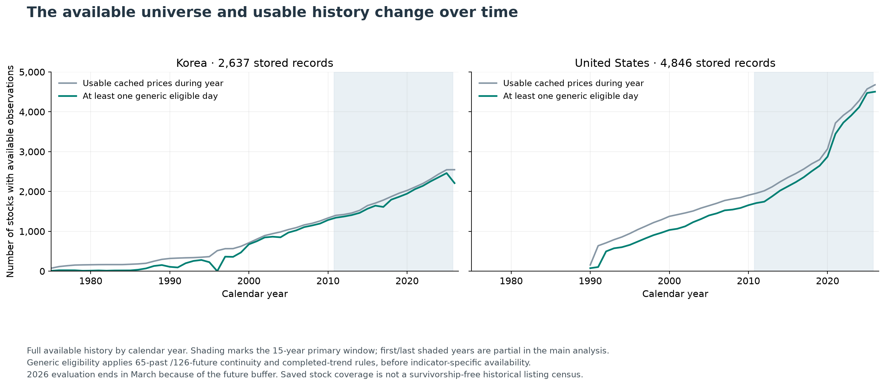
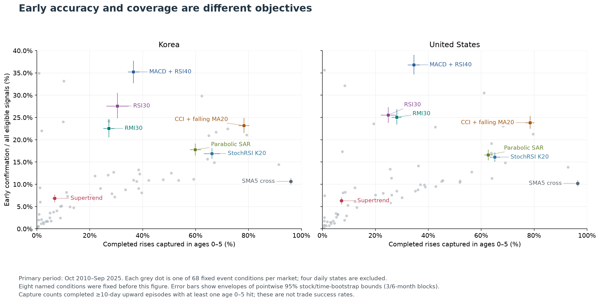
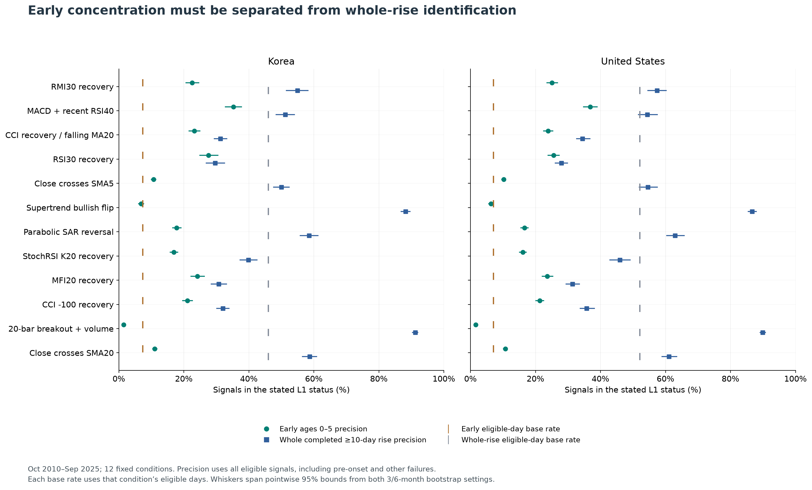
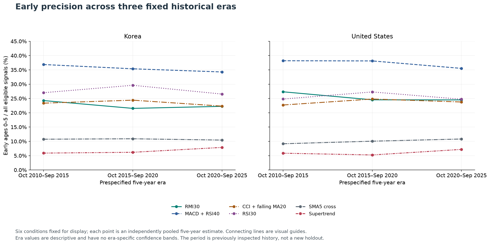
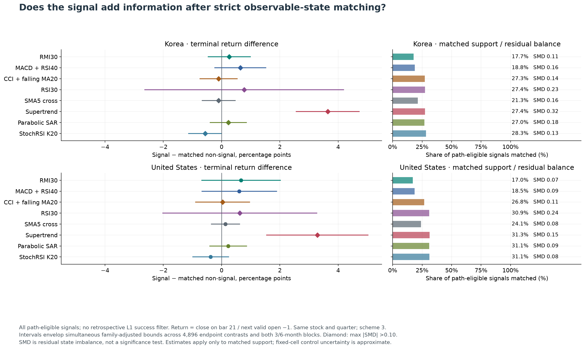
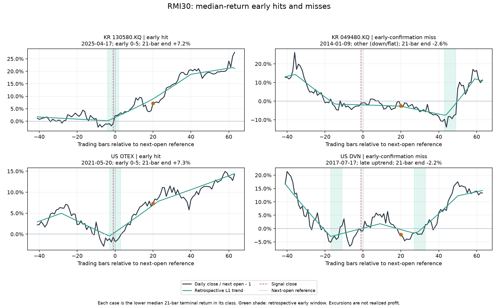
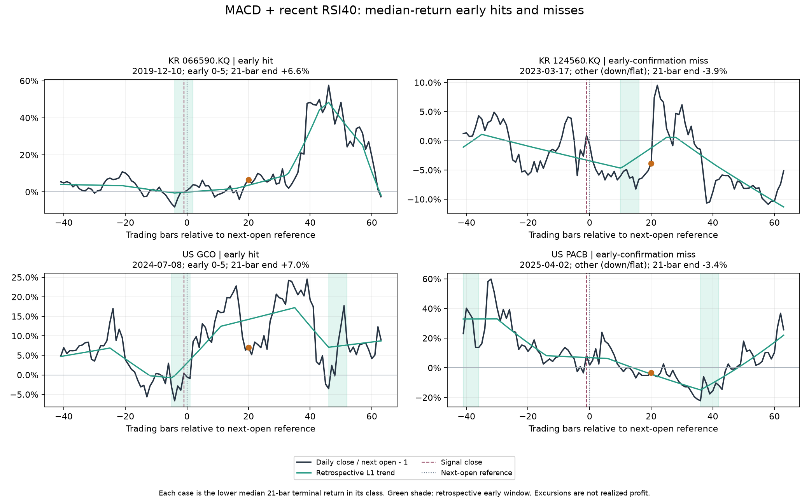
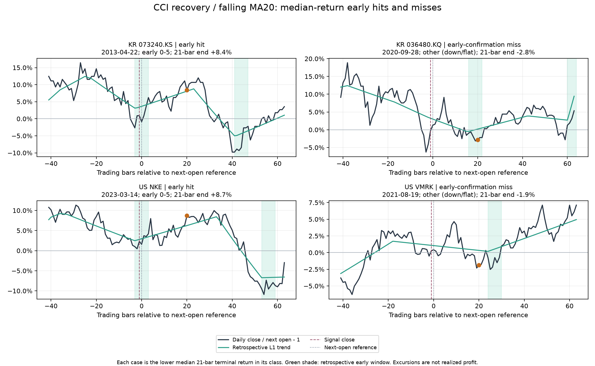
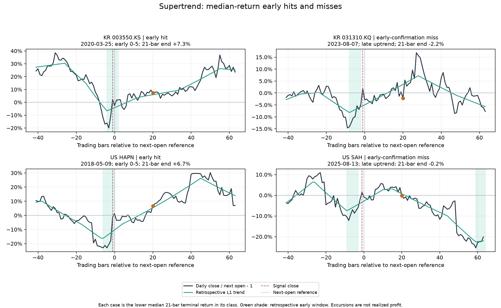

# Early uptrend confirmation across 15 years: Korea and the United States

Study UPTREND-LONGHISTORY-20261029 · report date 2026-10-29 · saved data through 2026-09-30 · research only.

## The question and the answer

**Which technical signals concentrate beyond ordinary recurring fluctuations on the first six trading days of an already-started rise?** This report measures recognition after onset, coverage of actual rises, confirmation delay and subsequent price paths as separate quantities. The common main window is **2010-10-01–2025-09-30**, a full 15 years. Short-history stocks enter from their earliest evaluable date; older available history is also evaluated descriptively.

The following fixed reference points show the main tradeoff without declaring a universal winner. Every percentage in this report uses its stated denominator.

| Market | Fixed reference | Early precision% [95%] | Episode capture% | Mean lag, bars | Missed episodes% | Already risen% |
| --- | --- | --- | --- | --- | --- | --- |
| KR | MACD cross + recent RSI40 | 35.2 [32.8, 37.7] | 36.5 | 3.73 | 63.5 | 7.7 |
| KR | MACD bullish cross with MACD < 0 | 29.8 [27.7, 32.0] | 62.3 | 3.68 | 37.7 | 6.6 |
| KR | CCI recovery / falling SMA20 | 23.2 [21.6, 24.9] | 78.3 | 1.97 | 21.7 | 4.1 |
| KR | RSI14 > 30 cross | 27.6 [24.9, 30.5] | 30.4 | 1.71 | 69.6 | 4.5 |
| KR | RMI20/5 > 30 cross | 22.5 [20.6, 24.6] | 27.2 | 3.92 | 72.8 | 7.8 |
| KR | Close > SMA5 cross | 10.7 [10.0, 11.3] | 96.0 | 1.94 | 4.0 | 3.6 |
| US | MACD cross + recent RSI40 | 36.8 [34.7, 39.0] | 34.5 | 3.74 | 65.5 | 8.1 |
| US | MACD bullish cross with MACD < 0 | 30.5 [28.9, 32.3] | 61.1 | 3.70 | 38.9 | 6.8 |
| US | CCI recovery / falling SMA20 | 23.8 [22.5, 25.3] | 78.5 | 1.92 | 21.5 | 4.3 |
| US | RSI14 > 30 cross | 25.6 [23.9, 27.3] | 24.9 | 1.80 | 75.1 | 5.4 |
| US | RMI20/5 > 30 cross | 25.1 [23.5, 26.8] | 28.0 | 3.79 | 72.0 | 8.3 |
| US | Close > SMA5 cross | 10.2 [9.6, 10.8] | 96.5 | 1.89 | 3.5 | 4.0 |

Read precision as “out of 100 historical alerts, this many occurred inside the specified early window.” Read capture as “out of 100 eligible completed rises, this many had an alert in their first six days.” These are different denominators. A more selective condition can recognize a larger proportion of its alerts correctly while missing more actual rises. Lag and already-risen amount describe the first successful early alert, not every alert.

**Practical reading of these historical results:** MACD plus recent RSI40 is a relatively selective confirmation clue, but roughly two-thirds of its alerts still miss this exact target and roughly two-thirds of eligible rises receive no such early alert. The MACD-below-zero anchor offers an intermediate accuracy/coverage tradeoff. CCI recovery against a falling 20-day average covers more starts and arrives earlier, with lower precision. RSI30 is another fast but narrower recovery clue. A close crossing SMA5 covers nearly every start by firing very often; its low precision makes the frequent-alert cost visible. The 11 additional events did not establish a replacement that improves this whole set of tradeoffs. The paired family-adjusted comparisons below qualify apparent small improvements.

An analogy for interpretation: a sensitive doorbell rings for most arrivals but also for many passers-by; a selective doorbell rings less often but misses visitors. A light showing that someone is already inside is a different instrument again. Here, precision, capture and whole-uptrend recognition measure these separate properties. None of them measures the profit from opening a position.

In **KR**, Supertrend's whole completed-uptrend precision is 88.2%, while its early precision is 6.8% and 81.4% of all alerts are late confirmations. TRIX-zero has whole-uptrend precision 77.6% and early precision 0.15%. Their usefulness for identifying an ongoing rise must therefore be evaluated separately from the six-day task.

In **US**, Supertrend's whole completed-uptrend precision is 86.7%, while its early precision is 6.3% and 80.4% of all alerts are late confirmations. TRIX-zero has whole-uptrend precision 80.1% and early precision 0.13%. Their usefulness for identifying an ongoing rise must therefore be evaluated separately from the six-day task.

The larger history is an **expanded retrospective reassessment**, not a new independent holdout. Some of these rules and years were examined previously. The study can identify historical accuracy/coverage/timing tradeoffs; it does not establish that buying after an alert earns a profit.

## Universe, dates and the meaning of “all stocks”

| Market | Stored inventory | Valid price/L1 caches | Primary eligible stocks | Raw span≥15y | Raw span<15y / empty | Generic eligible days | Raw date range |
| --- | --- | --- | --- | --- | --- | --- | --- |
| KR | 2,637 | 2,610 | 2,515 | 1,380 | 1,257 | 5,919,809 | 1975-01-04–2026-09-30 |
| US | 4,846 | 4,683 | 4,380 | 1,957 | 2,889 | 9,797,694 | 1990-01-02–2026-09-30 |

The combined research inventory attempts **all 7,483 stored histories**: the 2,604 KR and 4,843 US active saved-source names, plus 33 KR historical-only histories and 3 selected-chart ADR histories. All 57 previous operational exclusions were reconsidered for research;56 had usable caches, while NUTR had 38 valid bars and remained too short. Operational exclusion settings were preserved. A valid cache is not a guarantee that a stock contributes to every indicator, period or outcome.

“All stored” is a statement about the available archives, **not a point-in-time census of every stock listed in each historical year**. Earlier delistings and absent firms remain missing; survival and provider selection bias remain. There is no newly collected delisting-complete dataset. The per-stock coverage ledger identifies missing/too-short/no-long-segment histories and actual raw/eligible dates.

Primary eligibility needs 65 preceding and 126 following contiguous observations plus finite L1 information and a known completed state. Individual formulas may require longer warmups. Short histories are included when eligible. Stocks first available after the primary ending date can contribute to the full-history supplement if the maturity guard is met; they do not receive fabricated observations in the 15-year main window. KR generic evaluable history reaches 1975-03-25–2026-03-26; US reaches 1990-04-04–2026-03-31. The sparse early years do not represent the current breadth of either market.

Indicators use their full available preceding history, with no artificial 2010 reset. The inherited segmentation breaks at invalid/nonpositive price or volume observations, audited session gaps, or gaps exceeding 10 calendar days. This can also split a legitimate long holiday or suspension. Only 220 KR and 1,528 US stocks have a continuous generic evaluable run spanning 15 years; a 15-year market window is not 15 uninterrupted years per stock. The provider’s currently adjusted historical series is reused; historical corporate-action information is not reconstructed as it was known on every old date. Details and reconciled exclusions: [coverage-readme.md](uptrend-longhistory-2026-10-29/coverage-readme.md), [coverage-stocks.csv](uptrend-longhistory-2026-10-29/coverage-stocks.csv), [coverage-years.csv](uptrend-longhistory-2026-10-29/coverage-years.csv).

## Fixed target and signal definitions

The inherited L1 objective is `0.5 Σ(log(close)−x)² + 1 Σ|Δ²x|`. The slope attached to date t is `x[t+1]−x[t]`: **up > +1e−6; down < −1e−6; flat includes both boundaries**. Completed positive-edge runs need finite non-up boundaries before and after the run. Flats and gaps are not bridged. Duration counts positive trading edges. The main target is a completed rise of at least 10 edges; its early window is age 0 through 5 inclusive, six sessions.

L1 uses later observations and is an evaluation label only. No L1 state, eventual duration or future return is supplied to a signal or matching cell. Each causal event is timestamped at the close when its final requirement becomes known. The 4 maintained states count qualifying days and are shown separately from new events.

The frozen union contains 72 conditions per market:47 original standalone events,4 fixed anchors,6 previously selected followups,4 states and 11 additional events. KR followups use RSI30/MFI20; US uses RSI30/CCI−100. No new candidate selection or parameter grid was run. Exact formulas for all conditions are in [the condition catalog](uptrend-longhistory-2026-10-29/conditions.md) and [conditions.csv](uptrend-longhistory-2026-10-29/conditions.csv).

| Displayed condition | Exact fixed rule |
| --- | --- |
| Close > SMA5 cross | C crosses above SMA5 |
| Close > SMA20 cross | C crosses above SMA20 |
| RSI14 > 30 cross | Wilder RSI14 crosses above 30 |
| CCI20 > -100 cross | (TP-SMA20(TP))/(.015*mean absolute deviation20) crosses above -100 |
| CCI recovery / falling SMA20 | cci-100 AND SMA20[t]<SMA20[t-5] |
| MACD cross + recent RSI40 | macd_signal AND rsi40 crossed upward on t,t-1 or t-2 |
| MACD bullish cross with MACD < 0 | macd_signal AND MACD<0 |
| Supertrend bullish flip | Wilder ATR10 * 3 trailing bands; down-to-up flip at close |
| Parabolic SAR bullish reversal | PSAR start=.02, increment=.02, max=.20; bearish-to-bullish direction reversal |
| TRIX18 > 0 cross | 1-bar percent change of triple EMA18 crosses above0 |
| TRIX18 > signal cross | TRIX18 crosses above its EMA9 |
| StochRSI K > 20 cross | RSI14, range14, SMA3 K: K crosses20; flat range unknown |
| StochRSI low K/D cross | K crosses SMA3(K) and previous K<=20 |
| RMI20/5 > 30 cross | Wilder20 smoothed 5-day changes: RMI crosses above30 |
| RMI20/5 > 50 cross | Wilder20 smoothed 5-day changes: RMI crosses above50 |
| Chaikin3/10 > 0 cross | EMA3(ADL)-EMA10(ADL) crosses0; H=L contribution0 |
| Quarter daily AVWAP cross | C crosses sum(TP*V)/sum(V) since calendar quarter/segment start; at least 5 previous anchor bars |
| Volume oscillator + up day | SMA5(V)/SMA20(V)-1 crosses0 AND C>previous C |

Upward cross means `a−b > tol` now and prior `a−b ≤ prior tol`, with both dates finite and `tol=1e−12×max(abs(a),abs(b))`; simple maintained states use their stated strict inequalities. RSI is Wilder14; CCI uses typical price,20-bar mean absolute deviation and factor 0.015; MACD uses EMA12−EMA26 and EMA9 signal. The quarter AVWAP is a daily typical-price proxy, not intraday VWAP. Formula initialization may differ from a charting platform. Some candle/jump events are explicitly every qualifying day, rather than first transitions. Source evidence and deferred indicators remain documented in [literature-refresh.md](uptrend-longhistory-2026-10-29/literature-refresh.md).

## Accuracy, concentration, coverage and timing

Every evaluable alert is in the precision denominator, including alerts before an eventual onset. Early precision is compared with the early-day base rate among that condition’s eligible dates. Lift is precision/base. Episode capture requires the entire specified early window to be observable and counts at most one first alert per episode. A boundary alert can enter precision even when the entire episode window is unavailable for capture. Frequency is 252× alerts/feature-known eligible stock-sessions; it is a normalized rate, not a calendar-year forecast for a stock with sparse or gapped history. Eligibility can differ by formula, particularly longer moving averages and volume indicators.

Brackets envelope the marginal95% bootstrap intervals from 3- and 6-month blocks. The envelope is a conservative presentation of two specifications, not a separately calibrated joint95% interval. A precision interval is not a family-adjusted difference test. Family-adjusted early-minus-base and paired contrasts are retained in the CSVs.

### KR: first-six-day confirmation

| Signal | All-alert N | Early% [95%] | Early base% | Lift | Capture% [95%] | Alerts /252 days |
| --- | --- | --- | --- | --- | --- | --- |
| Close > SMA5 cross | 766,754 | 10.7 [10.0, 11.3] | 7.3 | 1.45× | 96.0 [95.6, 96.4] | 32.64 |
| Close > SMA20 cross | 333,177 | 11.0 [10.4, 11.7] | 7.3 | 1.50× | 47.7 [44.9, 50.4] | 14.18 |
| RSI14 > 30 cross | 84,531 | 27.6 [24.9, 30.5] | 7.3 | 3.76× | 30.4 [26.4, 34.6] | 3.60 |
| CCI20 > -100 cross | 292,203 | 21.1 [19.6, 22.6] | 7.3 | 2.87× | 79.4 [77.5, 81.1] | 12.44 |
| CCI recovery / falling SMA20 | 261,577 | 23.2 [21.6, 24.9] | 7.3 | 3.16× | 78.3 [76.3, 80.1] | 11.14 |
| MACD cross + recent RSI40 | 75,186 | 35.2 [32.8, 37.7] | 7.3 | 4.81× | 36.5 [34.4, 38.5] | 3.20 |
| MACD bullish cross with MACD < 0 | 152,639 | 29.8 [27.7, 32.0] | 7.3 | 4.07× | 62.3 [60.2, 64.3] | 6.50 |
| Supertrend bullish flip | 71,097 | 6.8 [6.1, 7.6] | 7.3 | 0.93× | 6.7 [5.9, 7.6] | 3.03 |
| Parabolic SAR bullish reversal | 245,198 | 17.8 [16.5, 19.1] | 7.3 | 2.43× | 59.8 [57.9, 61.9] | 10.44 |
| TRIX18 > 0 cross | 61,462 | 0.2 [0.1, 0.2] | 7.3 | 0.02× | 0.1 [0.1, 0.2] | 2.62 |
| TRIX18 > signal cross | 121,611 | 3.8 [3.3, 4.2] | 7.3 | 0.51× | 6.3 [5.5, 7.1] | 5.18 |
| StochRSI K > 20 cross | 287,933 | 16.9 [15.8, 18.1] | 7.3 | 2.31× | 66.2 [63.1, 69.1] | 12.26 |
| StochRSI low K/D cross | 367,632 | 10.9 [10.2, 11.7] | 7.3 | 1.48× | 53.6 [51.2, 55.7] | 15.65 |
| RMI20/5 > 30 cross | 88,061 | 22.5 [20.6, 24.6] | 7.3 | 3.07× | 27.2 [25.2, 29.2] | 3.75 |
| RMI20/5 > 50 cross | 128,730 | 5.1 [4.3, 5.8] | 7.3 | 0.69× | 8.9 [7.5, 10.4] | 5.48 |
| Chaikin3/10 > 0 cross | 250,671 | 10.9 [10.2, 11.7] | 7.3 | 1.49× | 36.5 [35.0, 38.1] | 10.67 |
| Quarter daily AVWAP cross | 272,599 | 7.9 [7.0, 9.0] | 7.2 | 1.10× | 28.4 [24.7, 32.6] | 12.61 |
| Volume oscillator + up day | 197,323 | 9.1 [8.6, 9.7] | 7.3 | 1.24× | 24.0 [23.1, 25.1] | 8.40 |

| Signal | Mean first-hit lag [95%] | Median lag | Onset close→next open% [95%] | Day0% of alerts | Days1–5% | Late% |
| --- | --- | --- | --- | --- | --- | --- |
| Close > SMA5 cross | 1.94 [1.90, 1.97] | 2 | 3.6 [3.2, 4.2] | 0.9 | 9.8 | 39.3 |
| Close > SMA20 cross | 3.76 [3.73, 3.80] | 4 | 8.2 [7.6, 8.8] | 0.0 | 11.0 | 47.7 |
| RSI14 > 30 cross | 1.71 [1.62, 1.82] | 1 | 4.5 [3.4, 6.2] | 4.1 | 23.5 | 2.0 |
| CCI20 > -100 cross | 1.96 [1.91, 2.02] | 2 | 4.1 [3.5, 4.9] | 1.9 | 19.1 | 10.9 |
| CCI recovery / falling SMA20 | 1.97 [1.92, 2.03] | 2 | 4.1 [3.5, 4.9] | 2.1 | 21.1 | 8.1 |
| MACD cross + recent RSI40 | 3.73 [3.66, 3.80] | 4 | 7.7 [6.9, 8.9] | 0.1 | 35.1 | 15.9 |
| MACD bullish cross with MACD < 0 | 3.68 [3.60, 3.76] | 4 | 6.6 [5.8, 7.6] | 0.3 | 29.6 | 19.2 |
| Supertrend bullish flip | 4.31 [4.26, 4.36] | 5 | 18.3 [16.8, 20.2] | 0.0 | 6.8 | 81.4 |
| Parabolic SAR bullish reversal | 3.33 [3.28, 3.37] | 3 | 7.1 [6.3, 8.2] | 0.4 | 17.4 | 40.7 |
| TRIX18 > 0 cross | 4.71 [4.50, 4.88] | 5 | 22.0 [15.1, 30.7] | 0.0 | 0.2 | 77.5 |
| TRIX18 > signal cross | 3.96 [3.86, 4.05] | 4 | 6.5 [5.9, 7.3] | 0.1 | 3.6 | 66.7 |
| StochRSI K > 20 cross | 2.08 [2.03, 2.14] | 2 | 4.4 [3.9, 5.0] | 1.6 | 15.3 | 22.9 |
| StochRSI low K/D cross | 1.46 [1.40, 1.52] | 1 | 2.5 [2.3, 2.7] | 2.4 | 8.4 | 19.3 |
| RMI20/5 > 30 cross | 3.92 [3.86, 3.98] | 4 | 7.8 [7.1, 8.5] | 0.3 | 22.2 | 32.4 |
| RMI20/5 > 50 cross | 4.07 [4.01, 4.13] | 4 | 9.6 [8.8, 10.5] | 0.1 | 5.0 | 68.9 |
| Chaikin3/10 > 0 cross | 3.22 [3.17, 3.27] | 3 | 7.3 [6.4, 8.4] | 0.5 | 10.4 | 48.9 |
| Quarter daily AVWAP cross | 3.25 [3.13, 3.36] | 3 | 8.2 [7.6, 8.8] | 0.2 | 7.8 | 54.5 |
| Volume oscillator + up day | 3.11 [3.05, 3.17] | 3 | 7.1 [6.7, 7.6] | 0.5 | 8.6 | 57.9 |

### US: first-six-day confirmation

| Signal | All-alert N | Early% [95%] | Early base% | Lift | Capture% [95%] | Alerts /252 days |
| --- | --- | --- | --- | --- | --- | --- |
| Close > SMA5 cross | 1,322,274 | 10.2 [9.6, 10.8] | 7.0 | 1.45× | 96.5 [96.0, 96.9] | 34.01 |
| Close > SMA20 cross | 603,225 | 10.7 [10.1, 11.4] | 7.0 | 1.53× | 52.0 [49.9, 54.0] | 15.52 |
| RSI14 > 30 cross | 120,281 | 25.6 [23.9, 27.3] | 7.0 | 3.64× | 24.9 [22.1, 27.7] | 3.09 |
| CCI20 > -100 cross | 464,614 | 21.3 [20.1, 22.5] | 7.0 | 3.03× | 79.6 [78.1, 81.0] | 11.95 |
| CCI recovery / falling SMA20 | 408,564 | 23.8 [22.5, 25.3] | 7.0 | 3.39× | 78.5 [76.9, 80.0] | 10.51 |
| MACD cross + recent RSI40 | 108,084 | 36.8 [34.7, 39.0] | 7.0 | 5.24× | 34.5 [32.3, 36.6] | 2.78 |
| MACD bullish cross with MACD < 0 | 232,971 | 30.5 [28.9, 32.3] | 7.0 | 4.34× | 61.1 [58.7, 63.3] | 5.99 |
| Supertrend bullish flip | 131,151 | 6.3 [5.6, 7.0] | 7.0 | 0.90× | 7.2 [6.4, 8.0] | 3.37 |
| Parabolic SAR bullish reversal | 437,592 | 16.6 [15.5, 17.7] | 7.0 | 2.36× | 62.6 [61.2, 64.2] | 11.26 |
| TRIX18 > 0 cross | 98,559 | 0.1 [0.1, 0.2] | 7.0 | 0.02× | 0.1 [0.1, 0.2] | 2.53 |
| TRIX18 > signal cross | 204,223 | 3.3 [2.8, 3.8] | 7.0 | 0.47× | 5.8 [5.0, 6.6] | 5.25 |
| StochRSI K > 20 cross | 471,929 | 16.1 [15.1, 17.1] | 7.0 | 2.29× | 65.1 [63.3, 67.0] | 12.14 |
| StochRSI low K/D cross | 588,246 | 10.5 [9.7, 11.1] | 7.0 | 1.49× | 52.0 [50.3, 53.6] | 15.13 |
| RMI20/5 > 30 cross | 129,792 | 25.1 [23.5, 26.8] | 7.0 | 3.57× | 28.0 [26.3, 29.7] | 3.34 |
| RMI20/5 > 50 cross | 210,584 | 5.3 [4.6, 6.1] | 7.0 | 0.75× | 9.6 [8.3, 11.1] | 5.42 |
| Chaikin3/10 > 0 cross | 505,033 | 10.8 [10.2, 11.5] | 7.0 | 1.54× | 45.5 [44.1, 46.9] | 12.99 |
| Quarter daily AVWAP cross | 467,354 | 9.9 [8.8, 11.1] | 6.9 | 1.43× | 38.5 [34.9, 42.4] | 13.05 |
| Volume oscillator + up day | 314,006 | 7.6 [7.1, 8.1] | 7.0 | 1.08× | 20.0 [19.1, 21.0] | 8.08 |

| Signal | Mean first-hit lag [95%] | Median lag | Onset close→next open% [95%] | Day0% of alerts | Days1–5% | Late% |
| --- | --- | --- | --- | --- | --- | --- |
| Close > SMA5 cross | 1.89 [1.86, 1.92] | 2 | 4.0 [3.3, 4.6] | 0.8 | 9.4 | 44.4 |
| Close > SMA20 cross | 3.70 [3.66, 3.73] | 4 | 8.6 [7.6, 9.6] | 0.0 | 10.7 | 50.3 |
| RSI14 > 30 cross | 1.80 [1.74, 1.86] | 2 | 5.4 [4.1, 7.1] | 3.5 | 22.0 | 2.4 |
| CCI20 > -100 cross | 1.91 [1.88, 1.95] | 2 | 4.4 [3.7, 5.0] | 2.1 | 19.2 | 14.5 |
| CCI recovery / falling SMA20 | 1.92 [1.89, 1.96] | 2 | 4.3 [3.7, 5.0] | 2.3 | 21.5 | 10.6 |
| MACD cross + recent RSI40 | 3.74 [3.69, 3.80] | 4 | 8.1 [7.0, 9.3] | 0.1 | 36.7 | 17.6 |
| MACD bullish cross with MACD < 0 | 3.70 [3.65, 3.76] | 4 | 6.8 [5.9, 7.8] | 0.3 | 30.2 | 21.6 |
| Supertrend bullish flip | 4.31 [4.27, 4.35] | 5 | 19.5 [16.5, 22.4] | 0.0 | 6.3 | 80.4 |
| Parabolic SAR bullish reversal | 3.37 [3.33, 3.41] | 4 | 7.5 [6.4, 8.6] | 0.3 | 16.2 | 46.4 |
| TRIX18 > 0 cross | 4.38 [3.95, 4.69] | 5 | 54.0 [23.0, 94.0] | 0.0 | 0.1 | 80.0 |
| TRIX18 > signal cross | 3.99 [3.93, 4.05] | 4 | 10.9 [8.5, 14.1] | 0.1 | 3.2 | 70.5 |
| StochRSI K > 20 cross | 2.12 [2.07, 2.18] | 2 | 4.9 [4.2, 5.5] | 1.5 | 14.6 | 29.8 |
| StochRSI low K/D cross | 1.48 [1.44, 1.51] | 1 | 3.2 [2.7, 3.7] | 2.2 | 8.2 | 25.8 |
| RMI20/5 > 30 cross | 3.79 [3.74, 3.84] | 4 | 8.3 [7.2, 9.4] | 0.4 | 24.7 | 32.3 |
| RMI20/5 > 50 cross | 4.12 [4.08, 4.17] | 5 | 10.4 [8.6, 12.3] | 0.1 | 5.2 | 68.5 |
| Chaikin3/10 > 0 cross | 2.99 [2.93, 3.04] | 3 | 6.5 [5.6, 7.4] | 0.7 | 10.2 | 47.9 |
| Quarter daily AVWAP cross | 3.21 [3.10, 3.30] | 3 | 8.3 [7.3, 9.2] | 0.2 | 9.7 | 51.1 |
| Volume oscillator + up day | 2.78 [2.72, 2.84] | 3 | 6.8 [5.6, 7.9] | 0.6 | 7.0 | 57.6 |

Already risen uses the next open after the **first successful early signal**, divided by the retrospectively identified onset close minus1. It is a timing cost, not a trade return. Rare early hits can have unstable conditional timing estimates. A low-frequency signal earns no preference merely for being rare. Every omitted main-table condition remains available in [primary-summary.csv](uptrend-longhistory-2026-10-29/primary-summary.csv).

| Market | Fixed paired comparison | Metric | Difference pp [family-adjusted envelope] |
| --- | --- | --- | --- |
| KR | RMI20/5 > 30 cross minus MACD cross + recent RSI40 | precision | -12.69 [-15.91, -9.47] |
| KR | RMI20/5 > 30 cross minus MACD cross + recent RSI40 | capture | -9.29 [-11.65, -6.93] |
| KR | Parabolic SAR bullish reversal minus CCI recovery / falling SMA20 | precision | -5.40 [-6.95, -3.85] |
| KR | Parabolic SAR bullish reversal minus CCI recovery / falling SMA20 | capture | -18.43 [-21.28, -15.57] |
| KR | StochRSI K > 20 cross minus CCI recovery / falling SMA20 | precision | -6.28 [-7.64, -4.92] |
| KR | StochRSI K > 20 cross minus CCI recovery / falling SMA20 | capture | -12.10 [-16.69, -7.51] |
| US | RMI20/5 > 30 cross minus MACD cross + recent RSI40 | precision | -11.73 [-14.37, -9.09] |
| US | RMI20/5 > 30 cross minus MACD cross + recent RSI40 | capture | -6.45 [-8.63, -4.27] |
| US | Parabolic SAR bullish reversal minus CCI recovery / falling SMA20 | precision | -7.26 [-9.16, -5.35] |
| US | Parabolic SAR bullish reversal minus CCI recovery / falling SMA20 | capture | -15.86 [-17.94, -13.79] |
| US | StochRSI K > 20 cross minus CCI recovery / falling SMA20 | precision | -7.73 [-9.57, -5.88] |
| US | StochRSI K > 20 cross minus CCI recovery / falling SMA20 | capture | -13.39 [-17.36, -9.43] |

These paired intervals use common draws for correlated signals. They are the appropriate comparison evidence; separate pointwise interval overlap is not a test of their difference. All 11 new signals against all 5benchmarks remain in [paired-benchmarks.csv](uptrend-longhistory-2026-10-29/paired-benchmarks.csv).

### Whole-uptrend recognition is a separate question

| Signal | KR whole≥10 up% / base% | US whole≥10 up% / base% | Whole lift KR / US | Early / down-flat event rate KR / US |
| --- | --- | --- | --- | --- |
| Close > SMA5 cross | 50.0 / 46.0 | 54.6 / 52.1 | 1.09 / 1.05 | 1.57 / 1.53 |
| Close > SMA20 cross | 58.7 / 46.0 | 61.1 / 52.1 | 1.28 / 1.17 | 1.97 / 1.89 |
| RSI14 > 30 cross | 29.6 / 46.0 | 28.0 / 52.1 | 0.64 / 0.54 | 2.89 / 2.43 |
| CCI20 > -100 cross | 32.0 / 46.0 | 35.8 / 52.1 | 0.70 / 0.69 | 2.28 / 2.26 |
| CCI recovery / falling SMA20 | 31.3 / 46.0 | 34.5 / 52.1 | 0.68 / 0.66 | 2.49 / 2.49 |
| MACD cross + recent RSI40 | 51.2 / 46.0 | 54.4 / 52.1 | 1.11 / 1.04 | 5.35 / 5.57 |
| MACD bullish cross with MACD < 0 | 49.1 / 46.0 | 52.0 / 52.1 | 1.07 / 1.00 | 4.32 / 4.36 |
| Supertrend bullish flip | 88.2 / 46.0 | 86.7 / 52.1 | 1.92 / 1.66 | 4.50 / 3.42 |
| Parabolic SAR bullish reversal | 58.5 / 46.0 | 62.9 / 52.1 | 1.27 / 1.21 | 3.17 / 3.07 |
| TRIX18 > 0 cross | 77.6 / 46.0 | 80.1 / 52.1 | 1.69 / 1.54 | 0.05 / 0.05 |
| TRIX18 > signal cross | 70.5 / 46.0 | 73.7 / 52.1 | 1.53 / 1.42 | 0.94 / 0.86 |
| StochRSI K > 20 cross | 39.8 / 46.0 | 45.9 / 52.1 | 0.87 / 0.88 | 2.07 / 2.04 |
| StochRSI low K/D cross | 30.1 / 46.0 | 36.3 / 52.1 | 0.65 / 0.70 | 1.15 / 1.12 |
| RMI20/5 > 30 cross | 54.9 / 46.0 | 57.4 / 52.1 | 1.19 / 1.10 | 3.70 / 4.07 |
| RMI20/5 > 50 cross | 73.9 / 46.0 | 73.8 / 52.1 | 1.61 / 1.42 | 1.44 / 1.39 |
| Chaikin3/10 > 0 cross | 59.9 / 46.0 | 58.7 / 52.1 | 1.30 / 1.13 | 2.01 / 1.80 |
| Quarter daily AVWAP cross | 62.4 / 45.7 | 61.0 / 51.9 | 1.36 / 1.17 | 1.59 / 1.77 |
| Volume oscillator + up day | 67.0 / 46.0 | 65.2 / 52.1 | 1.46 / 1.25 | 2.03 / 1.49 |

Whole precision counts both early and late dates in completed≥10-day rises. Its base rate is much larger than the early-window base. The early/down-flat event-rate ratio compares signal incidence within those two states and omits late and short rises; it cannot replace all-alert precision. Whole-up-any-duration rates are also saved in [base-rates.csv](uptrend-longhistory-2026-10-29/base-rates.csv).

| Market | Signal | Day0% | Days1–5% | Late% | Short<10% | Other% | Before onset5% |
| --- | --- | --- | --- | --- | --- | --- | --- |
| KR | RMI20/5 > 30 cross | 0.3 | 22.2 | 32.4 | 0.3 | 44.8 | 3.7 |
| KR | MACD cross + recent RSI40 | 0.1 | 35.1 | 15.9 | 0.4 | 48.4 | 3.9 |
| KR | MACD bullish cross with MACD < 0 | 0.3 | 29.6 | 19.2 | 0.2 | 50.7 | 4.5 |
| KR | CCI recovery / falling SMA20 | 2.1 | 21.1 | 8.1 | 0.2 | 68.6 | 9.6 |
| KR | RSI14 > 30 cross | 4.1 | 23.5 | 2.0 | 0.3 | 70.1 | 13.4 |
| KR | Parabolic SAR bullish reversal | 0.4 | 17.4 | 40.7 | 0.2 | 41.3 | 3.5 |
| KR | StochRSI K > 20 cross | 1.6 | 15.3 | 22.9 | 0.1 | 60.0 | 7.3 |
| KR | Supertrend bullish flip | 0.0 | 6.8 | 81.4 | 0.6 | 11.2 | 0.2 |
| KR | TRIX18 > 0 cross | 0.0 | 0.2 | 77.5 | 0.1 | 22.2 | 0.1 |
| US | RMI20/5 > 30 cross | 0.4 | 24.7 | 32.3 | 0.7 | 41.9 | 4.1 |
| US | MACD cross + recent RSI40 | 0.1 | 36.7 | 17.6 | 0.7 | 45.0 | 4.2 |
| US | MACD bullish cross with MACD < 0 | 0.3 | 30.2 | 21.6 | 0.4 | 47.5 | 4.6 |
| US | CCI recovery / falling SMA20 | 2.3 | 21.5 | 10.6 | 0.3 | 65.2 | 10.5 |
| US | RSI14 > 30 cross | 3.5 | 22.0 | 2.4 | 0.6 | 71.4 | 15.3 |
| US | Parabolic SAR bullish reversal | 0.3 | 16.2 | 46.4 | 0.3 | 36.7 | 3.2 |
| US | StochRSI K > 20 cross | 1.5 | 14.6 | 29.8 | 0.3 | 53.8 | 7.3 |
| US | Supertrend bullish flip | 0.0 | 6.3 | 80.4 | 0.8 | 12.5 | 0.2 |
| US | TRIX18 > 0 cross | 0.0 | 0.1 | 80.0 | 0.1 | 19.7 | 0.2 |

The first five outcome columns partition100% of alerts before rounding. Before-onset5 is a subset of other, remains a failure for this purpose, and stays in the denominator. An early-confirmation miss can still precede a price gain; it missed this specified label and timing window. “Most alerts miss the exact early label” does not mean “most trades lose money.”

### How far had prices moved at the first successful confirmation?

The mean timing cost can be pulled upward by rare jumps. This descriptive supplement reports the median and tails of `first captured signal next open / retrospective onset close − 1`. Each eligible episode contributes one first alert. Raw prices can fluctuate inside a positive fitted trend, so a negative timing value is possible.

| Market | Signal | Captured episodes | Mean% | Median% | P25 / P75% | P5 / P95% |
| --- | --- | --- | --- | --- | --- | --- |
| KR | MACD cross + recent RSI40 | 26,217 | 7.7 | 5.7 | 3.1 / 9.8 | 0.7 / 21.4 |
| KR | MACD bullish cross with MACD < 0 | 44,863 | 6.6 | 4.8 | 2.4 / 8.5 | 0.1 / 19.0 |
| KR | CCI recovery / falling SMA20 | 56,348 | 4.1 | 2.8 | 0.9 / 5.6 | -0.9 / 13.5 |
| KR | RSI14 > 30 cross | 21,906 | 4.5 | 2.9 | 0.8 / 6.0 | -1.3 / 16.3 |
| KR | RMI20/5 > 30 cross | 19,579 | 7.8 | 5.8 | 3.0 / 9.9 | 0.5 / 21.6 |
| KR | TRIX18 > 0 cross | 93 | 22.0 | 13.2 | 7.3 / 27.4 | 2.5 / 74.8 |
| US | MACD cross + recent RSI40 | 39,456 | 8.1 | 5.5 | 3.0 / 10.0 | 0.7 / 23.5 |
| US | MACD bullish cross with MACD < 0 | 69,935 | 6.8 | 4.7 | 2.3 / 8.6 | 0.1 / 20.3 |
| US | CCI recovery / falling SMA20 | 89,849 | 4.3 | 2.7 | 0.8 / 5.6 | -1.0 / 14.6 |
| US | RSI14 > 30 cross | 28,465 | 5.4 | 2.9 | 0.8 / 6.5 | -1.3 / 18.9 |
| US | RMI20/5 > 30 cross | 32,102 | 8.3 | 5.4 | 2.8 / 9.9 | 0.3 / 24.2 |
| US | TRIX18 > 0 cross | 130 | 54.0 | 18.6 | 5.3 / 48.2 | 1.5 / 266.9 |

For example, the US TRIX-zero mean timing rise is 54.0%, but the median is 18.6% across only 130captured episodes. Its upper tail includes an883.6% maximum. The trace ledger identifies the original symbols/dates/prices without removing observations. The quantile appendix was added after aggregate means exposed this skew; it is an explicitly descriptive supplement, not a changed hypothesis, target or candidate selection. No trimming or winsorization changes the main results. See [first-confirmation-distributions.csv](uptrend-longhistory-2026-10-29/first-confirmation-distributions.csv), [first-confirmation-extremes.csv](uptrend-longhistory-2026-10-29/first-confirmation-extremes.csv) and [distributions-readme.md](uptrend-longhistory-2026-10-29/distributions-readme.md).

## Standalone signals, simultaneous filters and delayed confirmation

The original six followups per market are repeated unchanged. No new combination was selected on the expanded history. Each row must be assessed with its loss of episode coverage and its confirmation delay.

| Market | Condition | N | Early% | Capture% | Mean lag | Already risen% | Frequency |
| --- | --- | --- | --- | --- | --- | --- | --- |
| KR | RSI14 > 30 cross | 84,531 | 27.6 | 30.4 | 1.71 | 4.5 | 3.60 |
| KR | RSI14 > 30 cross + same-day > SMA20 | 1,641 | 34.9 | 0.8 | 3.54 | 14.4 | 0.07 |
| KR | RSI14 > 30 cross + SMA20 cross by +5 | 22,258 | 33.2 | 10.2 | 4.14 | 12.2 | 0.95 |
| KR | RSI14 > 30 cross + 3 closes > SMA20 by +5 | 9,197 | 9.2 | 1.2 | 4.73 | 14.4 | 0.39 |
| KR | MFI14 > 20 cross | 86,087 | 24.2 | 27.2 | 2.25 | 4.2 | 3.66 |
| KR | MFI14 > 20 cross + same-day > SMA20 | 6,071 | 22.0 | 1.8 | 3.78 | 10.2 | 0.26 |
| KR | MFI14 > 20 cross + SMA20 cross by +5 | 29,942 | 24.0 | 10.0 | 4.08 | 9.7 | 1.27 |
| KR | MFI14 > 20 cross + 3 closes > SMA20 by +5 | 14,743 | 6.0 | 1.2 | 4.68 | 10.1 | 0.63 |
| US | RSI14 > 30 cross | 120,281 | 25.6 | 24.9 | 1.80 | 5.4 | 3.09 |
| US | RSI14 > 30 cross + same-day > SMA20 | 2,296 | 35.6 | 0.7 | 3.52 | 23.6 | 0.06 |
| US | RSI14 > 30 cross + SMA20 cross by +5 | 29,996 | 32.1 | 8.4 | 4.17 | 14.4 | 0.77 |
| US | RSI14 > 30 cross + 3 closes > SMA20 by +5 | 11,755 | 7.5 | 0.8 | 4.80 | 22.7 | 0.30 |
| US | CCI20 > -100 cross | 464,614 | 21.3 | 79.6 | 1.91 | 4.4 | 11.95 |
| US | CCI20 > -100 cross + same-day > SMA20 | 50,112 | 17.3 | 7.5 | 3.04 | 10.1 | 1.29 |
| US | CCI20 > -100 cross + SMA20 cross by +5 | 214,829 | 22.8 | 42.7 | 3.76 | 9.2 | 5.53 |
| US | CCI20 > -100 cross + 3 closes > SMA20 by +5 | 110,281 | 8.1 | 7.8 | 4.61 | 11.6 | 2.84 |

“Same day” adds close>SMA20to the base event. “By+5” waits for the first actual upward SMA20cross from base day through base+5. “3closes” waits for three consecutive closes above SMA20, beginning at/after the base and completing by+5. They trigger on completion, not retrospectively on the original base date.

| Market | Maintained state | Early% | Whole≥10 up% | Capture% | Qualifying days /252 |
| --- | --- | --- | --- | --- | --- |
| KR | State: close > SMA5 | 9.3 | 61.9 | 98.9 | 118.74 |
| KR | State: close > SMA20 | 2.4 | 69.8 | 47.8 | 117.21 |
| KR | State: MACD > signal | 4.6 | 64.6 | 72.3 | 127.91 |
| KR | State: MACD > signal and RSI > 40 | 3.7 | 67.3 | 63.5 | 118.07 |
| US | State: close > SMA5 | 8.3 | 66.9 | 99.3 | 127.64 |
| US | State: close > SMA20 | 2.2 | 73.9 | 52.0 | 129.56 |
| US | State: MACD > signal | 4.3 | 68.8 | 71.4 | 128.90 |
| US | State: MACD > signal and RSI > 40 | 3.5 | 71.7 | 64.3 | 119.87 |

These state rows answer how informative a condition is while it remains true. Their high frequency can repeat essentially the same episode; it must not be read as a stream of independent new crossings.

## Stability across three fixed five-year eras

Each cell reports early precision / episode capture. Periods were fixed before inspecting the expanded results. These are descriptive slices, not three independent validation experiments. Changes in market regime and the stock universe can both change a pooled percentage.

| Market | Signal | 2010-10..2015-09 precision% / capture% | 2015-10..2020-09 precision% / capture% | 2020-10..2025-09 precision% / capture% |
| --- | --- | --- | --- | --- |
| KR | RMI20/5 > 30 cross | 24.3 / 26.9 | 21.5 / 25.6 | 22.2 / 28.5 |
| KR | MACD cross + recent RSI40 | 36.9 / 34.6 | 35.4 / 35.6 | 34.3 / 38.4 |
| KR | MACD bullish cross with MACD < 0 | 30.8 / 60.8 | 30.3 / 61.2 | 29.0 / 64.1 |
| KR | CCI recovery / falling SMA20 | 23.4 / 75.4 | 24.4 / 80.0 | 22.3 / 78.9 |
| KR | RSI14 > 30 cross | 27.0 / 25.7 | 29.6 / 33.2 | 26.5 / 31.5 |
| KR | Parabolic SAR bullish reversal | 17.3 / 57.9 | 18.6 / 61.2 | 17.6 / 60.1 |
| KR | StochRSI K > 20 cross | 16.6 / 64.3 | 17.8 / 69.0 | 16.5 / 65.5 |
| KR | Supertrend bullish flip | 5.9 / 5.5 | 6.2 / 6.1 | 7.9 / 8.0 |
| KR | TRIX18 > 0 cross | 0.2 / 0.1 | 0.1 / 0.1 | 0.2 / 0.1 |
| US | RMI20/5 > 30 cross | 27.3 / 30.3 | 24.5 / 26.6 | 24.5 / 27.9 |
| US | MACD cross + recent RSI40 | 38.2 / 37.1 | 38.1 / 33.0 | 35.5 / 34.3 |
| US | MACD bullish cross with MACD < 0 | 31.7 / 65.7 | 31.3 / 60.2 | 29.5 / 59.7 |
| US | CCI recovery / falling SMA20 | 22.7 / 78.8 | 24.8 / 78.2 | 23.8 / 78.5 |
| US | RSI14 > 30 cross | 24.8 / 23.3 | 27.3 / 27.9 | 24.7 / 23.7 |
| US | Parabolic SAR bullish reversal | 15.0 / 63.8 | 16.4 / 62.3 | 17.5 / 62.3 |
| US | StochRSI K > 20 cross | 14.0 / 63.6 | 15.9 / 64.7 | 17.3 / 66.0 |
| US | Supertrend bullish flip | 5.8 / 7.5 | 5.2 / 5.8 | 7.2 / 7.9 |
| US | TRIX18 > 0 cross | 0.1 / 0.1 | 0.1 / 0.1 | 0.2 / 0.1 |

All 72era estimates, annual counts and changes in base rates are in [classification-eras.csv](uptrend-longhistory-2026-10-29/classification-eras.csv) and [classification-yearly.csv](uptrend-longhistory-2026-10-29/classification-yearly.csv). Calendar2010and2025 are partial years in the primary window. Precision is assigned by signal date; capture is assigned by the episode’s onset month, so a captured early-window signal can occur in the following period. Equal-stock estimates weight each stock with a signal equally, whereas the main precision weights every alert equally.

| Market | Signal | Primary pooled% | Primary equal-stock% | Full available history% | Full-history alerts |
| --- | --- | --- | --- | --- | --- |
| KR | MACD cross + recent RSI40 | 35.2 | 35.6 | 35.4 | 109,631 |
| KR | CCI recovery / falling SMA20 | 23.2 | 23.8 | 23.5 | 386,278 |
| KR | RMI20/5 > 30 cross | 22.5 | 22.8 | 23.0 | 128,119 |
| KR | Supertrend bullish flip | 6.8 | 7.7 | 7.2 | 107,091 |
| KR | TRIX18 > 0 cross | 0.2 | 0.1 | 0.2 | 89,631 |
| US | MACD cross + recent RSI40 | 36.8 | 36.7 | 37.3 | 166,286 |
| US | CCI recovery / falling SMA20 | 23.8 | 24.5 | 24.0 | 625,383 |
| US | RMI20/5 > 30 cross | 25.1 | 24.9 | 25.4 | 196,154 |
| US | Supertrend bullish flip | 6.3 | 7.0 | 7.0 | 203,277 |
| US | TRIX18 > 0 cross | 0.1 | 0.2 | 0.1 | 150,273 |

The full-history column includes eligible observations before2010 and after the main window, where available. It overlaps the primary data and changes the represented universe; it is a sensitivity description, not another independent test.

## Prices after every signal, including failures

The reference is the **next contiguous valid open, open[t+1]**. For horizon h=5,21or63, touches and extrema use high/low from t+1 through t+h inclusive; terminal return uses close[t+h]. Favorable excursion is `max(0, maximum high/reference−1)`; adverse depth is `max(0,1−minimum low/reference)`. They describe opportunity and risk ranges, not achievable returns. A path can touch both+5% and−5%.

The primary path population uses65 past and 63 future bars plus observable covariates. It does **not** require any retrospective L1 state, completion or future duration. Thus path counts differ from classification counts.

| Market | Signal | All-signal N | +5% touch% | −5% touch% | Mean favorable% | Mean adverse% | Mean end21% | Positive end21% |
| --- | --- | --- | --- | --- | --- | --- | --- | --- |
| KR | RMI20/5 > 30 cross | 90,502 | 63.3 | 61.6 | 12.3 | 8.8 | 0.9 | 47.2 |
| KR | MACD cross + recent RSI40 | 77,278 | 63.9 | 61.6 | 12.5 | 8.9 | 1.0 | 47.6 |
| KR | MACD bullish cross with MACD < 0 | 157,243 | 63.8 | 60.5 | 12.6 | 8.7 | 1.2 | 48.2 |
| KR | CCI recovery / falling SMA20 | 269,703 | 63.4 | 61.5 | 12.4 | 9.1 | 0.9 | 47.4 |
| KR | RSI14 > 30 cross | 86,540 | 69.3 | 58.8 | 13.8 | 8.8 | 2.5 | 53.9 |
| KR | Parabolic SAR bullish reversal | 253,416 | 64.8 | 64.6 | 13.2 | 9.4 | 0.8 | 45.9 |
| KR | StochRSI K > 20 cross | 297,593 | 63.6 | 64.0 | 12.8 | 9.5 | 0.7 | 45.9 |
| KR | Supertrend bullish flip | 73,311 | 66.6 | 69.1 | 14.2 | 10.1 | 0.3 | 43.5 |
| KR | TRIX18 > 0 cross | 63,557 | 64.8 | 66.1 | 13.4 | 9.5 | 0.2 | 43.3 |
| US | RMI20/5 > 30 cross | 130,590 | 64.7 | 62.1 | 13.7 | 10.4 | 1.1 | 51.3 |
| US | MACD cross + recent RSI40 | 108,767 | 64.5 | 61.1 | 13.1 | 10.1 | 1.1 | 52.0 |
| US | MACD bullish cross with MACD < 0 | 234,615 | 63.5 | 60.0 | 13.2 | 9.9 | 1.2 | 51.7 |
| US | CCI recovery / falling SMA20 | 411,525 | 63.9 | 60.0 | 13.3 | 9.9 | 1.2 | 52.2 |
| US | RSI14 > 30 cross | 120,892 | 68.3 | 64.3 | 15.4 | 11.5 | 1.4 | 52.9 |
| US | Parabolic SAR bullish reversal | 440,396 | 60.1 | 58.6 | 12.0 | 9.3 | 1.0 | 51.6 |
| US | StochRSI K > 20 cross | 475,401 | 60.9 | 58.6 | 12.2 | 9.4 | 1.1 | 51.8 |
| US | Supertrend bullish flip | 131,918 | 60.3 | 59.5 | 12.3 | 9.6 | 0.7 | 50.8 |
| US | TRIX18 > 0 cross | 99,147 | 59.5 | 58.1 | 12.0 | 9.2 | 0.8 | 50.3 |

All 72 conditions and all three horizons are saved in [all 72-path-summary.csv](uptrend-longhistory-2026-10-29/all72-path-summary.csv). Matching and bootstrap path inference cover the predeclared26 KR/25 US focal conditions; the remaining unconditional path summaries are descriptive. Means remain sensitive to exceptional observations and inherited adjustment errors; no favorable-return outlier trimming was applied.

| Market | Signal | Hindsight early-hit N | Early-hit mean end21% | Early-hit −5% touch% | ALL-signal mean end21% |
| --- | --- | --- | --- | --- | --- |
| KR | MACD cross + recent RSI40 | 26,483 | 9.9 | 34.3 | 1.0 |
| KR | CCI recovery / falling SMA20 | 60,651 | 12.1 | 22.2 | 0.9 |
| KR | RMI20/5 > 30 cross | 19,851 | 10.6 | 33.9 | 0.9 |
| US | MACD cross + recent RSI40 | 39,789 | 10.2 | 36.8 | 1.1 |
| US | CCI recovery / falling SMA20 | 97,380 | 12.6 | 27.5 | 1.2 |
| US | RMI20/5 > 30 cross | 32,551 | 11.0 | 34.1 | 1.1 |

The successful subset is explicitly conditioned on a future-known label and is only a diagnostic description. Its favorable outcomes cannot be used as the live signal’s expected result. The all-signal comparison above and below answers the prospective information question more directly.

### Incremental information versus comparable non-signal dates

Controls are dates with flag 0 for the same condition, in the same stock and calendar quarter. Scheme 0 matches SMA20[t]>SMA20[t−5], close>SMA20 and RSI≥50. Scheme 1 adds ATR/close and recent 5-bar return bins. Scheme 2 adds same-day return bins. Scheme 3 adds 20-bar return and distance to SMA20. No scheme uses L1 or future information. The unchanged boundaries are ATR/close:0.02,0.04; return5:−0.05,0,0.05; return1:−0.03,−0.01,0,0.01,0.03; return20:−0.10,−0.03,0,0.03,0.10; close/SMA20−1:−0.05,−0.02,0,0.02,0.05. Interior bins include their lower boundary and exclude their upper boundary. Implementation: [paths.py](../../scripts/research/uptrend_longhistory/paths.py); the frozen protocol preserves the inherited matching rule in [protocol.json](uptrend-longhistory-2026-10-29/protocol.json).

The following strict-scheme tables show the **retained subset**. Unsupported alerts remain in the all-signal results, but cannot contribute to the matched contrast. SMD is a standardized signal/control mean difference; a small SMD is not a guarantee of causal comparability. The intervals below are envelopes of the 3/6-month **family-adjusted** intervals across 4,896 matched comparisons. All differences are percentage points.

#### KR:21-bar strict matched contrasts

| Signal | Retained% | Max abs SMD | Δ terminal pp [sim95%] | Δ +5% touch pp [sim95%] | Δ −5% touch pp [sim95%] |
| --- | --- | --- | --- | --- | --- |
| Close > SMA5 cross | 21.3 | 0.164 | -0.10 [-0.66, +0.46] | -0.06 [-1.43, +1.30] | +0.24 [-1.62, +2.10] |
| Close > SMA20 cross | 8.3 | 0.366 | +0.80 [+0.03, +1.58] | +2.77 [+0.26, +5.27] | -3.08 [-5.62, -0.54] |
| RSI14 > 30 cross | 27.4 | 0.225 | +0.77 [-2.64, +4.18] | +4.60 [-0.08, +9.29] | -3.73 [-9.31, +1.85] |
| CCI20 > -100 cross | 25.4 | 0.119 | -0.08 [-0.70, +0.53] | +0.37 [-1.47, +2.21] | -0.46 [-2.80, +1.88] |
| CCI recovery / falling SMA20 | 27.3 | 0.138 | -0.10 [-0.74, +0.53] | +0.31 [-1.56, +2.19] | -0.42 [-2.85, +2.01] |
| MACD cross + recent RSI40 | 18.8 | 0.158 | +0.64 [-0.23, +1.52] | +3.82 [+0.31, +7.34] | -3.49 [-7.48, +0.50] |
| MACD bullish cross with MACD < 0 | 22.1 | 0.094 | +0.92 [+0.21, +1.64] | +3.68 [+1.22, +6.15] | -3.92 [-6.86, -0.98] |
| Supertrend bullish flip | 27.4 | 0.323 | +3.64 [+2.56, +4.72] | +8.84 [+5.65, +12.02] | -7.62 [-10.82, -4.41] |
| Parabolic SAR bullish reversal | 27.0 | 0.184 | +0.23 [-0.39, +0.85] | +0.47 [-1.41, +2.35] | -1.10 [-3.26, +1.06] |
| TRIX18 > 0 cross | 40.3 | 0.076 | +2.07 [+0.93, +3.21] | +4.30 [+1.51, +7.10] | -4.15 [-7.01, -1.30] |
| TRIX18 > signal cross | 27.2 | 0.141 | +1.58 [+0.75, +2.42] | +3.94 [+1.58, +6.29] | -4.18 [-6.69, -1.66] |
| StochRSI K > 20 cross | 28.3 | 0.125 | -0.56 [-1.13, +0.00] | -1.74 [-3.58, +0.09] | +1.24 [-1.56, +4.03] |
| StochRSI low K/D cross | 26.5 | 0.148 | -0.77 [-1.55, +0.01] | -1.95 [-3.66, -0.25] | +2.71 [-0.02, +5.45] |
| RMI20/5 > 30 cross | 17.7 | 0.113 | +0.27 [-0.46, +0.99] | +0.31 [-2.78, +3.41] | -1.01 [-4.13, +2.10] |
| RMI20/5 > 50 cross | 24.6 | 0.170 | +2.58 [+1.53, +3.64] | +6.41 [+3.97, +8.84] | -6.07 [-8.99, -3.15] |
| Chaikin3/10 > 0 cross | 29.5 | 0.251 | +0.28 [-0.26, +0.81] | +1.09 [-0.46, +2.63] | -0.96 [-2.61, +0.69] |
| Quarter daily AVWAP cross | 16.9 | 0.217 | +2.35 [+1.03, +3.67] | +5.13 [+2.59, +7.68] | -4.10 [-7.02, -1.18] |
| Volume oscillator + up day | 30.3 | 0.253 | +0.64 [-0.03, +1.31] | +1.59 [-0.19, +3.36] | -2.41 [-4.27, -0.55] |

| Signal | Terminal signal/control% | Favorable signal/control% | Δ favorable pp [sim95%] | Adverse signal/control% | Δ adverse pp [sim95%] | Control effective N |
| --- | --- | --- | --- | --- | --- | --- |
| RMI20/5 > 30 cross | -0.1 / -0.3 | 10.0 / 9.7 | +0.24 [-0.35, +0.82] | 8.1 / 8.2 | -0.13 [-0.58, +0.31] | 18,460 |
| MACD cross + recent RSI40 | 0.2 / -0.5 | 10.5 / 9.7 | +0.77 [-0.01, +1.55] | 8.2 / 8.5 | -0.33 [-0.88, +0.23] | 17,120 |
| MACD bullish cross with MACD < 0 | 0.8 / -0.1 | 10.9 / 10.1 | +0.86 [+0.27, +1.44] | 7.9 / 8.5 | -0.54 [-1.01, -0.08] | 41,215 |
| CCI recovery / falling SMA20 | 0.3 / 0.4 | 10.9 / 11.0 | -0.13 [-0.71, +0.45] | 8.8 / 8.9 | -0.09 [-0.57, +0.39] | 86,365 |
| RSI14 > 30 cross | 2.3 / 1.5 | 14.3 / 13.7 | +0.61 [-2.11, +3.33] | 9.7 / 10.1 | -0.47 [-1.94, +0.99] | 24,735 |
| Parabolic SAR bullish reversal | 0.8 / 0.6 | 13.6 / 13.1 | +0.52 [-0.00, +1.05] | 9.5 / 9.7 | -0.16 [-0.55, +0.22] | 93,144 |
| StochRSI K > 20 cross | 0.8 / 1.3 | 12.6 / 12.8 | -0.25 [-0.73, +0.22] | 9.4 / 9.1 | +0.22 [-0.27, +0.72] | 108,905 |
| Supertrend bullish flip | 1.5 / -2.1 | 16.7 / 13.6 | +3.13 [+2.05, +4.22] | 10.0 / 12.2 | -2.20 [-2.72, -1.68] | 28,253 |
| TRIX18 > 0 cross | 1.4 / -0.7 | 14.9 / 13.2 | +1.62 [+0.61, +2.62] | 9.2 / 10.1 | -0.92 [-1.36, -0.48] | 35,905 |

#### US:21-bar strict matched contrasts

| Signal | Retained% | Max abs SMD | Δ terminal pp [sim95%] | Δ +5% touch pp [sim95%] | Δ −5% touch pp [sim95%] |
| --- | --- | --- | --- | --- | --- |
| Close > SMA5 cross | 24.1 | 0.084 | +0.13 [-0.35, +0.62] | +0.60 [-0.58, +1.78] | -0.23 [-1.49, +1.03] |
| Close > SMA20 cross | 10.2 | 0.372 | +1.00 [+0.04, +1.96] | +3.47 [+1.43, +5.50] | -3.11 [-5.34, -0.88] |
| RSI14 > 30 cross | 30.9 | 0.236 | +0.63 [-2.02, +3.27] | +3.28 [-0.31, +6.87] | -1.86 [-5.29, +1.57] |
| CCI20 > -100 cross | 24.9 | 0.066 | +0.08 [-0.81, +0.96] | +0.65 [-1.15, +2.45] | -0.55 [-2.40, +1.30] |
| CCI recovery / falling SMA20 | 26.8 | 0.114 | +0.03 [-0.89, +0.96] | +0.61 [-1.27, +2.49] | -0.56 [-2.47, +1.35] |
| MACD cross + recent RSI40 | 18.5 | 0.087 | +0.61 [-0.67, +1.89] | +3.15 [-0.57, +6.87] | -3.54 [-7.44, +0.37] |
| MACD bullish cross with MACD < 0 | 22.1 | 0.048 | +1.14 [+0.09, +2.18] | +3.50 [+1.10, +5.91] | -3.39 [-5.83, -0.95] |
| Supertrend bullish flip | 31.3 | 0.147 | +3.29 [+1.54, +5.03] | +8.26 [+5.50, +11.03] | -6.32 [-9.10, -3.54] |
| Parabolic SAR bullish reversal | 31.1 | 0.095 | +0.23 [-0.40, +0.86] | +0.44 [-1.23, +2.12] | -0.43 [-2.04, +1.18] |
| TRIX18 > 0 cross | 44.4 | 0.067 | +2.01 [+0.92, +3.09] | +5.78 [+3.32, +8.25] | -4.67 [-6.90, -2.44] |
| TRIX18 > signal cross | 30.9 | 0.065 | +1.21 [+0.32, +2.10] | +3.85 [+1.75, +5.95] | -3.10 [-5.03, -1.17] |
| StochRSI K > 20 cross | 31.1 | 0.076 | -0.37 [-0.99, +0.24] | -1.67 [-3.18, -0.17] | +1.30 [-0.25, +2.86] |
| StochRSI low K/D cross | 28.9 | 0.091 | -0.76 [-1.53, +0.01] | -1.88 [-3.27, -0.48] | +1.90 [+0.37, +3.43] |
| RMI20/5 > 30 cross | 17.0 | 0.075 | +0.67 [-0.68, +2.02] | +1.58 [-1.38, +4.55] | -1.96 [-4.93, +1.01] |
| RMI20/5 > 50 cross | 27.4 | 0.142 | +2.91 [+1.00, +4.82] | +6.68 [+3.88, +9.49] | -4.98 [-7.22, -2.74] |
| Chaikin3/10 > 0 cross | 30.7 | 0.074 | +0.31 [-0.26, +0.89] | +0.62 [-0.74, +1.98] | -0.29 [-1.83, +1.25] |
| Quarter daily AVWAP cross | 15.8 | 0.159 | +1.75 [+0.41, +3.09] | +5.50 [+3.07, +7.92] | -3.70 [-6.35, -1.05] |
| Volume oscillator + up day | 37.9 | 0.096 | +0.24 [-0.38, +0.87] | +0.60 [-0.91, +2.12] | -0.15 [-1.59, +1.30] |

| Signal | Terminal signal/control% | Favorable signal/control% | Δ favorable pp [sim95%] | Adverse signal/control% | Δ adverse pp [sim95%] | Control effective N |
| --- | --- | --- | --- | --- | --- | --- |
| RMI20/5 > 30 cross | 0.3 / -0.3 | 12.4 / 11.5 | +0.89 [-0.86, +2.63] | 9.8 / 10.0 | -0.24 [-0.78, +0.30] | 25,151 |
| MACD cross + recent RSI40 | 0.1 / -0.5 | 11.8 / 11.0 | +0.80 [-0.90, +2.50] | 9.7 / 10.0 | -0.26 [-0.92, +0.41] | 23,155 |
| MACD bullish cross with MACD < 0 | 0.5 / -0.7 | 13.0 / 11.8 | +1.15 [-0.07, +2.38] | 9.9 / 10.5 | -0.56 [-1.08, -0.04] | 60,845 |
| CCI recovery / falling SMA20 | 0.1 / 0.0 | 13.2 / 13.2 | +0.09 [-1.46, +1.64] | 10.5 / 10.7 | -0.17 [-0.82, +0.47] | 126,036 |
| RSI14 > 30 cross | 0.2 / -0.4 | 18.9 / 17.3 | +1.52 [-3.37, +6.42] | 14.2 / 14.4 | -0.22 [-1.59, +1.14] | 36,638 |
| Parabolic SAR bullish reversal | 1.1 / 0.8 | 12.3 / 11.6 | +0.66 [-0.50, +1.81] | 9.0 / 9.1 | -0.10 [-0.47, +0.26] | 188,898 |
| StochRSI K > 20 cross | 0.7 / 1.1 | 12.4 / 12.5 | -0.13 [-0.87, +0.62] | 9.6 / 9.5 | +0.16 [-0.16, +0.49] | 193,796 |
| Supertrend bullish flip | 2.0 / -1.3 | 16.1 / 12.9 | +3.16 [+0.94, +5.38] | 10.2 / 11.6 | -1.41 [-2.03, -0.78] | 60,425 |
| TRIX18 > 0 cross | 1.9 / -0.1 | 13.5 / 11.9 | +1.59 [+0.46, +2.71] | 8.8 / 9.5 | -0.76 [-1.14, -0.38] | 64,879 |

**Incremental information is more limited than early-label accuracy.** Under the strict comparison, the 21-bar terminal-return differences for MACD+RSI, CCI recovery and RMI30 have simultaneous intervals spanning zero in both markets. This is an absence of established advantage under this comparison, not proof that the differences are exactly zero.

In KR, the predeclared MACD-below-zero signal-cross anchor retains 22.1% of its path signals and has a 21-bar terminal contrast of +0.92 [+0.21, +1.64] percentage points. This is a supported-subset association; it is not a paired proof that this indicator beats another indicator, nor an effect established for every alert.

In US, the predeclared MACD-below-zero signal-cross anchor retains 22.1% of its path signals and has a 21-bar terminal contrast of +1.14 [+0.09, +2.18] percentage points. This is a supported-subset association; it is not a paired proof that this indicator beats another indicator, nor an effect established for every alert.

TRIX-zero retains a positive matched terminal contrast with broader support, while being exceptionally poor at the six-session onset task. Supertrend also has positive matched contrasts, but substantial remaining same-day/volume differences limit attribution. Stricter matching does not completely isolate a technical signal: even small standardized differences can coexist with meaningful raw differences when a covariate is highly skewed. The tables below show that limitation directly.

A positive terminal contrast is a historical association on supported dates. It can coexist with larger adverse excursions, low early precision, residual imbalance, costs and selection. A confidence interval crossing zero does not prove equivalence. A strictly positive simultaneous interval is not itself a profitable trading rule.

| Market | Signal | Scheme | Retained% | Max abs SMD | Largest imbalance | Δ end21 pp [sim95%] |
| --- | --- | --- | --- | --- | --- | --- |
| KR | RMI20/5 > 30 cross | 0 | 96.5 | 0.734 | return5 | +0.10 [-0.56, +0.76] |
| KR | RMI20/5 > 30 cross | 1 | 83.3 | 0.259 | return1 | +0.29 [-0.21, +0.78] |
| KR | RMI20/5 > 30 cross | 2 | 44.1 | 0.121 | return5 | +0.62 [-0.06, +1.30] |
| KR | RMI20/5 > 30 cross | 3 | 17.7 | 0.113 | return5 | +0.27 [-0.46, +0.99] |
| KR | MACD cross + recent RSI40 | 0 | 97.4 | 0.713 | return1 | +0.37 [-0.58, +1.33] |
| KR | MACD cross + recent RSI40 | 1 | 86.9 | 0.571 | return1 | +0.51 [+0.03, +1.00] |
| KR | MACD cross + recent RSI40 | 2 | 50.2 | 0.151 | return1 | +0.89 [+0.11, +1.67] |
| KR | MACD cross + recent RSI40 | 3 | 18.8 | 0.158 | return1 | +0.64 [-0.23, +1.52] |
| KR | Supertrend bullish flip | 0 | 98.2 | 1.073 | return1 | +0.35 [-0.37, +1.07] |
| KR | Supertrend bullish flip | 1 | 89.4 | 0.969 | return1 | +0.41 [-0.04, +0.86] |
| KR | Supertrend bullish flip | 2 | 58.7 | 0.314 | return1 | +1.98 [+1.24, +2.73] |
| KR | Supertrend bullish flip | 3 | 27.4 | 0.323 | return1 | +3.64 [+2.56, +4.72] |
| KR | TRIX18 > 0 cross | 0 | 99.1 | 0.231 | rsi14 | +1.58 [+0.60, +2.56] |
| KR | TRIX18 > 0 cross | 1 | 94.8 | 0.114 | distance_ma20 | +1.27 [+0.44, +2.11] |
| KR | TRIX18 > 0 cross | 2 | 66.0 | 0.122 | distance_ma20 | +1.54 [+0.53, +2.55] |
| KR | TRIX18 > 0 cross | 3 | 40.3 | 0.076 | return5 | +2.07 [+0.93, +3.21] |
| US | RMI20/5 > 30 cross | 0 | 96.4 | 0.387 | return5 | +0.10 [-0.54, +0.75] |
| US | RMI20/5 > 30 cross | 1 | 84.6 | 0.115 | return1 | +0.46 [-0.06, +0.99] |
| US | RMI20/5 > 30 cross | 2 | 46.2 | 0.065 | return5 | +0.77 [-0.23, +1.78] |
| US | RMI20/5 > 30 cross | 3 | 17.0 | 0.075 | return1 | +0.67 [-0.68, +2.02] |
| US | MACD cross + recent RSI40 | 0 | 97.3 | 0.434 | rsi14 | +0.29 [-0.56, +1.14] |
| US | MACD cross + recent RSI40 | 1 | 87.7 | 0.240 | return1 | +0.43 [-0.25, +1.10] |
| US | MACD cross + recent RSI40 | 2 | 52.7 | 0.113 | rsi14 | +0.82 [-0.33, +1.96] |
| US | MACD cross + recent RSI40 | 3 | 18.5 | 0.087 | rsi14 | +0.61 [-0.67, +1.89] |
| US | Supertrend bullish flip | 0 | 98.6 | 0.561 | rsi14 | +0.58 [-0.16, +1.33] |
| US | Supertrend bullish flip | 1 | 91.6 | 0.309 | return1 | +0.68 [+0.07, +1.29] |
| US | Supertrend bullish flip | 2 | 65.1 | 0.145 | return1 | +1.54 [+0.65, +2.43] |
| US | Supertrend bullish flip | 3 | 31.3 | 0.147 | return1 | +3.29 [+1.54, +5.03] |
| US | TRIX18 > 0 cross | 0 | 99.1 | 0.165 | distance_ma20 | +1.73 [+0.94, +2.52] |
| US | TRIX18 > 0 cross | 1 | 95.5 | 0.098 | distance_ma20 | +1.48 [+0.78, +2.18] |
| US | TRIX18 > 0 cross | 2 | 71.0 | 0.102 | distance_ma20 | +1.82 [+0.92, +2.73] |
| US | TRIX18 > 0 cross | 3 | 44.4 | 0.067 | distance_ma20 | +2.01 [+0.92, +3.09] |

Stricter matching trades broader coverage for comparability. The estimates in different scheme rows need not describe the same signals. Where support becomes small, the strict result cannot be generalized to the whole signal family. All covariate raw means, SMDs, distinct control days and effective sample sizes are in [balance.csv](uptrend-longhistory-2026-10-29/balance.csv). The next table exposes same-day returns and relative volume for representative conditions because large skew can make standardized differences look modest.

| Market | Signal | ATR/close% signal/control | Same-day return% signal/control | Recent5 return% signal/control | Relative volume× signal/control |
| --- | --- | --- | --- | --- | --- |
| KR | MACD cross + recent RSI40 | 3.7 / 3.7 | 1.7 / 1.1 | 3.3 / 3.0 | 2.45 / 1.37 |
| KR | MACD bullish cross with MACD < 0 | 3.8 / 3.8 | 1.0 / 0.8 | 2.1 / 1.7 | 1.33 / 1.04 |
| KR | CCI recovery / falling SMA20 | 4.2 / 4.2 | 1.0 / 0.8 | -1.7 / -2.3 | 1.08 / 0.84 |
| KR | RMI20/5 > 30 cross | 3.6 / 3.6 | 1.2 / 0.9 | 4.7 / 4.0 | 2.01 / 1.31 |
| KR | Supertrend bullish flip | 4.4 / 4.6 | 7.2 / 5.1 | 11.6 / 12.4 | 9.11 / 4.45 |
| KR | TRIX18 > 0 cross | 4.1 / 4.2 | 1.8 / 1.7 | 9.0 / 8.1 | 3.20 / 2.69 |
| US | MACD cross + recent RSI40 | 4.4 / 4.5 | 3.9 / 1.9 | 5.3 / 4.2 | 8.74 / 1.52 |
| US | MACD bullish cross with MACD < 0 | 5.1 / 5.0 | 1.7 / 1.4 | 2.4 / 1.8 | 2.28 / 1.37 |
| US | CCI recovery / falling SMA20 | 5.5 / 5.4 | 1.7 / 1.2 | -2.0 / -2.8 | 1.95 / 1.13 |
| US | RMI20/5 > 30 cross | 4.4 / 4.4 | 4.0 / 2.0 | 8.7 / 7.1 | 10.80 / 2.24 |
| US | Supertrend bullish flip | 4.4 / 4.5 | 8.3 / 4.4 | 13.4 / 12.1 | 15.75 / 2.72 |
| US | TRIX18 > 0 cross | 4.0 / 4.0 | 2.0 / 1.7 | 9.9 / 8.2 | 4.09 / 2.57 |

| Market | Signal | 5-bar Δ terminal pp [sim95%] | 21-bar Δ terminal pp [sim95%] | 63-bar Δ terminal pp [sim95%] |
| --- | --- | --- | --- | --- |
| KR | RMI20/5 > 30 cross | +0.04 [-0.36, +0.44] | +0.27 [-0.46, +0.99] | +0.42 [-0.50, +1.34] |
| KR | MACD cross + recent RSI40 | +0.36 [-0.15, +0.88] | +0.64 [-0.23, +1.52] | +0.64 [-0.41, +1.69] |
| KR | MACD bullish cross with MACD < 0 | +0.42 [+0.06, +0.78] | +0.92 [+0.21, +1.64] | +0.86 [+0.06, +1.65] |
| KR | CCI recovery / falling SMA20 | +0.02 [-0.33, +0.38] | -0.10 [-0.74, +0.53] | -0.30 [-1.16, +0.56] |
| KR | Supertrend bullish flip | +1.84 [+1.16, +2.52] | +3.64 [+2.56, +4.72] | +3.83 [+2.44, +5.21] |
| KR | TRIX18 > 0 cross | +0.51 [+0.01, +1.01] | +2.07 [+0.93, +3.21] | +2.55 [+1.32, +3.78] |
| US | RMI20/5 > 30 cross | +0.35 [-0.35, +1.04] | +0.67 [-0.68, +2.02] | +0.69 [-1.01, +2.38] |
| US | MACD cross + recent RSI40 | +0.22 [-0.73, +1.17] | +0.61 [-0.67, +1.89] | +0.59 [-1.49, +2.66] |
| US | MACD bullish cross with MACD < 0 | +0.59 [-0.36, +1.54] | +1.14 [+0.09, +2.18] | +1.44 [-0.48, +3.36] |
| US | CCI recovery / falling SMA20 | +0.22 [-0.39, +0.83] | +0.03 [-0.89, +0.96] | +0.23 [-1.05, +1.50] |
| US | Supertrend bullish flip | +1.31 [+0.45, +2.18] | +3.29 [+1.54, +5.03] | +3.64 [+1.44, +5.83] |
| US | TRIX18 > 0 cross | +0.42 [-0.03, +0.87] | +2.01 [+0.92, +3.09] | +2.42 [+1.03, +3.81] |

Annual and five-year matched path contrasts/support are retained in [path-yearly.csv](uptrend-longhistory-2026-10-29/path-yearly.csv) and [path-eras.csv](uptrend-longhistory-2026-10-29/path-eras.csv). They use fixed full-quarter means and allocate first-order control influence to the controls’ actual months. The primary/era boundaries align to calendar quarters. These are dependence-aware descriptive adjustments, not randomized comparisons.

### All-signal return distributions: the mean is not a typical outcome

These are all-signal path-population results, with no retrospective-success restriction. Return is next-open to21st-bar close. Percentiles are empirical descriptive values, not confidence intervals. Their purpose is to expose skew and downside, while the fixed mean/threshold hypotheses above remain unchanged.

| Market | Signal | All path signals | Mean end21% | Median end21% | Positive end21% | P5 / P95% |
| --- | --- | --- | --- | --- | --- | --- |
| KR | MACD cross + recent RSI40 | 77,278 | 1.0 | -0.4 | 47.6 | -18.2 / 24.3 |
| KR | MACD bullish cross with MACD < 0 | 157,243 | 1.2 | -0.3 | 48.2 | -17.9 / 24.9 |
| KR | CCI recovery / falling SMA20 | 269,703 | 0.9 | -0.5 | 47.4 | -18.1 / 24.0 |
| KR | RSI14 > 30 cross | 86,540 | 2.5 | 1.0 | 53.9 | -17.5 / 27.0 |
| KR | RMI20/5 > 30 cross | 90,502 | 0.9 | -0.5 | 47.2 | -17.8 / 23.7 |
| KR | Supertrend bullish flip | 73,311 | 0.3 | -1.7 | 43.5 | -20.8 / 27.4 |
| KR | TRIX18 > 0 cross | 63,557 | 0.2 | -1.5 | 43.3 | -19.8 / 25.3 |
| US | MACD cross + recent RSI40 | 108,767 | 1.1 | 0.5 | 52.0 | -22.7 / 24.7 |
| US | MACD bullish cross with MACD < 0 | 234,615 | 1.2 | 0.4 | 51.7 | -22.5 / 24.9 |
| US | CCI recovery / falling SMA20 | 411,525 | 1.2 | 0.5 | 52.2 | -22.6 / 24.6 |
| US | RSI14 > 30 cross | 120,892 | 1.4 | 0.8 | 52.9 | -25.9 / 27.7 |
| US | RMI20/5 > 30 cross | 130,590 | 1.1 | 0.4 | 51.3 | -23.3 / 25.2 |
| US | Supertrend bullish flip | 131,918 | 0.7 | 0.2 | 50.8 | -22.3 / 22.9 |
| US | TRIX18 > 0 cross | 99,147 | 0.8 | 0.1 | 50.3 | -21.2 / 22.8 |

For MACD+RSI, the 21-bar median is about−0.4% KR /+0.5% US despite positive mean returns near1%. The lower5th percentile is about−18.2% /−22.7%. A successful early-label association therefore does not imply that most alerts lead to large positive returns. All 5/21/63-bar return and favorable/adverse-depth distributions, separately for all signals and early-success diagnostics, are in [path-distributions.csv](uptrend-longhistory-2026-10-29/path-distributions.csv). These are marginal signal distributions; they are not median treatment effects versus matched controls.

## Sensitivity and representative cases

The early window was not widened to make an indicator look better. Each cell below reports precision/capture under the three fixed windows. The principal result remains0–5.

| Market | Signal | 0–3 precision/capture% | 0–5 precision/capture% | 0–10 precision/capture% |
| --- | --- | --- | --- | --- |
| KR | RMI20/5 > 30 cross | 6.7 / 8.1 | 22.5 / 27.2 | 46.0 / 54.8 |
| KR | MACD cross + recent RSI40 | 13.3 / 13.8 | 35.2 / 36.5 | 45.7 / 46.7 |
| KR | MACD bullish cross with MACD < 0 | 11.5 / 24.2 | 29.8 / 62.3 | 41.3 / 84.1 |
| KR | CCI recovery / falling SMA20 | 19.8 / 69.7 | 23.2 / 78.3 | 25.2 / 80.9 |
| KR | RSI14 > 30 cross | 24.2 / 27.5 | 27.6 / 30.4 | 29.2 / 31.4 |
| KR | Parabolic SAR bullish reversal | 9.2 / 31.0 | 17.8 / 59.8 | 27.2 / 89.1 |
| KR | StochRSI K > 20 cross | 14.4 / 57.0 | 16.9 / 66.2 | 17.7 / 68.2 |
| KR | Supertrend bullish flip | 1.2 / 1.1 | 6.8 / 6.7 | 33.0 / 32.4 |
| KR | TRIX18 > 0 cross | 0.0 / 0.0 | 0.2 / 0.1 | 5.4 / 4.6 |
| US | RMI20/5 > 30 cross | 8.5 / 9.6 | 25.1 / 28.0 | 48.2 / 53.3 |
| US | MACD cross + recent RSI40 | 13.8 / 13.0 | 36.8 / 34.5 | 48.7 / 44.9 |
| US | MACD bullish cross with MACD < 0 | 11.5 / 23.2 | 30.5 / 61.1 | 43.5 / 84.5 |
| US | CCI recovery / falling SMA20 | 20.5 / 70.6 | 23.8 / 78.5 | 25.9 / 80.9 |
| US | RSI14 > 30 cross | 21.6 / 21.8 | 25.6 / 24.9 | 27.4 / 25.9 |
| US | Parabolic SAR bullish reversal | 8.2 / 31.3 | 16.6 / 62.6 | 24.8 / 90.5 |
| US | StochRSI K > 20 cross | 13.7 / 55.9 | 16.1 / 65.1 | 16.7 / 66.9 |
| US | Supertrend bullish flip | 1.0 / 1.2 | 6.3 / 7.2 | 32.6 / 37.2 |
| US | TRIX18 > 0 cross | 0.0 / 0.0 | 0.1 / 0.1 | 5.2 / 4.4 |

Duration strata10–20,21–62and63+are auxiliary descriptions in [evaluate-duration.csv](uptrend-longhistory-2026-10-29/evaluate-duration.csv). They are never inputs to a live signal.

The following16 examples were chosen deterministically at the **lower median21-bar terminal return** within each fixed market/condition/known-label success-or-miss group. They illustrate typical paths under that selection rule; they are not best/worst exhibits, representative of every market regime, or additional evidence of accuracy.

| Market | Condition | Symbol | Signal close date | Target result | Class code | End21% | Favorable21% | Adverse21% | Selection population |
| --- | --- | --- | --- | --- | --- | --- | --- | --- | --- |
| KR | RMI20/5 > 30 cross | 049480.KQ | 2014-01-09 | early miss | 0 | -2.6 | 3.4 | 5.7 | 68,200 |
| KR | RMI20/5 > 30 cross | 130580.KQ | 2025-04-17 | early hit | 1 | 7.2 | 10.8 | 1.2 | 19,851 |
| KR | MACD cross + recent RSI40 | 124560.KQ | 2023-03-17 | early miss | 0 | -3.9 | 1.7 | 10.3 | 48,694 |
| KR | MACD cross + recent RSI40 | 066590.KQ | 2019-12-10 | early hit | 1 | 6.6 | 9.6 | 4.5 | 26,483 |
| KR | CCI recovery / falling SMA20 | 036480.KQ | 2020-09-28 | early miss | 0 | -2.8 | 18.9 | 4.4 | 200,901 |
| KR | CCI recovery / falling SMA20 | 073240.KS | 2013-04-22 | early hit | 1 | 8.4 | 12.0 | 2.7 | 60,651 |
| KR | Supertrend bullish flip | 031310.KQ | 2023-08-07 | early miss | 2 | -2.2 | 19.2 | 5.6 | 66,218 |
| KR | Supertrend bullish flip | 003550.KS | 2020-03-25 | early hit | 1 | 7.3 | 11.2 | 8.1 | 4,869 |
| US | RMI20/5 > 30 cross | DVN | 2017-07-17 | early miss | 2 | -2.2 | 8.4 | 3.3 | 97,241 |
| US | RMI20/5 > 30 cross | OTEX | 2021-05-20 | early hit | 1 | 7.3 | 8.8 | 2.1 | 32,551 |
| US | MACD cross + recent RSI40 | PACB | 2025-04-02 | early miss | 0 | -3.4 | 27.4 | 9.4 | 68,295 |
| US | MACD cross + recent RSI40 | GCO | 2024-07-08 | early hit | 1 | 7.0 | 25.4 | 2.5 | 39,789 |
| US | CCI recovery / falling SMA20 | VMRK | 2021-08-19 | early miss | 0 | -1.9 | 4.7 | 3.5 | 311,184 |
| US | CCI recovery / falling SMA20 | NKE | 2023-03-14 | early hit | 1 | 8.7 | 8.9 | 0.4 | 97,380 |
| US | Supertrend bullish flip | SAH | 2025-08-13 | early miss | 2 | -0.2 | 6.3 | 4.2 | 122,892 |
| US | Supertrend bullish flip | HAPN | 2018-05-09 | early hit | 1 | 6.7 | 7.8 | 6.1 | 8,259 |

Class codes:0known down/flat;1early≥10-day rise;2late≥10-day rise;3short rise. Unknown labels are excluded only from illustrative case selection, not from the main all-signal price population. Green chart shading uses retrospective early windows. Zero on the price axis is the next open.

## Academic basis, uncertainty and retrospective-label limits

The source review affected actual choices: Kim et al. keeps the two-sided L1 label separate from signals; Lo et al. motivates explicit conditional-information tests; Sullivan et al. motivates freezing/reporting the candidate family and controlling multiple comparisons; Bajgrowicz and Scaillet motivates persistence checks and the distinction between statistical discovery and economic value. Original/author/institution links and the specific decisions are in [literature-refresh.md](uptrend-longhistory-2026-10-29/literature-refresh.md). Long-horizon momentum profitability is not used as proof of short-horizon early confirmation.

The 1,999 replicate inference crosses Poisson stock weights with common stationary-month weights, using mean blocks3and6 months. Common month weights preserve shared market shocks, and blocks address recurring/overlapping observations. The simultaneous families are 432classification-state-minus-base contrasts,144early-versus-ordinary event-rate contrasts,220paired new-versus-benchmark precision/capture contrasts, and 4,896matched path contrasts. The computation streams bounded stock chunks while retaining the same weights and full families. Zero/nonfinite standard errors receive no adjusted p-value.

This correction covers the frozen reassessment, not every candidate or decision tried across earlier research. Some followups were selected in prior2016–2021work; previously inspected2016–2025 years remain reused. Final-sample L1 can depend on prices after evaluation cutoffs, even though signal computations do not. A wider historical window does not solve that labeling dependence or create a fresh out-of-sample test. Fixed matching cells and first-order control influence approximate uncertainty; controls are not fully rematched in each draw.

A new fixed-hash **40-stock endpoint audit** refitted the original solver through 2015-09-30,2020-09-30and2025-09-30 and compared with the final saved fit. Mature common-known days agreed on class and early membership in every audited market/cutoff. That100% common-known agreement omits changes in whether a label was known: the 2020prefix had 5 KR and 9 US mature days still in unfinished rises that became known under the final fit.

Tail labels were materially less stable. At the 2025cutoff,304 KR and 621 US tail days changed from prefix-unknown to final-known. Across cutoffs, tail early-day Jaccard was90.6–97.4% KR and 70.6–91.9% US. This supports a maturity buffer and explicit censoring; it does not prove126 bars guarantee stable labels in every security or period. The hash sample required long history and is not representative of all recent listings. All 120prefix label arrays and 240confusion matrices reconcile; every audited solver gap was below1e−8. Exact counts and scope: [endpoint-audit-readme.md](uptrend-longhistory-2026-10-29/endpoint-audit-readme.md), [endpoint-audit.csv](uptrend-longhistory-2026-10-29/endpoint-audit.csv), [endpoint-audit-validation.json](uptrend-longhistory-2026-10-29/endpoint-audit-validation.json).

## Reproduction and verification

The old research and input caches are preserved. New code lives under `scripts/research/uptrend_longhistory/`; new computation artifacts live under `runtime/uptrend-longhistory-20261029/`. The research-only 57-source preparation reused the original preprocessing and solver. Four deliberately varied existing caches exactly reproduced dates/OHLCV/segments, and the longest-segment refits had maximum fit difference0.0. The supplemental source hashes and identities are recorded.

Core verification passed:379,584 causal-prefix cells;23,040 shared formula cells;2,310 original/extension metrics in the exact overlapping30-month window;77,189,112 aggregate cells with monthly/episode/denominator conservation;7,293 source-cache hashes;94 protected prior-file hashes. The vectorized matching reference test compares 132,795 scalar cells, with maximum absolute difference1.71e−12;12real-stock overlapping path checks compare1,272,960cells. Streaming bootstrap is checked against explicit crossed products, including negative control influences and condition slices. All 7,293 stocks reconcile in the descriptive-quantile supplement. These software checks validate calculations under the stated data and definitions; they do not remove historical-universe or adjustment limitations.

Saved verification receipts: [artifacts-validation.json](uptrend-longhistory-2026-10-29/artifacts-validation.json), [cases-verification.json](uptrend-longhistory-2026-10-29/cases-verification.json), [coverage-validation.json](uptrend-longhistory-2026-10-29/coverage-validation.json), [delivery-validation.json](uptrend-longhistory-2026-10-29/delivery-validation.json), [endpoint-audit-validation.json](uptrend-longhistory-2026-10-29/endpoint-audit-validation.json), [verification-distributions.json](uptrend-longhistory-2026-10-29/verification-distributions.json), [verification-final.json](uptrend-longhistory-2026-10-29/verification-final.json), [verification-path-matching.json](uptrend-longhistory-2026-10-29/verification-path-matching.json), [verification-path-reconciliation-smoke.json](uptrend-longhistory-2026-10-29/verification-path-reconciliation-smoke.json), [verification-path-reconciliation.json](uptrend-longhistory-2026-10-29/verification-path-reconciliation.json), [verification-preliminary.json](uptrend-longhistory-2026-10-29/verification-preliminary.json), [verification-streaming.json](uptrend-longhistory-2026-10-29/verification-streaming.json).

| Deliverable | Purpose |
| --- | --- |
| [primary-summary.csv](uptrend-longhistory-2026-10-29/primary-summary.csv) | All 144market/condition rows: precision/base/concentration/capture/lag/frequency and uncertainty |
| [conditions.md](uptrend-longhistory-2026-10-29/conditions.md) / [conditions.csv](uptrend-longhistory-2026-10-29/conditions.csv) | Exact definitions and event/state distinction |
| [base-rates.csv](uptrend-longhistory-2026-10-29/base-rates.csv) / [paired-benchmarks.csv](uptrend-longhistory-2026-10-29/paired-benchmarks.csv) | Three state bases and dependent paired contrasts |
| [classification-eras.csv](uptrend-longhistory-2026-10-29/classification-eras.csv) / [classification-yearly.csv](uptrend-longhistory-2026-10-29/classification-yearly.csv) | Fixed-era and annual stability |
| [matched-summary21.csv](uptrend-longhistory-2026-10-29/matched-summary21.csv) / [matched-paths.csv](uptrend-longhistory-2026-10-29/matched-paths.csv) | Matched differences, support and family-adjusted uncertainty |
| [all 72-path-summary.csv](uptrend-longhistory-2026-10-29/all72-path-summary.csv) | All signals and retrospective successes separately,5/21/63 bars |
| [path-distributions.csv](uptrend-longhistory-2026-10-29/path-distributions.csv) / [first-confirmation-distributions.csv](uptrend-longhistory-2026-10-29/first-confirmation-distributions.csv) | Descriptive quantiles and timing-cost tails; no changed hypotheses |
| [balance.csv](uptrend-longhistory-2026-10-29/balance.csv) / [path-eras.csv](uptrend-longhistory-2026-10-29/path-eras.csv) | Remaining observable differences and period support |
| [coverage-stocks.csv](uptrend-longhistory-2026-10-29/coverage-stocks.csv) / [endpoint-audit.csv](uptrend-longhistory-2026-10-29/endpoint-audit.csv) | Per-stock scope and retrospective-label sensitivity |
| [representative-cases.csv](uptrend-longhistory-2026-10-29/representative-cases.csv) | Deterministic case selection and exact dates/prices |
| [Reproduction code](../../scripts/research/uptrend_longhistory/) | Frozen protocol, feature/label/path producers, inference, validation and report generator |

## Confirmed findings, remaining uncertainty and permitted interpretation

**Confirmed within this dataset:** the tables quantify which fixed events concentrated on retrospective early rises and the accompanying precision, episode coverage, lag and already-risen cost. Whole-uptrend recognition, early recognition and incremental future-path association are different results. The all-alert denominator includes pre-onset, late, short and other failures; successful-only paths are clearly separated.

**Still uncertain:** the results are not delisting-complete, independently prospective or causal. Label revision near endpoints, provider/adjustment errors, unequal history lengths, remaining state imbalance, limited strict-match support and repeated historical research constrain generalization. Statistical significance does not erase these limitations.

**Useful scope:** these results can inform how a human interprets a technical alert—whether it is a relatively selective early recovery clue, a broad but noisy coverage tool, or confirmation of an already established rise. The report supplies historical tradeoffs and price-risk context. It does not supply an execution/exit/position-sizing/cost model or establish that purchasing after a signal is profitable.

The fixed research question is sufficiently specified to be closed after the stated verification. A universal winner is not required. Further threshold searches are not needed merely to obtain a stronger-looking result. A new prospective, point-in-time universe study would be needed for a materially stronger claim about future investability; that is a different objective and is not automatically started here. No operating alert, automated trade or order is changed by this research.
