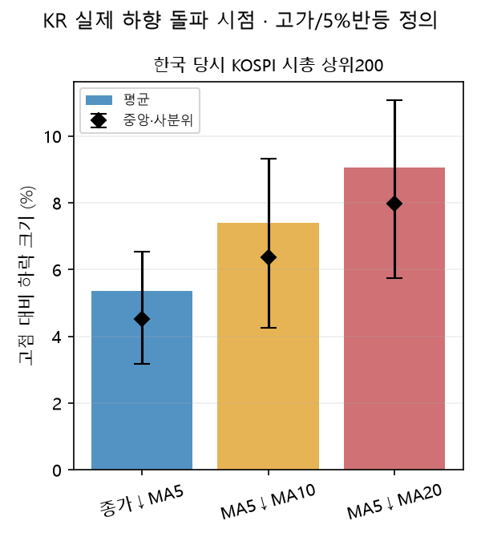
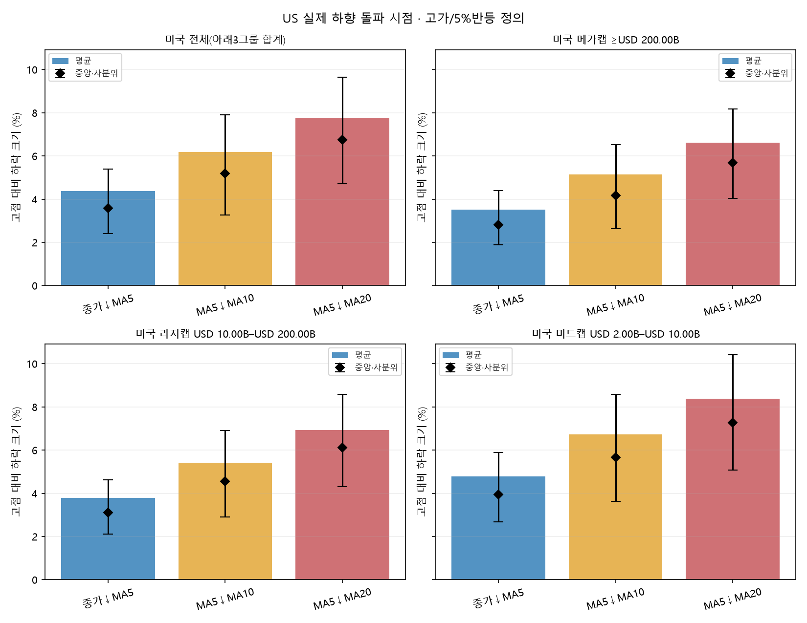

# 이동평균선 하락 신호가 나올 때 이미 얼마나 빠져 있는가

독립 기술통계 연구 `MA-DD-DESCRIBE-20261017-v1` · 작성2026-10-17 · **원가격/시총 자료의 최신 완료일: 한국·미국2026-10-15** · 분석 시작2016-01-01.

이 보고서는 실제 세 하향 돌파가 확인된 날의 종가를 그 하락 다리의 관측 고점과 비교한다. 미래 하락 확률, 매도 성공률, 전략 수익률 또는 매도 비중을 추정하지 않는다. 앞선 두 연구의 표본·고점 사건·후보·손실 목표를 재사용하지 않았다. 같은 역사 기간을 쓰므로 통계적으로 서로 독립인 새 실험이라는 뜻은 아니다.

## 1. 먼저 보는 비교표

Drawdown = (신호일 종가 / 해당 하락 다리의 관측 고점 −1)×100. 아래의 음수는 이미 발생한 하락이다. 주 고점은 **조정 고가**다. 종가 고점과 재설정 방법을 바꾼 결과는 뒤의 민감도 표에 함께 실었다.


| 시장·규모 | 신호 | 평균DD | 중앙DD | Q25 | Q75 | Q90 | 손실크기P90 | 고점→신호 봉 평균/중앙 | 사건/종목 |
|---|---|---|---|---|---|---|---|---|---|
| 한국 당시 KOSPI 시총 상위200 | 종가↓MA5 | -5.36% | -4.53% | -6.54% | -3.17% | -2.31% | 9.25% | 1.6 / 1.0 | 36,509/394 |
| 한국 당시 KOSPI 시총 상위200 | MA5↓MA10 | -7.41% | -6.37% | -9.31% | -4.25% | -2.76% | 13.18% | 4.8 / 5.0 | 22,580/388 |
| 한국 당시 KOSPI 시총 상위200 | MA5↓MA20 | -9.07% | -7.97% | -11.09% | -5.74% | -4.19% | 15.25% | 6.8 / 6.0 | 14,692/378 |
| 미국 전체(아래3그룹 합계) | 종가↓MA5 | -4.37% | -3.58% | -5.39% | -2.41% | -1.70% | 7.86% | 1.6 / 1.0 | 199,034/1,944 |
| 미국 전체(아래3그룹 합계) | MA5↓MA10 | -6.19% | -5.18% | -7.90% | -3.28% | -2.04% | 11.49% | 4.6 / 5.0 | 120,053/1,921 |
| 미국 전체(아래3그룹 합계) | MA5↓MA20 | -7.78% | -6.75% | -9.64% | -4.72% | -3.34% | 13.42% | 6.7 / 6.0 | 78,396/1,902 |
| 미국 메가캡 ≥$200.00B | 종가↓MA5 | -3.51% | -2.82% | -4.41% | -1.89% | -1.39% | 6.46% | 1.6 / 1.0 | 4,305/99 |
| 미국 메가캡 ≥$200.00B | MA5↓MA10 | -5.14% | -4.18% | -6.52% | -2.62% | -1.67% | 9.65% | 4.7 / 5.0 | 2,529/98 |
| 미국 메가캡 ≥$200.00B | MA5↓MA20 | -6.62% | -5.68% | -8.18% | -4.03% | -2.91% | 11.35% | 7.1 / 6.0 | 1,667/91 |
| 미국 라지캡 $10.00B–$200.00B | 종가↓MA5 | -3.78% | -3.10% | -4.61% | -2.11% | -1.51% | 6.79% | 1.6 / 1.0 | 75,731/866 |
| 미국 라지캡 $10.00B–$200.00B | MA5↓MA10 | -5.42% | -4.56% | -6.91% | -2.91% | -1.82% | 9.99% | 4.6 / 5.0 | 45,972/852 |
| 미국 라지캡 $10.00B–$200.00B | MA5↓MA20 | -6.93% | -6.12% | -8.57% | -4.31% | -3.07% | 11.72% | 6.9 / 6.0 | 30,440/834 |
| 미국 미드캡 $2.00B–$10.00B | 종가↓MA5 | -4.78% | -3.95% | -5.88% | -2.67% | -1.90% | 8.51% | 1.6 / 1.0 | 118,998/1,643 |
| 미국 미드캡 $2.00B–$10.00B | MA5↓MA10 | -6.72% | -5.66% | -8.59% | -3.63% | -2.26% | 12.38% | 4.6 / 5.0 | 71,552/1,621 |
| 미국 미드캡 $2.00B–$10.00B | MA5↓MA20 | -8.37% | -7.26% | -10.40% | -5.08% | -3.61% | 14.48% | 6.6 / 6.0 | 46,289/1,595 |


**분위수의 방향:** Q25·Q75·Q90은 요청대로 음수 Drawdown의 오름차순 분위수다. 따라서 Q90은0에 더 가깝고 큰 손실 꼬리를 뜻하지 않는다. 직관적인 큰 손실 비교를 위해 손실크기P90=−DD의Q10도 추가했다. 예를 들어 손실크기P90이10%면 관측 사건 약90%가10% 이내 하락 시점에 발생했다는 기술통계이며 미래 보장이 아니다. ⚠는 사건100개 미만 또는 종목20개 미만이다.

각 행은 서로 다른 경고 표본일 수 있다. 3차 신호의 평균이 더 낮다고 해서 같은 모든 하락에서 순서대로 그만큼씩 더 빠졌다는 뜻은 아니다. 동일 사건의 대응 비교는 별도로 제시한다.

## 2. 직전 고점과 실제 하향 돌파를 고정한 방법

이동평균은 조정 종가의 단순평균 SMA5/10/20이다. A(t)<B(t)이고 A(t−1)≥B(t−1)인 날만 실제 교차다. 계속 아래에 머문 날과2봉 확인은 새 사건으로 세지 않았다. 수치 연산 오차만 제거하도록 가격의10⁻¹² 상대 허용오차로 수학적 동률을 처리했다. 실질적인 매매 완충폭을 둔 것이 아니다.

고점은 다음 온라인 규칙으로 정했다. 처음에는 관측 종가 저점에서5% 반등이 확인되어야 추적을 시작한다. 이후 지금까지 본 고가가 기존 추적 고가 이상이면 옛 다리는 고점을 회복한 것으로 종료하고 그 날 고가·날짜를 새 고점으로 둔다. 하락 중에는 최저 종가를 추적한다. 그 저점에서 종가가5% 반등하면 당일 신호를 기존 고점에 대해 계산한 뒤 다리를 종료하고, 다음 날부터 반등 확인일 고가를 출발점으로 새 고점을 추적한다. 더 오래된 고점 아래에서 반등한 종목도 새 국지 하락으로 관측한다.

이는 임의63/126일 최고가나 미래 저점을 본 피벗이 아니다. 반등 확인 전날의 고점을 소급해서 바꾸지 않는다. 당일 고가가 형성된 뒤 종가에서 교차할 수도 있으므로 경과 봉0이 가능하다. 고가가 언제 형성됐는지 장중 경로를 추정할 필요 없이, 최종 종가는 그 날 고가 이후에 확정된다. 주가가 다시 크게 빠졌는지 여부를 사건 선정 조건으로 쓰지 않는다.

**5%는 유일한 자연 고점의 정답이 아니다.** 먼저 고정한 재설정 규약이다. 3%·8% 반등, 종가 고점, 전일 ATR14의2배 반등 재설정으로 같은 계산을 반복해 고점 정의 의존성을 비교했다. ATR 방식은 변동성이 사건 구분에도 들어가므로 고정5% 방식과 함께 해석한다. 결과가 마음에 드는 정의로 주 분석을 바꾸지 않았다.

하락 다리마다 각 신호의 첫 실제 교차만 남긴다. 다른 MA 신호가 나왔거나 시간이 지났다는 이유로 다리를 재시작하지 않는다. 첫 교차가 규모/순위 조건 밖에 있었으면 조건 안으로 들어온 뒤 반복된 교차를 최초라고 바꾸지 않는다. 반복 교차 전체를 포함한 결과와 더 큰 running-high parent에서 처음 관측된 다리만 남긴 민감도도 제시했다. 같은 종목·시장 국면의 사건들이 독립이라는 가정은 하지 않는다.

## 3. 실제 자료와 사건 당시 표본

한국은 사용자 추가 답변에 따라 **사건 당일 KOSPI 시가총액 상위200 보통주**다. KOSPI200 지수 구성이 아니다. [FinanceData/marcap 원자료](https://github.com/FinanceData/marcap)는 KRX에서 수집한 날짜별 시세·시총을 보존한 공개 데이터셋이다. 고정 커밋의2015–2026년 파일에서 시장과 보통주 코드(끝자리0)를 구분하고, 매일 시총 내림차순·코드순 동률 처리로 순위를 재계산했다. 현재 순위를 과거에 대입하지 않았다. 우선주를 합산한 법인 전체 시총은 복원하지 못했으며 보통주 종목 시총 순위다.

KRX 직접 경로는 이번 연결에서 LOGOUT/인증키 부족 응답을 반환해 공개 원보존본을 썼다. 자료 설명의 시총 단위 문구를 그대로 가정하지 않고 실제 모든 사용 파일에서 `시총=종가×상장주식수`가 맞는 원(KRW) 단위임을 확인했다. 원장의 일별 시총은 그 날 값이며 가격 조정에는 사용하지 않는다.

한국 OHLC는 `f(t)=(종가(t)−전일대비(t))/전일 종가`를 기준가격 변경 계수로 삼아 이후 계수의 곱으로 일관되게 역조정했다. 예를 들어 원자료의2018-05-04 삼성전자 계수는0.02다. 무거래/잘못된 봉·빠진 거래일·10일 초과 달력 공백은 지표와 고점 추적 구간을 끊으며, 충분한 지표와 새 반등 시작이 생겨야 다시 관측한다. 멈춘 날을 연속된 정상 거래처럼 붙이지 않았다. 단순 배당 재투자 수익률은 아니다.

미국은 원시 보통주 목록의 STOCK을 SEC 정확한 티커–CIK와 대응했다. [SEC API](https://www.sec.gov/search-filings/edgar-application-programming-interfaces)의 DEI `EntityCommonStockSharesOutstanding` **시점 주식수**와 [Yahoo 일봉](https://finance.yahoo.com/)의 분할 조정 OHLC·같은 응답의 분할 이벤트를 새로 수집했다. 배당 조정 adjclose는 쓰지 않았다. 현재의 주식 수·시총을 과거로 복사하거나 EPS용 가중평균/희석 주식수로 대체하지 않았다.

미국 시총은 **당시 공시로 알 수 있었던 주식 수를 사용한 근사치**다. 사건일보다 앞선 날 공시된 자료 중 기준일이 가장 최근인 시점 주식수를 선택하고180달력일을 넘으면 결측으로 둔다. 공시 당일의 장 마감 전후를 확정할 수 없어 다음 날부터 사용한다. 주식 수와 종가를 같은 분할 단위로 맞춰 곱한다. 공시 사이 발행/소각을 매일 알 수 없으므로 거래소의 정확한 일별 시총이라고 부르지 않는다. ADR 단위가 미검증인 종목 및 같은 CIK의 복수 상장 보통주 티커는 주 분석에서 제외했다. 상장되지 않은 의결권 주식 등 세부 클래스 범위 한계는 남는다.

메가≥$200B, 라지$10B 이상~$200B 미만, 미드$2B 이상~$10B 미만을 **사건일 근사 시총**으로 구분한다. 미국 전체는 이 세 규모 그룹의 합계이며 미국의 모든 소형주·모든 과거 상장사를 뜻하지 않는다. 현재 원시 목록에 없는 상장폐지 기업과 과거 다른 티커의 완전한 미국 모집단은 확보하지 못했다. 한국은 현재 목록으로 제한하지 않고 시총 원자료에 있는 과거 종목도 포함했다.






| 시장 | 입력·대상 | 최초 교차 사건 | 반복 교차 제외 | 첫/마지막 사건일 |
|---|---|---|---|---|
| 한국 | 과거 상위200 편입 407종목 / 결과 396종목 | 73,781 | 41,823 | 2016-01-04 ~ 2026-10-15 |
| 미국 | 원목록 4,843 → SEC단위 대상 4,695 → 수집ready 3,955 → 처리 3,954 → 규모조건 결과 1,948 | 397,483 | 224,383 | 2016-01-04 ~ 2026-10-15 |


동일 종목이 시기에 따라 여러 시총 그룹에 속할 수 있다. 그룹별 종목 수를 더해 미국 전체의 고유 종목 수로 쓰면 안 된다. 첫 교차 사건 수는 세 신호를 합한 관측행 수로, 세 독립 하락의 수가 아니다. 결측/무거래 분절로 일부 관측이 제외되므로 과거 전체 시장의 완전한 전수 통계라고 주장하지 않는다.

일부2026년 기존 Toss 저장 종가와 공개 시총 원자료의 종가가 다름을 입력 감사에서 확인했다. DD 결과를 계산하기 **전에** 가격 소스를 독립적으로 확정했고, 충돌하는 공급자 가격을 섞지 않았다. 차이가 컸던 대표3종목의2026-03-03~06일12개 봉은 네이버 과거 시세와 별도로 대조해 OHLCV60값이 모두 이번 원자료와 일치했다. 이는 점검한 사례의 근거이며 전 시장의 절대 정확성 보증은 아니다. 한국은 같은 원자료의 가격·당시 시총을 사용한다. 연도별 표에서2026년을 따로 확인할 수 있으며 원본은 변경하지 않았다. 최신 확보 원본은10/15까지라10/16 종가까지 전부 반영했다고 주장하지 않는다.

## 4. 변동성 분포와 조건부 Drawdown

σ는 신호 전일 기준 최근20개 로그수익의 표본 표준편차×√252다. ATR%는 전일까지 Wilder ATR14÷전일 종가이며 첫14 TR 산술평균으로 시작해 `(13×전일ATR+당일TR)/14`로 갱신했다. 당일 급락의 수익률/고저폭은 둘 다에 들어가지 않는다.

구간은 시장별 **규모/순위 조건에 해당하는 고유 종목–거래일**의 변동성 분포로 정한 사분위다. 신호가 자주 발생한 날을 세 번씩 넣어 경계를 계산하지 않았다. 임계값 이상 조건은 미리 고정한 Q50·Q75·Q90이며 실제 숫자는 다음과 같다. 표시 반올림과 무관하게 계산은 원정밀도를 썼다. 변동성 이력이 짧은 사건은 무조건부 표에 남기고 조건부 표에서 결측으로 구분한다.


| 시장 | 분포의 종목–일 수 | 지표 | Q25 | Q50 | Q75 | Q90 |
|---|---|---|---|---|---|---|
| KR | 520,143 | sigma | 25.60% | 33.95% | 45.99% | 63.41% |
| KR | 520,143 | atrpct | 2.60% | 3.28% | 4.26% | 5.58% |
| US | 2,830,327 | sigma | 20.72% | 28.64% | 40.69% | 58.42% |
| US | 2,830,327 | atrpct | 2.06% | 2.69% | 3.65% | 5.01% |

### 미국 전체(아래3그룹 합계)

각 신호 셀: **평균DD / 중앙DD · 사건수/종목수**. DD 단위는%. ⚠ 표본 부족.


**연율화 σ**

| 전일 변동성 구간 | 종가↓MA5 | MA5↓MA10 | MA5↓MA20 |
|---|---|---|---|
| <20.72% | -2.48 / -2.14 · 41,532/1,261 | -3.43 / -3.09 · 24,567/1,178 | -4.62 / -4.31 · 17,366/1,150 |
| 20.72–28.64% | -3.34 / -2.94 · 43,592/1,511 | -4.79 / -4.47 · 27,920/1,464 | -6.28 / -5.98 · 19,977/1,422 |
| 28.64–40.69% | -4.20 / -3.74 · 50,661/1,681 | -6.13 / -5.73 · 32,062/1,640 | -8.02 / -7.68 · 20,832/1,603 |
| ≥40.69% | -6.45 / -5.60 · 63,179/1,882 | -9.24 / -8.32 · 35,477/1,848 | -11.73 / -10.95 · 20,219/1,775 |
| ≥28.64% (누적 상위, Q50) | -5.45 / -4.63 · 113,840/1,919 | -7.76 / -6.83 · 67,539/1,891 | -9.85 / -8.94 · 41,051/1,869 |
| ≥40.69% (누적 상위, Q75) | -6.45 / -5.60 · 63,179/1,882 | -9.24 / -8.32 · 35,477/1,848 | -11.73 / -10.95 · 20,219/1,775 |
| ≥58.42% (누적 상위, Q90) | -7.84 / -6.93 · 27,617/1,749 | -11.11 / -10.17 · 14,257/1,655 | -14.19 / -13.60 · 7,649/1,416 |
| 이력 부족/결측 | -9.34 / -7.56 · 70/43 ⚠ | -9.80 / -8.28 · 27/24 ⚠ | -6.78 / -6.78 · 2/2 ⚠ |

**ATR%**

| 전일 변동성 구간 | 종가↓MA5 | MA5↓MA10 | MA5↓MA20 |
|---|---|---|---|
| <2.06% | -2.33 / -2.05 · 43,969/1,069 | -3.29 / -3.00 · 25,237/1,014 | -4.51 / -4.21 · 16,787/994 |
| 2.06–2.69% | -3.27 / -2.91 · 45,888/1,362 | -4.65 / -4.34 · 28,080/1,298 | -6.16 / -5.85 · 19,513/1,243 |
| 2.69–3.65% | -4.27 / -3.85 · 50,088/1,563 | -6.11 / -5.75 · 31,301/1,513 | -7.86 / -7.52 · 20,670/1,469 |
| ≥3.65% | -6.82 / -5.95 · 59,052/1,855 | -9.54 / -8.68 · 35,426/1,815 | -11.73 / -10.92 · 21,426/1,759 |
| ≥2.69% (누적 상위, Q50) | -5.65 / -4.82 · 109,140/1,912 | -7.93 / -7.01 · 66,727/1,892 | -9.83 / -8.90 · 42,096/1,869 |
| ≥3.65% (누적 상위, Q75) | -6.82 / -5.95 · 59,052/1,855 | -9.54 / -8.68 · 35,426/1,815 | -11.73 / -10.92 · 21,426/1,759 |
| ≥5.01% (누적 상위, Q90) | -8.44 / -7.48 · 25,363/1,668 | -11.72 / -11.00 · 14,745/1,565 | -14.28 / -13.61 · 8,498/1,361 |
| 이력 부족/결측 | -11.80 / -9.74 · 37/28 ⚠ | -10.41 / -9.35 · 9/9 ⚠ | — (0) |

### 미국 메가캡 ≥$200.00B

각 신호 셀: **평균DD / 중앙DD · 사건수/종목수**. DD 단위는%. ⚠ 표본 부족.


**연율화 σ**

| 전일 변동성 구간 | 종가↓MA5 | MA5↓MA10 | MA5↓MA20 |
|---|---|---|---|
| <20.72% | -2.22 / -1.93 · 1,578/57 | -3.09 / -2.86 · 904/55 | -4.37 / -4.10 · 616/51 |
| 20.72–28.64% | -3.15 / -2.76 · 1,005/63 | -4.47 / -4.28 · 619/62 | -6.02 / -5.76 · 451/50 |
| 28.64–40.69% | -3.76 / -3.40 · 780/68 | -5.64 / -5.28 · 498/67 | -7.54 / -7.15 · 317/54 |
| ≥40.69% | -5.87 / -5.30 · 942/78 | -9.09 / -8.20 · 508/73 | -11.42 / -10.37 · 283/58 |
| ≥28.64% (누적 상위, Q50) | -4.91 / -4.29 · 1,722/91 | -7.38 / -6.43 · 1,006/88 | -9.37 / -8.56 · 600/74 |
| ≥40.69% (누적 상위, Q75) | -5.87 / -5.30 · 942/78 | -9.09 / -8.20 · 508/73 | -11.42 / -10.37 · 283/58 |
| ≥58.42% (누적 상위, Q90) | -6.97 / -6.40 · 401/54 | -11.03 / -10.37 · 215/49 | -13.44 / -12.96 · 118/40 |
| 이력 부족/결측 | — (0) | — (0) | — (0) |

**ATR%**

| 전일 변동성 구간 | 종가↓MA5 | MA5↓MA10 | MA5↓MA20 |
|---|---|---|---|
| <2.06% | -2.20 / -1.94 · 1,861/54 | -3.10 / -2.87 · 1,058/52 | -4.44 / -4.19 · 689/49 |
| 2.06–2.69% | -3.31 / -2.93 · 1,063/57 | -4.66 / -4.41 · 621/54 | -6.16 / -5.85 · 450/50 |
| 2.69–3.65% | -4.30 / -3.90 · 665/67 | -6.27 / -5.99 · 422/61 | -7.97 / -8.03 · 279/53 |
| ≥3.65% | -6.48 / -5.89 · 716/68 | -9.73 / -8.98 · 428/61 | -11.95 / -11.29 · 249/49 |
| ≥2.69% (누적 상위, Q50) | -5.43 / -4.86 · 1,381/86 | -8.01 / -7.20 · 850/84 | -9.84 / -8.92 · 528/75 |
| ≥3.65% (누적 상위, Q75) | -6.48 / -5.89 · 716/68 | -9.73 / -8.98 · 428/61 | -11.95 / -11.29 · 249/49 |
| ≥5.01% (누적 상위, Q90) | -7.90 / -7.37 · 287/43 | -12.12 / -11.63 · 175/41 | -14.24 / -13.33 · 106/33 |
| 이력 부족/결측 | — (0) | — (0) | — (0) |

### 미국 라지캡 $10.00B–$200.00B

각 신호 셀: **평균DD / 중앙DD · 사건수/종목수**. DD 단위는%. ⚠ 표본 부족.


**연율화 σ**

| 전일 변동성 구간 | 종가↓MA5 | MA5↓MA10 | MA5↓MA20 |
|---|---|---|---|
| <20.72% | -2.40 / -2.06 · 21,977/626 | -3.32 / -3.00 · 12,936/589 | -4.51 / -4.20 · 8,976/567 |
| 20.72–28.64% | -3.20 / -2.82 · 18,672/701 | -4.65 / -4.34 · 12,045/689 | -6.13 / -5.86 · 8,546/670 |
| 28.64–40.69% | -3.96 / -3.56 · 18,213/751 | -5.89 / -5.50 · 11,544/721 | -7.80 / -7.50 · 7,602/699 |
| ≥40.69% | -6.02 / -5.21 · 16,850/797 | -8.68 / -7.81 · 9,440/777 | -11.08 / -10.40 · 5,315/711 |
| ≥28.64% (누적 상위, Q50) | -4.95 / -4.21 · 35,063/844 | -7.14 / -6.35 · 20,984/825 | -9.15 / -8.41 · 12,917/803 |
| ≥40.69% (누적 상위, Q75) | -6.02 / -5.21 · 16,850/797 | -8.68 / -7.81 · 9,440/777 | -11.08 / -10.40 · 5,315/711 |
| ≥58.42% (누적 상위, Q90) | -7.47 / -6.64 · 6,791/693 | -10.46 / -9.51 · 3,445/634 | -13.45 / -13.05 · 1,786/479 |
| 이력 부족/결측 | -7.44 / -6.86 · 19/13 ⚠ | -9.66 / -9.35 · 7/6 ⚠ | -6.04 / -6.04 · 1/1 ⚠ |

**ATR%**

| 전일 변동성 구간 | 종가↓MA5 | MA5↓MA10 | MA5↓MA20 |
|---|---|---|---|
| <2.06% | -2.31 / -2.03 · 24,998/578 | -3.25 / -2.97 · 14,235/554 | -4.47 / -4.16 · 9,386/529 |
| 2.06–2.69% | -3.27 / -2.91 · 19,936/666 | -4.69 / -4.40 · 12,483/648 | -6.25 / -5.95 · 8,708/629 |
| 2.69–3.65% | -4.21 / -3.81 · 16,881/711 | -6.11 / -5.78 · 10,816/691 | -7.89 / -7.57 · 7,288/666 |
| ≥3.65% | -6.62 / -5.79 · 13,907/753 | -9.24 / -8.44 · 8,435/748 | -11.32 / -10.59 · 5,058/685 |
| ≥2.69% (누적 상위, Q50) | -5.30 / -4.54 · 30,788/828 | -7.48 / -6.70 · 19,251/814 | -9.29 / -8.54 · 12,346/794 |
| ≥3.65% (누적 상위, Q75) | -6.62 / -5.79 · 13,907/753 | -9.24 / -8.44 · 8,435/748 | -11.32 / -10.59 · 5,058/685 |
| ≥5.01% (누적 상위, Q90) | -8.33 / -7.47 · 5,393/620 | -11.43 / -10.92 · 3,074/545 | -13.99 / -13.54 · 1,724/419 |
| 이력 부족/결측 | -8.71 / -8.94 · 9/7 ⚠ | -12.24 / -9.35 · 3/3 ⚠ | — (0) |

### 미국 미드캡 $2.00B–$10.00B

각 신호 셀: **평균DD / 중앙DD · 사건수/종목수**. DD 단위는%. ⚠ 표본 부족.


**연율화 σ**

| 전일 변동성 구간 | 종가↓MA5 | MA5↓MA10 | MA5↓MA20 |
|---|---|---|---|
| <20.72% | -2.60 / -2.25 · 17,977/917 | -3.60 / -3.23 · 10,727/839 | -4.76 / -4.45 · 7,774/816 |
| 20.72–28.64% | -3.46 / -3.05 · 23,915/1,190 | -4.92 / -4.58 · 15,256/1,130 | -6.40 / -6.06 · 10,980/1,075 |
| 28.64–40.69% | -4.35 / -3.86 · 31,668/1,351 | -6.28 / -5.89 · 20,020/1,308 | -8.16 / -7.81 · 12,913/1,264 |
| ≥40.69% | -6.62 / -5.75 · 45,387/1,553 | -9.44 / -8.52 · 25,529/1,514 | -11.97 / -11.17 · 14,621/1,442 |
| ≥28.64% (누적 상위, Q50) | -5.69 / -4.85 · 77,055/1,612 | -8.06 / -7.09 · 45,549/1,579 | -10.18 / -9.22 · 27,534/1,541 |
| ≥40.69% (누적 상위, Q75) | -6.62 / -5.75 · 45,387/1,553 | -9.44 / -8.52 · 25,529/1,514 | -11.97 / -11.17 · 14,621/1,442 |
| ≥58.42% (누적 상위, Q90) | -7.99 / -7.02 · 20,425/1,399 | -11.32 / -10.34 · 10,597/1,332 | -14.44 / -13.76 · 5,745/1,149 |
| 이력 부족/결측 | -10.05 / -7.71 · 51/31 ⚠ | -9.85 / -8.25 · 20/18 ⚠ | -7.52 / -7.52 · 1/1 ⚠ |

**ATR%**

| 전일 변동성 구간 | 종가↓MA5 | MA5↓MA10 | MA5↓MA20 |
|---|---|---|---|
| <2.06% | -2.38 / -2.10 · 17,110/728 | -3.36 / -3.05 · 9,944/675 | -4.56 / -4.28 · 6,712/663 |
| 2.06–2.69% | -3.27 / -2.91 · 24,889/1,033 | -4.62 / -4.30 · 14,976/959 | -6.10 / -5.79 · 10,355/895 |
| 2.69–3.65% | -4.30 / -3.86 · 32,542/1,232 | -6.10 / -5.73 · 20,063/1,174 | -7.84 / -7.48 · 13,103/1,124 |
| ≥3.65% | -6.89 / -6.00 · 44,429/1,521 | -9.63 / -8.75 · 26,563/1,476 | -11.86 / -11.01 · 16,119/1,429 |
| ≥2.69% (누적 상위, Q50) | -5.79 / -4.94 · 76,971/1,593 | -8.11 / -7.14 · 46,626/1,574 | -10.06 / -9.06 · 29,222/1,538 |
| ≥3.65% (누적 상위, Q75) | -6.89 / -6.00 · 44,429/1,521 | -9.63 / -8.75 · 26,563/1,476 | -11.86 / -11.01 · 16,119/1,429 |
| ≥5.01% (누적 상위, Q90) | -8.47 / -7.48 · 19,683/1,313 | -11.79 / -11.02 · 11,496/1,261 | -14.36 / -13.63 · 6,668/1,121 |
| 이력 부족/결측 | -12.80 / -10.57 · 28/21 ⚠ | -9.50 / -6.63 · 6/6 ⚠ | — (0) |

### 한국 당시 KOSPI 시총 상위200

각 신호 셀: **평균DD / 중앙DD · 사건수/종목수**. DD 단위는%. ⚠ 표본 부족.


**연율화 σ**

| 전일 변동성 구간 | 종가↓MA5 | MA5↓MA10 | MA5↓MA20 |
|---|---|---|---|
| <25.60% | -3.16 / -2.86 · 6,091/290 | -4.32 / -4.05 · 3,817/274 | -5.58 / -5.37 · 2,828/259 |
| 25.60–33.95% | -4.09 / -3.71 · 8,200/318 | -5.69 / -5.38 · 5,340/301 | -7.28 / -7.00 · 3,761/298 |
| 33.95–45.99% | -5.05 / -4.61 · 9,759/357 | -7.18 / -6.84 · 6,347/338 | -9.02 / -8.79 · 4,001/324 |
| ≥45.99% | -7.54 / -6.57 · 12,086/364 | -10.64 / -9.58 · 6,916/362 | -13.16 / -12.17 · 4,096/343 |
| ≥33.95% (누적 상위, Q50) | -6.43 / -5.54 · 21,845/386 | -8.99 / -7.95 · 13,263/382 | -11.11 / -10.18 · 8,097/366 |
| ≥45.99% (누적 상위, Q75) | -7.54 / -6.57 · 12,086/364 | -10.64 / -9.58 · 6,916/362 | -13.16 / -12.17 · 4,096/343 |
| ≥63.41% (누적 상위, Q90) | -9.06 / -7.88 · 5,235/334 | -12.81 / -11.73 · 2,842/321 | -15.73 / -15.16 · 1,625/288 |
| 이력 부족/결측 | -6.33 / -4.75 · 373/217 | -7.89 / -6.53 · 160/143 | -7.40 / -7.57 · 6/6 ⚠ |

**ATR%**

| 전일 변동성 구간 | 종가↓MA5 | MA5↓MA10 | MA5↓MA20 |
|---|---|---|---|
| <2.60% | -2.99 / -2.76 · 6,873/256 | -4.10 / -3.89 · 4,011/243 | -5.45 / -5.26 · 2,825/237 |
| 2.60–3.28% | -4.03 / -3.73 · 8,717/300 | -5.50 / -5.28 · 5,360/286 | -7.13 / -6.91 · 3,714/276 |
| 3.28–4.26% | -5.24 / -4.81 · 9,589/335 | -7.17 / -6.87 · 6,184/318 | -8.98 / -8.80 · 3,956/306 |
| ≥4.26% | -7.94 / -6.94 · 11,124/360 | -10.99 / -10.02 · 6,955/360 | -13.29 / -12.33 · 4,197/342 |
| ≥3.28% (누적 상위, Q50) | -6.69 / -5.79 · 20,713/387 | -9.19 / -8.17 · 13,139/378 | -11.20 / -10.24 · 8,153/365 |
| ≥4.26% (누적 상위, Q75) | -7.94 / -6.94 · 11,124/360 | -10.99 / -10.02 · 6,955/360 | -13.29 / -12.33 · 4,197/342 |
| ≥5.58% (누적 상위, Q90) | -9.62 / -8.45 · 4,690/322 | -13.48 / -12.65 · 2,926/312 | -15.99 / -15.39 · 1,736/285 |
| 이력 부족/결측 | -6.75 / -4.64 · 206/171 | -8.90 / -6.77 · 70/68 ⚠ | — (0) |


누적 상위 조건은 서로 겹친다. Q90 이상은 Q75 이상 안에 포함되므로 별개의 독립 표본처럼 더하지 않는다. σ는 일간 수익의 연율화, ATR%는 일간 진폭의 가격 대비 비율이므로 둘의 숫자를 같은 크기로 비교하지 않는다. 여기서의 조건부 평균은 “그 변동성·신호 조합에서 과거 이미 발생해 있던 하락”이며 앞으로의 손실 예측이 아니다.

## 5. 동일 하락 다리에서의 세 신호 비교

아래는 세 최초 교차가 모두 관측된 같은 다리의 대응 표본이다. 전체 사건을 대표하지 않으며 세 신호가 특정 순서로 나타난다고 가정하지 않았다. '순서1→2→3'은 날짜가 엄격하게 다른 경우만 포함한다. 동시 발생은 전체3신호 표본에는 남긴다. 규모별 표는 세 시점 모두 해당 규모여야 포함된다.


| 표본 | 범위 | 다리/종목 | 신호1 평균DD | 신호2 | 신호3 | 1→2 손실증가 | 2→3 손실증가 |
|---|---|---|---|---|---|---|---|
| 한국 당시 KOSPI 시총 상위200 | all_three_any_order | 13,848/375 | -5.36% | -7.82% | -9.15% | 2.45pp | 1.34pp |
| 한국 당시 KOSPI 시총 상위200 | strict_1_2_3 | 10,115/368 | -5.09% | -7.47% | -9.20% | 2.38pp | 1.73pp |
| 미국 전체(아래3그룹 합계) | all_three_any_order | 74,612/1,886 | -4.38% | -6.62% | -7.81% | 2.24pp | 1.18pp |
| 미국 전체(아래3그룹 합계) | strict_1_2_3 | 55,838/1,848 | -3.98% | -6.15% | -7.63% | 2.17pp | 1.48pp |
| 미국 메가캡 ≥$200.00B | all_three_any_order | 1,592/87 | -3.63% | -5.50% | -6.62% | 1.87pp | 1.12pp |
| 미국 메가캡 ≥$200.00B | strict_1_2_3 | 1,258/86 | -3.37% | -5.23% | -6.55% | 1.86pp | 1.31pp |
| 미국 라지캡 $10.00B–$200.00B | all_three_any_order | 29,122/821 | -3.88% | -5.86% | -6.94% | 1.97pp | 1.09pp |
| 미국 라지캡 $10.00B–$200.00B | strict_1_2_3 | 22,333/807 | -3.53% | -5.44% | -6.77% | 1.91pp | 1.33pp |
| 미국 미드캡 $2.00B–$10.00B | all_three_any_order | 42,863/1,562 | -4.74% | -7.14% | -8.37% | 2.40pp | 1.23pp |
| 미국 미드캡 $2.00B–$10.00B | strict_1_2_3 | 31,447/1,508 | -4.31% | -6.65% | -8.21% | 2.34pp | 1.56pp |


손실증가가 양수면 같은 고점 대비 낙폭이 더 커졌다는 뜻이고 음수면 회복한 상태에서 다음 교차가 나타났다는 뜻이다. 이름만으로 순서를 결정하지 않았고 누락 신호를 가정해 채우지 않았다. 실제 순서 빈도는 results.json의 paired/orders에 `+` 동시 발생과 `>` 날짜 선후로 보존했다.

## 6. 고점 정의·중복·순위 기준에 따른 민감도

다음은 동일한 자료에서 고점 재설정과 중복 처리만 바꾼 결과다. 각 셀은 평균DD / 중앙DD · 사건수/종목수다. 종가 고점은 고가 고점과 앵커 가격 자체가 달라지는 별도 정의이며 차이가 나는 것이 오류라는 뜻은 아니다.


**한국 당시 KOSPI 시총 상위200**

| 정의 | 종가↓MA5 | MA5↓MA10 | MA5↓MA20 |
|---|---|---|---|
| 고가·5%반등(주) | -5.36 / -4.53 · 36,509/394 | -7.41 / -6.37 · 22,580/388 | -9.07 / -7.97 · 14,692/378 |
| 고가·3%반등 | -4.94 / -4.18 · 48,537/394 | -6.77 / -5.78 · 26,606/388 | -8.25 / -7.28 · 15,890/378 |
| 고가·8%반등 | -5.74 / -4.82 · 26,689/391 | -8.01 / -6.90 · 17,501/386 | -10.02 / -8.87 · 12,256/377 |
| 종가·5%반등 | -3.60 / -3.00 · 36,634/394 | -5.89 / -5.02 · 22,116/388 | -7.53 / -6.61 · 14,626/378 |
| 고가·전일2ATR반등 | -5.18 / -4.30 · 28,868/389 | -7.40 / -6.29 · 19,292/384 | -9.52 / -8.26 · 13,918/376 |
| 5%·반복 교차 포함 | -7.37 / -5.75 · 70,173/394 | -8.07 / -6.86 · 29,024/388 | -9.05 / -7.95 · 16,407/378 |
| 5%·parent첫 관측 다리 | -7.13 / -5.79 · 4,071/389 | -9.56 / -8.02 · 2,551/362 | -12.04 / -10.45 · 1,581/323 |
| 5%·전일 상위200 | -5.39 / -4.56 · 36,956/400 | -7.44 / -6.40 · 22,677/391 | -9.09 / -7.99 · 14,770/377 |

**미국 전체(아래3그룹 합계)**

| 정의 | 종가↓MA5 | MA5↓MA10 | MA5↓MA20 |
|---|---|---|---|
| 고가·5%반등(주) | -4.37 / -3.58 · 199,034/1,944 | -6.19 / -5.18 · 120,053/1,921 | -7.78 / -6.75 · 78,396/1,902 |
| 고가·3%반등 | -4.18 / -3.45 · 256,980/1,944 | -5.76 / -4.82 · 140,677/1,922 | -7.15 / -6.15 · 85,790/1,903 |
| 고가·8%반등 | -4.46 / -3.59 · 152,221/1,940 | -6.47 / -5.35 · 96,087/1,916 | -8.33 / -7.25 · 66,008/1,898 |
| 종가·5%반등 | -3.11 / -2.44 · 199,159/1,943 | -5.12 / -4.16 · 117,256/1,921 | -6.68 / -5.71 · 77,938/1,900 |
| 고가·전일2ATR반등 | -4.00 / -3.22 · 176,304/1,924 | -5.98 / -4.92 · 112,619/1,906 | -7.85 / -6.70 · 78,297/1,893 |
| 5%·반복 교차 포함 | -6.01 / -4.57 · 376,878/1,945 | -6.71 / -5.60 · 155,830/1,923 | -7.74 / -6.71 · 89,158/1,904 |
| 5%·parent첫 관측 다리 | -3.76 / -2.92 · 35,693/1,874 | -5.48 / -4.41 · 22,937/1,749 | -7.26 / -6.13 · 15,673/1,637 |

**미국 메가캡 ≥$200.00B**

| 정의 | 종가↓MA5 | MA5↓MA10 | MA5↓MA20 |
|---|---|---|---|
| 고가·5%반등(주) | -3.51 / -2.82 · 4,305/99 | -5.14 / -4.18 · 2,529/98 | -6.62 / -5.68 · 1,667/91 |
| 고가·3%반등 | -3.43 / -2.78 · 5,492/99 | -4.87 / -4.01 · 3,000/98 | -6.10 / -5.25 · 1,866/91 |
| 고가·8%반등 | -3.54 / -2.79 · 3,434/98 | -5.27 / -4.21 · 2,085/97 | -6.98 / -5.93 · 1,405/91 |
| 종가·5%반등 | -2.55 / -1.94 · 4,336/98 | -4.33 / -3.39 · 2,482/97 | -5.74 / -4.86 · 1,670/91 |
| 고가·전일2ATR반등 | -3.23 / -2.60 · 4,328/98 | -4.89 / -3.98 · 2,646/97 | -6.45 / -5.45 · 1,780/91 |
| 5%·반복 교차 포함 | -5.13 / -3.84 · 8,470/99 | -5.75 / -4.75 · 3,441/98 | -6.65 / -5.72 · 1,965/91 |
| 5%·parent첫 관측 다리 | -3.36 / -2.66 · 1,343/81 | -4.99 / -3.97 · 810/79 | -6.58 / -5.68 · 566/72 |

**미국 라지캡 $10.00B–$200.00B**

| 정의 | 종가↓MA5 | MA5↓MA10 | MA5↓MA20 |
|---|---|---|---|
| 고가·5%반등(주) | -3.78 / -3.10 · 75,731/866 | -5.42 / -4.56 · 45,972/852 | -6.93 / -6.12 · 30,440/834 |
| 고가·3%반등 | -3.66 / -3.04 · 97,908/866 | -5.11 / -4.32 · 54,809/852 | -6.42 / -5.62 · 33,842/835 |
| 고가·8%반등 | -3.82 / -3.08 · 58,362/866 | -5.58 / -4.63 · 36,616/851 | -7.32 / -6.45 · 25,233/832 |
| 종가·5%반등 | -2.71 / -2.12 · 76,112/866 | -4.51 / -3.68 · 44,970/852 | -5.98 / -5.19 · 30,332/834 |
| 고가·전일2ATR반등 | -3.49 / -2.85 · 72,522/864 | -5.22 / -4.36 · 45,737/849 | -6.89 / -5.99 · 31,432/834 |
| 5%·반복 교차 포함 | -5.53 / -4.11 · 149,770/868 | -6.11 / -5.08 · 61,865/852 | -6.99 / -6.15 · 35,394/835 |
| 5%·parent첫 관측 다리 | -3.27 / -2.59 · 17,096/807 | -4.82 / -3.92 · 10,887/784 | -6.50 / -5.60 · 7,453/753 |

**미국 미드캡 $2.00B–$10.00B**

| 정의 | 종가↓MA5 | MA5↓MA10 | MA5↓MA20 |
|---|---|---|---|
| 고가·5%반등(주) | -4.78 / -3.95 · 118,998/1,643 | -6.72 / -5.66 · 71,552/1,621 | -8.37 / -7.26 · 46,289/1,595 |
| 고가·3%반등 | -4.53 / -3.77 · 153,580/1,644 | -6.22 / -5.22 · 82,868/1,625 | -7.67 / -6.60 · 50,082/1,598 |
| 고가·8%반등 | -4.91 / -4.01 · 90,425/1,635 | -7.08 / -5.91 · 57,386/1,610 | -9.03 / -7.89 · 39,370/1,585 |
| 종가·5%반등 | -3.38 / -2.69 · 118,711/1,643 | -5.54 / -4.53 · 69,804/1,620 | -7.17 / -6.11 · 45,936/1,593 |
| 고가·전일2ATR반등 | -4.41 / -3.57 · 99,454/1,621 | -6.56 / -5.42 · 64,236/1,606 | -8.58 / -7.32 · 45,085/1,583 |
| 5%·반복 교차 포함 | -6.37 / -4.91 · 218,638/1,649 | -7.15 / -6.01 · 90,524/1,627 | -8.30 / -7.18 · 51,799/1,599 |
| 5%·parent첫 관측 다리 | -4.29 / -3.34 · 17,254/1,482 | -6.16 / -5.00 · 11,240/1,349 | -8.04 / -6.75 · 7,654/1,222 |


고점 선택에 따라 평균이 바뀌는 폭도 연구 결과다. '직전 고점'에는 단 하나의 데이터 독립 정답이 없으므로 주 표 숫자만 보편적인 법칙으로 사용하지 않는다. 5% 반등 재설정은 변동성이 높은 종목에서 더 자주 새 다리를 만들 수 있고, ATR 방식은 그 차이를 일부 정규화하는 대신 정의에 변동성이 들어간다.

## 7. 신뢰도와 해석의 범위

평균과 중앙값이 크게 다르면 긴 손실 꼬리의 영향이 크다. 큰 값이 불리하다고 제거하거나 임의 손실 상한으로 자르지 않았다. 주 평균의 종목 군집1,000회 bootstrap95% 구간, 종목별 평균을 같은 비중으로 평균한 값, 연도별 분포는 아래 파일에 함께 제공한다. 같은 종목의 사건 의존성을 반영하지만 시장 공통 충격과 데이터 공급자 오류를 완전히 제거하는 구간은 아니다. 기술통계이므로 학습/검증 승자를 선정하지 않았고, 신호 예측력·전략 우월성 검정을 실행한 것처럼 표시하지 않는다.

미국은 현재 목록 생존 편향, SEC 정확한 티커/시점 주식수 결측, ADR/복수 클래스 제외, 공시 간 주식수 변동 미관측이 남는다. 한국도 코드/시장 변경·우선주 합산 제외·과거 데이터 결측·원보존본의 완전성을 확인할 한계가 있다. 무거래/누락 구간 뒤 초기 신호가 제외되는 효과를 전체 모집단으로 일반화해서는 안 된다. 사건수와 종목수가 충분하더라도 새 국면의 같은 평균을 보장하지 않는다.

이 표는 “이 신호가 나타날 때 해당 정의의 고점에서 보통 얼마나 내려와 있었는가”의 참고값이다. 현재 특정 종목의 실시간 고점과 변동성을 같은 정의로 계산하지 않고 표의 평균만 직접 대입할 수는 없다. 4분할 비중·수익률·미래 하락확률·운영 경보는 이번 연구에서 만들거나 변경하지 않았다.

## 8. 전체 표와 재현·검증


- [KR 모든 조건·주요 분위수·경과 봉·표본 수](../../runtime/ma-dd-describe-20261017/KR_summary.csv) · [KR 연도별 분포](../../runtime/ma-dd-describe-20261017/KR_annual.csv) · [KR 모든 민감도](../../runtime/ma-dd-describe-20261017/KR_sensitivity.csv) · [KR 날짜/고점/전일변동성/당시시총 사건원장 — 상세 원본 미포함](../../OMITTED_DATA.md) · [KR 자료/제외 감사 — 상세 원본 미포함](../../OMITTED_DATA.md)

- [US 모든 조건·주요 분위수·경과 봉·표본 수](../../runtime/ma-dd-describe-20261017/US_summary.csv) · [US 연도별 분포](../../runtime/ma-dd-describe-20261017/US_annual.csv) · [US 모든 민감도](../../runtime/ma-dd-describe-20261017/US_sensitivity.csv) · [US 날짜/고점/전일변동성/당시시총 사건원장 — 상세 원본 미포함](../../OMITTED_DATA.md) · [US 자료/제외 감사 — 상세 원본 미포함](../../OMITTED_DATA.md)


- [사전 고정 프로토콜](../../runtime/ma-dd-describe-20261017/protocol.json) · [전체 결과·실제 순서](../../runtime/ma-dd-describe-20261017/results.json) · [한국 시총 파일·단위·고정 커밋 — 상세 원본 미포함](../../OMITTED_DATA.md)
- [미국 표본 제외 — 상세 원본 미포함](../../OMITTED_DATA.md) · [미국 수집 성공/실패 — 상세 원본 미포함](../../OMITTED_DATA.md) · [검증 영수증](../../runtime/ma-dd-describe-20261017/verification.json) · [해시 manifest — 상세 원본 미포함](../../OMITTED_DATA.md)
- [한국 대표 시세의 별도 공급자 대조 — 상세 원본 미포함](../../OMITTED_DATA.md)

핵심11검사 PASS: 실제 교차/지속 구분, 전일 σ/ATR, Wilder seed, 온라인 고점 prefix 불변, 같은 다리 반복 구분, 반등 후 낮은 새 고점, 주식분할 단위/공시일/시점 주식수/180일 제한, 결측 분절, 초기 변동성 결측 유지. 사용 원본7,920개 해시, 원장471,264행의DD산식·중복, 실제 원행79사례의교차·고점·전일변동성, 당시 미국 시총40사례, 변동성 셀 합계30검사를 확인했다. 그림2개도 실제 열어 표시를 검토했다. 여기의 사건행 수는 종목/국면 의존성을 제거한 독립 표본 수가 아니다.

프로토콜은 `27984ab`에 먼저 고정했고 가격 원자료 가용성 감사에 따른 소스 변경은 DD 통계 전에 `0426f9b`에 기록했다. 고점·교차·변동성·조건부 문턱을 결과에 맞춰 변경하지 않았다. 원본은 불변으로 보존하고 연구 산출물은 별도 runtime에 저장했다. 재현 시 새 출력 경로를 사용한다.

```powershell
$researchPython = '<USER_HOME>/Desktop/Ai 사일로/invest-agent-engine/.venv/Scripts/python.exe'
# 별도 폴더에 PyArrow와 고정 커밋 한국 원본·SEC/Yahoo 원본을 먼저 준비한다.
& $researchPython scripts/research/drawdown/ma_dd_describe.py prepare --out runtime/ma-dd-replay --market KR
& $researchPython scripts/research/drawdown/ma_dd_describe.py prepare --out runtime/ma-dd-replay --market US
& $researchPython scripts/research/drawdown/ma_dd_describe.py describe --out runtime/ma-dd-replay
& $researchPython scripts/research/drawdown/ma_dd_report.py --out runtime/ma-dd-replay --report docs/research/ma-dd-replay.md
```
