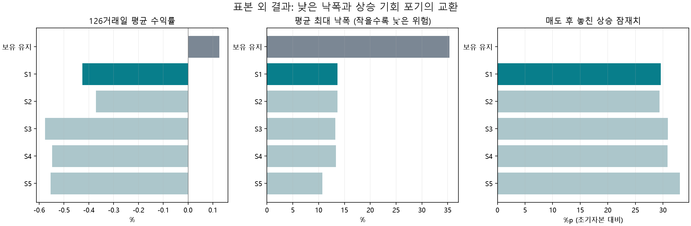
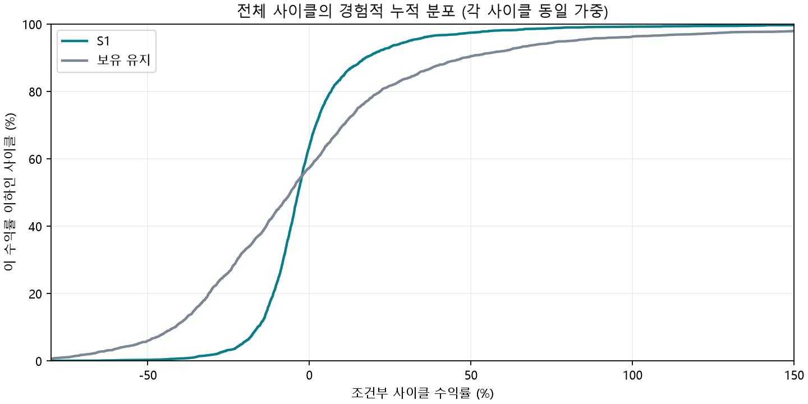

# 이동평균선 기반 4분할 매도 최적화 — 최종 연구 보고서

연구 ID: `MA-EXIT4-20261016-v1` · 작성: 2026-10-16 · **시세 기준: 2026-09-30 완료 일봉** · Toss 장기 수집본(2026-10-01) 재사용.

## 1. 결론부터: 추천 후보는 S1, 효과가 확인된 것은 낙폭 완화다

이 연구의 사전 평가 기준에서는 **S1: 2봉 확인, 60:10:10:20, 매도 보류 없음**을 가장 우선 검토할 규칙으로 선정했다. 단기 MA5 이탈에는 팔지 않고 MA5가 MA10 아래에서 2거래일 유지될 때 첫 매도를 시작한다. 매도 시작을 늦추는 대신, 시작되면 최초 수량의 60%를 줄이는 형태다.

그러나 **상승을 길게 보유하면서 수익 반납까지 줄인다는 두 목표가 모두 검증된 완성 전략은 아니다.** 실제 최적화와 표본 외 검증 결과, 평균 최대 낙폭은 보유 유지의 35.31%에서 13.67%로 낮아졌지만, 126거래일 평균 조건부 수익률은 -0.43%로 보유 유지의 +0.13%를 넘지 못했다. 보유 대비 차이 -0.55%p의 종목 군집 95% 신뢰구간은 [-2.60, +1.37]%p다.

따라서 추천의 의미는 **“이번 후보군·목적함수에서 우선 검토할 하락 완화형 4분할 규칙”**이다. 더 높은 수익률, 가장 적은 수익 반납, 유일한 최적 비중이 입증됐다는 의미는 아니다. 가까운 상위 후보들의 우열도 통계적으로 뚜렷하지 않다. 운영 매매·알림에는 적용하지 않았다.

**평가 범위:** 아래 수익률은 상승 추세 자격을 갖춘 시점부터 완전히 보유한1단위의 매도 성과다. 개인의 실제 체결 수익률을 평가한 것이 아니다.

## 2. 상위 5개 전략 비교

순위는 **2021년 이후 자료를 평가하기 전에 동결한 개발 구간 순위**다. 검증 결과를 보고 비중이나 추천 순서를 다시 맞추지 않았다. 각 지표는 종목별 사이클 평균→시장별 종목 평균→한국/미국 50:50 순서로 집계했다.

| 순위/코드 | 비중 | 수익률 | 보유 대비 | 최대 낙폭 | 반납 폭 | 놓친 상승 | 회피 하락 잠재치 |
| --- | --- | --- | --- | --- | --- | --- | --- |
| 1 / S1 | 60:10:10:20 | -0.43% | -0.55%p | 13.67% | 37.66%p | 29.60%p | 20.52%p |
| 2 / S2 | 10:60:10:20 | -0.37% | -0.50%p | 13.63% | 37.60%p | 29.38%p | 20.56%p |
| 3 / S3 | 10:60:10:20 | -0.58% | -0.70%p | 13.25% | 37.81%p | 30.88%p | 21.36%p |
| 4 / S4 | 60:10:10:20 | -0.55% | -0.67%p | 13.38% | 37.78%p | 30.81%p | 21.34%p |
| 5 / S5 | 10:70:10:10 | -0.55% | -0.68%p | 10.72% | 37.78%p | 33.05%p | 22.61%p |
| 기준: 보유 유지 | 100% 잔존 | +0.13% | 0.00%p | 35.31% | 37.10%p | 0.00%p | 0.00%p |

반납 폭·놓친 상승·회피 하락은 초기자본 대비 %p다. 특히 “회피 하락 잠재치”는 이후 최저가를 기준으로 한 사후 위험 크기이며 실제 확보 수익과 다르다. 이를 놓친 상승과 단순 차감해서 기대손익으로 부르면 안 된다.



| 전략 | 1차 조건·최초 수량 비중 | 2차 조건·비중 | 3차 조건·비중 | 4차 조건·비중 | 확인 | 보류 |
| --- | --- | --- | --- | --- | --- | --- |
| S1 | MA5 < MA10 / 60% | 종가 < MA20 / 10% | Δ20 ≤ 0 / 10% | 종가 < L10 이고 Δ20 ≤ 0 / 20% | 각 2봉 | 없음 |
| S2 | 종가 < MA5 / 10% | MA5 < MA10 이고 Δ5 < 0 / 60% | 종가 < MA20 이고 Δ20 ≤ 0 / 10% | 종가 < L10 이고 Δ20 ≤ 0 / 20% | 각 2봉 | 없음 |
| S3 | 종가 < MA5 / 10% | MA5 < MA10 이고 Δ5 < 0 / 60% | 종가 < MA20 이고 Δ20 ≤ 0 / 10% | 종가 < L10 이고 Δ20 ≤ 0 / 20% | 각 2봉 | G5 |
| S4 | MA5 < MA10 / 60% | 종가 < MA20 / 10% | Δ20 ≤ 0 / 10% | 종가 < L10 이고 Δ20 ≤ 0 / 20% | 각 2봉 | G5 |
| S5 | 종가 < MA5 / 10% | MA5 < MA10 이고 Δ5 < 0 / 70% | 종가 < MA20 이고 Δ20 ≤ 0 / 10% | 종가 < L10 이고 Δ20 ≤ 0 / 10% | 각 1봉 | 없음 |

MA는 단순이동평균(SMA), Δ5=오늘 MA5−직전 거래일 MA5, **Δ20=오늘 MA20−5거래일 전 MA20**이다. L10은 당일을 제외한 직전 10거래일의 최저 저가다. Δ20=0은 상승 유지가 아니라 비상승으로 처리한다. “2봉”은 해당 차수의 전체 복합 조건이 두 번의 연속 완료 종가에서 모두 참이라는 뜻이다.

G5 보류는 후속 차수(2~4차)에서 `Δ20>0, 종가>MA5, MA5>MA10`이 거짓→참으로 바뀌면 최대 5거래일 매도를 보류한다. 보류 도중 `종가<L5` 또는 `종가<MA20 이고 Δ20≤0`이면 보류를 해제하고 다음 미실행 차수를 재개한다. 이 강한 하락 재개 조건은 원래 차수 신호가 아직 없어도 다음 차수를 실행한다. 5일 만료 때는 원래 차수 조건이 참이어야 실행한다. 만료/해제 당일에는 재보류하지 않는다. L5도 당일을 제외한 직전 5거래일 최저 저가다. **S1/S2/S5는 회복 신호에 따른 추가 보류가 없다.**

S1은 MA5 단독 이탈에 흔들리지 않고 실제 적용 조건이 비교적 단순하다. S2는 10%를 먼저 줄이고 더 큰 60%를 MA5/MA10 훼손에 배정하여 S1과 비슷한 결과를 냈다. S3/S4는 보류·재개를 추가해 복잡해졌고 검증 수익률이 나아지지 않았다. S5는 더 빨리 줄여 낙폭을 더 낮췄지만 놓친 상승이 가장 컸다.

참고로 원래 네 신호를 순서대로 배정하고 1봉 확인·보류 없이 적용한 기준 규칙의 결과는 다음과 같다. 비중 예시 자체가 우수한 해답이라고 고정하지 않았다.

| 기본 신호 매핑의 비중 | 표본 외 수익률 | 최대 낙폭 | 놓친 상승 |
| --- | --- | --- | --- |
| equal_classic | -0.65% | 10.69% | +33.46%p |
| example_10_10_30_50 | -0.85% | 13.29% | +32.33%p |
| example_10_20_30_40 | -0.79% | 12.60% | +32.64%p |
| example_20_20_30_30 | -0.72% | 11.49% | +33.11%p |

## 3. S1을 실제 관찰에 사용할 때의 정확한 규칙

1. 매수 20:30:50은 기존 프로세스를 따른다. 연구 적용 대상은 이미 매수한 보유분 중 상승 추세 자격을 확인한 경우다. 연구의 자격은 `MA5>MA10>MA20>MA60`, `Δ20>0`, 직전 63거래일 수익률≥20%, 종가≥최근 63거래일 최고 종가의 90%가 3일 연속 유지되는 것이다. 이 자격은 매수 추천이 아니라 연구의 보유 시작 조건이다. 자격 밖의 포지션에 같은 성과를 기대할 근거는 없다.
2. 감시 시작 시 **최초 전체 수량 Q0를 고정**한다. 첫 차수는 `MA5<MA10`이 연속 2개 완료 종가에서 참일 때 Q0×60%다.
3. 첫 차수 체결 후 다음 미실행 차수만 평가한다. 2차는 `종가<MA20` 연속 2봉, Q0×10%다. 3차는 `Δ20≤0` 연속 2봉, Q0×10%다. 4차는 `종가<L10 이고 Δ20≤0` 연속 2봉, Q0×20%다.
4. 신호는 완료 종가로 확정하고 **다음 체결 가능한 거래일 시가**에 실행한다고 가정한다. 같은 날 여러 조건이 이미 충족돼도 한 차수만 체결한다. 이전 차수 체결일의 종가에 다음 차수 조건을 확인하여 그 다음 시가에 이어갈 수 있다. 신호를 미래에 나타날 고점이나 저점으로 바꾸지 않는다.
5. 매도한 물량은 재매수하지 않는다. 신호의 실제 발생 순서가 바뀌어도 남은 차수의 현재 조건을 평가한다. 과거 신호를 무기한 적립해서 몰아 팔지 않는다. 같은 차수의 반복 신호는 중복 매도를 만들지 않는다. 다음 차수 조건이 끝내 없으면 보유를 유지한다. **126일은 평가 종료일이지 강제 전량매도일이 아니다.**
6. 거래량 0 또는 고가=저가인 봉에는 시가 체결을 보류하고 주문 의도를 다음 체결 가능 봉으로 넘긴다. 실제 시장의 호가·거래정지·가격제한·유동성은 일봉만으로 완전히 재현할 수 없다. 실제 체결 지연은 별도 기록한다.

예를 들어 Q0=100주이면 60/10/10/20주다. 수량은 잔여 수량의 60/10/10/20%가 아니다. 실제 정수 주식에는 최초 세 차수를 내림하고 마지막 차수에 잔여를 배정할 수 있지만 연구는 소수 수량을 사용했다. 10주 미만이면 이 비중으로 4개 양의 정수 차수를 구성할 수 없고, 작은 수량의 정수 반올림 성과는 검증하지 않았다.

검증에서 네 번 모두 매도한 사이클은 76.00%였다. 나머지는 126일에 미실행 물량이 남았다. 종목별 평균을 시장 균등 집계한 매도 횟수는 3.76회, 기말 누적 매도 비중은 95.25%다. 네 차수의 틀을 지키되 신호가 없는 차수를 가짜 체결로 채우지 않았다.

## 4. 무엇을, 얼마나 최적화했는가

가격 수익률과 무관하게 `SHA256('MA-EXIT4-v1|시장:종목')` 값이 작은 순서로 한국·미국 각각 400종목을 고정했다. 기존 운영 제외 정책과 검증된 장기 일봉 로더를 재사용했다. 총 **5,397개 비중복 보유 사이클**, 최종 구간은 **2,512개 사이클·704개 종목**이다. 같은 종목의 보유 126봉끼리는 겹치지 않지만, 그 뒤 신호 평가 60봉은 다른 사이클과 겹칠 수 있어 군집 처리가 필요하다.

| 구간 | 시장 | 사이클 | 종목 | 첫 보유 시작 | 마지막 보유 시작 |
| --- | --- | --- | --- | --- | --- |
| 최종 검증 | KR | 1194 | 368 | 2021-01-04 | 2025-12-24 |
| 최종 검증 | US | 1318 | 336 | 2021-01-04 | 2026-01-02 |
| 탐색 | KR | 1181 | 231 | 2010-01-04 | 2016-04-01 |
| 탐색 | US | 700 | 168 | 2010-01-04 | 2016-04-08 |
| 선정 | KR | 498 | 255 | 2017-01-02 | 2020-03-25 |
| 선정 | US | 506 | 204 | 2017-01-03 | 2020-03-05 |

분할 경계는 탐색 2016-12-31, 선정 2020-12-31이다. 사이클 126거래일과 사후 평가 60거래일 **전부가 해당 구간 안에 들어오는 경우만** 사용해 경계 누출을 막았다. 최종 시세는 2026-09-30이지만 완전한 후속 관측이 필요한 탓에 대부분의 최종 표본은 2021~2025년 진입이고, 2026년 진입은 2건뿐이다. 2026년 연간 성과로 해석할 수 없다.

6개 신호군은 기본 4신호, MA20 기울기 보호, 늦은 MA 교차, 종가 5/10/20 단계, 지지 이탈, 기울기·지지 복합이다. 각 군에 보류 없음·조기 회복 5일·구조 회복 10일·MA5>MA10 회복 5일을 결합하고 1/2봉 확인을 비교했다. 구조 회복은 `Δ20>0`이면서 `종가>MA10` 또는 `종가>직전5봉 최고 고가 이고 최근3봉 최저 저가>그 전3봉 최저 저가`다. 단기 저점 상승을 미래 피벗 확정 없이 표현했다.

처음에는 48개 타이밍 규칙×9개 비중=432개를 탐색했다. 학습 종합점수가 높은 서로 다른 6개 타이밍을 골라 양의 10% 격자 84개 배분과 25:25:25:25를 정밀 비교했다. 정밀 비교 510개, 중복을 제외하면 총 888개 전략이다. 예시의 10:10:30:50·10:20:30:40·20:20:30:30과 초기 비중이 큰 대안 모두 포함했다.

**선정 기준은 수익률 35%, 낮은 최대 낙폭 35%, 적은 놓친 상승 30%의 상대 순위 점수**다. 이 셋을 서로 다른 투자자 목표로 취급했다. 학습 점수 40%+선정 점수 60%를 합성하고 서로 다른 타이밍의 상위 5개를 동결했다. 동점이면 조건이 적은 규칙을 우선한다. 최적화의 평균 수익률에만 -100~+300% 상한/하한을 적용해 극단적인 급등주가 단독으로 우승시키지 않게 했고, 보고서 수익률은 상한 없는 원값이다. 점수는 통계적 유의확률이나 경제적 효용의 단위가 아니다.

반납 폭은 같은 진입·기말 아래에서 수익률의 역방향과 겹치므로 점수에 추가하지 않았다. 회피 하락 잠재치와 기대손익도 수익률에 중복 가산하지 않았다. 낮은 낙폭을 우선하는 선호와 상승 기회를 우선하는 선호가 충돌한다는 점을 아래와 같이 별도로 보였다.

| 수익률/낙폭/상승보존 가중 | 개발 구간 1위 | S1의 정밀 후보 내 순위 |
| --- | --- | --- |
| [0.5, 0.25, 0.25] | support_break__none__c2__60-10-10-20 | 1/510 |
| [0.2, 0.6, 0.2] | slope_protect__none__c1__30-50-10-10 | 63/510 |
| [0.2, 0.2, 0.6] | support_break__none__c2__50-10-10-30 | 80/510 |

목표 가중치를 바꾸면 1위 비중과 타이밍이 바뀐다. **60:10:10:20을 보편적 정답으로 고정할 근거는 약하다.** 같은 S1 신호에서 25:25:25:25의 검증 수익률은 -0.57%, 최대 낙폭은 15.99%였다. 최적 비중의 수익률 개선은 +0.15%p, 종목 군집 95% 구간 [-0.12, +0.41]%p로 0을 포함한다. 큰 초기 비중은 낙폭을 더 낮추는 대신 이후 상승을 더 포기하는 선택이다.

## 5. 표본 외에서도 유지된 것과 유지되지 않은 것

| 전략 | 학습 수익률 | 선정 수익률 | 최종 수익률 | 학습 낙폭 | 선정 낙폭 | 최종 낙폭 | 선정점수 |
| --- | --- | --- | --- | --- | --- | --- | --- |
| S1 | +1.23% | -0.41% | -0.43% | 10.70% | 11.30% | 13.67% | 0.665 |
| S2 | +1.29% | -0.58% | -0.37% | 10.81% | 11.45% | 13.63% | 0.637 |
| S3 | +0.98% | -0.35% | -0.58% | 10.47% | 11.03% | 13.25% | 0.597 |
| S4 | +0.91% | -0.29% | -0.55% | 10.37% | 10.94% | 13.38% | 0.586 |
| S5 | +0.64% | -0.19% | -0.55% | 8.24% | 8.39% | 10.72% | 0.566 |

낙폭 완화는 후속 구간에서도 유지됐다. S1의 보유 대비 낙폭 감소는 +21.64%p, 종목 군집 95% 구간 [+20.94, +22.37]%p다. 4분기 묶음 재표집에서도 감소 구간은 [+20.56, +23.59]%p다. 다만 현금화하면 낙폭이 줄어드는 것은 자연스러운 효과이므로 이것만으로 매도 타이밍의 수익 우위를 입증한 것은 아니다.

**수익 반납 완화는 전체 최종 표본에서 확인되지 않았다.** S1의 반납 폭은 37.66%p로 보유의 37.10%p보다 조금 컸다. 놓친 상승 잠재치 29.60%p는 이후 큰 상승을 상당 부분 포기했음을 뜻한다. 하락 방어와 큰 상승 보존의 동시 충족이라는 처음 목적에 아직 한계가 남는다.

| S1 구분 | 사이클 | 수익률 | 보유 대비 | 평균 최대 낙폭 |
| --- | --- | --- | --- | --- |
| KR | 1194 | -0.65% | -0.30%p | 14.14% |
| US | 1318 | -0.20% | -0.80%p | 13.20% |
| down | 613 | -1.11% | -3.32%p | 14.28% |
| sideways | 499 | -1.12% | +2.52%p | 13.46% |
| up | 1400 | +1.57% | -3.58%p | 13.21% |

국면은 같은 표본 종목들의 일별 동일가중 수익률 지수와 200일선·20일 기울기로 구분했다. **공식 KOSPI/SPY가 아닌 현재 표본의 시장 대용치**이며 진입 전 완료일의 값으로 분류했다. 이 분류는 매도 판단에 쓰지 않았다. 이후 별도 시장 필터로 채택하면 다시 학습·검증이 필요하다. 연도별 결과는 [원 결과](../../runtime/ma-exit4-20261016-v1/final_results.json)에 있다. 특히 2025년에는 S1의 보유 대비 수익 차이가 -7.84%p였고, 2022년에는 +2.03%p였다. 상승장이 강할수록 큰 상승을 놓치는 비용을 무시할 수 없다.

개발 구간의 3개 전진 구간도 계산했지만, 최종 후보 집합을 과거 구간에 재사용했으므로 **완전히 중첩된 독립 워크포워드 검증으로 부르지 않았다.** 진짜 독립 최종 검증은 동결 이후의 2021년 이후 구간 한 개다. 여러 기간을 본 사실을 숨겨 검증 횟수를 부풀리지 않았다.

### 평균만 보면 놓치는 분포와 극단값

S1의 모든 사이클을 단순 동일가중하면 평균 +0.11%, 중앙값 -3.43%, 하위 5% -20.79%, 상위 5% +30.72%다. 앞의 핵심 표의 -0.43%는 시장·종목 균형 평균이라 단순 평균과 다르다. 중앙값이 음수인 것은 보유 시작 이후 수익이 난 사이클이 전형적 결과가 아니었음을 보여준다. 이는 매수 전에 이미 형성된 상승 수익을 포함하지 않는 조건부 연구라는 점과 함께 읽어야 한다.



그림은 가로축 -80~+150% 범위를 보여주며 바깥 꼬리는 원 CSV에 그대로 남아 있다. 상위 1% 최고 상승 기회를 가진 26개 사이클을 양쪽 전략에서 같이 제외하면 S1은 -1.49%, 보유는 -3.47%, 차이는 +1.97%p로 바뀐다. 반대로 보유 수익률의 하위 1% 26개를 제외하면 S1 -0.06%, 보유 +1.46%다. **급등/급락 꼬리가 비교 결론을 바꿀 수 있다.** 이 제거는 설명용 민감도이며 제거 후 결과를 새로운 추천 선정에 쓰지 않았다.

## 6. 신뢰구간과 통계적 해석

| 전략 | 수익률 95% 구간 (%) | 보유 대비 95% 구간 (%p), 종목 | 보유 대비 95% 구간 (%p), 4분기 묶음 | 보유 수익 우위 Holm p |
| --- | --- | --- | --- | --- |
| S1 | [-1.34, +0.48] | [-2.60, +1.37] | [-9.22, +4.67] | 1.000 |
| S2 | [-1.29, +0.54] | [-2.55, +1.44] | [-8.50, +4.83] | 1.000 |
| S3 | [-1.46, +0.34] | [-2.80, +1.33] | [-8.45, +4.98] | 1.000 |
| S4 | [-1.47, +0.38] | [-2.78, +1.32] | [-9.19, +4.80] | 1.000 |
| S5 | [-1.35, +0.25] | [-2.93, +1.57] | [-10.68, +5.54] | 1.000 |

같은 종목의 반복 매매를 독립으로 보지 않고 종목 전체를 함께 뽑는 2,000회 재표집을 했다. 시장별로 종목을 재표집하고 한국/미국을 균등 가중한다. 동시에 서로 다른 종목이 같은 장세를 공유하는 문제를 보기 위해 진입 분기별 집계에서 **연속 4분기 블록**을 2,000회 재표집했다. 최종 표본은 704종목이지만 독립적인 장세는 21개 진입 분기 정도로 제한된다. 수천 회 거래가 수천 번의 독립적인 실험을 의미하지 않는다.

두 구간은 같은 추정치가 아니다. 종목 구간은 각 종목에 균등 비중, 분기 구간은 각 진입 분기에 균등 비중을 준다. 교차 의존성을 완전히 동시에 제거한 보증 구간은 아니므로 두 결과가 다르면 더 넓은 불확실성을 함께 고려한다. 특히 표본 2건인 2026년 진입 분기는 매우 불안정하다. 구간이 넓거나 0을 포함하면 실제 효과의 방향까지 확신하기 어렵다. 95% 구간은 다음 거래의 수익이 95% 확률로 그 안에 들어간다는 뜻이 아니다.

최종 상위 5개와 보유의 수익 차이에 대해서만 군집 표준오차의 정규 근사 단측 p를 구하고 Holm으로 5회 비교를 보정했다. 모두 보유 수익률을 능가한다는 근거가 없다. 개별 신호·차수·국면 구간은 탐색적 보조 수치이고 동시 신뢰구간이 아니다. 최종 후보 사이 S1−S2 수익 차이의 종목 구간은 [-0.24, +0.13]%p다. S1이 S2보다 수익 면에서 우월하다고 할 수 없다.

**20거래일 매도 성공률은 53.81%**, 종목 구간 [+52.17, +55.58]%다. 시간 블록 구간은 [+46.14, +57.07]%로 50%도 포함한다. 성공 횟수가 조금 많아도 놓친 큰 상승 한 번이 작은 방어 여러 번을 상쇄할 수 있어, 승률만으로 실행 여부를 정하면 안 된다. 성공률은 같은 조건의 과거 집계이며 특정 종목의 다음 신호 확률로 보정된 예측값은 아니다.

다중 탐색 888개 중 최고 후보가 우연히 좋아 보일 위험은 남는다. 이를 줄이기 위해 후보 생성·점수·기간을 먼저 저장하고, 학습/선정 후 별도 최종 구간을 봉인했으며, 검증 결과를 본 뒤 비중을 고치지 않았다. 최종 구간을 다음 개편에 사용하면 그 구간은 다시 검증용으로 쓸 수 없다. 그때는 이후 새 거래 기간을 별도로 확보해야 한다. 관련 근거: [Bailey 외, The Probability of Backtest Overfitting](https://escholarship.org/uc/item/4w1110bb), [Forecasting: Principles and Practice — time series cross-validation](https://otexts.com/fpptr/tscv.html).

## 7. 1~4차 판단의 기여와 기대손익

| 차수 | Q0 비중 | 체결 사이클 | 평균 체결 지연 | 20일 성공률 | 종목 95% 구간 (%) | 20일 단위 물량 기대차익 | 최종 보유 대비 기여 |
| --- | --- | --- | --- | --- | --- | --- | --- |
| 1 | 60% | 2,512 | 10.2봉 | 55.18% | [+52.94, +57.45] | +0.54%p | -0.29%p |
| 2 | 10% | 2,511 | 17.2봉 | 54.20% | [+52.02, +56.55] | +0.34%p | -0.11%p |
| 3 | 10% | 2,509 | 26.8봉 | 56.04% | [+53.86, +58.26] | +0.72%p | -0.09%p |
| 4 | 20% | 1,909 | 58.1봉 | 50.92% | [+48.47, +53.52] | -1.19%p | -0.06%p |

차수 성공률은 그 차수가 실제 체결된 표본의 성공률이다. 단위 물량 기대차익은 `(매도 순단가−체결20봉 뒤 종가)/보유 시작시점의 1주 원가`로, 실제 비중을 곱하기 전이다. 마지막 열은 비중과 미체결을 반영한 `(해당 차수 순매도대금−그 물량의 공통 기말 평가가치)/전체 초기자본`이다. 네 기여의 합은 전체 보유 대비 -0.55%p와 일치한다. 뒤 차수는 서로 다른 상태에서 나온 조건부 표본이므로 차수끼리 확률을 단순 인과 비교할 수 없다.

4차의 20일 기대차익이 음수이고 종목·시간 구간도 음수인 점은 특히 주의할 부분이다. 강한 저점 이탈 뒤 반등에서 마지막 물량을 낮은 가격에 정리하는 경향이 있다. 최종 기말 기여 또한 음수다. 이 결과를 보고 4차를 없애거나 신호를 바꾸면 새 전략이 되므로 이번 검증 결과를 근거로 즉석 수정하지 않았다. S1을 우선 후보로 제시하되 이 약점을 숨기지 않는다.

전체 전략의 최초 물량 기준 가중 기대손익은 매도 후 5봉 -0.50%p, 20봉 +0.25%p, 60봉 +0.22%p다. 20봉 성공률이 50%를 넘더라도 기대차익은 작고 평가기간을 바꾸면 부호가 달라진다. 신뢰할 수 있는 강한 매도 우위 신호로 해석할 수 없다.

20봉 기대손익의 종목 군집 95% 구간은 [-0.41, +0.95]%p, 4분기 묶음 구간은 [-2.36, +1.38]%p다. 기대손익의 점추정치가 양수라는 이유만으로 미래 매도의 이익이 검증됐다고 볼 수 없다.

## 8. 회복 신호와 매도 보류의 실효성

조기 회복 후보 E5는 `Δ20>0, 종가>MA5`에 더해 `Δ5≥0` 또는 `Δ5가 전일보다 개선되고 (MA10−MA5)/MA10 간격이 전일보다 축소`되는 조건이다. 회복 상태 진입 때 2~4차를 최대 5봉 보류하며 G5와 같은 강한 하락 재개 조건을 쓴다. 구조 회복 10봉, MA5>MA10 회복 5봉도 함께 최적화했다.

MA5/MA10 골든크로스가 완료되기 전에 E5가 나온 최종 표본은 1,809개 사이클·672종목이었다. 이후 실제 골든크로스까지 중앙 3봉 앞서 포착했지만, 20봉 뒤 종가가 신호 종가보다 높았던 비율은 42.17%, 종목 구간 [+39.55, +44.74]%였다. 20봉 수익률 평균 -1.05%, 향후 60봉 내 5% 이상 하락은 78.87%였다. **빨리 포착하는 것과 유효한 회복을 구별하는 것은 다르다.**

개발 구간에서 가장 나았던 E5 후보 `slope_protect__early5__c2__10-70-10-10`를 선정 결과 변경 없이 보조 평가했다. 최종 수익률 -0.46%, 같은 비중·신호에서 보류를 제거한 수익률 -0.39%였다. 보류 추가의 차이는 -0.07%p, 종목 구간 [-0.27, +0.12]%p다. 보류가 발생한 2,290개 중 보류 없는 규칙보다 5%p 이상 불리한 경우 101개, 유리한 경우 52개였다. 최악의 상대 차이는 -57.58%p다. 이는 원금 손실률이 아니라 두 매도 규칙 사이 기회손익 차이여서 100%p를 넘을 수도 있다.

G5 보류는 S3에서 무보류 대비 -0.20%p, S4에서 -0.12%p의 평균 수익률 차이를 냈다. G5는 5일 만료뿐 아니라 강한 하락 재개 때 원래 차수 조건이 없어도 매도를 재개하므로 일부 경우 무보류보다 더 많은 차수를 체결한다. 단순히 “며칠 늦게 판 전략”과 동일하지 않다. 전체로 보류의 뚜렷한 개선이 입증되지 않아 **추천 규칙은 추가 보류를 채택하지 않는다.** MA20 상승 중이면 무조건 기다린다는 규칙도 근거가 부족하다.

## 9. 개별 신호 통계는 전략의 보조 근거다

최초 네 교차/이탈 사건이 모두 관측된 사이클은 2,511개다. 같은 날 동시 발생을 허용해 종가↓5 → 5↓10 → 5↓20 → 10↓20의 비감소 순서를 만족한 것은 2,112개(84.1%)였다. 중앙 발생 시점은 보유 시작 뒤 각각 2/6/12/14봉이다. 네 사건 모두 있는 표본의 인접 간격 중앙값은 4/4/2봉이다. 일부 역순·동시·누락이 있으므로 항상 이 순서로 신호를 적립하는 매도 엔진을 만들지 않았다. 원 사건별 날짜 차이는 [신호 순서 CSV — 상세 원본 미포함](../../OMITTED_DATA.md)에 남겼다.

| 첫 신호 | 20일선 방향 | 사건 수 | 기존 최고 종가 대비 | 향후60봉 상승 잠재 | 향후60봉 하락 잠재 | 기존 고점 회복률 |
| --- | --- | --- | --- | --- | --- | --- |
| MA10↓MA20 | 비상승 | 455 | -16.35% | 21.77% | -15.59% | 41.78% |
| MA10↓MA20 | 상승 | 2056 | -12.80% | 22.14% | -17.11% | 49.64% |
| MA5↓MA10 | 비상승 | 15 | -11.60% | 14.92% | -13.36% | 47.22% |
| MA5↓MA10 | 상승 | 2497 | -9.29% | 21.92% | -17.46% | 59.31% |
| MA5↓MA20 | 비상승 | 114 | -14.02% | 16.12% | -17.47% | 42.32% |
| MA5↓MA20 | 상승 | 2397 | -13.07% | 22.16% | -16.74% | 48.85% |
| 종가↓MA5 | 비상승 | 65 | -15.69% | 17.80% | -15.83% | 36.85% |
| 종가↓MA5 | 상승 | 2447 | -6.00% | 22.49% | -17.70% | 68.12% |

최고점은 평가용이다. 여기서는 보유 시작 시점 직전 63봉 최고 종가와 신호 시점까지 형성된 최고 종가 중 큰 값을 “기존 고점”으로 정의한다. 표의 하락 잠재는 음수다. 최고점의 미래 위치를 매도 판단에 사용하지 않았다. 현재보다 5% 이상 떨어졌다가 기존 고점을 회복할 수도 있으므로 하락확률과 회복확률은 상호 배타적이지 않다. 회복률·신고가·반등·추가 하락, 평균·중앙·10/90 분위는 [신호 집계](../../runtime/ma-exit4-20261016-v1/signal_summary_test.csv), 사건 원행은 [신호 사건 — 상세 원본 미포함](../../OMITTED_DATA.md)에 있다.

### 횡보와 상승 이후 신호를 섞지 않았을 때

최근 63봉 안에 상승 추세 자격이 있었으면 “최근 상승 추세”로, 그렇지 않으면서 63봉 종가 고저폭≤20%, 63봉 절대 수익률≤10%, MA20의 5봉 절대 변화≤1%이면 “횡보”로 분류했다. 신호 자체는 교차가 새로 발생한 사건이다. 신호 빈도는 모든 문맥별 거래일을 분모로 하고, 사후 확률 표본은 같은 종목·신호·문맥의 20봉 이내 반복을 건너뛰었다. 기존 보유 사이클과는 다른 보조 표본이다.

| 문맥 | 신호 | 사건 표본 | 종목 | 100일당 신호 | 60일 고점 회복률 | 종목 95% 구간 (%) | 60일 5% 추가하락 |
| --- | --- | --- | --- | --- | --- | --- | --- |
| 최근 상승 추세 | MA10↓MA20 | 6,982 | 726 | 2.93 | 37.81% | [+36.17, +39.37] | 79.23% |
| 최근 상승 추세 | MA5↓MA10 | 9,711 | 728 | 5.72 | 42.59% | [+40.91, +44.15] | 80.34% |
| 최근 상승 추세 | MA5↓MA20 | 7,359 | 728 | 3.30 | 38.09% | [+36.32, +39.80] | 79.29% |
| 최근 상승 추세 | 종가↓MA5 | 12,425 | 730 | 13.44 | 45.32% | [+43.64, +46.80] | 80.35% |
| 횡보 | MA10↓MA20 | 3,924 | 540 | 4.49 | 51.10% | [+48.44, +53.49] | 64.32% |
| 횡보 | MA5↓MA10 | 4,690 | 557 | 6.35 | 55.45% | [+52.95, +57.79] | 63.30% |
| 횡보 | MA5↓MA20 | 3,983 | 545 | 5.03 | 52.28% | [+49.74, +54.72] | 64.01% |
| 횡보 | 종가↓MA5 | 6,299 | 587 | 13.02 | 56.14% | [+53.85, +58.54] | 63.87% |

횡보의 일부 MA 교차 빈도가 더 높고, 이전 고점 회복 비율도 최근 상승 이후 신호와 다르다. 모든 MA 이탈을 같은 매도 경보로 해석하면 잦은 매도와 기회손실이 생길 수 있다. 다만 60일 중 한 번의 5% 하락은 변동성이 큰 주식에서 흔하므로 그것만으로 “진짜 하락 추세”를 확정하지 않는다. 여기서는 조정/전환의 평가 결과를 고점 회복 여부·20봉 후 수익·하락 크기로 나누어 설명했고, 사후 분류를 매도 신호로 역수입하지 않았다.

## 10. 지표의 정의와 겹침

초기 보유 원가를 C0, 평가 말 현금을 Cash, 남은 수량을 Q, 마지막 종가를 P_H라고 한다. 연구의 C0는 보유 시작 시가×전량×가정 매수 비용이다.

- **총수익률:** `(Cash+Q×P_H)/C0−1`. 실제 매도 수익과 잔여 평가가치를 합치며, 재투자·이자·환율 손익은 없다. 126봉 조건부 사이클 수익이지 여러 거래를 복리 연결한 포트폴리오 수익률/CAGR은 아니다.
- **수익 반납 폭:** `연구 시작 후 전량 보유 최고 종가 평가수익률−전략 기말 수익률`. 같은 시작·종료 조건이면 이 값은 기말 수익률과 역방향으로 겹친다. 따라서 독립적인 가점 지표로 또 더하지 않는다.
- **수익 반납률:** `반납 폭/그 최고 평가수익률`. 분모가 작으면 폭발하므로 최고 평가수익률≥10%인 사이클에서만 계산했다. S1의 평균은 105.43%, 보유는 109.67%다. 100%를 넘으면 연구 시작 이후 형성된 상승분 전부 이상을 반납했다는 뜻이다. “반납 폭 평균/고점 수익률 평균”과는 계산 순서가 다르므로 두 지표가 다른 방향으로 움직일 수 있다.
- **놓친 상승 잠재치:** 차수별 `Q0비중×max(매도 이후 공통 기말까지 최고 종가−매도 시가,0)/초기 1주 원가`의 합. 실제 재매수할 수 있었던 수익이라고 간주하지 않는다. 매도하지 않은 물량에는 0을 부여한다.
- **하락 방어 잠재치:** 차수별 `Q0비중×max(매도 시가−그 뒤 공통 기말까지 최저 종가,0)/초기 1주 원가`의 합. 서로 다른 차수의 최고·최저 시점이 달라도 계산되는 사후 크기다. 실제 확보 차익은 공통 기말의 보유 대비 기여로 따로 본다.
- **매도 성공률:** 실제 체결 뒤 5/20/60봉 종가보다 순매도단가가 높으면 성공이다. 차수 비중을 적용해 사이클별 성공 비중/실제 매도 비중을 구한 뒤 종목·시장 집계한다. 미체결은 성공 사건이 아니며 매도가 전혀 없으면 해당 없음이다.
- **기대손익:** `Σ차수 Q0비중×(순매도단가−체결 후 h봉 종가)/초기 1주 원가`. 같은 미래 시점의 하락 회피액에서 상승 기회손실을 뺀 부호 있는 기대차익이다. 최고가와 최저가를 따로 사용한 잠재치 둘을 차감한 값과 다르다. 배당을 포함한 경제적 총수익은 아니다.
- **최대 낙폭:** 사이클 중 `현금+잔여종가 평가가치`의 누적 최고 대비 하락률 최댓값. 초기자본도 최고값 후보에 포함한다. 장중 손실·전체 포트폴리오 최대 낙폭과 다르며, 핵심 표는 사이클 낙폭의 종목·시장 균형 평균이다.

## 11. 비용·체결·기간 민감도와 데이터 한계

기본 비용은 한국 매수 15bp/매도 30bp, 미국 양방향 10bp로 잡은 **연구용 일괄 가정**이다. 수수료·스프레드·슬리피지 및 한국 매도 쪽 추가 부담을 합한 시나리오로, 현재 법정 세율이나 특정 증권사 수수료를 인용한 것이 아니다. 실제 비용이 다르면 다시 계산해야 한다.

| S1 조건 변경 | 수익률 | 해당 조건 보유 대비 | 평균 최대 낙폭 | 놓친 상승 잠재 |
| --- | --- | --- | --- | --- |
| zero_cost | -0.11% | -0.37%p | 13.54% | +29.64%p |
| double_cost | -0.74% | -0.74%p | 13.80% | +29.57%p |
| one_session_late | -0.28% | -0.40%p | 14.14% | +29.12%p |
| horizon63 | -0.73% | +0.20%p | 13.28% | +16.05%p |

같은 매도 규칙을 두고 비용·체결 하루 지연·평가기간 63봉만 바꾼 보조 검증이다. 63봉 결과도 같은 186봉 관측 가능 표본에서 기간만 줄인 값이라 독립 표본은 아니다. 지연 결과가 더 좋아 보였다는 이유로 2일 체결을 새 최적값으로 선택하지 않았다. 기본 비용이 없어도 S1 수익은 음수였다.

중요한 적용 한계는 다음과 같다.

1. **생존 편향:** 현재 Toss 보통주 목록에서 표본을 뽑았다. 당시 상장폐지·소멸 기업까지 포함한 시점별 유니버스가 아니어서 전체 시장에 일반화할 수 없다. 종목 선택·행태 변화가 결과를 바꿀 수 있다.
2. **매수 과정 미모형화:** 본 연구는 매수 시점·원가·분할 매수·현금 투입을 모형화하지 않았다. 따라서 특정 보유분의 이익 보호율이 위 수치와 같다고 단정할 수 없다.
3. **사후 데이터 가용성 필터:** 긴 거래 공백을 만난 후보 140회, 결측/오류 구간을 만난 후보 3회를 제외했다. 이는 전략의 실시간 판단이 아니라 계산 가능한 표본을 고른 것이다. 그러나 장기 정지·상장폐지 같은 불리한 상황이 빠지는 선택 편향을 만들 수 있다. 진입 자격을 갖춘 모든 실제 거래를 포괄한 성과가 아니다. 제외 후보 수는 고유 거래 수와 다를 수 있다.
4. **가격 기준:** 공급자 수정 OHLC를 그대로 사용했다. 배당 재투자 총수익률이 아니고 수정주가의 사후 재작성·기업행동 분해를 독립 검증하지 않았다. 기존 로더의 시장별 달력·OHLC 검증·해시를 재사용했다.
5. **일봉 체결 근사:** 양의 거래량·고가/저가 차이로 체결 가능성을 근사했다. 호가 충격·전량 체결·장중 시가 주문 실패·세금별 실효 비용을 입증한 것은 아니다. 수량·거래대금에 따른 시장 충격은 모형에 없다.
6. **한 번의 최종 검증:** 여러 독립 미래 기간에서 반복 입증된 전략이 아니다. 2026년의 표본도 충분하지 않다. 신호 확률을 특정 종목·시장 국면의 보정된 미래 확률로 바로 적용하지 않는다.

따라서 실전 검토 순서는 S1을 **기존 매수 기록이 확보된 동일 사이클의 그림자 규칙**으로 먼저 대조하는 것이다. 이번 연구 범위에서 단정적 실제 매도 지시나 운영 자동화를 만들지 않았다.

## 12. 실제 거래 후 ‘규칙 준수’와 ‘전략 성과’를 나누는 최소 기록

[기록 양식 CSV — 상세 원본 미포함](../../OMITTED_DATA.md)에 종목/사이클/규칙 버전, Q0, 실제 매수 원가, 차수, 완료 신호일, 확인 종가와 MA 값, 기대 체결일/수량/시가, 실제 체결일/수량/가격/비용, 보류/재개 상태와 사유, 기말일·잔여평가를 한 줄씩 남긴다. 실제 사용자 답·체결은 자동 생성하지 않는다.

**규칙 준수 평가:** 신호가 발생한 차수 중 정확한 다음 체결 가능일·Q0 기준 수량·정해진 보류 상태를 지킨 비율을 기록한다. 미체결 의무 매도, 조기 임의 매도, 과잉/과소 수량, 잘못된 반복 체결을 각각 세고, 거래정지처럼 불가피한 사유와 임의 판단을 구별한다. 체결일을 맞췄는지와 가격 슬리피지도 따로 기록한다.

**전략 성과 평가:** 같은 실제 매수 원가·실제 수량·같은 종료일에 ① 정해진 규칙을 지켰을 가상 장부 ② 실제 체결 장부 ③ 계속 보유 장부를 같이 만든다. 이후 매수 시점이나 종료일을 전략별로 바꾸지 않는다. 미실행 차수는 기말 보유가치다. `실제 성과−규칙 장부 성과`는 실행·규칙 이탈 효과, `규칙 장부 성과−보유 장부 성과`는 매도 규칙 효과다. 양쪽에 실제 비용을 대응시켜 비용·체결 차이도 나눈다. 대등한 종목 집합으로 여러 사이클을 누적하고 한 번의 반등·급락으로 규칙 우열을 판단하지 않는다.

## 13. 재현·검증·산출물

원본을 복사하거나 재수집하지 않고 800개 원 시계열의 해시와 식별자·검증 결과를 기록했다. 실제 매매 DB의 전후 해시도 일치했다. 보유 수량 보존, 4차수 중복 방지, 다음 봉 체결/갭, 보류→재개, 미체결 평가, 1/2봉 확인, 0거래량·잠긴 봉 지연, 미래 가격 변경에 대한 지표 인과성을 포함한 핵심 검사를 수행했다. 개별 차수의 공통 기말 기여 합=보유 대비 전체 차이라는 항등식은 모든 평가에서 검사한다.

핵심 단위 검사 **11개**, 추천 규칙을 벡터 계산과 별도로 재현한 단일 현금·수량 장부 **40건**, 최종 5개 전략의 전 사이클 장부·기여 합·체결 순서가 통과했다. 원자료 **800개 SHA-256과 실제 매매 DB**가 연구 전후 동일하다. [검증 영수증 — 상세 원본 미포함](../../OMITTED_DATA.md)과 [결과 해시 manifest — 상세 원본 미포함](../../OMITTED_DATA.md)로 확인할 수 있다.

선정 동결 SHA-256: `2a4215050fb13929825cbedbb5835927063d13e16c12d60211c4592d1305a817`. 최종 평가 전후 동일하며, 표본 외를 보고 규칙·비중·점수를 재탐색하지 않았다. 검증 중 JSON의 해당 없음과 불리언 분위수 저장 오류를 수정했지만 신호·비중·선정 파일은 바꾸지 않았다.

재현 명령(워크벤치 루트, 기존 엔진 Python 사용):

```powershell
$researchPython = '<USER_HOME>/Desktop/Ai 사일로/invest-agent-engine/.venv/Scripts/python.exe'
# prepare는 새 결과 경로에만 실행. 원 최종 결과를 덮어쓰지 않는다.
& $researchPython scripts/research/exit4/ma_exit4_research.py prepare --out runtime/ma-exit4-replay
& $researchPython scripts/research/exit4/ma_exit4_research.py optimize --out runtime/ma-exit4-replay
& $researchPython scripts/research/exit4/ma_exit4_research.py evaluate --out runtime/ma-exit4-replay
& $researchPython scripts/research/exit4/ma_exit4_diagnostics.py --out runtime/ma-exit4-replay
& $researchPython scripts/research/exit4/ma_exit4_report.py --out runtime/ma-exit4-replay --report docs/research/ma-exit4-replay.md
```

- [사전 고정 프로토콜](../../runtime/ma-exit4-20261016-v1/protocol.json) · [원자료/실매수 감사 — 상세 원본 미포함](../../OMITTED_DATA.md) · [사이클 목록 — 상세 원본 미포함](../../OMITTED_DATA.md)
- [개발 구간 전체 순위](../../runtime/ma-exit4-20261016-v1/development_ranking.csv) · [최종 검증 이전 선정 동결](../../runtime/ma-exit4-20261016-v1/selection_frozen.json) · [최종 결과·구간·분포·민감도](../../runtime/ma-exit4-20261016-v1/final_results.json)
- [추천 전략 전체 사이클 — 상세 원본 미포함](../../OMITTED_DATA.md) · 같은 경로의 rank2~rank5 파일은 다른 상위 전략이다.
- [차수별 통계](../../runtime/ma-exit4-20261016-v1/stage_statistics_test.json) · [조기 회복 분석](../../runtime/ma-exit4-20261016-v1/early_recovery_summary_test.json) · [보류/비중 보조 비교](../../runtime/ma-exit4-20261016-v1/supplementary_test.json) · [문맥별 신호 확률](../../runtime/ma-exit4-20261016-v1/context_summary_test.json)

이 산출물은 연구 결과이며 `10_방법론/`의 사용자 방법론 원문을 대신 작성하거나 운영 3분할 매도·알림·체결 상태를 변경한 것이 아니다.
