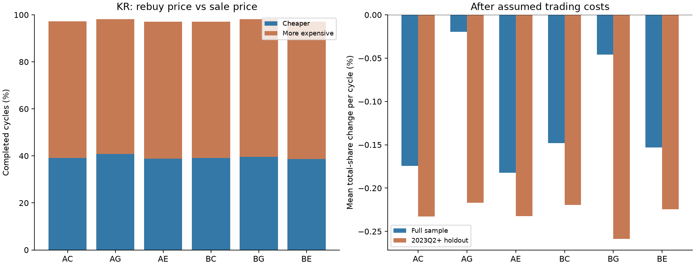
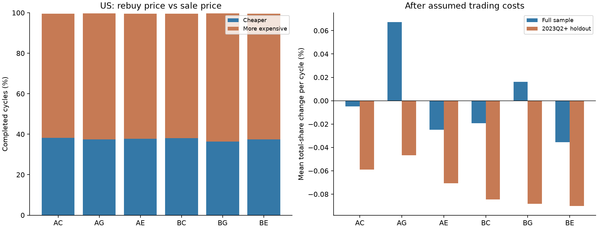
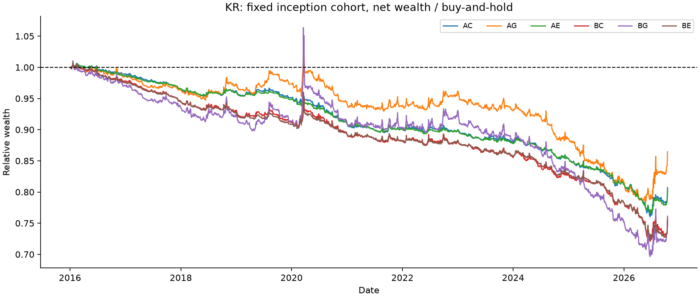
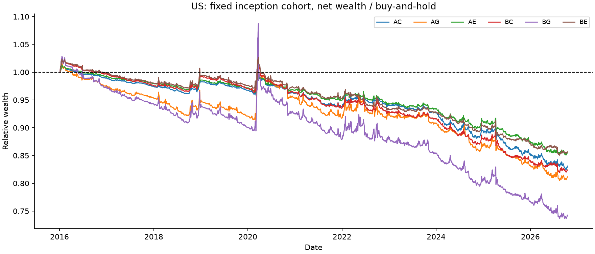

# 역배열에서 절반을 팔고 반등에 되사는 전략은 유효한가

연구 `MA-REENTRY-20261017-v1` · 2016년부터 한국·미국 **2026-10-15 완료봉까지** · 시작2026-10-17, 검증2026-10-18. 사용자 후속 요청의 전체 시계열9조합 연구에 대한 보조 보고서다.

**판단 범위:** 한국은 당시 KOSPI 보통주 시총 상위200, 미국은 확보된 보통주의 당시 추정 시총≥20억 달러다. 미국의 과거 상장폐지 누락과 한국의 실제 배당·상장폐지 회수금액 결측이 남는다. 따라서 아래 결과를 생존 편향 없는 전체시장·완전한 세후 총수익 검증이라고 주장하지 않는다.

## 1. 연구 질문에 대한 답

**한국:** 완료 사이클에서 더 싸게 재매수한 비율은 38.7%~40.8%, 비용 후 전체 주식 수의 평균 변화는 사이클당 -0.18%~-0.02%였다. 시간 분리 검증에서 복리 주식수 효과의 다중비교 보정 신뢰구간이0을 웃도는 전략은 **없다**. 2016년 시작 고정 표본의 비용 후 최종자산/보유 대비 차이는 -24.48%~-13.54%다.

**미국:** 완료 사이클에서 더 싸게 재매수한 비율은 36.4%~38.2%, 비용 후 전체 주식 수의 평균 변화는 사이클당 -0.04%~+0.07%였다. 시간 분리 검증에서 복리 주식수 효과의 다중비교 보정 신뢰구간이0을 웃도는 전략은 **없다**. 2016년 시작 고정 표본의 비용 후 최종자산/보유 대비 차이는 -25.74%~-14.36%다.

**기존 여섯 규칙에서는 보유를 개선할 유의미한 우위를 발견하지 못했다.** 골든크로스를 기다리면 일부 큰 하락 방어는 나아졌지만, 두 시장 모두 검증기간 평균 주식 수와 전체기간 고정 표본 최종자산이 보유보다 불리했다. 미국 AG/BG의 전체기간 산술평균 주식수 이익도 평균 로그효과와 검증기간에서는 유지되지 않았다. 큰 하락을 피하면서 장기 상승을 거의 그대로 유지했다는 결론은 지지되지 않는다.

싸게 되사는 횟수만으로 성공을 판단할 수 없다. 작은 손실을 자주 보고 드물게 큰 주식 수 증가를 얻으면 산술평균과 전형적 경험이 달라진다. 반복 거래의 복리 효과, 현금 대기와 놓친 배당, 실제 전체기간 최종자산을 함께 보아야 한다. 아래의 양수는 해당 표본·가정에서의 관측 이익이며 새 시장에서 보장되는 효과가 아니다.

## 2. 여섯 전략과 계산 기준

A는 `MA5<MA20 AND MA10<MA20`, B는 `MA5<MA10<MA20`이다. A는 B를 포함한다. C는 종가가 MA5를, G는 MA5가 MA10을 직전일 이하에서 당일 엄격히 상향 돌파한 신호, E는 둘 중 먼저다. 이동평균은 분할·기준가 조정 종가의 단순평균이며 10⁻¹² 상대 허용오차는 숫자 동률만 처리한다.

역배열의 false→true 진입을 종가에서 확인하고 **다음 거래일 시가**에 당시 보유 수량의50%를 판다. 남은50%는 유지하고, 매도 신호보다 나중에 확인된 첫 반등 신호의 다음 시가에 순매도대금 전액을 재투자한다. 매도 체결일 종가의 반등은 유효하다. 매도 신호와 같은 종가의 반등은 이후 반등으로 재사용하지 않는다. 반등 전 중복 매도는 무시하며, 재매수 후 역배열이 계속된다는 이유만으로 다시 팔지 않는다. 상태를 벗어났다가 새로 진입해야 한다. 재매수일 종가에 새 진입이 생기면 다음 날 매도할 수 있다. 손절·익절·최대 대기기간을 추가하지 않았다.

표본 자격은 매도 신호 당일 판단한다. 재매수는 시총 조건을 벗어나도 실행하며 보유 중 순위 이탈 때문에 강제 청산하지 않는다. 한 종목의 첫 적격 종가 다음 시가부터 같은 초기자산으로 전략과 보유를 비교한다. 거래 단위는 소수 주식이 가능한 소규모 가격수용자 가정이며, 매수대금과 보유 비중의 분모를 바꾸지 않는다.

관측 시가는 소량 주문의 체결 대용값이다. 유동성·가격제한·거래정지 후 경매에서 체결을 보장하지 않는다. 기준가격과 실제 시장가 체결가격의 차이는 [SEC 투자자 안내](https://www.investor.gov/introduction-investing/general-resources/news-alerts/alerts-bulletins/investor-bulletins-15)도 강조한다. 하루 더 늦은 시가 체결을 별도 비교했다.


| 구분 | 매도 차감 | 매수 가산 | 해석 |
|---|---|---|---|
| 한국 기본 | 0.35% | 0.05% | 수수료·스프레드·슬리피지·매도세 부담 여유 가정 |
| 미국 기본 | 0.05% | 0.05% | 수수료·스프레드·슬리피지 가정 |
| 한국 비용 스트레스 | 0.50% | 0.20% | 불리한 비용 가정 |
| 미국 비용 스트레스 | 0.25% | 0.25% | 불리한 비용 가정 |


이는 연도별 법정 세율이나 특정 증권사 실측 수수료표가 아니다. 실제 과세계좌의 양도소득세·개인별 세금·환율·환전비는 반영하지 않았다. 초기 보유는 양쪽에 동일하게 주어졌고, 마지막에는 청산하지 않고 평가하므로 공통 초기·최종 청산비도 부과하지 않는다. 현금 이자는 기본0%, 연4% 민감도를 제시한다.

## 3. 시장별 핵심 비교표

**주식수 변화**는 팔았던 절반만의 변화가 아닌 매도 직전 전체 수량 대비 변화다. **최종자산 차이**는 `(전략 최종자산/보유 최종자산−1)`이며 수익률의 %p 차이와 구별한다. 고정 표본은2016년 첫 적격 거래일에 알 수 있던 종목에 같은 초기금액을 주고 추가 편입·재균형 없이 보유한 비교다. 도중 가입 종목을 미래에 알고2016년에 샀다고 계산하지 않았다.

### 한국


| 전략 | 완료/미완료 | 싸게 재매수 | 비싸게 재매수 | 평균 순주식수 | OOS 평균 순주식수 | 고정표본 최종자산 차이 | MDD 전략/보유 |
|---|---|---|---|---|---|---|---|
| A·종가↑5 | 14,506/50 | 39.1% | 58.1% | -0.17% | -0.23% | -19.29% | 52.2%/52.2% |
| A·5↑10 | 14,316/93 | 40.8% | 57.5% | -0.02% | -0.22% | -13.54% | 48.0%/52.2% |
| A·먼저 | 14,855/47 | 38.9% | 58.2% | -0.18% | -0.23% | -19.62% | 52.5%/52.2% |
| B·종가↑5 | 19,578/67 | 39.1% | 58.1% | -0.15% | -0.22% | -24.14% | 51.2%/52.2% |
| B·5↑10 | 20,051/132 | 39.6% | 58.6% | -0.05% | -0.26% | -23.88% | 45.2%/52.2% |
| B·먼저 | 20,607/64 | 38.7% | 58.3% | -0.15% | -0.22% | -24.48% | 51.6%/52.2% |




### 미국


| 전략 | 완료/미완료 | 싸게 재매수 | 비싸게 재매수 | 평균 순주식수 | OOS 평균 순주식수 | 고정표본 최종자산 차이 | MDD 전략/보유 |
|---|---|---|---|---|---|---|---|
| A·종가↑5 | 76,672/119 | 38.2% | 61.4% | -0.00% | -0.06% | -16.90% | 37.4%/39.7% |
| A·5↑10 | 76,056/278 | 37.5% | 62.3% | +0.07% | -0.05% | -18.84% | 30.2%/39.7% |
| A·먼저 | 78,736/93 | 37.7% | 61.9% | -0.02% | -0.07% | -14.41% | 37.8%/39.7% |
| B·종가↑5 | 99,546/217 | 38.0% | 61.6% | -0.02% | -0.08% | -17.61% | 36.0%/39.7% |
| B·5↑10 | 103,003/489 | 36.4% | 63.3% | +0.02% | -0.09% | -25.74% | 26.7%/39.7% |
| B·먼저 | 105,184/179 | 37.4% | 62.2% | -0.04% | -0.09% | -14.36% | 36.2%/39.7% |




매도가와 같은 가격의 비율은 별도 원표에 남겼다. 미완료는 위 확률의 분모에서 제외하되 아래 최종자산과 미완료 평가에는 포함한다. 여섯 전략은 대안별 시뮬레이션이므로 사이클 수를 더해 독립 사건 수로 부를 수 없다.

## 4. 역배열 이후 얼마나 더 하락하고 얼마나 기다렸는가

추가 하락은 **신호일 종가**에서 다음 날 이후 반등 신호일까지 최저가로 잰다. 체결일 이후 최저가를 이용한 매매가능 구간 낙폭도 따로 저장했다. 종가 최저점과 구간 내 종가 고점→저점 최대낙폭은 다른 지표다. 저가에서 매수했다고 계산하지 않으며 재매수일 시가 이후의 저가도 미리 사용하지 않는다.

### KR


| 전략 | 최저가 추가낙폭 평균/중앙/P95 | 최저종가/구간MDD 평균 | 반등 대기봉 평균/중앙/P95 | 낙폭1% 미만 | 3봉 내 반등 | 두 조건 동시 | 20봉 넘게 대기(KM) |
|---|---|---|---|---|---|---|---|
| A·종가↑5 | 4.1%/2.5%/13.5% | 3.1%/3.6% | 4.7/4.0/12.0 | 28.6% | 47.9% | 24.2% | 0.5% |
| A·5↑10 | 5.7%/3.3%/19.4% | 4.7%/5.5% | 9.4/7.0/24.0 | 22.6% | 18.2% | 9.7% | 8.5% |
| A·먼저 | 3.7%/2.2%/12.8% | 2.8%/3.0% | 3.8/3.0/10.0 | 31.5% | 58.7% | 29.5% | 0.3% |
| B·종가↑5 | 4.1%/2.4%/13.8% | 3.2%/3.6% | 4.6/4.0/12.0 | 29.1% | 48.5% | 24.9% | 0.4% |
| B·5↑10 | 5.7%/3.2%/19.5% | 4.7%/5.5% | 9.1/7.0/23.0 | 23.6% | 18.7% | 10.7% | 7.6% |
| B·먼저 | 3.8%/2.1%/13.1% | 2.8%/3.0% | 3.8/3.0/10.0 | 32.2% | 59.3% | 30.6% | 0.2% |


### US


| 전략 | 최저가 추가낙폭 평균/중앙/P95 | 최저종가/구간MDD 평균 | 반등 대기봉 평균/중앙/P95 | 낙폭1% 미만 | 3봉 내 반등 | 두 조건 동시 | 20봉 넘게 대기(KM) |
|---|---|---|---|---|---|---|---|
| A·종가↑5 | 3.8%/2.2%/13.2% | 2.8%/3.3% | 4.6/4.0/12.0 | 30.9% | 49.4% | 25.2% | 0.4% |
| A·5↑10 | 5.3%/2.8%/18.3% | 4.2%/5.0% | 8.7/7.0/22.0 | 26.2% | 19.8% | 11.9% | 6.2% |
| A·먼저 | 3.4%/1.8%/12.1% | 2.4%/2.6% | 3.6/3.0/9.0 | 35.2% | 62.1% | 33.0% | 0.1% |
| B·종가↑5 | 3.9%/2.2%/13.3% | 2.8%/3.3% | 4.5/3.0/12.0 | 31.2% | 50.1% | 25.7% | 0.4% |
| B·5↑10 | 5.2%/2.7%/18.3% | 4.1%/4.8% | 8.3/7.0/21.0 | 27.1% | 20.9% | 13.0% | 5.3% |
| B·먼저 | 3.5%/1.8%/12.3% | 2.4%/2.6% | 3.5/3.0/9.0 | 35.7% | 63.3% | 33.9% | 0.1% |


‘곧바로 반등’은 사전에 고정한3봉 이내 반등과 추가 저가낙폭1% 미만을 동시에 만족한 경우다. 종가 아래로 한 번도 내려가지 않은 경우와 동일하지 않으며,1%·3봉은 거래 필터가 아니다. 평균·중앙·P95 외 P5/Q25/Q75와 달력일 대기는 [summary.csv](../../runtime/ma-reentry-20261017/summary.csv)에 있다. Kaplan–Meier(KM)는 반등이 없는 종료건을 우측 검열로 반영한다. 거래정지·자료 종료가 가격과 무관한 검열이라는 가정은 완전히 성립하지 않을 수 있다.

## 5. 싸게 되산 이익과 비싸게 되산 손실

가격 할인율=`1−재매수가/매도가`; 순주식수 변화=`0.5×[(1−매도비용)/(1+매수비용)×매도가/재매수가−1]`. 같은 재매수 시점의 최종자산을 비교하면 이 주식수 변화가 보유 대비 상대자산 변화와 일치한다. 평단 하락은 판정 기준으로 쓰지 않았다.

### KR


| 전략 | 성공 때 평균 할인 | 실패 때 평균 할증 | 비용 후 이익 확률 | 순주식수 P5/중앙/P95 | 이익/손실 조건부 평균 | 5%↓ 후 가격이익 없음/전체 | 동일/5%↓ 사례만 |
|---|---|---|---|---|---|---|---|
| A·종가↑5 | 4.0% | 3.2% | 35.2% | -3.49%/-0.51%/+4.24% | +2.28%/-1.51% | 4.1% | 14.8% |
| A·5↑10 | 5.5% | 4.5% | 37.9% | -4.64%/-0.63%/+6.57% | +3.36%/-2.08% | 9.0% | 24.2% |
| A·먼저 | 3.6% | 2.8% | 34.6% | -3.14%/-0.50%/+3.85% | +2.08%/-1.38% | 3.6% | 14.8% |
| B·종가↑5 | 4.0% | 3.1% | 35.2% | -3.36%/-0.50%/+4.30% | +2.30%/-1.48% | 4.3% | 15.4% |
| B·5↑10 | 5.6% | 4.3% | 36.7% | -4.56%/-0.67%/+6.47% | +3.38%/-2.03% | 9.7% | 26.0% |
| B·먼저 | 3.7% | 2.7% | 34.4% | -3.05%/-0.49%/+3.89% | +2.12%/-1.34% | 3.9% | 15.6% |


### US


| 전략 | 성공 때 평균 할인 | 실패 때 평균 할증 | 비용 후 이익 확률 | 순주식수 P5/중앙/P95 | 이익/손실 조건부 평균 | 5%↓ 후 가격이익 없음/전체 | 동일/5%↓ 사례만 |
|---|---|---|---|---|---|---|---|
| A·종가↑5 | 3.8% | 2.8% | 36.9% | -3.18%/-0.39%/+4.13% | +2.25%/-1.32% | 3.6% | 14.7% |
| A·5↑10 | 5.4% | 3.9% | 36.6% | -4.27%/-0.57%/+6.11% | +3.36%/-1.83% | 8.2% | 25.0% |
| A·먼저 | 3.5% | 2.5% | 36.3% | -2.82%/-0.38%/+3.64% | +2.03%/-1.20% | 3.1% | 14.8% |
| B·종가↑5 | 3.9% | 2.9% | 36.7% | -3.24%/-0.40%/+4.20% | +2.27%/-1.35% | 3.7% | 15.0% |
| B·5↑10 | 5.4% | 3.9% | 35.5% | -4.26%/-0.61%/+6.02% | +3.36%/-1.82% | 8.5% | 26.0% |
| B·먼저 | 3.5% | 2.5% | 36.0% | -2.86%/-0.39%/+3.70% | +2.06%/-1.21% | 3.2% | 15.1% |


마지막 두 열은 매도 이후 저가가5% 이상 내려갔지만 실제 재매수 시가가 매도가 이상으로 회복된 사례다. ‘싼 가격을 한 번 보여주었다’와 ‘규칙대로 싸게 살 수 있었다’를 구분한다.10% 하락 기준과 놓친 최고 상승폭도 원표에 포함했다. 반등을 기다리는 전략은 저점을 확인한 뒤 그 저가에 되살 수 없다.

## 6. 반복 운용의 최종자산·낙폭과 비용·배당 민감도

### KR — 2016년 시작 고정 표본 200종목, 조기 종료 16종목


| 전략 | 최종자산 차이 무비용/기본/스트레스 | CAGR 전략/보유 | OOS 새 표본 최종차이 | 모든 종목 상대자산 중앙값 | 보유를 이긴 종목 | 종목평균 MDD 전략/보유 |
|---|---|---|---|---|---|---|
| A·종가↑5 | -8.07%/-19.29%/-26.71% | +4.87%/+6.98% | -8.21% | -3.40% | 33.8% | 72.6%/72.9% |
| A·5↑10 | -1.69%/-13.54%/-21.38% | +5.54%/+6.98% | -9.56% | -0.58% | 41.7% | 70.8%/72.9% |
| A·먼저 | -8.14%/-19.62%/-27.19% | +4.83%/+6.98% | -7.64% | -4.09% | 31.9% | 72.8%/72.9% |
| B·종가↑5 | -9.92%/-24.14%/-33.18% | +4.27%/+6.98% | -10.49% | -3.50% | 34.1% | 72.2%/72.9% |
| B·5↑10 | -9.22%/-23.88%/-33.15% | +4.30%/+6.98% | -14.65% | -0.71% | 41.7% | 69.7%/72.9% |
| B·먼저 | -9.46%/-24.48%/-33.95% | +4.23%/+6.98% | -10.43% | -4.62% | 32.3% | 72.3%/72.9% |





| 전략 | 배당민감도 최종차이 | 현금이자4% 최종차이 | 조기종료 주식0 평가 | 하루 지연체결 종목중앙 차이 | 종목평균 CAGR 차이(%p) |
|---|---|---|---|---|---|
| A·종가↑5 | -21.37% | -17.25% | -18.33% | -1.38% | -0.91% |
| A·5↑10 | -17.68% | -9.26% | -13.23% | +0.00% | -0.41% |
| A·먼저 | -21.37% | -17.95% | -19.95% | -1.71% | -0.88% |
| B·종가↑5 | -26.66% | -21.68% | -23.36% | -2.29% | -1.05% |
| B·5↑10 | -28.66% | -18.91% | -23.80% | +0.00% | -0.66% |
| B·먼저 | -26.65% | -22.39% | -24.91% | -2.45% | -1.06% |


### US — 2016년 시작 고정 표본 720종목, 조기 종료 0종목


| 전략 | 최종자산 차이 무비용/기본/스트레스 | CAGR 전략/보유 | OOS 새 표본 최종차이 | 모든 종목 상대자산 중앙값 | 보유를 이긴 종목 | 종목평균 MDD 전략/보유 |
|---|---|---|---|---|---|---|
| A·종가↑5 | -13.95%/-16.90%/-27.70% | +11.28%/+13.21% | -5.73% | -1.46% | 39.7% | 63.9%/65.1% |
| A·5↑10 | -15.99%/-18.84%/-29.31% | +11.04%/+13.21% | -7.22% | -0.18% | 44.9% | 61.6%/65.1% |
| A·먼저 | -11.28%/-14.41%/-25.82% | +11.59%/+13.21% | -5.27% | -1.85% | 38.6% | 64.2%/65.1% |
| B·종가↑5 | -13.87%/-17.61%/-30.95% | +11.19%/+13.21% | -7.62% | -2.04% | 38.9% | 63.6%/65.1% |
| B·5↑10 | -22.26%/-25.74%/-38.15% | +10.12%/+13.21% | -9.99% | -1.91% | 41.8% | 60.8%/65.1% |
| B·먼저 | -10.26%/-14.36%/-28.95% | +11.59%/+13.21% | -7.38% | -2.88% | 37.5% | 63.9%/65.1% |





| 전략 | 배당민감도 최종차이 | 현금이자4% 최종차이 | 조기종료 주식0 평가 | 하루 지연체결 종목중앙 차이 | 종목평균 CAGR 차이(%p) |
|---|---|---|---|---|---|
| A·종가↑5 | -16.94% | -14.75% | -16.90% | -0.85% | -0.39% |
| A·5↑10 | -19.23% | -14.98% | -18.84% | -0.00% | -0.13% |
| A·먼저 | -14.43% | -12.68% | -14.41% | -1.27% | -0.43% |
| B·종가↑5 | -18.00% | -14.92% | -17.61% | -1.15% | -0.68% |
| B·5↑10 | -26.12% | -21.24% | -25.74% | -0.62% | -0.54% |
| B·먼저 | -14.83% | -12.15% | -14.36% | -1.61% | -0.76% |


CAGR는 관측 시작 시가와 끝 종가 사이 달력연수로 환산했다. 종목별 CAGR 차이는1년 이상 이력이 있는 종목만 계산했다. 종목별 시작일이 달라 모든 종목의 평균을 하나의 실제2016년 포트폴리오 수익률로 해석하지 않는다. 고정 표본 경로는 그 오류를 피하지만 뒤에 커진 기업을 새로 편입하는 전체시장 지수와는 다르다.

미국 배당민감도는 같은 Yahoo 응답의 `adjclose/close` 비율을 조정 OHLC에 곱한 **총수익 단위 대용 계산**이다. 가격 신호는 바꾸지 않았다. 배당 지급일 현금 원장·원천징수·정확한 실제 재투자 주문을 복원한 것은 아니다. 한국은 실제 과거 배당이 없으므로 보유 주식에 연4% 연속수익을 주고 현금에는 주지 않는 가정이다. 두 시장의 배당 열은 서로 같은 자료 수준이 아니며, 한국 숫자는 실제 총수익이 아니다.

조기 종료 주식0 평가는 데이터가 끝난 다음 날부터 그 주식 가치만0, 남은 현금은 유지한 스트레스다. 실제 상장폐지 회수금액을 추정한 결과가 아니다. 마지막 저장가격 고정평가와0평가는 편향의 방향을 살피는 가정이며, 인수대금·신주교환·권리발생을 포함한 법적 상하한도 아니다.

## 7. 규모·변동성·시장 국면별 차이

아래는 **2023년2분기 이후** 완료 사이클의 비용 후 전체 주식수 평균 변화다. 각 셀은 `평균 · 사건수`이며 사후 탐색표다. 좋은 셀만 골라 새 전략으로 바꾸거나 통계적으로 확정된 최적 조건이라고 부르지 않는다. 전체기간 조건표도 함께 저장했다.

### KR — 전일 변동성 사분위 경계: 24.7%, 32.1%, 41.9%


| 분류 | 구간 | AC | AG | AE | BC | BG | BE |
|---|---|---|---|---|---|---|---|
| group | 한국101–200위 | -0.13% · 2,388 | -0.01% · 2,364 | -0.11% · 2,452 | -0.14% · 3,175 | -0.04% · 3,272 | -0.14% · 3,357 |
| group | 한국1–50위 | -0.31% · 1,188 | -0.32% · 1,167 | -0.34% · 1,217 | -0.29% · 1,500 | -0.44% · 1,544 | -0.34% · 1,593 |
| group | 한국51–100위 | -0.36% · 1,209 | -0.52% · 1,170 | -0.36% · 1,237 | -0.32% · 1,615 | -0.51% · 1,649 | -0.30% · 1,705 |
| regime | 대용지수↓200일선 | -0.68% · 799 | -1.35% · 791 | -0.69% · 822 | -0.70% · 1,129 | -1.44% · 1,160 | -0.65% · 1,186 |
| regime | 대용지수↑200일선 | -0.14% · 3,986 | +0.01% · 3,910 | -0.14% · 4,084 | -0.11% · 5,161 | -0.00% · 5,305 | -0.13% · 5,469 |
| vol | Q1 | +0.39% · 800 | +0.85% · 792 | +0.35% · 823 | +0.17% · 1,109 | +0.42% · 1,125 | +0.14% · 1,165 |
| vol | Q2 | -0.33% · 784 | -0.57% · 769 | -0.30% · 798 | -0.34% · 1,070 | -0.53% · 1,108 | -0.30% · 1,133 |
| vol | Q3 | -0.29% · 938 | -0.49% · 924 | -0.27% · 968 | -0.25% · 1,247 | -0.44% · 1,275 | -0.22% · 1,316 |
| vol | Q4 | -0.39% · 2,263 | -0.36% · 2,216 | -0.40% · 2,317 | -0.31% · 2,863 | -0.34% · 2,956 | -0.34% · 3,040 |
| vol | 변동성 미확인 | — | — | — | -0.08% · 1 | -0.20% · 1 | -0.08% · 1 |


### US — 전일 변동성 사분위 경계: 19.8%, 27.8%, 39.8%


| 분류 | 구간 | AC | AG | AE | BC | BG | BE |
|---|---|---|---|---|---|---|---|
| group | 라지$10–200B | -0.11% · 11,752 | -0.09% · 11,645 | -0.09% · 12,063 | -0.13% · 15,154 | -0.13% · 15,664 | -0.11% · 16,004 |
| group | 메가≥$200B | -0.17% · 803 | -0.25% · 798 | -0.19% · 830 | -0.14% · 988 | -0.32% · 1,033 | -0.14% · 1,054 |
| group | 미드$2–10B | -0.02% · 16,782 | -0.00% · 16,552 | -0.05% · 17,228 | -0.05% · 21,897 | -0.05% · 22,556 | -0.07% · 23,214 |
| regime | 대용지수↓200일선 | -0.48% · 4,495 | -0.68% · 4,417 | -0.47% · 4,595 | -0.43% · 6,429 | -0.51% · 6,642 | -0.36% · 6,787 |
| regime | 대용지수↑200일선 | +0.02% · 24,842 | +0.07% · 24,578 | +0.00% · 25,526 | -0.02% · 31,610 | -0.00% · 32,611 | -0.04% · 33,485 |
| vol | Q1 | +0.00% · 5,368 | -0.04% · 5,327 | -0.00% · 5,541 | -0.01% · 6,945 | -0.08% · 7,182 | -0.01% · 7,398 |
| vol | Q2 | -0.10% · 7,899 | -0.08% · 7,804 | -0.09% · 8,135 | -0.11% · 10,141 | -0.13% · 10,451 | -0.10% · 10,746 |
| vol | Q3 | -0.08% · 8,015 | -0.08% · 7,922 | -0.08% · 8,208 | -0.06% · 10,237 | -0.06% · 10,590 | -0.08% · 10,836 |
| vol | Q4 | -0.04% · 8,054 | +0.02% · 7,941 | -0.09% · 8,236 | -0.13% · 10,714 | -0.08% · 11,028 | -0.13% · 11,290 |
| vol | 변동성 미확인 | -0.21% · 1 | +0.76% · 1 | -0.21% · 1 | -1.67% · 2 | -2.63% · 2 | -1.67% · 2 |


변동성은 신호 전일까지20개 로그수익의 표본표준편차×√252다. 경계는2016–2022년 적격 종목–일로 정했고 미래 검증기간에 다시 맞추지 않았다. 시장 국면은 전일 시총 적격 표본의 동일가중 가격수익으로 만든 누적지수의 **전일**200일선 위·아래다. 공식 KOSPI/S&P 500 국면이 아니며 미국 표본의 생존 편향도 공유한다. 이 표만으로 시장 전체의 국면 효과를 단정하지 않는다.

## 8. 연도 의존성과 A에서 B로 진행되는 과정

연도표는 매도 신호 연도 기준의 완료 사이클 평균 순주식수 변화다. 연말 이후 끝난 사이클은 이 기술통계 연도표에는 들어가지만, 학습 표본에는2022년 안에 끝난 것만 포함한다.2026년은10월15일까지의 부분 연도다.

### KR


| 연도 | AC | AG | AE | BC | BG | BE |
|---|---|---|---|---|---|---|
| 2016 | -0.06% | +0.01% | -0.10% | -0.17% | -0.15% | -0.19% |
| 2017 | -0.36% | -0.34% | -0.33% | -0.36% | -0.41% | -0.33% |
| 2018 | +0.10% | +0.40% | +0.04% | -0.04% | +0.14% | -0.08% |
| 2019 | -0.12% | +0.23% | -0.13% | -0.13% | +0.15% | -0.13% |
| 2020 | -0.50% | -0.28% | -0.42% | -0.03% | +0.28% | +0.03% |
| 2021 | -0.18% | -0.05% | -0.24% | -0.11% | -0.05% | -0.16% |
| 2022 | +0.20% | +0.66% | +0.16% | +0.13% | +0.51% | +0.11% |
| 2023 | +0.04% | +0.52% | +0.05% | -0.05% | +0.27% | -0.03% |
| 2024 | -0.19% | -0.30% | -0.25% | -0.12% | -0.20% | -0.16% |
| 2025 | -0.46% | -0.82% | -0.35% | -0.41% | -0.74% | -0.33% |
| 2026 | -0.44% | -0.32% | -0.49% | -0.46% | -0.50% | -0.51% |


한 해씩 제외한 평균 순주식수 범위: -0.22%~+0.06%. 전략별 제외연도 결과는 [leave_one_year_out.csv](../../runtime/ma-reentry-20261017/leave_one_year_out.csv)에 보존했다. 고정 표본의 실제 달력연도 전략·보유 수익률은 [cohort_annual.csv](../../runtime/ma-reentry-20261017/cohort_annual.csv)에서 별도로 비교한다.

### US


| 연도 | AC | AG | AE | BC | BG | BE |
|---|---|---|---|---|---|---|
| 2016 | -0.09% | -0.32% | -0.06% | +0.02% | -0.24% | +0.02% |
| 2017 | -0.18% | -0.25% | -0.16% | -0.21% | -0.28% | -0.18% |
| 2018 | +0.20% | +0.09% | +0.16% | +0.23% | +0.11% | +0.20% |
| 2019 | -0.11% | -0.16% | -0.11% | -0.15% | -0.24% | -0.13% |
| 2020 | +0.33% | +1.38% | +0.29% | +0.33% | +1.16% | +0.27% |
| 2021 | -0.21% | -0.20% | -0.21% | -0.19% | -0.20% | -0.17% |
| 2022 | +0.15% | +0.20% | +0.06% | +0.06% | +0.10% | -0.02% |
| 2023 | +0.11% | +0.20% | +0.05% | +0.05% | +0.09% | +0.00% |
| 2024 | -0.17% | -0.27% | -0.13% | -0.18% | -0.29% | -0.16% |
| 2025 | -0.21% | -0.14% | -0.23% | -0.17% | -0.07% | -0.16% |
| 2026 | +0.19% | +0.31% | +0.13% | +0.07% | +0.10% | +0.02% |


한 해씩 제외한 평균 순주식수 범위: -0.08%~+0.11%. 전략별 제외연도 결과는 [leave_one_year_out.csv](../../runtime/ma-reentry-20261017/leave_one_year_out.csv)에 보존했다. 고정 표본의 실제 달력연도 전략·보유 수익률은 [cohort_annual.csv](../../runtime/ma-reentry-20261017/cohort_annual.csv)에서 별도로 비교한다.


| 시장 | A 사건의 결과 | 사건수 | 비율 | A→결과 대기봉 평균/중앙 | A→결과 가격 평균/중앙 |
|---|---|---|---|---|---|
| KR | already_B | 13,180 | 86.4% | 0.0/0.0 | +0.00%/+0.00% |
| KR | ended_without_B | 596 | 3.9% | 1.5/1.0 | +2.35%/+1.37% |
| KR | later_B | 1,483 | 9.7% | 1.4/1.0 | -0.75%/-0.55% |
| US | already_B | 69,791 | 87.0% | 0.0/0.0 | +0.00%/+0.00% |
| US | censored | 2 | 0.0% | 0.0/0.0 | +0.00%/+0.00% |
| US | ended_without_B | 2,925 | 3.6% | 1.5/1.0 | +1.91%/+1.29% |
| US | later_B | 7,460 | 9.3% | 1.4/1.0 | -0.67%/-0.43% |


`already_B`는 A 진입 순간 이미 B도 충족, `later_B`는 A가 끝나기 전 B로 진행, `ended_without_B`는 B 없이 A 종료, `censored`는 자료 경계로 미확정이다. B로 진행된 미래 결과로 A 거래를 선택하지 않았다. 같은 순간 A/B가 발생하는 비중을 빼고 ‘B가 항상 더 늦다’고 해석하면 안 된다.

## 9. 미완료·체결 누락·통계적 신뢰도


| 시장 | 전략 | 미완료 | 평가상 상대효과 평균/중앙 | 대기봉 평균/최대 | 조기종료/공백횡단 |
|---|---|---|---|---|---|
| KR | A·종가↑5 | 50 | +5.39%/+3.55% | 5.1/14 | 3/0 |
| KR | A·먼저 | 47 | +5.86%/+4.15% | 4.7/11 | 1/0 |
| KR | A·5↑10 | 93 | +6.91%/+5.94% | 9.8/30 | 3/0 |
| KR | B·종가↑5 | 67 | +5.03%/+3.02% | 5.1/18 | 3/0 |
| KR | B·먼저 | 64 | +5.24%/+2.98% | 4.6/18 | 1/0 |
| KR | B·5↑10 | 132 | +6.42%/+5.02% | 9.6/30 | 4/0 |
| US | A·종가↑5 | 119 | +1.88%/+0.74% | 4.6/22 | 0/0 |
| US | A·먼저 | 93 | +2.76%/+1.25% | 3.8/16 | 0/0 |
| US | A·5↑10 | 278 | +4.83%/+2.18% | 13.9/57 | 0/0 |
| US | B·종가↑5 | 217 | +1.47%/+0.10% | 4.6/24 | 0/0 |
| US | B·먼저 | 179 | +2.07%/+0.58% | 3.9/24 | 0/0 |
| US | B·5↑10 | 489 | +3.96%/+2.05% | 12.8/57 | 0/0 |


미완료 사이클은 가상의 재매수를 넣지 않고 남은 주식과 순매도 현금으로 평가했다. 위 효과는 해당 미완료 사이클만의 매도 직전 기준 상대효과이며, 이전 완료 사이클까지 합친 누적자산 효과는 경로표에 있다. 반등 신호가 마지막 날 나와 다음 체결봉이 없는 경우와 반등 자체가 없는 경우는 원장 `status`로 구분한다.


| 시장 | 전략 | 다음 봉 없어 미체결 매도 | 현금 대기 중 무시한 매도 | 다음 봉 없어 미체결 반등 |
|---|---|---|---|---|
| KR | A·종가↑5 | 7 | 696 | 1 |
| KR | A·먼저 | 7 | 350 | 1 |
| KR | A·5↑10 | 7 | 843 | 5 |
| KR | B·종가↑5 | 8 | 1420 | 5 |
| KR | B·먼저 | 8 | 394 | 5 |
| KR | B·5↑10 | 8 | 882 | 10 |
| US | A·종가↑5 | 29 | 3358 | 19 |
| US | A·먼저 | 30 | 1319 | 20 |
| US | A·5↑10 | 30 | 3814 | 26 |
| US | B·종가↑5 | 41 | 6890 | 60 |
| US | B·먼저 | 42 | 1289 | 60 |
| US | B·5↑10 | 42 | 3160 | 44 |


주 검정량은 `평균 log(1+비용 후 전체 주식수 변화)`다. 반복 거래에서 한 번의 큰 이익이 산술평균만 높이는지 확인하기 위한 복리 지표다. 종목×매도 분기를 동시에 재표집하는2,000회 군집 bootstrap을 사용했다. 같은 종목의 반복 사건과 같은 시장 분기의 공동 충격을 독립 사건으로 간주하지 않는다. 아래는12개 시장·전략 비교에 대한 Bonferroni 가족95% 구간이다. 극단 분위수의 Monte Carlo 오차와 분기 간 장기 의존성은 남는다.


| 시장 | 전략 | 전체 log효과/사이클 | OOS log효과/사이클 | OOS 가족95%CI | 종목/분기 군집 | OOS 고정표본 연환산 log상대수익 가족CI |
|---|---|---|---|---|---|---|
| KR | A·종가↑5 | -0.23% | -0.32% | -0.69% ~ +0.18% | 272/15 | -5.41% ~ +1.67% |
| KR | A·5↑10 | -0.13% | -0.40% | -0.92% ~ +0.35% | 272/15 | -7.64% ~ +4.19% |
| KR | A·먼저 | -0.23% | -0.31% | -0.65% ~ +0.18% | 272/15 | -4.34% ~ +0.98% |
| KR | B·종가↑5 | -0.20% | -0.30% | -0.61% ~ +0.08% | 272/15 | -6.23% ~ +1.02% |
| KR | B·5↑10 | -0.14% | -0.41% | -0.86% ~ +0.19% | 272/15 | -10.66% ~ +3.14% |
| KR | B·먼저 | -0.19% | -0.29% | -0.54% ~ +0.03% | 272/15 | -5.60% ~ +0.62% |
| US | A·종가↑5 | -0.06% | -0.10% | -0.43% ~ +0.19% | 1678/15 | -3.74% ~ +0.09% |
| US | A·5↑10 | -0.03% | -0.12% | -0.64% ~ +0.42% | 1674/15 | -5.26% ~ +0.87% |
| US | A·먼저 | -0.07% | -0.11% | -0.37% ~ +0.14% | 1678/15 | -3.40% ~ -0.00% |
| US | B·종가↑5 | -0.07% | -0.13% | -0.45% ~ +0.18% | 1682/15 | -4.61% ~ -0.10% |
| US | B·5↑10 | -0.08% | -0.16% | -0.62% ~ +0.35% | 1679/15 | -6.55% ~ +0.57% |
| US | B·먼저 | -0.08% | -0.12% | -0.38% ~ +0.12% | 1682/15 | -4.17% ~ -0.25% |


학습은2016–2022년 안에 끝난 사이클,2023년1분기는 경계 구간, 검증은2023년4월 이후 새 매도 신호다. 여섯 전략을 전부 그대로 평가했고 성과가 좋은 것으로 규칙을 교체하지 않았다. 새 검증기간 시작 보유를 사용한 독립 경로도 비교했다. 다만 같은 역사 자료가 이전 연구에서 이미 쓰였으므로 **시간 분리 검증이지, 아무도 보지 않은 신규 데이터나 전향적 실거래 검증은 아니다.**

고정 표본의 통계는 전략−보유의 일별 로그수익 차이를 분기 블록으로 묶어 재표집했다. 사건 단위의 양수만으로 포트폴리오 초과수익이 입증되지 않으며, 검증기간의 분기 수가 적어 구간이 넓을 수 있다. 조건별 표의 수많은 비교는 확정적 발견 검정으로 사용하지 않았다.

## 10. 자료·정확성 검증과 남는 한계

기존 연구 원본 **7,920개 해시**를 다시 대조했다. 가격·시점시총 원본을 다시 수집하거나 과거 DD 사건을 재활용하지 않고 새 상태 전환과 거래 원장을 계산했다. 당시 적격일이 있는 유효 입력은 한국406종목·미국2,000종목이다. 최초 반등 고점 규칙을 쓰지 않으므로 이전 DD 연구와 사건·종목 수가 다르다. 기존 WBD 응답의 timestamp 결측은 그대로 미포함·기록했다.

한국은 FinanceData/marcap의 고정 커밋에서 날짜별 KOSPI 보통주 코드와 종목 시총 순위를 재구성했다. KOSPI200 구성도, 현재 상위200도 아니다. 기준가격 변경 계수로 OHLC를 역조정했지만 권리배정·합병·현금배당의 실제 모든 현금흐름을 복원하지는 못했다.

미국은 SEC의 사건일보다 앞서 공시된 최근 시점 주식수(기준일180일 이내)를 같은 분할단위 가격에 곱한 시총 근사다. 공시 사이 주식수 변동, 복수 클래스와 ADR 제외, 정확한 티커–CIK 대응 결측이 남는다. **현재 목록에 없는 과거 상장폐지 회사의 누락은 해결되지 않았다.** 역사 시총만 쓴다고 이 생존 편향이 없어지는 것은 아니다. 상장폐지 수익 누락이 성과 추정을 왜곡할 수 있다는 근거는 [Shumway의 원 연구](https://doi.org/10.1111/j.1540-6261.1997.tb03818.x)를 참조한다.

처음 입력 감사에서 기존 DD 코드가2017-09-29→10-10의 정상 장기 연휴에도 지표를 초기화하는 것을 발견했다. 성과 요약을 보기 전에 미완료 실행을 중단·보존하고, 실제 연속 시장 거래일이면 유지하도록 수정했다.323개 인위적 구간 경계를 합쳤다. 실제 무거래·비정상 OHLC·빠진 시장 세션은 여전히 구간을 끊으며 원래 보유 주식·현금은 이어진다. 이 변경은 매도·반등·비용·검증기간 최적화가 아니다. 최초 규약 `bdfc49c`, 구현 `268838f`, 달력 보정 `88cd46b`로 이력을 남겼다.

미완료 사례의 마지막 가격을 확정 청산금으로 볼 수 없고, 가격 제한일·정지 재개 경매의 실제 체결 가능 수량도 확인하지 못했다. 이 한계가 큰 사례의 이익은 실현 가능한 이익으로 단정하지 않는다. 비용 스트레스와 체결 지연·배당 민감도는 이 부족한 원자료를 대신하지 않는다.

**독립 검증 PASS:** 핵심21검사, 원본7,920해시·파생2,406해시, 전체 원장644,938행의 산식·시간순서·중복·비용 단조성 검사. 독립 scalar SMA/일별 현금 원장으로6,563사이클·168종목×전략 경로를 재생하고 미래 자료를 잘라낸 prefix 결과도 일치했다. 원본 가격·시총427,392값, 신호 플래그498,624개, 요약/고정표본 합계156개를 대조했다. 검증기는 구현 일치를 확인하며 누락된 상장폐지·배당의 실재를 증명하지 않는다.

## 11. 판단과 재현 자료

이 전략의 가치는 “역배열 뒤 하락한 적이 많다”가 아니라 **비용을 내고 현금으로 기다렸다가 신호대로 되산 뒤 자산이 더 남는가**에 달려 있다. 일부 큰 하락에서 방어가 되더라도 반등을 뒤늦게 따라사거나 반복 비용이 누적되면 장기 상승을 유지한다는 목적과 충돌한다. 위 확률·복리 신뢰구간·고정표본 자산·민감도가 함께 지지하지 않는 전략은 추천하지 않는다. 생존 편향 없는 미국 전체시장과 한국의 실제 세후 총수익에 대한 확정 결론은 현재 자료만으로 낼 수 없다.

독립 실행·검증 경로를 보존했으며 운영 감시·계좌·주문·예약에는 적용하지 않았다. 다음 파일에서 모든 결과와 실패·누락을 추적할 수 있다.

- [protocol.json](../../runtime/ma-reentry-20261017/protocol.json)
- [prepared.json — 상세 원본 미포함](../../OMITTED_DATA.md)
- [results.json](../../runtime/ma-reentry-20261017/results.json)
- [summary.csv](../../runtime/ma-reentry-20261017/summary.csv)
- [cycles.csv.gz — 상세 원본 미포함](../../OMITTED_DATA.md)
- [paths.csv.gz — 상세 원본 미포함](../../OMITTED_DATA.md)
- [path_summary.csv](../../runtime/ma-reentry-20261017/path_summary.csv)
- [conditions.csv](../../runtime/ma-reentry-20261017/conditions.csv)
- [annual.csv](../../runtime/ma-reentry-20261017/annual.csv)
- [cohort_summary.csv](../../runtime/ma-reentry-20261017/cohort_summary.csv)
- [cohort_annual.csv](../../runtime/ma-reentry-20261017/cohort_annual.csv)
- [progression.csv.gz — 상세 원본 미포함](../../OMITTED_DATA.md)
- [open_cycles.csv — 상세 원본 미포함](../../OMITTED_DATA.md)
- [examples.csv — 상세 원본 미포함](../../OMITTED_DATA.md)
- [execution_audit.csv.gz — 상세 원본 미포함](../../OMITTED_DATA.md)
- [verification.json](../../runtime/ma-reentry-20261017/verification.json)
- [manifest.json — 상세 원본 미포함](../../OMITTED_DATA.md)

```powershell
$researchPython = "<USER_HOME>/Desktop/Ai 사일로/invest-agent-engine/.venv/Scripts/python.exe"
# 원본은 기존 runtime/ma-dd-describe-20261017 유지. 재현 시 새 출력 폴더 사용.
& $researchPython scripts/research/reentry/ma_reentry_research.py prepare --out runtime/ma-reentry-replay
& $researchPython scripts/research/reentry/ma_reentry_research.py run --out runtime/ma-reentry-replay
& $researchPython scripts/research/reentry/ma_reentry_statistics.py --out runtime/ma-reentry-replay
& $researchPython scripts/research/reentry/verify_ma_reentry.py --out runtime/ma-reentry-replay
& $researchPython scripts/research/reentry/ma_reentry_report.py --out runtime/ma-reentry-replay --report docs/research/ma-reentry-replay.md
& $researchPython -m unittest discover -s tests -p test_ma_reentry.py
```
