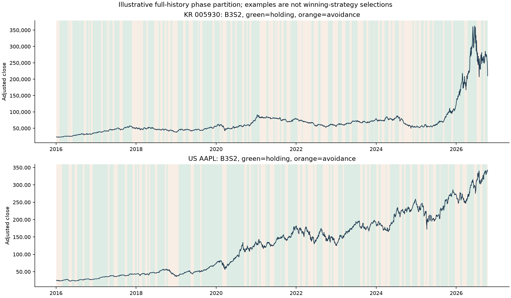
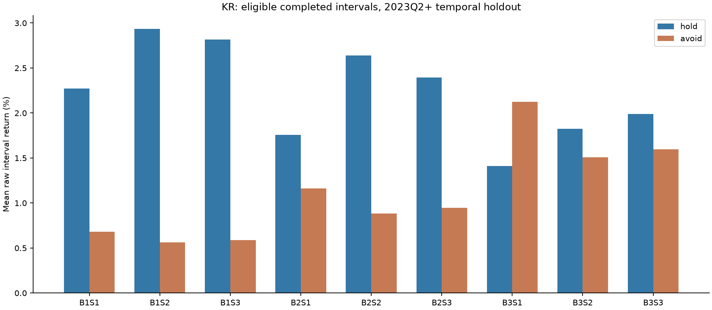
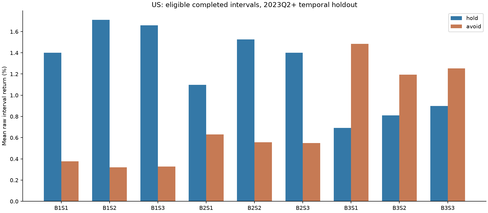
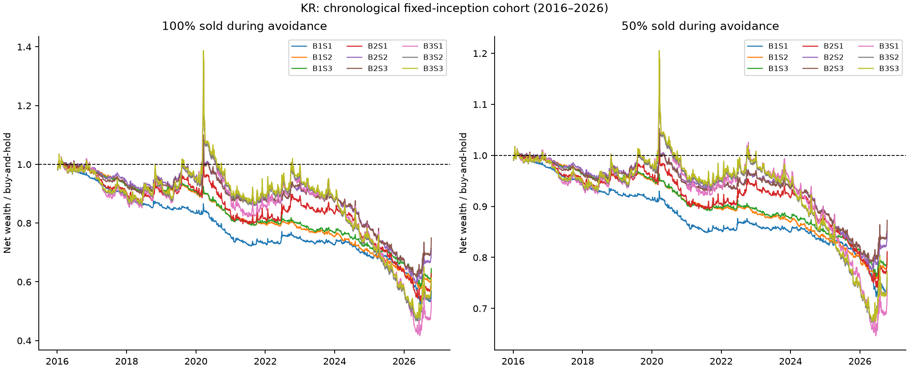
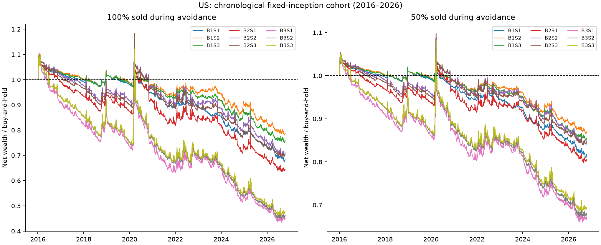

# 이동평균선으로 보유·회피 구간을 나누면 투자 성과가 개선되는가

**주 연구:** 매수3×매도3의9조합, 전량 회피와 절반 회피. **보조 연구:** 기존 역배열2×반등3의6개 절반매도 전략. 2026-10-18 작성 · 저장 원자료2016년~2026-10-15 완료 거래일까지.

## 1. 먼저 답하면

**한국:** 시간 분리 검증기간(2023년4월 이후) 회피 구간에서 실제 가격이 하락한 비율은 조합별 35.2%~40.0%였다. 같은 기간을 처음부터 연결한 고정 표본의 비용 후 보유 대비 최종자산 차이는 전량 회피 -37.22%~-16.22%, 절반 회피 -20.93%~-8.18%다.36개 비교를 고려한 신뢰구간이0을 웃도는 조합은 **없다**.

**미국:** 시간 분리 검증기간(2023년4월 이후) 회피 구간에서 실제 가격이 하락한 비율은 조합별 34.7%~39.4%였다. 같은 기간을 처음부터 연결한 고정 표본의 비용 후 보유 대비 최종자산 차이는 전량 회피 -25.52%~-9.77%, 절반 회피 -13.94%~-5.20%다.36개 비교를 고려한 신뢰구간이0을 웃도는 조합은 **없다**.

**이번 자료에서는 추천할 만한 보유 대비 우위를 발견하지 못했다.** 새9조합의 전량·절반 방식 모두 전체기간과 검증기간 고정 표본에서 최종자산이 보유보다 적었다. 원래6개 절반매도 전략도 같은 방향이다. 늦은 골든크로스는 큰 낙폭을 줄이는 데 도움이 되었지만, 장기 상승을 최대한 유지하면서 하락만 피하는 목적은 달성하지 못했다. 다만 “모든 종목에서 항상 손해” 또는 “진정한 기대수익이 반드시 음수”까지 증명한 결과는 아니다.

이 연구는 기업을 고르는 능력을 평가하지 않는다. 첫 적격 시점에 투자 아이디어가 있다고 가정한 종목에서, 신호를 따라 **언제 주식에 노출되고 언제 현금으로 기다리는가**만 비교한다. 회피 중 내린 가격은 피한 하락, 오른 가격은 놓친 상승으로 양쪽 모두 집계한다. 낙폭 감소와 자산 증가를 별개의 결과로 평가한다.

**자료 범위:** 사용자가2026-10-18에 정정한 대로 기존 데이터셋을 최대한 재사용했다. 확보 입력은 한국406·미국2,000종목이며 실제 시작 가능한 경로는405·1,999종목이다. 한국450140·미국LVO는 유일한 적격일 다음에 연속 유효봉이 없어 초기 체결을 만들지 못했다. 손실 종목이라서 제외한 것이 아니다. 미국의 현재 목록 기반 표본에는 과거 상장폐지 누락이 남으며, 한국의 실제 배당·합병/폐지 회수금액도 완전하지 않다. 아래는 이 관측 표본과 명시한 비용 가정에 대한 실증이다. 생존 편향 없는 전체시장 또는 실제 세후 총수익이라고 확대하지 않는다.

## 2. 신호와 실제 매매 순서


| 기호 | 매수 신호 |
|---|---|
| B1 | 종가의 MA5 상향 돌파 |
| B2 | MA5의 MA10 상향 돌파 |
| B3 | MA10의 MA20 상향 돌파 |


| 기호 | 매도 신호 |
|---|---|
| S1 | MA5의 MA20 하향 돌파 |
| S2 | MA10의 MA20 하향 돌파 |
| S3 | MA5<MA20 및 MA10<MA20 상태에 처음 진입 |


교차는 직전일 반대쪽 또는 동률→당일 엄격한 돌파다. 단순 이동평균을 사용하며, 같은 상태에 머문 날은 새로운 신호가 아니다. 매수 신호가 매도 신호보다 항상 먼저 또는 나중에 온다고 가정하지 않는다. **보유 상태에서는 매도 신호만, 회피 상태에서는 매수 신호만** 사용한다. 같은 종가에 양쪽 신호가 나와도 현재 상태에 맞는 주문 하나만 다음 거래일 시가에 실행한다. 체결 후 그날 종가에서는 바뀐 상태로 다시 판단한다.

100% 회피는 보유 주식 전량을,50% 회피는 당시 보유 주식 절반을 팔고 나머지를 유지한다. 다음 매수 신호의 다음 시가에 해당 순매도 현금만 전액 재투자한다. 손절·익절·최대 대기일·추세 필터는 추가하지 않았다. 첫 적격 종가 다음 시가부터100% 방식은 현금,50% 방식은 절반 주식·절반 현금으로 시작해 **첫 실제 매수 교차**를 기다린다. 처음부터 전부 보유한 경우도 별도 민감도로 계산했다. 시작 이전의 좋은 매수 신호를 사후에 골라 가져오지 않는다.

첫 종목 포함 시점은 당시 한국 KOSPI 보통주 시총 상위200 또는 미국 시점 추정 시총20억 달러 이상이다. 그 뒤에는 시총 조건을 벗어나도 주식과 모든 신호를 계속 추적한다. 시총 이탈을 또 다른 청산 규칙으로 만들지 않기 위해서다. **구간 분포의 주 표는 구간 시작 신호 당일에도 적격인 구간**, 연결 성과는 최초 선정 후 모든 구간이다. 자격 밖·결측 구간 수와 전체 구간 분포도 저장해 이 차이를 숨기지 않았다.

완료 보유 구간은 매수 시가→다음 매도 시가, 완료 회피 구간은 매도 시가→다음 매수 시가다. 경계 시가를 공유하므로 누락·겹침 없이 전체 가격 경로를 복원한다. 처음 진행 중이던 구간과 마지막 미완료 구간은 완료구간 분포에서 구분하고, 자산·보유 시간 계산에는 모두 포함했다. 마지막 날 강제 매도·매수는 하지 않는다.



위 삼성전자·AAPL과 B3S2는 구간 구분을 설명하는 고정 예시이며 성과가 좋은 종목·조합을 선정한 그림이 아니다.

## 3. 보유 구간과 회피 구간의 성격

다음 표는 사건 당시 적격이며 실제 양쪽 체결이 있는 완료 구간이다. 보유 구간 수익은 높을수록 좋지만, 회피 구간의 **가격 변화는 음수일수록** 회피에 유리하다. 평균과 중앙값을 함께 보며, 완료된 구간만 골라 투자가 시작된 것으로 누적 성과를 만들지는 않았다.

### 한국


| 조합 | 보유/회피 구간수 | 보유 수익 평균/중앙 | 보유 봉 평균/중앙 | 회피 가격 평균/중앙 | 회피 봉 평균/중앙 | 피한 하락 확률 | 놓친 상승 확률 |
|---|---|---|---|---|---|---|---|
| B1S1 | 16,065/15,874 | +0.75%/-1.18% | 28.3/24.0 | +0.40%/+0.73% | 4.4/3.0 | 37.6% | 59.9% |
| B1S2 | 14,192/14,021 | +1.03%/-1.23% | 32.1/28.0 | +0.32%/+0.63% | 4.8/4.0 | 39.0% | 58.2% |
| B1S3 | 14,615/14,442 | +1.01%/-1.43% | 31.1/27.0 | +0.31%/+0.62% | 4.7/4.0 | 39.0% | 58.2% |
| B2S1 | 16,024/15,812 | +0.76%/-1.68% | 22.4/18.0 | +0.43%/+1.13% | 10.2/8.0 | 39.4% | 59.1% |
| B2S2 | 13,581/13,400 | +1.06%/-1.54% | 28.6/24.0 | +0.32%/+0.81% | 9.9/8.0 | 41.3% | 56.9% |
| B2S3 | 14,379/14,187 | +1.02%/-1.84% | 26.8/22.0 | +0.30%/+0.87% | 9.4/7.0 | 40.7% | 57.5% |
| B3S1 | 13,137/12,905 | +0.63%/-1.84% | 17.1/13.0 | +0.75%/+1.49% | 22.7/18.0 | 40.5% | 58.4% |
| B3S2 | 14,312/14,087 | +0.80%/-1.73% | 17.8/14.0 | +0.50%/+1.45% | 18.7/15.0 | 39.9% | 58.9% |
| B3S3 | 13,417/13,200 | +0.87%/-1.92% | 19.3/15.0 | +0.52%/+1.56% | 19.6/16.0 | 39.7% | 59.3% |




### 미국


| 조합 | 보유/회피 구간수 | 보유 수익 평균/중앙 | 보유 봉 평균/중앙 | 회피 가격 평균/중앙 | 회피 봉 평균/중앙 | 피한 하락 확률 | 놓친 상승 확률 |
|---|---|---|---|---|---|---|---|
| B1S1 | 86,093/85,564 | +1.08%/-0.41% | 28.2/25.0 | +0.30%/+0.74% | 4.2/3.0 | 36.8% | 62.8% |
| B1S2 | 75,491/75,075 | +1.33%/-0.22% | 32.1/28.0 | +0.24%/+0.65% | 4.8/4.0 | 38.8% | 60.8% |
| B1S3 | 76,671/76,267 | +1.27%/-0.57% | 31.6/28.0 | +0.27%/+0.69% | 4.6/4.0 | 38.1% | 61.5% |
| B2S1 | 86,423/85,759 | +0.88%/-1.04% | 22.9/19.0 | +0.49%/+1.28% | 9.4/8.0 | 36.5% | 63.3% |
| B2S2 | 72,248/71,673 | +1.23%/-0.55% | 29.3/25.0 | +0.42%/+1.00% | 9.3/7.0 | 38.1% | 61.6% |
| B2S3 | 75,863/75,312 | +1.12%/-1.07% | 27.9/24.0 | +0.43%/+1.07% | 8.6/7.0 | 37.3% | 62.4% |
| B3S1 | 70,898/69,957 | +0.62%/-1.26% | 18.4/15.0 | +1.05%/+2.00% | 20.9/17.0 | 35.7% | 64.2% |
| B3S2 | 76,859/75,903 | +0.66%/-1.14% | 19.7/16.0 | +0.88%/+1.75% | 16.6/14.0 | 34.6% | 65.2% |
| B3S3 | 71,225/70,295 | +0.72%/-1.34% | 21.5/17.0 | +0.94%/+1.95% | 17.6/15.0 | 34.3% | 65.5% |




**보유 구간 평균은 모든 조합에서 양수지만 중앙값은 모두 음수였다.** 긴 상승을 잡은 소수 구간이 평균을 끌어올렸다. 반면 회피 구간의 가격 변화는 두 시장 모든 조합에서 평균·중앙값이 모두 양수였다. 즉 전형적 회피는 더 싸게 돌아오기보다 더 비싸게 돌아오는 구간이었다.

매수를 B1에서 B3로 늦추면 보유 구간 중앙기간은 대체로24~28봉에서13~17봉으로 짧아지고, 회피 구간은3~4봉에서14~18봉으로 길어졌다. 늦은 확인이 상승을 더 길게 보유하도록 만들지는 않았다. 신호가 확인될 때 이미 상승 구간의 일부가 지나 있기 때문이다. 확률과 꼬리를 분리한 다음 표를 함께 봐야 한다. 수익률은 해당 구간의 시작 시가 대비이며 연율화하지 않았다.

## 4. 분포·큰 하락·놓친 상승

### KR


| 조합 | 보유 수익 P5/P95 | 회피 가격 P5/P95 | 회피↓/↑ 조건부 평균 | 보유/회피 봉P95 | 회피 중10%↓ | 5%↓ 후 가격 회복 비율 | 순재매수 주식수 전량/절반 |
|---|---|---|---|---|---|---|---|
| B1S1 | -17.08%/+23.44% | -7.72%/+6.80% | -3.81%/+3.06% | 64.0/11.0 | 9.0% | 16.5% | -0.52%/-0.26% |
| B1S2 | -18.00%/+25.11% | -8.24%/+7.19% | -4.02%/+3.26% | 69.0/12.0 | 9.8% | 14.6% | -0.36%/-0.18% |
| B1S3 | -17.26%/+25.15% | -8.16%/+7.10% | -3.96%/+3.18% | 69.0/12.0 | 9.7% | 14.8% | -0.36%/-0.18% |
| B2S1 | -13.77%/+22.08% | -12.54%/+10.37% | -5.97%/+4.71% | 56.0/24.0 | 18.6% | 25.1% | -0.12%/-0.06% |
| B2S2 | -16.05%/+24.88% | -12.29%/+10.04% | -5.58%/+4.62% | 64.0/25.0 | 17.5% | 23.9% | -0.00%/-0.00% |
| B2S3 | -14.97%/+24.76% | -11.97%/+9.78% | -5.53%/+4.44% | 63.0/24.0 | 17.3% | 24.2% | -0.04%/-0.02% |
| B3S1 | -11.39%/+20.62% | -17.71%/+15.52% | -8.52%/+7.20% | 45.0/53.0 | 31.4% | 32.9% | +0.29%/+0.14% |
| B3S2 | -11.67%/+20.55% | -16.81%/+13.60% | -7.85%/+6.17% | 45.0/46.0 | 28.1% | 31.6% | +0.25%/+0.13% |
| B3S3 | -11.96%/+21.81% | -17.25%/+13.88% | -8.17%/+6.36% | 49.0/47.0 | 29.4% | 31.8% | +0.29%/+0.14% |


### US


| 조합 | 보유 수익 P5/P95 | 회피 가격 P5/P95 | 회피↓/↑ 조건부 평균 | 보유/회피 봉P95 | 회피 중10%↓ | 5%↓ 후 가격 회복 비율 | 순재매수 주식수 전량/절반 |
|---|---|---|---|---|---|---|---|
| B1S1 | -15.46%/+21.22% | -7.48%/+6.25% | -3.72%/+2.66% | 63.0/11.0 | 8.0% | 15.3% | -0.09%/-0.05% |
| B1S2 | -16.82%/+22.88% | -7.73%/+6.77% | -3.78%/+2.81% | 70.0/12.0 | 8.4% | 14.5% | -0.00%/-0.00% |
| B1S3 | -16.24%/+23.32% | -7.68%/+6.68% | -3.80%/+2.79% | 70.0/12.0 | 8.4% | 14.8% | -0.03%/-0.02% |
| B2S1 | -12.44%/+19.76% | -11.46%/+9.63% | -5.82%/+4.13% | 56.0/22.0 | 16.0% | 25.3% | +0.09%/+0.05% |
| B2S2 | -15.12%/+22.11% | -11.10%/+9.47% | -5.39%/+4.01% | 65.0/24.0 | 14.8% | 24.5% | +0.13%/+0.07% |
| B2S3 | -14.19%/+22.24% | -10.90%/+9.22% | -5.39%/+3.92% | 65.0/22.0 | 14.6% | 24.9% | +0.11%/+0.06% |
| B3S1 | -11.06%/+17.97% | -15.88%/+14.27% | -8.10%/+6.13% | 48.0/49.0 | 26.4% | 36.1% | +0.19%/+0.10% |
| B3S2 | -12.04%/+18.77% | -14.36%/+12.42% | -7.33%/+5.24% | 50.0/40.0 | 22.5% | 35.7% | +0.11%/+0.05% |
| B3S3 | -12.29%/+19.83% | -14.92%/+12.82% | -7.73%/+5.48% | 54.0/41.0 | 23.9% | 35.9% | +0.12%/+0.06% |


‘회피 중10%↓’는 그 구간에서 실제로10% 낮은 저가가 한 번이라도 나타난 비율이며, 그 저가에 재매수했다고 계산한 비율이 아니다. ‘5%↓ 후 가격 회복’은5% 이상 내렸던 회피 구간 중 실제 재매수 시가가 매도가 이상인 비율이다. 매수일 시가 이후의 장중 저가는 미리 활용하지 않는다. 구간 내 최저·최고·종가 최대낙폭, Q25/Q75, 달력일 기간은 [segment_summary.csv](../../runtime/ma-timing-segments-20261018/segment_summary.csv)에 포함했다.

순재매수 주식수는 매도대금으로 산 수량의 매도 전 전체 수량 대비 변화다. 전량은 `(1−매도비용)/(1+매수비용)×매도가/매수가−1`, 절반은 그 값의0.5배다. 이것만 평균한 값과 계속 연결한 포트폴리오 자산은 동일한 통계가 아니다.

## 5. 모든 구간을 연결한 경제적 성과

기본 비용은 한국 매도0.35%·매수0.05%, 미국 각각0.05%다. 더 불리한 비용은 한국0.50%/0.20%, 미국0.25%/0.25%다. 수수료·스프레드·슬리피지와 한국 매도세 부담 여유를 둔 **가정**이며, 실제 연도별 세율표나 특정 증권사 체결자료는 아니다. 양도소득세·환전·원천징수는 제외한다. 시가는 소규모 주문의 체결 대용값으로 가격제한·정지 재개·유동성 부족에서 체결을 보장하지 않는다.

고정 표본은2016년 첫 적격 종가에 알 수 있던 종목에 같은 초기자산을 주고 추가 편입·재균형 없이 연결했다. 비교 보유도 같은 시작 시가·마지막 평가가격이다. 검증기간은2023년4월 초 새 표본을 같은 방식으로 시작했다. 각 표본의 끝난 종목은 마지막 가격으로 평가하고 별도 스트레스로 불확실성을 확인했다. **상대자산 차이**는 전략/보유−1이며 수익률 %p 차이와 다르다.

### KR — 최초 고정 표본 200종목, 조기 자료종료 16종목


| 조합 | 최종자산 차이 전량/절반 | CAGR 전량/절반/보유 | MDD 전량/절반/보유 | 보유시간/연 거래수 중앙 | OOS 최종차이 전량/절반 |
|---|---|---|---|---|---|
| B1S1 | -43.18%/-24.07% | +1.51%/+4.28%/+6.98% | 53.7%/52.6%/52.2% | 85.8%/14.8 | -26.10%/-13.91% |
| B1S2 | -36.48%/-20.01% | +2.57%/+4.79%/+6.98% | 52.3%/52.2%/52.2% | 86.3%/13.1 | -16.22%/-8.18% |
| B1S3 | -35.50%/-19.25% | +2.71%/+4.88%/+6.98% | 51.9%/52.0%/52.2% | 86.1%/13.5 | -17.30%/-8.72% |
| B2S1 | -37.27%/-18.88% | +2.45%/+4.92%/+6.98% | 43.7%/47.7%/52.2% | 67.5%/14.7 | -32.40%/-17.78% |
| B2S2 | -28.58%/-14.77% | +3.69%/+5.40%/+6.98% | 43.3%/47.8%/52.2% | 73.1%/12.6 | -20.73%/-10.41% |
| B2S3 | -25.04%/-12.73% | +4.15%/+5.64%/+6.98% | 42.5%/47.4%/52.2% | 72.6%/13.4 | -20.88%/-10.65% |
| B3S1 | -46.28%/-26.21% | +0.98%/+4.00%/+6.98% | 27.1%/38.8%/52.2% | 41.1%/12.0 | -37.22%/-20.93% |
| B3S2 | -39.59%/-22.74% | +2.09%/+4.45%/+6.98% | 26.7%/38.5%/52.2% | 46.2%/13.2 | -28.78%/-15.10% |
| B3S3 | -38.67%/-22.80% | +2.23%/+4.44%/+6.98% | 26.6%/38.3%/52.2% | 46.9%/12.3 | -28.99%/-15.32% |




### US — 최초 고정 표본 720종목, 조기 자료종료 0종목


| 조합 | 최종자산 차이 전량/절반 | CAGR 전량/절반/보유 | MDD 전량/절반/보유 | 보유시간/연 거래수 중앙 | OOS 최종차이 전량/절반 |
|---|---|---|---|---|---|
| B1S1 | -31.41%/-18.35% | +9.32%/+11.10%/+13.21% | 36.4%/38.0%/39.7% | 86.0%/15.3 | -11.63%/-6.08% |
| B1S2 | -21.13%/-13.04% | +10.74%/+11.75%/+13.21% | 35.8%/37.7%/39.7% | 86.2%/13.5 | -9.77%/-5.20% |
| B1S3 | -23.99%/-14.47% | +10.36%/+11.58%/+13.21% | 35.1%/37.4%/39.7% | 86.3%/13.8 | -10.09%/-5.41% |
| B2S1 | -35.68%/-19.59% | +8.67%/+10.94%/+13.21% | 23.0%/29.4%/39.7% | 68.7%/15.4 | -15.49%/-8.12% |
| B2S2 | -28.67%/-15.26% | +9.71%/+11.48%/+13.21% | 25.5%/30.9%/39.7% | 74.0%/12.9 | -13.35%/-7.04% |
| B2S3 | -29.60%/-15.39% | +9.58%/+11.47%/+13.21% | 25.7%/29.9%/39.7% | 73.9%/13.6 | -13.23%/-7.02% |
| B3S1 | -54.98%/-32.95% | +5.13%/+9.09%/+13.21% | 16.4%/23.9%/39.7% | 43.6%/12.6 | -25.52%/-13.94% |
| B3S2 | -53.89%/-31.99% | +5.36%/+9.23%/+13.21% | 19.5%/24.4%/39.7% | 50.0%/13.7 | -23.99%/-13.19% |
| B3S3 | -52.45%/-30.58% | +5.66%/+9.44%/+13.21% | 19.7%/24.4%/39.7% | 50.7%/12.7 | -23.31%/-12.75% |




연 거래수는 매수와 매도 각각1건이며1년 이상 관측된 종목의 중앙값이다. 보유시간은 실제 유효 종가 관측일 중 보유 상태인 비율의 종목평균이다.50% 방식은 회피 상태에서도 절반 주식을 보유한다. 실제 자산가중 주식 노출률도 경로표에 따로 저장했다. 종목별 시작일이 다른 평균을2016년부터 투자한 단일 포트폴리오처럼 표시하지 않았다.

개별 투자 아이디어의 경험을 보기 위해 아래는 각 종목의 최초 적격 시점부터 끝까지 연결한 분포다. 보유를 이긴 종목 비율과 상대자산 중앙값을 함께 표시한다. 종목마다 시작일과 관측기간이 달라 고정 표본 포트폴리오와 다른 질문에 답하며, 사용자의 실제 기업 선정 능력에 대한 검증은 아니다.

### KR 종목별 전체 경로


| 조합 | 종목수 | 보유 초과 비율 전량/절반 | 상대자산 중앙 전량/절반 | 전량 상대자산 P5/P95 | 끝 현금 잔존 전량/절반 |
|---|---|---|---|---|---|
| B1S1 | 405 | 25.7%/27.9% | -27.46%/-13.72% | -69.11%/+67.03% | 18.8%/18.8% |
| B1S2 | 405 | 30.6%/33.8% | -21.01%/-8.94% | -63.73%/+72.59% | 16.5%/16.5% |
| B1S3 | 405 | 31.9%/34.6% | -20.48%/-9.05% | -62.02%/+73.95% | 18.8%/18.8% |
| B2S1 | 405 | 38.5%/43.7% | -16.63%/-5.02% | -71.62%/+159.51% | 41.2%/41.2% |
| B2S2 | 405 | 42.0%/46.7% | -11.19%/-2.98% | -68.40%/+147.69% | 33.8%/33.8% |
| B2S3 | 405 | 41.0%/46.2% | -11.76%/-2.49% | -68.86%/+178.97% | 36.8%/36.8% |
| B3S1 | 405 | 48.1%/54.3% | -5.17%/+6.18% | -76.30%/+443.12% | 68.4%/68.4% |
| B3S2 | 405 | 47.2%/55.3% | -5.90%/+3.52% | -74.47%/+307.37% | 64.7%/64.7% |
| B3S3 | 405 | 49.4%/53.3% | -1.05%/+6.38% | -72.94%/+307.40% | 64.2%/64.2% |


### US 종목별 전체 경로


| 조합 | 종목수 | 보유 초과 비율 전량/절반 | 상대자산 중앙 전량/절반 | 전량 상대자산 P5/P95 | 끝 현금 잔존 전량/절반 |
|---|---|---|---|---|---|
| B1S1 | 1999 | 36.3%/39.8% | -11.66%/-4.23% | -57.07%/+134.95% | 13.0%/13.0% |
| B1S2 | 1999 | 40.7%/44.5% | -7.40%/-2.16% | -54.77%/+142.88% | 9.6%/9.6% |
| B1S3 | 1999 | 38.9%/42.4% | -8.53%/-3.00% | -55.63%/+139.91% | 10.2%/10.2% |
| B2S1 | 1999 | 39.6%/45.2% | -13.34%/-3.04% | -67.93%/+251.95% | 28.0%/28.0% |
| B2S2 | 1999 | 42.1%/48.4% | -7.34%/-0.92% | -61.91%/+221.58% | 22.0%/22.0% |
| B2S3 | 1999 | 41.0%/46.2% | -10.08%/-2.15% | -63.05%/+240.43% | 22.7%/22.7% |
| B3S1 | 1999 | 39.2%/46.2% | -18.55%/-3.29% | -77.15%/+600.59% | 63.1%/63.1% |
| B3S2 | 1999 | 38.3%/44.7% | -18.80%/-4.30% | -75.58%/+480.61% | 60.6%/60.6% |
| B3S3 | 1999 | 38.6%/45.5% | -17.46%/-3.72% | -75.71%/+480.29% | 59.9%/59.9% |


한국 절반 회피에서는 일부 느린 매수 조합의 종목별 보유 초과 비율이50%를 넘고 상대자산 중앙값도 양수였다. 이는 반대 근거로 남긴다. 다만 종목별 최초 적격 시점이 다른 분포이고, 같은 시점에 출발한 포트폴리오 및 별도 검증기간의 자산 우위로 이어지지 않았다. 어떤 기업을 골랐는지에 따라 효과가 달라질 수 있지만, 이 결과로 성공할 종목을 사전에 식별했다고 볼 수 없다.

## 6. 비용·시작상태·배당·체결과 노출 축소의 영향

아래는 전량 회피의 고정 표본 **보유 대비 최종자산 차이**다. 절반 회피의 같은 모든 계산은 [cohort_summary.csv](../../runtime/ma-timing-segments-20261018/cohort_summary.csv)에 있다. 특정 민감도에서 좋은 값을 골라 기본 결과를 바꾸지 않았다.

### KR


| 조합 | 무비용 | 기본 | 고비용 | 처음부터 보유 | 하루 지연 | 배당민감도 | 현금이자4% |
|---|---|---|---|---|---|---|---|
| B1S1 | -22.46% | -43.18% | -54.95% | -43.83% | -32.87% | -46.47% | -39.93% |
| B1S2 | -16.54% | -36.48% | -48.21% | -37.14% | -29.60% | -40.02% | -32.93% |
| B1S3 | -14.63% | -35.50% | -47.69% | -36.48% | -25.93% | -39.12% | -31.87% |
| B2S1 | -14.65% | -37.27% | -50.14% | -37.74% | -29.67% | -45.03% | -28.69% |
| B2S2 | -7.34% | -28.58% | -41.21% | -30.14% | -23.00% | -35.82% | -20.75% |
| B2S3 | -1.30% | -25.04% | -38.98% | -26.62% | -16.21% | -32.70% | -16.71% |
| B3S1 | -30.98% | -46.28% | -55.45% | -47.11% | -43.09% | -57.64% | -32.18% |
| B3S2 | -20.57% | -39.59% | -50.76% | -40.61% | -36.57% | -51.06% | -25.71% |
| B3S3 | -20.77% | -38.67% | -49.35% | -39.65% | -36.08% | -50.19% | -24.74% |


| 조합 | 평균 실제 주식 노출 | 상승일/하락일 포착 | 동일노출 정적혼합 대비 자산 | MDD 타이밍/정적혼합 |
|---|---|---|---|---|
| B1S1 | 85.8% | 82.4%/86.3% | -39.13% | 53.7%/46.1% |
| B1S2 | 86.3% | 83.0%/85.9% | -31.95% | 52.3%/46.2% |
| B1S3 | 86.1% | 82.8%/85.6% | -30.96% | 51.9%/46.2% |
| B2S1 | 67.5% | 65.1%/67.0% | -26.18% | 43.7%/37.6% |
| B2S2 | 73.1% | 70.4%/71.5% | -18.54% | 43.3%/40.3% |
| B2S3 | 72.6% | 70.2%/70.9% | -14.63% | 42.5%/40.0% |
| B3S1 | 41.1% | 38.5%/40.1% | -26.65% | 27.1%/24.4% |
| B3S2 | 46.2% | 44.2%/45.1% | -21.61% | 26.7%/27.3% |
| B3S3 | 46.9% | 44.9%/45.7% | -20.86% | 26.6%/27.7% |


### US


| 조합 | 무비용 | 기본 | 고비용 | 처음부터 보유 | 하루 지연 | 배당민감도 | 현금이자4% |
|---|---|---|---|---|---|---|---|
| B1S1 | -25.61% | -31.41% | -50.41% | -35.39% | -25.01% | -31.34% | -27.58% |
| B1S2 | -15.32% | -21.13% | -40.64% | -25.53% | -22.44% | -22.04% | -16.62% |
| B1S3 | -18.34% | -23.99% | -42.91% | -28.05% | -23.74% | -24.74% | -19.80% |
| B2S1 | -30.25% | -35.68% | -53.49% | -40.48% | -30.03% | -37.37% | -27.44% |
| B2S2 | -23.64% | -28.67% | -45.67% | -34.06% | -25.92% | -29.85% | -21.08% |
| B2S3 | -24.41% | -29.60% | -46.99% | -34.96% | -26.58% | -30.77% | -22.41% |
| B3S1 | -51.87% | -54.98% | -65.52% | -57.79% | -54.67% | -57.46% | -43.78% |
| B3S2 | -50.43% | -53.89% | -65.48% | -56.85% | -52.95% | -55.75% | -44.29% |
| B3S3 | -49.17% | -52.45% | -63.60% | -55.44% | -52.04% | -54.39% | -42.76% |


| 조합 | 평균 실제 주식 노출 | 상승일/하락일 포착 | 동일노출 정적혼합 대비 자산 | MDD 타이밍/정적혼합 |
|---|---|---|---|---|
| B1S1 | 86.0% | 83.9%/85.4% | -24.56% | 36.4%/36.5% |
| B1S2 | 86.2% | 86.0%/86.5% | -12.99% | 35.8%/36.5% |
| B1S3 | 86.3% | 85.5%/86.2% | -16.47% | 35.1%/36.6% |
| B2S1 | 68.7% | 67.3%/67.3% | -19.83% | 23.0%/32.0% |
| B2S2 | 74.0% | 72.5%/72.3% | -14.50% | 25.5%/33.4% |
| B2S3 | 73.9% | 72.7%/72.5% | -16.35% | 25.7%/33.6% |
| B3S1 | 43.6% | 41.2%/41.3% | -29.08% | 16.4%/24.0% |
| B3S2 | 50.0% | 47.4%/48.1% | -34.05% | 19.5%/26.7% |
| B3S3 | 50.7% | 48.4%/48.9% | -32.51% | 19.7%/27.0% |


**거래비용만의 문제도 아니었다.** 전량 방식의 무비용 고정 표본도9조합 모두 보유를 하회했다. 한국 B2S3은 무비용 상대자산−1.30%에서 기본비용−25.04%로 악화되어 반복 비용의 영향이 컸다. 미국 B3 계열은 무비용에서도 약49~52% 하회해 상승을 놓치는 영향이 더 뚜렷했다. 처음부터 전부 보유하거나 체결을 하루 늦추고, 현금에 연4%를 주어도 이 표의 기본 결론은 뒤집히지 않았다.

전량 회피의 같은 평균 노출 정적혼합 대비 최종자산도 두 시장9조합 모두 더 적었다. 낮은 MDD가 교차 타이밍 자체의 수익 우위를 뜻하지 않는다는 근거다.

상승일/하락일 포착은 해당 보유 포트폴리오의 일별 로그수익 부호별로 전략 로그수익 합계를 나눈 값이다. 상승일 포착이 낮으면 상승 기회를 놓친 것이다. 하락일 포착이 낮으면 일별 하락 노출을 줄인 것이다. 이는 전체 누적자산이나 MDD를 대체하지 않는다.

동일노출 정적혼합은 전략의 사후 평균 주식 노출만큼 처음에 주식, 나머지 현금을 두고 보유한 **효과 분해용 진단**이다. 미래 노출을 알고 실행할 수 있는 전략이나 추가 후보가 아니다. 단순 현금 보유로도 얻을 수 있는 위험 감소와 교차 신호의 추가 기여를 구별하기 위해 제시한다.

미국 배당민감도는 동일 Yahoo 응답의 adjclose/close를 적용한 총수익 단위 대용값이며 가격 신호를 바꾸지 않았다. 실제 지급일 현금·원천징수 원장은 아니다. 한국은 실제 배당 이력이 없어 주식 보유에 연4% 연속수익을 주는 가정이다. 현금이자4%는 별도의 가정이다. 초기·최종 자산은 양쪽에 같은 기준으로 평가하고 마지막에 가상의 청산비를 넣지 않았다.

## 7. 규모·변동성·시장 국면의 일관성

아래는2023년4월 이후 완료 적격 구간에서 **9조합에 걸친 평균값의 최솟값~최댓값**이다. 조합을 합쳐 독립 사건 수를 늘린 통계가 아니다. 좋은 하위 조건만으로 전략을 새로 만들지 않는다. 조합별 수치·표본 수는 [conditions.csv](../../runtime/ma-timing-segments-20261018/conditions.csv)에서 확인할 수 있다.

### KR


| 분류 | 구간 | 보유 평균수익 범위 | 회피 평균가격 변화 범위 | 피한 하락 확률 범위 | 조합별 회피 표본수 |
|---|---|---|---|---|---|
| group | rank101_200 | +0.84%~+2.35% | +0.49%~+2.07% | 36.0%~40.1% | 2,134~2,627 |
| group | rank1_50 | +1.42%~+3.69% | +0.56%~+2.59% | 32.5%~40.6% | 1,091~1,336 |
| group | rank51_100 | +2.23%~+3.47% | +0.61%~+1.75% | 35.6%~39.2% | 1,053~1,330 |
| regime | down | +3.12%~+7.48% | +1.14%~+4.08% | 24.1%~33.0% | 640~805 |
| regime | up | +0.90%~+1.76% | +0.45%~+1.78% | 37.4%~42.4% | 3,609~4,499 |
| vol | Q1 | +0.39%~+1.75% | -0.16%~+1.39% | 31.2%~39.6% | 715~890 |
| vol | Q2 | +1.19%~+3.56% | +0.34%~+2.33% | 31.8%~39.9% | 695~845 |
| vol | Q3 | +0.85%~+3.11% | +0.29%~+2.29% | 32.9%~39.7% | 867~1,080 |
| vol | Q4 | +1.99%~+3.31% | +0.92%~+2.25% | 36.7%~40.5% | 1,966~2,477 |
| vol | missing | -11.11%~+14.38% | -0.30%~-0.30% | 100.0%~100.0% | 1~1 |


### US


| 분류 | 구간 | 보유 평균수익 범위 | 회피 평균가격 변화 범위 | 피한 하락 확률 범위 | 조합별 회피 표본수 |
|---|---|---|---|---|---|
| group | large | +0.65%~+1.69% | +0.33%~+1.42% | 34.4%~39.0% | 10,749~13,341 |
| group | mega | +1.24%~+2.54% | +0.43%~+2.03% | 32.5%~38.4% | 739~907 |
| group | mid | +0.70%~+1.69% | +0.31%~+1.50% | 34.9%~39.7% | 14,974~18,670 |
| regime | down | +2.92%~+5.13% | +0.83%~+3.19% | 27.7%~34.3% | 4,009~4,891 |
| regime | up | +0.24%~+0.95% | +0.17%~+1.18% | 36.0%~40.5% | 22,470~28,017 |
| vol | Q1 | +0.19%~+0.96% | +0.02%~+0.88% | 35.3%~40.9% | 4,823~6,308 |
| vol | Q2 | +0.15%~+1.00% | +0.24%~+1.10% | 34.6%~39.1% | 7,106~8,838 |
| vol | Q3 | +0.48%~+1.54% | +0.33%~+1.39% | 34.7%~38.7% | 7,294~9,072 |
| vol | Q4 | +1.61%~+3.21% | +0.56%~+2.41% | 34.4%~39.9% | 6,985~8,701 |
| vol | missing | -4.11%~+1.12% | —~— | —~— | —~— |


**규모를 나눠도 회피의 평균 가격 변화는 검증기간 모든 규모·9조합에서 양수였다.** 미국은 변동성4분위 모두 같은 방향이다. 한국 최저 변동성의 일부 조합에서만 작은 음수가 나타났고 조합 전반에 일관되지는 않았다. 결측 변동성 등 작은 셀은 확정 결론에 사용하지 않는다.

전일 지수가200일선 아래인 구간에서도 회피 평균가격 변화는 양수였으며 오히려 반등을 놓치는 폭이 더 컸다. 따라서 당시 관측 가능한 이 국면 구분만으로 “하락장이니 매도하면 유리하다”고 결론낼 수 없다. 향후 실제 수익으로 상승장·하락장을 사후 분류하지 않았다.

한국 규모는 당시1–50/51–100/101–200위, 미국은 메가≥2,000억 달러·라지100억~2,000억·미드20억~100억이다. 변동성은 신호 전일20개 로그수익의 연율화 표준편차다.2016–2022년 적격 종목–일로 정한 사분위 경계를 미래 기간에 고정했다. 시장 국면은 전일 적격 표본의 동일가중 가격 대용지수의 전일200일선 위(up)/아래(down)다. 공식 KOSPI·S&P 500 분류가 아니며 미국 생존 편향도 공유한다.

## 8. 연도별 성과와 시간 분리 검증

다음은 전량 회피 고정 표본의 **연도별 전략 수익률−보유 수익률(%p)**이다. 완료 구간의 시작연도 분포와 달리 실제 달력연도 자산변화를 비교한다.2026년은10월15일까지다. 절반 회피와 구간별 연도표, 한 해씩 제외한 결과도 함께 저장했다.

### KR


| 연도 | B1S1 | B1S2 | B1S3 | B2S1 | B2S2 | B2S3 | B3S1 | B3S2 | B3S3 |
|---|---|---|---|---|---|---|---|---|---|
| 2016 | -4.46% | -1.22% | -1.92% | -2.54% | -1.19% | -1.99% | -1.48% | -2.10% | -2.01% |
| 2017 | -7.94% | -6.57% | -6.07% | -8.03% | -5.12% | -5.60% | -10.98% | -9.32% | -8.97% |
| 2018 | -2.71% | -1.07% | -0.50% | +0.14% | +0.49% | +0.98% | +3.43% | +3.08% | +3.23% |
| 2019 | -3.03% | -1.68% | -1.60% | +0.37% | +0.90% | +1.08% | +1.49% | +1.11% | +1.39% |
| 2020 | -10.59% | -10.61% | -11.28% | -9.58% | -8.05% | -7.79% | -6.09% | -3.70% | -3.49% |
| 2021 | -3.43% | -2.88% | -1.86% | -1.98% | -1.02% | -0.49% | -3.28% | -2.46% | -2.57% |
| 2022 | +2.39% | -1.33% | -0.30% | +7.15% | +4.38% | +5.17% | +10.38% | +8.65% | +8.46% |
| 2023 | -3.91% | -4.43% | -4.74% | -7.02% | -6.55% | -7.40% | -11.02% | -12.17% | -12.32% |
| 2024 | -5.35% | -6.80% | -6.12% | -10.01% | -9.97% | -10.56% | -13.00% | -14.95% | -14.62% |
| 2025 | -13.32% | -14.96% | -13.77% | -25.72% | -24.31% | -23.64% | -39.18% | -38.95% | -38.29% |
| 2026 | -11.65% | -1.06% | -2.89% | -1.55% | +6.65% | +12.45% | -9.01% | +6.10% | +6.13% |


### US


| 연도 | B1S1 | B1S2 | B1S3 | B2S1 | B2S2 | B2S3 | B3S1 | B3S2 | B3S3 |
|---|---|---|---|---|---|---|---|---|---|
| 2016 | +2.98% | +3.95% | +3.55% | -0.51% | +2.81% | +1.64% | -9.74% | -7.28% | -7.24% |
| 2017 | -3.98% | -3.65% | -3.64% | -7.26% | -5.34% | -5.64% | -11.82% | -10.38% | -10.26% |
| 2018 | +2.17% | +1.13% | +1.42% | -0.10% | -1.86% | -1.83% | +3.54% | +1.23% | +1.28% |
| 2019 | -4.42% | -3.40% | -3.68% | -8.26% | -5.64% | -6.21% | -18.58% | -17.61% | -17.42% |
| 2020 | -4.41% | -1.29% | -1.49% | +5.06% | +6.57% | +7.64% | +1.16% | +2.38% | +2.83% |
| 2021 | -7.91% | -5.32% | -6.21% | -13.34% | -9.31% | -10.03% | -19.09% | -16.14% | -15.87% |
| 2022 | +0.48% | +1.08% | +0.46% | +3.42% | +0.99% | +0.80% | +8.38% | +5.03% | +4.83% |
| 2023 | -4.90% | -0.91% | -1.98% | -4.69% | -3.17% | -3.67% | -9.17% | -8.95% | -8.36% |
| 2024 | -8.76% | -5.04% | -6.01% | -11.74% | -8.09% | -9.74% | -18.95% | -17.42% | -17.09% |
| 2025 | -7.84% | -8.76% | -9.37% | -7.97% | -9.65% | -8.83% | -11.44% | -13.03% | -12.70% |
| 2026 | -8.24% | -6.27% | -5.64% | -7.44% | -6.48% | -4.81% | -8.98% | -8.60% | -7.31% |


방어 효과는 특정 해에 집중됐다.2022년 미국 전량 방식은9조합 모두 보유보다 연수익이 높았지만,2023~2026년에는 매년9조합 모두 낮았다. 한국도2023~2025년에는 모두 낮았다.2020년 중간 급락을 피한 경험이 그해 전체 우위로 이어진 것도 아니다. 한국9조합의2020년 연수익은 모두 보유보다 낮았다. **전체기간에서 어떤 한 해를 빼더라도 두 시장·두 매도비중·모든 조합의 누적 상대성과는 음수**였다. 손해를 한 번의 특수한 해로만 설명할 수 없다.

새 검증 경로는2023년4월 초에 다시 시작하며, 학습 구간 기술통계는2022년 안에 끝난 것만 사용했다.2023년1분기는 경계/완충 구간이다.9조합 모두 고정한 그대로 평가했고 검증 결과로 승자를 골라 신호를 변경하지 않았다. 기존6전략 및 이전 연구가 같은 역사 가격을 썼으므로, **시간 분리 검증이며 새 실시간 자료로 한 전향 검증은 아니다.**

주 경제 검정은 검증 고정 표본의 연환산 `log(전략자산/보유자산)`이다. 일별 차이를 분기 블록으로 묶어4,000회 bootstrap하고36개 시장×9조합×2비중에 대해 Bonferroni 가족95% 구간을 제시한다. 종목별 반복 사건을 독립 t검정으로 다루지 않았다. 구간 수익 평균에는 종목×시작분기 군집 bootstrap도 저장했다. 조건부 비교는 탐색적이며 다중검정 후 확정 발견이 아니다. 적은 분기 수·분기 간 장기 의존성과 극단 분위수 Monte Carlo 오차는 남는다.


| 시장 | 조합 | 전량 연log상대수익 | 전량 가족95%CI | 절반 연log상대수익 | 절반 가족95%CI |
|---|---|---|---|---|---|
| KR | B1S1 | -8.56% | -16.07%~+2.34% | -4.24% | -7.95%~+1.29% |
| KR | B1S2 | -5.01% | -10.54%~+3.68% | -2.42% | -5.17%~+1.99% |
| KR | B1S3 | -5.38% | -11.20%~+3.08% | -2.58% | -5.44%~+1.71% |
| KR | B2S1 | -11.09% | -26.79%~+7.21% | -5.54% | -14.16%~+4.44% |
| KR | B2S2 | -6.58% | -17.99%~+8.31% | -3.11% | -9.09%~+4.68% |
| KR | B2S3 | -6.63% | -16.31%~+9.07% | -3.19% | -8.29%~+5.22% |
| KR | B3S1 | -13.18% | -33.36%~+11.00% | -6.65% | -17.13%~+6.41% |
| KR | B3S2 | -9.61% | -27.31%~+11.67% | -4.63% | -13.85%~+6.78% |
| KR | B3S3 | -9.69% | -27.01%~+11.41% | -4.71% | -13.88%~+6.64% |
| US | B1S1 | -3.50% | -7.35%~+0.45% | -1.78% | -3.68%~+0.23% |
| US | B1S2 | -2.91% | -8.03%~+0.92% | -1.51% | -4.09%~+0.42% |
| US | B1S3 | -3.01% | -8.13%~+0.62% | -1.58% | -4.13%~+0.23% |
| US | B2S1 | -4.77% | -12.17%~+3.36% | -2.40% | -6.19%~+1.71% |
| US | B2S2 | -4.06% | -11.07%~+3.06% | -2.07% | -5.64%~+1.60% |
| US | B2S3 | -4.02% | -10.63%~+2.29% | -2.06% | -5.42%~+1.18% |
| US | B3S1 | -8.34% | -20.10%~+4.60% | -4.25% | -10.37%~+2.61% |
| US | B3S2 | -7.77% | -18.41%~+3.13% | -4.00% | -9.42%~+1.71% |
| US | B3S3 | -7.52% | -18.13%~+3.26% | -3.86% | -9.26%~+1.75% |


## 9. 미완료·자격 밖 구간과 기록 검증


| 시장 | 구간 | 전체 구간행 | 초기 부분구간 | 끝 미완료 | 완료 적격 | 완료 자격밖/결측 |
|---|---|---|---|---|---|---|
| KR | avoid | 201076 | 3645 | 1471 | 127928 | 68041 |
| KR | hold | 199605 | 0 | 2174 | 129722 | 67709 |
| US | avoid | 927360 | 17991 | 5777 | 685805 | 217844 |
| US | hold | 921583 | 0 | 12214 | 691771 | 217598 |


초기와 끝이 같은 한 구간일 수 있으므로 초기/미완료 수는 서로 겹칠 수 있다.9조합의 행 합계는 독립 사건 수가 아니다. 초기·미완료 구간도 실제 현금/주식 상태로 최종자산에 포함했고 완료구간과 별도로 [censoring.csv](../../runtime/ma-timing-segments-20261018/censoring.csv)에 기간·평가가격 변화·생존분석을 남겼다. 정상 연휴는 거래일 연속성을 유지한다. 자료가 빠지면 체결을 만들지 않고 새 지표 워밍업 뒤 실제 새 교차를 기다린다. 보유 주식이나 현금을 임의로 지우지 않는다.

초기 규약은 `1cab71f`에9조합 결과를 보기 전에 고정했다. 이전6전략에서 발견한 정상 연휴 처리 보정은 그 결과 요약 전 `88cd46b`로 기록되어 이번 입력에도 반영됐다. 원본 데이터는 추가 수집 없이 그대로이며, 이력 종료·주식분할/권리조정·당시 시총 자료의 한계도 그대로 남는다.

**검증 PASS:** 원본7,920개·입력2,406개 해시를 대조했다. 구간2,249,624행의 산식·연결·초기/미완료 구분, 종목×조합21,636개의 전체 가격 복원 및 전량매도 거래비용 항등식을 확인했다. 별도 scalar 계산으로 신호330,792개, 일별 자산756경로, 실행20,172건과 prefix414경로가 일치했다. 요약/고정 표본 합계648개도 대조했다. 검증 통과는 실행·계산 정확성의 증거이며 시장자료 완전성이나 실제 주문 체결의 증거는 아니다.

## 10. 기존 여섯 절반매도 전략과의 연결

원래 요청한 A(부분 역배열)/B(완전 역배열)×C(종가↑MA5)/G(MA5↑MA10)/E(둘 중 먼저)의6개 전략은 그대로 유지했다. 이 보조 연구는 처음부터 보유하고, 매도 신호 당일 자격으로 새 매도를 제한한다. 새9조합은 첫 매수 대기부터 전체 구간을 나누고 최초 선정 뒤 모든 신호를 따르므로 정의가 다르다. 동일 전략인 것처럼 수치 차이를 해석하지 않는다.


| 시장 | 기존 전략 | 싸게 재매수 | 비싸게 재매수 | 평균 순주식수 | OOS 평균 순주식수 | 최종자산 차이 |
|---|---|---|---|---|---|---|
| KR | A·종가↑5 | 39.1% | 58.1% | -0.17% | -0.23% | -19.29% |
| KR | A·5↑10 | 40.8% | 57.5% | -0.02% | -0.22% | -13.54% |
| KR | A·먼저 | 38.9% | 58.2% | -0.18% | -0.23% | -19.62% |
| KR | B·종가↑5 | 39.1% | 58.1% | -0.15% | -0.22% | -24.14% |
| KR | B·5↑10 | 39.6% | 58.6% | -0.05% | -0.26% | -23.88% |
| KR | B·먼저 | 38.7% | 58.3% | -0.15% | -0.22% | -24.48% |
| US | A·종가↑5 | 38.2% | 61.4% | -0.00% | -0.06% | -16.90% |
| US | A·5↑10 | 37.5% | 62.3% | +0.07% | -0.05% | -18.84% |
| US | A·먼저 | 37.7% | 61.9% | -0.02% | -0.07% | -14.41% |
| US | B·종가↑5 | 38.0% | 61.6% | -0.02% | -0.08% | -17.61% |
| US | B·5↑10 | 36.4% | 63.3% | +0.02% | -0.09% | -25.74% |
| US | B·먼저 | 37.4% | 62.2% | -0.04% | -0.09% | -14.36% |


기존6개는 검증기간 평균 순주식수 변화가 모두 음수였고,2016년 고정 표본 최종자산도 모든 전략에서 보유보다 적었다. 미국의 일부 골든크로스 재매수 전략은 전체기간 산술평균 주식수 변화가 조금 양수였지만 평균 로그효과는 음수였다. 큰 이익 꼬리와 반복 운용을 구분해야 하는 사례다. 상세 하락·지속기간·손익분포·배당/비용·미완료 분석은 [기존6전략 보조 보고서](ma-reentry-research-2026-10-17.md)에 보존했다.

## 11. 활용 판단과 재현

**최종 판단: 보유 대비 자산을 늘리기 위한 기계적 매도·재매수 규칙으로는 추천하지 않는다.** 한국 전체기간의 상대손실이 가장 작았던 절반 B2S3도−12.73%, 미국 절반 B1S2도−13.04%였다. 이들은 사후 순위에서 덜 불리했을 뿐 유효성이 입증된 우승 전략은 아니다. 검증기간에도 각각−10.65%,−5.20%였다.

낙폭 관리 효과는 존재했다. 예를 들어 B3S2 전량 회피는 전체기간 MDD를 한국52.22%→26.70%, 미국39.66%→19.46%로 줄였다. 그러나 최종자산은 각각39.59%,53.89% 적었다. 같은 조합의 절반 회피는 손실과 방어 효과를 모두 완화했지만 보유를 이기지는 못했다. **변동과 낙폭을 줄이는 대가로 상승 참여를 포기하는 선택**으로 이해해야 하며, 긴 상승은 유지하고 큰 하락만 피하는 해법으로 확인되지는 않았다.

주된 실패 경로는 잦은 교차에 따른 비용, 매도 후 빠른 회복, 느린 골든크로스 확인까지 놓치는 상승이다. 보유 구간 평균의 양수만 보고 유리하다고 판단하면 이 회피 비용을 빠뜨리게 된다. 사용자의 기업 선정이 이 표본과 다른 분포를 만들 가능성은 남지만, 본 연구로 그 조건부 우위를 입증하지는 못했다.

실제 계좌·주문·운영 알림·예약에는 적용하지 않았다. 재현 코드와 모든 구간/거래 원장을 분리 저장했다.

- [protocol.json](../../runtime/ma-timing-segments-20261018/protocol.json)
- [simulation.json](../../runtime/ma-timing-segments-20261018/simulation.json)
- [results.json](../../runtime/ma-timing-segments-20261018/results.json)
- [KR_segments.csv.gz — 상세 원본 미포함](../../OMITTED_DATA.md)
- [US_segments.csv.gz — 상세 원본 미포함](../../OMITTED_DATA.md)
- [trades.csv.gz — 상세 원본 미포함](../../OMITTED_DATA.md)
- [paths.csv.gz — 상세 원본 미포함](../../OMITTED_DATA.md)
- [segment_summary.csv](../../runtime/ma-timing-segments-20261018/segment_summary.csv)
- [path_summary.csv](../../runtime/ma-timing-segments-20261018/path_summary.csv)
- [cohort_summary.csv](../../runtime/ma-timing-segments-20261018/cohort_summary.csv)
- [conditions.csv](../../runtime/ma-timing-segments-20261018/conditions.csv)
- [annual_segments.csv](../../runtime/ma-timing-segments-20261018/annual_segments.csv)
- [cohort_annual.csv](../../runtime/ma-timing-segments-20261018/cohort_annual.csv)
- [cohort_leave_year_out.csv](../../runtime/ma-timing-segments-20261018/cohort_leave_year_out.csv)
- [leave_one_year_out.csv](../../runtime/ma-timing-segments-20261018/leave_one_year_out.csv)
- [segment_counts.csv](../../runtime/ma-timing-segments-20261018/segment_counts.csv)
- [censoring.csv](../../runtime/ma-timing-segments-20261018/censoring.csv)
- [execution_audit.csv.gz — 상세 원본 미포함](../../OMITTED_DATA.md)
- [verification.json](../../runtime/ma-timing-segments-20261018/verification.json)
- [manifest.json — 상세 원본 미포함](../../OMITTED_DATA.md)

```powershell
$researchPython = "<USER_HOME>/Desktop/Ai 사일로/invest-agent-engine/.venv/Scripts/python.exe"
# 기존 source prepared.json의 실제 배열 경로를 유지한다. 새 출력 폴더 사용.
& $researchPython scripts/research/timing/ma_timing_segments.py --out runtime/ma-timing-replay
& $researchPython scripts/research/timing/ma_timing_statistics.py --out runtime/ma-timing-replay
& $researchPython scripts/research/timing/verify_ma_timing.py --out runtime/ma-timing-replay
& $researchPython scripts/research/timing/ma_timing_report.py --out runtime/ma-timing-replay --report docs/research/ma-timing-replay.md
& $researchPython -m unittest discover -s tests -p test_ma_timing_segments.py
```

원본 입력은 기존 MA-DD 자료를 가리킨다. 일부 재사용 미국 파생 배열은 `ma-reentry-20261017-calendar-draft/arrays`에 있으므로, 폴더 이름만 보고 삭제하면 안 된다. 정확한 입력 경로와 해시는 참조된 prepared.json에 고정되어 있다.
