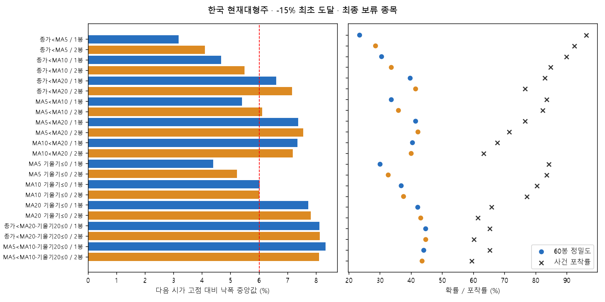
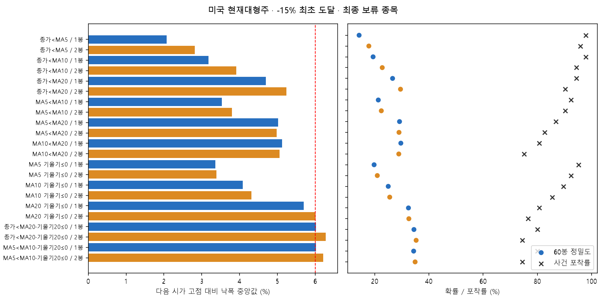

# -15% 하락의 초기 경고 — 한국·미국 독립 검증

작성 2026-10-16 · 가격 기준 **2026-09-30 완료 일봉** · 2026-10-01 저장 수정주가 재사용 · 운영 적용 없음.

## 결론

**-15%로 연구 목표를 변경해 실제 후보 탐색과 보류 종목 검증을 수행했지만, 이번 자료에서 초기 경고의 추가 예측력을 충분히 확인한 신호는 없었다.** 이것은 이동평균선이 항상 무용하다는 결론이 아니다. 빠른 경고가 큰 하락을 상당수 포착한다는 사실과, 비슷한 하락 상태에서 이동평균선 신호가 추가 정보를 준다는 주장은 별개다.

현재 대형주 표본에서는 한국의 `종가<MA20 연속2봉`, 미국의 `MA5<MA20 연속2봉`이 선정 구간 점수상 앞섰다. 아래는 검증 전에 동결한 **설명용 후보**다. 통과한 신호만 우선하고 부족하면 탐색 후보를 남기는 사전 규칙을 적용했으며, 선정 단계에서 모든 조건을 만족한 후보는 두 시장·두 코호트 모두 없었다. 검증 결과를 보고 다른 후보를 우승자로 바꾸지 않았다.

사용자의 변경 지시에 따라 **같은 고점 대비 종가가 처음 -15%에 도달하는 사건**이 주 목표다. -20% 이상 계속 하락한 사례도 포함한다. 손실을15%로 잘라내거나 그보다 더 하락한 사례를 제외하지 않았다. 원래의 마지막 탈출 탐색보다 이번의 초기 식별을 우선했으며, 늦은 탈출 후보는 시점 비교용으로 별도 남겼다. 비중이나 매매 수익률을 최적화하지 않았다.


| 시장·현재대형주 | 동결1순위 | 경보수 | 발생 낙폭 중앙 | 다음시가 낙폭 중앙 | 60봉 -15% 확률 | 사건 포착률 | 실행가능 포착률 | 경보 중 오경보 | 적중시 남은 봉 중앙 |
|---|---|---|---|---|---|---|---|---|---|
| KR | 종가<MA20 / 2봉 | 268 | 7.1% | 7.2% | 41.4% | 76.6% | 75.3% | 58.6% | 13.0 |
| US | MA5<MA20 / 2봉 | 391 | 5.0% | 5.0% | 28.9% | 82.8% | 82.1% | 71.1% | 14.0 |


하락폭은 고점 대비 손실의 양의 크기로 표기한다. 확률은 신호 이후60관측봉, 사건 포착률은 고점 이후126관측봉 내 첫 -15% 사건 기준이므로 분모와 시간 원점이 다르다. 경고 시점에 이미 -15%에 도달한 사건은 사전 경고 성공에서 제외했다.

## 1. 하락률 기준과 관련 근거

10% 조정·20% 약세장은 주로 지수의 시장 용어다. [FINRA 설명](https://syndication.finra.org/content/key-terms-tough-times-vocabulary-stressed-markets)은 이런 용어를 정리하며, 개별 대형주에 대한 최적 경고 문턱을 검증하지 않는다. 이번 검토에서 개별 대형주에 보편적으로 더 우수한 누적 낙폭 기준이라는 근거는 확보하지 못했다.

[Campbell·Lettau·Malkiel·Xu(2001)](https://dash.harvard.edu/entities/publication/73120378-863f-6bd4-e053-0100007fdf3b)는 시장·산업·기업 고유 변동성을 구분한다. 같은15%라도 종목 변동성과 시대에 따라 드문 정도가 다르다는 분석상의 근거이며, 15% 자체의 적정성을 증명하지 않는다. [Johansen·Sornette의 개별 기업 포함 낙폭 연구](https://arxiv.org/abs/cond-mat/0010050)와 [작은 반등을 허용하는 낙폭 정의 연구](https://arxiv.org/abs/cond-mat/0210574)는 낙폭 분포와 사건 정의의 중요성을 보여준다. 여기서도 모든 개별주에 적용할 단일 대체 퍼센트가 도출되는 것은 아니다.

[Kim·Kim(2023), 한국 기업 주가 급락 연구](https://journals.sagepub.com/doi/10.1177/21582440231199377)는 기업 고유 주간 수익의 극단값 및 비대칭 변동성 계열 지표를 쓴다. 이는 누적 고점 낙폭이나 사전 MA 경고와 다른 정의라 그대로 대체하지 않았다. [Duke의 Drawdowns(2020) 게재 기록](https://scholars.duke.edu/publication/1461725)도 참고했지만 원문 전체를 확보한 것으로 주장하지 않는다.

최초 v1은 사용자 fallback에 따라10/20%를 주 분석,15%를 민감도로 사전 고정했다. 이후 사용자가 “15% 하락을 초기에 식별”하도록 명시해 **v2를 별도로 고정**했다. 따라서15%는 실용적인 사용자 손실 목표이며 학술적 약세장 정의나 데이터에서 발견한 자연 경계가 아니다. v2 프로토콜의 원래 threshold_decision·sample·confidence 문구는 v1 출처 설명으로 남아 있고, 충돌 시 명시적 revision_reason·primary_target·cohort_priority·ranking15가 우선한다. 기존 불변 파일은 고치지 않았다.

한국과 미국은 별도 시장·변동성 분포·장세 대리변수·대조군·선정·검증을 사용했다. 이번 자료만으로 국가 간 제도 차이가 특정 신호의 원인이라고 말할 수 없다. 변동성 보정은 대응 분석에 포함했으며, 표준편차 목표로 결과 라벨을 바꾸지는 않았다.

## 2. 표본과 실시간 고점·사건

원시 SavedHistory 보통주 목록에서 운영 필터 없이 한국600·미국600개를 고정 해시로 뽑았다. 이전4분할 연구의800종목은 식별자만 이용해 제외했다. 현재 시총 상위100 중 겹치지 않는 종목을 보조로 더해 총 한국667·미국672종목을 준비했다. 600개 일반 코호트(core)와 현재 상위100 태그(largecap)는 겹칠 수 있으나 합산하지 않는다. 후자는 현재 생존·대형주라는 **사후 분류**로, 과거 당시 대형주 구성은 아니다. 이 연구는 “역사적 대형주 전체”에 대한 보증을 제공하지 못한다.

시총 태그는 2026-10-15 수집 snapshot의 제공자 보통주·시총 필드가 있는 가격이력 종목을 기준으로 한다. 전체 거래소의 완전한 시점별 구성이라는 보증은 없다. 기존 매수·매도 채택 여부, MA60 정배열, 상승률, 장기선 위 여부는 표본 조건이 아니다.

관측 가능한63봉 최고 **종가**를 감시한다. 같거나 높은 종가가 나오면 고점 가격과 날짜를 갱신하며, 처음 낮아진 종가부터 고점을 고정한다. 종가가 고점을 회복하면 사건 종료다. 이전 고점이63봉 이상 오래됐고 새63봉 최고 종가가 낮은 위치에서 형성되면 새 국지 고점으로 재설정한다. 126봉이 지났거나 신호가 반복됐다는 이유로 새 사건을 만들지 않는다. 더 큰 누적 고점이 회복되기 전 국지 사건들은 같은 parent로 묶고 첫 사건만 남기는 민감도를 제시했다. 국지 사건을 독립 하락 전체로 부풀리지 않는다.

각 사건은 최대126봉의 경고 관측과 추가60봉의 결과 지지구간을 요구한다. 고점+186봉이 같은 시간 분할에 있어야 하므로2026-09-30 직전 고점 사건까지 모두 포함하는 것은 아니다. 학습2010–2016, 선정2017–2020, 최종2021 이후로 나누고 약30% 종목은 과거까지 전부 선정에서 보류했다. 보류 종목이 공급한 검증 결과만 최종으로 사용한다. 기초 지표 준비는2008년부터다.

SMA5/10/20, 기울기는 MA(t)−MA(t−3)이다. 1봉은 조건이 거짓에서 참으로 바뀌는 날, 2봉은 연속 참2개가 처음 완성된 날이다. 사건별 첫 새 발생(first)과 사건 시작부터 이미 조건이 참인 경우도 포함한 첫 확인 상태(first_state)를 분리했다. 지속되는 동안 매일 새 경고로 세지 않는다. 두 종류가 같아지는 후보도 그대로 기록해 독립 증거처럼 취급하지 않았다.


| 시장 | 코호트 | 구간 | 종목 | 국지 사건 | parent | -10% 사건 | -15% 사건 | -20% 사건 |
|---|---|---|---|---|---|---|---|---|
| KR | largecap | 학습 | 50 | 2417 | 702 | 559 | 389 | 259 |
| KR | largecap | 선정 | 57 | 1351 | 181 | 325 | 247 | 194 |
| KR | largecap | 최종 | 23 | 880 | 222 | 233 | 158 | 114 |
| KR | core | 학습 | 249 | 10410 | 2683 | 3312 | 2429 | 1815 |
| KR | core | 선정 | 298 | 5530 | 866 | 1887 | 1442 | 1177 |
| KR | core | 최종 | 168 | 4245 | 576 | 1604 | 1223 | 966 |
| US | largecap | 학습 | 55 | 4217 | 1972 | 492 | 261 | 157 |
| US | largecap | 선정 | 60 | 2612 | 1599 | 293 | 183 | 119 |
| US | largecap | 최종 | 24 | 1451 | 608 | 228 | 145 | 93 |
| US | core | 학습 | 227 | 12367 | 4622 | 2354 | 1552 | 1080 |
| US | core | 선정 | 268 | 7376 | 2719 | 1530 | 1124 | 864 |
| US | core | 최종 | 156 | 5302 | 1340 | 1570 | 1150 | 903 |


목표 사건 수는 서로 포함 관계다. 이 비율은 “대형주가 연간15% 하락할 확률”이 아니다. 다수의 짧은 하락·횡보·고점 회복 사건을 분모에 포함하며, 같은 종목/parent에 여러 국지 고점이 있다. 최종 한국 현재대형주에서는15% 사건158건 대20%114건, 미국은145건 대93건이었다. 20%가 드물다는 가정을 미리 참으로 두지 않고 이 정의에서의 빈도를 함께 확인했다.

## 3. 평가 방법과 추가 예측력

- 조건부 확률(정밀도): 목표 미도달 상태의 첫 경고 뒤60봉 안에 같은 사건이 처음 -15%를 기록한 비율. 20봉도 별도 계산한다.
- 포착률: 고점 이후126봉 내 -15% 사건 중 첫 도달 **이전**에 경고가 있었던 비율. 실행가능 포착률은 바로 다음 관측 시가가 목표 가격보다 높고 목표 종가일까지 거래 가능한 봉이어야 한다.
- 오경보: 60봉 내 목표 미도달 경보 비율(1−정밀도). 비사건 오경보율(FPR)은 고점 이후126봉 내 목표 미도달 사건 중 경고가 있었던 비율이다. 두 지표는 같은 분모가 아니다.
- 고점 회복·반등: 이후20/60봉의 종가 고점 회복, 종가5% 이상 반등. 목표 도달과 반등은 동시에 일어날 수 있다. 추가 상승/하락은 신호 다음 봉부터 고가/저가 극값으로 측정하므로 종가 목표와 다르다.
- 다음시가: 종가 신호가 확정된 바로 다음 관측 봉의 시가. 거래량>0·고가>저가일 때만 사용한다. 갭으로 이미 -15% 이하이면 탈출 성공이 아니다. 결측·거래불가를 직전 종가 체결로 채우지 않는다. 실제 주문 전량 체결이나 호가를 입증한 값은 아니다.

이미 많이 빠져서 확률이 높아진 효과를 구분하기 위해 각 경고를 당시 비신호 상태와 대응했다. 같은 시장·분할·분기·시장 국면·사건 연령 구간·학습 변동성5분위, 낙폭 차≤0.5pp·변동성비0.8–1.25·시장20봉 수익 차≤3pp를 요구하고 다른 종목/사건의 최대5개 대조를 선택했다. 대조는 사건1,6,11…봉에 사전 배치한다. 나중에 신호가 생길 수 있으며 미래에 끝까지 비신호였다는 조건을 쓰지 않는다. 미래 결과는 대조 선택에 사용하지 않는다.

추가 예측력 Δ는 대응 가능한 경고 부분집합의 목표 확률−대응 대조 확률이다. 전체 정밀도와 다른 표본이며, 미대응 경고로 확대 해석할 수 없다. 대응이 낮다는 것은 신호가 강하다는 증거가 아니라 비교 정보의 부족이다. 업종·뉴스 등 관측하지 않은 교란은 남는다.

선정 문턱은 경보100개·20종목·대응≥50%, 신호 낙폭 중앙≤5%·다음시가≤6%, 정밀도≥20%·포착≥60%·실행가능 포착≥55%, Δ≥3pp·학습 Δ>0·선정의 종목/시간95% 하한>0이다. 통과 후보를 우선한 뒤 선정 점수 0.35×포착+0.30×정밀도+0.20×clip(Δ/0.10,−1,1)+0.15×(1−실행낙폭/0.15)로3개를 동결했다. 해석상 편의로 정한 실용 문턱이지 금융 상수가 아니다. 최종에서 동일 문턱과 각 시장·코호트의3후보 Holm 보정 p<0.05를 요구했다.


## 4. 한국: 현재대형주 중심 결과

다음22개는 첫 새 발생 기준 전체 비교이며 최종 검증 구간을 본 뒤 새 우승자를 고르기 위한 표가 아니다. 개별 신호의95% 구간은 탐색적 구간이다.


| 신호 | n | 발생낙폭 평균/중앙/p10~p90 | 다음시가 중앙 | 60봉 확률 [종목95%] | 포착/실행포착 | 경보오류/FPR | 적중시 남은봉 중앙 | 회복확률 |
|---|---|---|---|---|---|---|---|---|
| 종가<MA5 / 1봉 | 602 | 3.7% / 3.2% / 1.1%~6.7% | 3.2% | 23.4% [18.7, 29.1] | 96.2%/94.3% | 76.6%/62.3% | 13.0 | 77.9% |
| 종가<MA5 / 2봉 | 473 | 4.8% / 4.4% / 1.7%~8.9% | 4.1% | 28.5% [22.7, 34.8] | 92.4%/91.1% | 71.5%/45.3% | 13.0 | 72.9% |
| 종가<MA10 / 1봉 | 433 | 5.2% / 4.7% / 2.2%~9.2% | 4.7% | 30.5% [24.3, 37.5] | 89.9%/87.3% | 69.5%/40.3% | 14.0 | 70.7% |
| 종가<MA10 / 2봉 | 369 | 6.0% / 5.5% / 2.5%~10.4% | 5.5% | 33.6% [27.0, 41.2] | 84.8%/84.2% | 66.4%/32.5% | 15.0 | 66.7% |
| 종가<MA20 / 1봉 | 305 | 7.1% / 6.7% / 3.2%~11.7% | 6.6% | 39.7% [31.9, 48.7] | 82.9%/81.0% | 60.3%/24.1% | 14.0 | 62.3% |
| 종가<MA20 / 2봉 | 268 | 7.6% / 7.1% / 3.7%~11.9% | 7.2% | 41.4% [33.7, 50.8] | 76.6%/75.3% | 58.6%/20.4% | 13.0 | 59.0% |
| MA5<MA10 / 1봉 | 366 | 5.8% / 5.5% / 2.0%~9.9% | 5.4% | 33.6% [27.4, 40.7] | 83.5%/82.3% | 66.4%/32.4% | 14.0 | 67.5% |
| MA5<MA10 / 2봉 | 337 | 6.2% / 5.7% / 1.9%~11.3% | 6.1% | 35.9% [29.3, 43.4] | 82.3%/80.4% | 64.1%/28.7% | 14.0 | 64.7% |
| MA5<MA20 / 1봉 | 268 | 7.6% / 7.5% / 3.3%~12.0% | 7.4% | 41.4% [34.0, 50.6] | 76.6%/74.1% | 58.6%/20.4% | 13.0 | 59.0% |
| MA5<MA20 / 2봉 | 249 | 7.6% / 7.5% / 2.8%~12.0% | 7.5% | 42.2% [34.8, 51.1] | 71.5%/70.3% | 57.8%/18.8% | 13.0 | 58.2% |
| MA10<MA20 / 1봉 | 245 | 7.4% / 7.6% / 2.3%~11.9% | 7.3% | 40.4% [33.2, 49.3] | 67.7%/65.8% | 59.6%/19.1% | 13.0 | 59.2% |
| MA10<MA20 / 2봉 | 230 | 7.0% / 7.3% / 2.3%~11.5% | 7.2% | 40.0% [32.7, 49.1] | 63.3%/62.7% | 60.0%/18.0% | 12.5 | 58.7% |
| MA5 기울기≤0 / 1봉 | 410 | 5.1% / 4.4% / 1.5%~9.5% | 4.4% | 30.0% [24.2, 36.4] | 84.2%/83.5% | 70.0%/38.4% | 15.0 | 70.5% |
| MA5 기울기≤0 / 2봉 | 374 | 5.6% / 5.1% / 1.7%~10.2% | 5.2% | 32.6% [26.9, 39.1] | 83.5%/82.3% | 67.4%/33.5% | 14.0 | 68.4% |
| MA10 기울기≤0 / 1봉 | 318 | 6.4% / 5.9% / 2.4%~11.3% | 6.0% | 36.8% [29.4, 45.6] | 80.4%/79.1% | 63.2%/26.5% | 14.0 | 64.2% |
| MA10 기울기≤0 / 2봉 | 301 | 6.6% / 6.3% / 2.2%~11.3% | 6.0% | 37.5% [30.2, 46.1] | 77.2%/75.9% | 62.5%/24.8% | 13.0 | 64.1% |
| MA20 기울기≤0 / 1봉 | 228 | 7.9% / 8.0% / 3.5%~12.3% | 7.7% | 42.1% [34.9, 50.8] | 65.8%/62.0% | 57.9%/17.2% | 11.5 | 57.9% |
| MA20 기울기≤0 / 2봉 | 209 | 7.7% / 7.8% / 3.2%~12.0% | 7.8% | 43.1% [35.4, 52.2] | 61.4%/60.8% | 56.9%/15.5% | 12.5 | 56.5% |
| 종가<MA20·기울기20≤0 / 1봉 | 215 | 8.2% / 8.5% / 4.0%~12.4% | 8.1% | 44.7% [37.0, 53.7] | 65.2%/61.4% | 55.3%/15.5% | 12.0 | 55.3% |
| 종가<MA20·기울기20≤0 / 2봉 | 197 | 8.2% / 8.2% / 4.1%~12.1% | 8.1% | 44.7% [37.0, 54.4] | 60.1%/59.5% | 55.3%/14.1% | 12.5 | 54.8% |
| MA5<MA10·기울기20≤0 / 1봉 | 218 | 8.2% / 8.5% / 3.9%~12.5% | 8.3% | 44.0% [36.6, 53.0] | 65.2%/61.4% | 56.0%/15.9% | 11.5 | 56.0% |
| MA5<MA10·기울기20≤0 / 2봉 | 200 | 8.1% / 8.2% / 3.7%~12.5% | 8.1% | 43.5% [35.8, 53.0] | 59.5%/58.2% | 56.5%/14.7% | 12.0 | 56.0% |


### 동결 후보의 추가 예측력과 검증


| 후보·종류 | 대응n/전체n | 대응비 | 대응경보/대조 확률 | Δ | 종목95%Δ (pp) | 시간95%Δ (pp) | Holm p | 결론 |
|---|---|---|---|---|---|---|---|---|
| 종가<MA20 / 2봉 / first | 15/268 | 5.6% | 46.7%/46.7% | +0.00pp | [-31.7, 30.8] | [-41.2, 53.8] | 1.000 | 미통과 |
| 종가<MA20 / 2봉 / first_state | 15/268 | 5.6% | 46.7%/46.7% | +0.00pp | [-31.7, 30.8] | [-41.2, 53.8] | 1.000 | 미통과 |
| 종가<MA10 / 2봉 / first | 27/369 | 7.3% | 18.5%/37.0% | -18.52pp | [-42.5, 8.6] | [-32.0, -6.9] | 1.000 | 미통과 |


전체 경보의 확률과 대응된 경보의 확률을 섞어 비교하면 안 된다. 특히 현재대형주에서 대응 가능한 사건은 적어 구간이 넓다. 아래는 고정 후보의 기간·실행·기회비용이다.


| 후보 | 20/60봉 확률 | 확률 시간95% | 실행낙폭 평균/중앙/p10~p90 | 남은봉 평균/중앙/p10~p90 | 적중시15%까지 여유 중앙 | 5%반등 확률 | 추가상승 분포 | 추가하락 분포 | 오경보 상승기회 분포 |
|---|---|---|---|---|---|---|---|---|---|
| 종가<MA20 / 2봉/first | 29.1%/41.4% | [34.0, 50.2] | 7.5% / 7.2% / 3.8%~11.8% | 15.6 / 13.0 / 2.0~32.0 | 5.9% | 73.5% | 20.5% / 12.9% / 2.6%~42.5% | -11.1% / -9.8% / -21.6%~-2.2% | 25.6% / 19.3% / 5.1%~52.1% |
| 종가<MA20 / 2봉/first_state | 29.1%/41.4% | [34.0, 50.2] | 7.5% / 7.2% / 3.8%~11.8% | 15.6 / 13.0 / 2.0~32.0 | 5.9% | 73.5% | 20.5% / 12.9% / 2.6%~42.5% | -11.1% / -9.8% / -21.6%~-2.2% | 25.6% / 19.3% / 5.1%~52.1% |
| 종가<MA10 / 2봉/first | 22.2%/33.6% | [27.9, 41.1] | 5.8% / 5.5% / 2.2%~10.0% | 17.0 / 15.0 / 2.3~36.1 | 7.4% | 75.3% | 20.1% / 13.1% / 2.5%~46.6% | -11.7% / -10.1% / -24.0%~-2.2% | 24.5% / 17.5% / 5.4%~56.3% |


잔여 가격 여유는 고점 기준15%−다음시가 낙폭(pp)이다. 적중 사례만의 사후 분포라 신규 경보의 확정 여유가 아니다. 오경보 상승기회는 다음시가 이후60봉 내 최고 고가 상승의 양수 부분으로 기회비용의 상한 성격이며 실제 다시 살 수 있는 수익이 아니다.


### 일반 코호트의 독립 비교


| 동결 후보 | n | 다음시가 중앙 | 정밀도 | 포착률 | 대응비 | Δ | 종목95%Δ(pp) | 검증 |
|---|---|---|---|---|---|---|---|---|
| 종가<MA10 / 1봉/first_state | 2242 | 5.4% | 41.7% | 79.1% | 31.9% | +0.12pp | [-5.0, 5.1] | 미통과 |
| 종가<MA10 / 1봉/first | 2242 | 5.4% | 41.7% | 79.1% | 31.9% | +0.12pp | [-5.0, 5.1] | 미통과 |
| MA10 기울기≤0 / 1봉/first | 1571 | 6.4% | 46.0% | 61.4% | 31.0% | +0.06pp | [-6.1, 6.5] | 미통과 |


### 최초 발생·상태, parent 및 고점기간 민감도


| 후보 | 기본 포착/확률 | parent첫사건 포착/확률 | 126봉고점 포착/확률 | 126봉고점 실행낙폭 |
|---|---|---|---|---|
| 종가<MA20 / 2봉/first | 76.6%/41.4% | 64.3%/44.8% | 72.0%/43.2% | 7.2% |
| 종가<MA20 / 2봉/first_state | 76.6%/41.4% | 64.3%/44.8% | 72.0%/43.2% | 7.2% |
| 종가<MA10 / 2봉/first | 84.8%/33.6% | 66.7%/33.3% | 81.6%/34.7% | 5.7% |


국지 사건을 parent 첫 사건으로 제한하면 분모·질문이 바뀐다. 126봉 고점은 사전 민감도이며 여기서 후보를 재선정하지 않았다.


### 동결1순위의 장세·변동성 차이


| 분류 | 그룹 | 경보n | 종목n | 60봉 확률 | 다음시가 낙폭 중앙 |
|---|---|---|---|---|---|
| regime | 하락 | 87 | 22 | 47.1% | 7.6% |
| regime | 혼조 | 56 | 19 | 37.5% | 6.7% |
| regime | 상승 | 125 | 22 | 39.2% | 6.7% |
| vol_quintile | 1/5 | 34 | 10 | 11.8% | 3.7% |
| vol_quintile | 2/5 | 30 | 14 | 20.0% | 4.9% |
| vol_quintile | 3/5 | 35 | 19 | 42.9% | 6.1% |
| vol_quintile | 4/5 | 63 | 21 | 41.3% | 7.5% |
| vol_quintile | 5/5 | 106 | 21 | 56.6% | 10.2% |


장세는 선정용 종목의 동일비중 가격 대리 지수와200봉 평균·20봉 평균 방향으로 정한 상승/하락/혼조이며 공식 지수 판정이 아니다. 변동성 경계는 학습20봉 로그수익 표준편차로 고정했다. 같은15% 목표의 정밀도가 그룹에 따라 다르지만 작은 셀과 시장 공통 충격 때문에 탐색적 차이로만 읽는다. 이 표를 보고 그룹 필터를 추가하거나 신호를 다시 고르지 않았다.


[현재대형주44조건 전체 값·분포·신뢰구간](../../runtime/ma-warning-20261016-v2-15early/KR_largecap_all44.csv) · [일반44조건](../../runtime/ma-warning-20261016-v2-15early/KR_core_all44.csv) · [사후 신호 순서·간격 — 상세 원본 미포함](../../OMITTED_DATA.md) · [실제15% 사건의 신호 행 — 상세 원본 미포함](../../OMITTED_DATA.md) · [동결 후보 날짜·다음시가 원장 — 상세 원본 미포함](../../OMITTED_DATA.md). 실현된15% 사건만 고른 순서 표는 사후 설명이며 그 표의 비율을 적중 확률로 사용하지 않았다. 신호 누락·역순·동시 발생이 가능하고 고정 순서를 가정하지 않았다.





## 4. 미국: 현재대형주 중심 결과

다음22개는 첫 새 발생 기준 전체 비교이며 최종 검증 구간을 본 뒤 새 우승자를 고르기 위한 표가 아니다. 개별 신호의95% 구간은 탐색적 구간이다.


| 신호 | n | 발생낙폭 평균/중앙/p10~p90 | 다음시가 중앙 | 60봉 확률 [종목95%] | 포착/실행포착 | 경보오류/FPR | 적중시 남은봉 중앙 | 회복확률 |
|---|---|---|---|---|---|---|---|---|
| 종가<MA5 / 1봉 | 926 | 2.6% / 2.1% / 0.9%~4.5% | 2.1% | 14.3% [11.6, 17.4] | 97.9%/96.6% | 85.7%/60.0% | 20.0 | 85.0% |
| 종가<MA5 / 2봉 | 734 | 3.3% / 2.8% / 1.2%~6.2% | 2.8% | 17.8% [14.5, 21.6] | 95.9%/95.9% | 82.2%/45.6% | 19.0 | 81.5% |
| 종가<MA10 / 1봉 | 680 | 3.8% / 3.2% / 1.7%~6.7% | 3.2% | 19.4% [15.8, 23.6] | 97.9%/96.6% | 80.6%/41.2% | 17.5 | 79.6% |
| 종가<MA10 / 2봉 | 566 | 4.5% / 3.9% / 1.9%~7.8% | 3.9% | 22.8% [18.8, 27.2] | 94.5%/93.8% | 77.2%/32.8% | 17.0 | 76.1% |
| 종가<MA20 / 1봉 | 485 | 5.4% / 4.9% / 2.6%~9.0% | 4.7% | 26.6% [22.2, 31.6] | 94.5%/92.4% | 73.4%/26.6% | 17.0 | 71.8% |
| 종가<MA20 / 2봉 | 420 | 5.7% / 5.2% / 2.9%~9.5% | 5.2% | 29.5% [24.9, 34.4] | 90.3%/89.0% | 70.5%/22.1% | 14.0 | 68.8% |
| MA5<MA10 / 1봉 | 586 | 4.2% / 3.6% / 1.2%~7.9% | 3.5% | 21.3% [17.8, 25.1] | 92.4%/91.7% | 78.7%/34.6% | 17.0 | 77.5% |
| MA5<MA10 / 2봉 | 548 | 4.3% / 3.8% / 1.1%~7.9% | 3.8% | 22.4% [18.8, 26.4] | 90.3%/89.0% | 77.6%/31.9% | 16.0 | 76.5% |
| MA5<MA20 / 1봉 | 408 | 5.6% / 5.0% / 2.4%~9.4% | 5.0% | 29.2% [24.7, 34.1] | 86.9%/83.4% | 70.8%/21.6% | 14.0 | 69.4% |
| MA5<MA20 / 2봉 | 390 | 5.6% / 5.0% / 2.1%~9.7% | 5.0% | 29.0% [24.5, 33.8] | 82.8%/82.1% | 71.0%/20.7% | 14.0 | 69.2% |
| MA10<MA20 / 1봉 | 371 | 5.8% / 5.1% / 2.2%~9.7% | 5.1% | 29.6% [24.7, 34.7] | 80.7%/78.6% | 70.4%/19.4% | 13.5 | 67.9% |
| MA10<MA20 / 2봉 | 353 | 5.7% / 5.0% / 1.9%~9.9% | 5.1% | 28.9% [23.7, 34.0] | 75.2%/73.8% | 71.1%/18.7% | 15.0 | 68.3% |
| MA5 기울기≤0 / 1봉 | 652 | 3.8% / 3.2% / 1.1%~7.1% | 3.4% | 19.8% [16.2, 23.8] | 95.2%/94.5% | 80.2%/39.4% | 18.0 | 79.1% |
| MA5 기울기≤0 / 2봉 | 601 | 4.0% / 3.4% / 1.0%~7.6% | 3.4% | 21.0% [17.4, 24.9] | 92.4%/91.7% | 79.0%/35.8% | 17.0 | 78.0% |
| MA10 기울기≤0 / 1봉 | 492 | 4.8% / 4.3% / 1.8%~8.2% | 4.1% | 25.0% [21.1, 28.9] | 89.7%/89.0% | 75.0%/27.7% | 16.0 | 73.8% |
| MA10 기울기≤0 / 2봉 | 458 | 4.9% / 4.3% / 1.7%~8.7% | 4.3% | 25.5% [21.7, 29.6] | 85.5%/84.8% | 74.5%/25.6% | 15.0 | 72.9% |
| MA20 기울기≤0 / 1봉 | 342 | 6.1% / 5.6% / 2.6%~9.9% | 5.7% | 32.5% [27.4, 37.8] | 80.7%/79.3% | 67.5%/17.2% | 14.0 | 65.5% |
| MA20 기울기≤0 / 2봉 | 322 | 6.1% / 5.8% / 2.3%~10.1% | 6.0% | 32.6% [27.6, 37.7] | 76.6%/75.2% | 67.4%/16.2% | 13.0 | 64.3% |
| 종가<MA20·기울기20≤0 / 1봉 | 319 | 6.5% / 6.1% / 3.3%~10.2% | 6.0% | 34.5% [28.8, 40.2] | 80.0%/78.6% | 65.5%/15.5% | 14.0 | 63.3% |
| 종가<MA20·기울기20≤0 / 2봉 | 289 | 6.7% / 6.2% / 3.4%~10.6% | 6.3% | 35.3% [29.5, 41.1] | 74.5%/73.1% | 64.7%/13.9% | 14.0 | 60.9% |
| MA5<MA10·기울기20≤0 / 1봉 | 320 | 6.5% / 6.0% / 3.2%~10.5% | 6.0% | 34.4% [29.0, 40.1] | 80.0%/78.6% | 65.6%/15.6% | 14.0 | 63.4% |
| MA5<MA10·기울기20≤0 / 2봉 | 295 | 6.6% / 6.1% / 2.8%~10.8% | 6.2% | 34.9% [29.3, 40.5] | 74.5%/73.1% | 65.1%/14.3% | 15.0 | 61.7% |


### 동결 후보의 추가 예측력과 검증


| 후보·종류 | 대응n/전체n | 대응비 | 대응경보/대조 확률 | Δ | 종목95%Δ (pp) | 시간95%Δ (pp) | Holm p | 결론 |
|---|---|---|---|---|---|---|---|---|
| MA5<MA20 / 2봉 / first_state | 86/391 | 22.0% | 11.6%/15.1% | -3.49pp | [-11.5, 4.2] | [-14.3, 6.8] | 1.000 | 미통과 |
| MA5<MA20 / 2봉 / first | 85/390 | 21.8% | 11.8%/15.3% | -3.53pp | [-11.4, 4.1] | [-14.3, 7.0] | 1.000 | 미통과 |
| 종가<MA20 / 2봉 / first | 73/420 | 17.4% | 16.4%/11.4% | +5.02pp | [-4.9, 14.5] | [-4.9, 12.8] | 0.494 | 미통과 |


전체 경보의 확률과 대응된 경보의 확률을 섞어 비교하면 안 된다. 특히 현재대형주에서 대응 가능한 사건은 적어 구간이 넓다. 아래는 고정 후보의 기간·실행·기회비용이다.


| 후보 | 20/60봉 확률 | 확률 시간95% | 실행낙폭 평균/중앙/p10~p90 | 남은봉 평균/중앙/p10~p90 | 적중시15%까지 여유 중앙 | 5%반등 확률 | 추가상승 분포 | 추가하락 분포 | 오경보 상승기회 분포 |
|---|---|---|---|---|---|---|---|---|---|
| MA5<MA20 / 2봉/first_state | 17.6%/28.9% | [22.0, 37.3] | 5.5% / 5.0% / 2.0%~10.2% | 19.6 / 14.0 / 3.0~41.8 | 8.3% | 73.4% | 14.7% / 11.7% / 2.1%~30.0% | -9.2% / -7.3% / -18.8%~-1.0% | 17.3% / 14.7% / 5.2%~32.9% |
| MA5<MA20 / 2봉/first | 17.7%/29.0% | [22.1, 37.7] | 5.5% / 5.0% / 2.0%~10.2% | 19.6 / 14.0 / 3.0~41.8 | 8.3% | 73.6% | 14.8% / 11.8% / 2.1%~30.0% | -9.1% / -7.3% / -18.8%~-1.0% | 17.3% / 14.7% / 5.4%~32.9% |
| 종가<MA20 / 2봉/first | 18.8%/29.5% | [22.6, 38.7] | 5.6% / 5.2% / 2.6%~9.3% | 19.5 / 14.0 / 3.3~42.0 | 8.2% | 73.6% | 15.1% / 11.8% / 2.2%~31.1% | -9.4% / -7.3% / -19.9%~-1.2% | 17.9% / 14.5% / 5.8%~34.1% |


잔여 가격 여유는 고점 기준15%−다음시가 낙폭(pp)이다. 적중 사례만의 사후 분포라 신규 경보의 확정 여유가 아니다. 오경보 상승기회는 다음시가 이후60봉 내 최고 고가 상승의 양수 부분으로 기회비용의 상한 성격이며 실제 다시 살 수 있는 수익이 아니다.


### 일반 코호트의 독립 비교


| 동결 후보 | n | 다음시가 중앙 | 정밀도 | 포착률 | 대응비 | Δ | 종목95%Δ(pp) | 검증 |
|---|---|---|---|---|---|---|---|---|
| MA5<MA10 / 1봉/first | 2086 | 4.7% | 33.5% | 63.9% | 35.3% | +0.66pp | [-3.0, 4.3] | 미통과 |
| MA5<MA10 / 1봉/first_state | 2131 | 4.7% | 33.1% | 64.5% | 36.7% | +0.50pp | [-3.1, 4.0] | 미통과 |
| 종가<MA20 / 2봉/first | 1486 | 6.6% | 40.1% | 54.6% | 29.6% | +0.33pp | [-5.9, 6.8] | 미통과 |


### 최초 발생·상태, parent 및 고점기간 민감도


| 후보 | 기본 포착/확률 | parent첫사건 포착/확률 | 126봉고점 포착/확률 | 126봉고점 실행낙폭 |
|---|---|---|---|---|
| MA5<MA20 / 2봉/first_state | 82.8%/28.9% | 83.1%/30.8% | 82.9%/27.5% | 5.0% |
| MA5<MA20 / 2봉/first | 82.8%/29.0% | 83.1%/30.8% | 82.9%/27.6% | 5.0% |
| 종가<MA20 / 2봉/first | 90.3%/29.5% | 90.8%/31.5% | 91.5%/28.9% | 5.2% |


국지 사건을 parent 첫 사건으로 제한하면 분모·질문이 바뀐다. 126봉 고점은 사전 민감도이며 여기서 후보를 재선정하지 않았다.


### 동결1순위의 장세·변동성 차이


| 분류 | 그룹 | 경보n | 종목n | 60봉 확률 | 다음시가 낙폭 중앙 |
|---|---|---|---|---|---|
| regime | 하락 | 57 | 21 | 40.4% | 5.0% |
| regime | 혼조 | 62 | 22 | 33.9% | 4.9% |
| regime | 상승 | 272 | 24 | 25.4% | 5.0% |
| vol_quintile | 1/5 | 21 | 12 | 19.0% | 2.8% |
| vol_quintile | 2/5 | 54 | 17 | 11.1% | 3.2% |
| vol_quintile | 3/5 | 87 | 20 | 29.9% | 4.3% |
| vol_quintile | 4/5 | 116 | 23 | 24.1% | 5.9% |
| vol_quintile | 5/5 | 113 | 19 | 43.4% | 7.2% |


장세는 선정용 종목의 동일비중 가격 대리 지수와200봉 평균·20봉 평균 방향으로 정한 상승/하락/혼조이며 공식 지수 판정이 아니다. 변동성 경계는 학습20봉 로그수익 표준편차로 고정했다. 같은15% 목표의 정밀도가 그룹에 따라 다르지만 작은 셀과 시장 공통 충격 때문에 탐색적 차이로만 읽는다. 이 표를 보고 그룹 필터를 추가하거나 신호를 다시 고르지 않았다.


[현재대형주44조건 전체 값·분포·신뢰구간](../../runtime/ma-warning-20261016-v2-15early/US_largecap_all44.csv) · [일반44조건](../../runtime/ma-warning-20261016-v2-15early/US_core_all44.csv) · [사후 신호 순서·간격 — 상세 원본 미포함](../../OMITTED_DATA.md) · [실제15% 사건의 신호 행 — 상세 원본 미포함](../../OMITTED_DATA.md) · [동결 후보 날짜·다음시가 원장 — 상세 원본 미포함](../../OMITTED_DATA.md). 실현된15% 사건만 고른 순서 표는 사후 설명이며 그 표의 비율을 적중 확률로 사용하지 않았다. 신호 누락·역순·동시 발생이 가능하고 고정 순서를 가정하지 않았다.





## 5. 무엇을 초기 경고·마지막 탈출로 남길 수 있는가

한국의 선정1순위 종가<MA20·2봉은 최종 시가 낙폭 중앙7.15%로15% 목표의 약 절반이 진행된 뒤였다. 예측 확률41.4%만으로 “초기”라 부르기 어렵고, 대응은268개 중15개에 불과했다. Δ는0pp, 구간은 매우 넓어 추가 예측력이 입증되지 않았다. 더 빠른 MA10·2봉 후보도 최종 예측 우위는 확인하지 못했다.

미국의 선정1순위 MA5<MA20·2봉 상태는 시가 낙폭 중앙4.97%, 사건 포착82.8%였으나 정밀도28.9%라 경보의 약71.1%는60봉 내15%로 이어지지 않았다. 비슷한 상태와 비교한 Δ도 음수이고 불확실했다. 따라서 “15% 하락의 검증된 초기 식별기”로 확정하지 않는다.

원래 마지막 탈출 역할로 고정한 종가<MA20·MA20 기울기≤0·2봉은 v1에서20% 목표로 검증했고 두 시장 모두 추가 예측력 기준을 통과하지 못했다. 이번15% 전체표에도 포함했지만 새 마지막 탈출 최적화를 실행한 것으로 포장하지 않는다. 늦은 신호의 높은 확률은 늦음 자체의 효과일 수 있으며 목표 이후 신호는 성공에서 제외된다. 검증된 최후 탈출선 역시 확정하지 않는다.

실무적으로 전달할 것은 경고별 **시점·포착·오경보·실행 여유의 교환관계**다. 빠른 경고만으로 자동 매도를 연결하거나 현재 추정확률을 개별 종목의 확정 확률처럼 사용하지 않는다. 후속4분할 연구의 입력으로는 검증 부족 표시와 전체 분포를 함께 전달해야 한다.

## 6. 통계적 불확실성과 검증의 한계

확률·포착·회복에는 종목 군집2,000회 및 연속4분기 순환 블록2,000회 구간을 별도로 계산했다. 대응 Δ의 종목 구간은 신호와 재사용 대조 종목을 포함한 선형화 wild multiplier 방식, 시간 구간은 같은 분기 대응 차이의4분기 블록이다. 둘을 동시에 완벽히 통제하는 보증은 아니며 유리한 한쪽만 고르지 않았다. 종목23/24개나 적은 대응 경고는 수백 경보로 늘려도 수백 독립 표본이 되지 않는다. 95% 구간은 다음 거래 결과가95% 확률로 들어갈 범위도 아니다.

Δ의 구간이0을 포함하면 관측 자료가 추가 정보의 부재와 의미 있는 양의 효과를 구분하지 못한다는 뜻이다. “신호가 효과없음이 증명됐다”는 뜻은 아니다. 다만 검증된 확률로 채택할 근거는 부족하다. 전체44개 및 여러 기간의 구간은 동시 유의성 보장이 없는 탐색 결과다. 최종 동결3후보에만 시장·코호트 안 Holm 보정을 적용했다. 같은 신호의 first/state가 같으면 별개의 반복 성공 증거가 아니다.

v1과 다른 종목을 선정/최종에 나누었지만 공통 시장 시대를 이미 알고 있었고,15% 결과는 v1 민감도에 존재했다. 사용자가 기준을 바꾼 v2는 **사후 목적 변경에 따른 재탐색**이다. 동결 뒤 결과를 바꾸지 않았다는 장점은 있지만 순수한 미공개 최종 검증 또는 전향 검증으로 부르지 않는다. 신규 기간과 당시 시점별 대형주 구성으로 다시 확인해야 한다.

현재 생존 보통주 목록만 있어 상장폐지·합병·식별자 변경을 완전하게 반영하지 못한다. 최신 대형주 분류로 과거를 나눈 생존/크기 편향도 있다. 이 때문에20% 사건 빈도나15% 정밀도를 역사적 전체 대형주 확률로 일반화할 수 없다. 극단 종목 영향은 평균과 중앙·p10/p90 및 종목 군집 구간으로 드러내되, 결과가 나쁘다는 이유로 급락/급등주를 제거하지 않았다.

지표·평가 지지구간의 고립된 결측/잘못된 봉은 제외 사유와 수를 감사에 남겼다. 달력10일 초과 공백은 휴장·정지·제공자 누락을 완전히 구별할 수 없어 보존하고 표시했다. 단절 뒤 다음 관측 시가를 즉시 다음 거래일과 동일하게 보장하지 못하며, 경고 원장에 long_gap을 남겼다. 수정 종가 목표와 장중 최저가는 다른 정의다. 일봉 시가가 있어도 주문량·호가·슬리피지·전량 체결은 미검증이며 이번에는 거래비용을 넣은 전략 수익률을 계산하지 않았다.

후속 검증의 우선순위는 시점별 상장·대형주 구성과 새 미사용 기간 확보다. 부족한 대응 수를 숨기거나 결과에 맞춰 캘리퍼·고점·기간을 완화하는 방식은 이번에 사용하지 않았다. 기존 매수·매도·비중·운영 경보·알림·예약·사용자 판단 기록은 변경하지 않았다.

## 7. 재현 자료


- [15% 프로토콜](../../runtime/ma-warning-20261016-v2-15early/protocol.json) · [동결44후보·선정 결과](../../runtime/ma-warning-20261016-v2-15early/selection_frozen.json) · [최종 후보 판정·실패 조건](../../runtime/ma-warning-20261016-v2-15early/final_results.json)
- [원자료 감사·해시·제외 수 — 상세 원본 미포함](../../OMITTED_DATA.md) · [표본·현재 시총 태그 — 상세 원본 미포함](../../OMITTED_DATA.md) · [한국 사건 — 상세 원본 미포함](../../OMITTED_DATA.md) · [미국 사건 — 상세 원본 미포함](../../OMITTED_DATA.md)
- [고점126봉·parent 민감도](../../runtime/ma-warning-20261016-v2-15early/diagnostics.json) · [검증 영수증](../../runtime/ma-warning-20261016-v2-15early/verification.json) · [산출물 해시 — 상세 원본 미포함](../../OMITTED_DATA.md)
- [고정 후보의 장세·변동성별 비교](../../runtime/ma-warning-20261016-v2-15early/fixed_candidate_subgroups.csv)
- [하락률 문헌 검토](ma-warning-thresholds-2026-10-16.md) · [보존된 v1 최종 결과](../../runtime/ma-warning-20261016-v1/final_results.json)

v2 동결 SHA-256 `0b77fc3e4965111c0e1cbdc7e621edecf354806f8b69c11ec29da50689654301`는 최종 검증 전후 동일하다. v1의 원 프로토콜·결과도 별도 보존했다. 코드 `scripts/research/warning/ma_warning_research.py`의 prepare가 원자료·사건을 준비하고 `ma_warning15_research.py select/test`가 v2를 실행한다. 재현 시 새 출력 폴더를 사용한다. 최신 포인터에 의존하는 표본 준비는 감사에 기록된 원본 경로/해시를 먼저 고정해야 한다.

핵심10검사(미래가격 변경 시 지표/사건 불변·연속하락 단일 사건·오경보 회복·국지고점 재설정·1/2봉 최초 발생·목표 후 신호와 갭 실행 제외·미래 결과와 무관한 매칭 등)를 통과했다. 원본1,339개 해시·가격 원행40개·경보178,482행·대응쌍120,174개를 직접 대조했고 목표 도달 후 경보41,573행은 성공 후보에서 제외됨을 확인했다. 여기의 행 수는 두 코호트·여러 신호의 중복 검사량이며 독립 표본 수가 아니다. 그림2개도 직접 열어 축·문자·범례를 확인했다.

```powershell
$researchPython = '<USER_HOME>/Desktop/Ai 사일로/invest-agent-engine/.venv/Scripts/python.exe'
& $researchPython scripts/research/warning/ma_warning15_research.py select --source runtime/ma-warning-20261016-v1 --out runtime/ma-warning15-replay
& $researchPython scripts/research/warning/ma_warning15_research.py test --out runtime/ma-warning15-replay
& $researchPython scripts/research/warning/ma_warning15_diagnostics.py --out runtime/ma-warning15-replay --secondary runtime/ma-warning-20261016-peak126
& $researchPython scripts/research/warning/ma_warning15_report.py --out runtime/ma-warning15-replay --report docs/research/ma-warning15-replay.md
& $researchPython scripts/research/warning/verify_ma_warning15.py --out runtime/ma-warning15-replay --report docs/research/ma-warning15-replay.md
```
